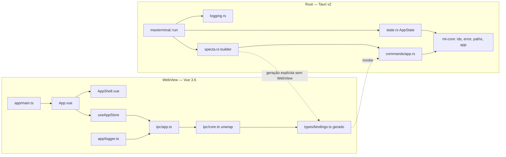
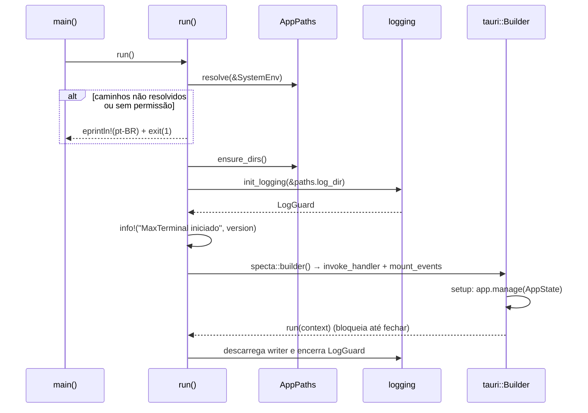

# Fase 01 — Setup e Fundação do Projeto (`spec.md`)

> Complementa [`./instructions.md`](./instructions.md). Respeita os contratos de [`../README.md`](../README.md) §2.
> Esta fase **não consome** contratos de nenhuma outra fase; ela **define** os contratos-base consumidos por 02–17.

> **Status:** especificação de implementação futura. Assinaturas de domínio abaixo são contratos propostos
> do MaxTerminal; trechos com `...`, corpos omitidos ou dependências externas são esquemáticos, não código
> compilado nesta revisão. O §14 distingue fontes efetivamente consultadas de APIs a validar. Nenhum teste
> ou smoke descrito aqui foi executado como parte da edição documental.

---

## 1. Visão Arquitetural



Princípios:
1. **Uma única fonte de tipos**: structs Rust com `#[derive(specta::Type)]` → `bindings.ts`. O TS nunca redeclara.
2. **Erros como valores**: todo comando retorna `MtResult<T>`; o frontend converte em exceção tipada num único ponto (`ipc/core.ts`).
3. **Domínios isolados em crates**: o binário `maxterminal` é apenas *composição* (registro de comandos, estado, plugins).
4. **Nada bloqueia a thread principal**: logging com writer não bloqueante; comandos `async` quando tocam disco.

---

## 2. Workspace Cargo

### 2.1. `src-tauri/Cargo.toml`

```toml
[workspace]
resolver = "3"
members = [".", "crates/mt-core"]

[workspace.package]
version = "0.1.0"
edition = "2024"
rust-version = "1.85"
license = "UNLICENSED"
authors = ["Johnattas Santana"]

[workspace.dependencies]
mt-core = { path = "crates/mt-core" }
tauri = { version = "2", features = [] }
tauri-build = { version = "2", features = [] }
serde = { version = "1", features = ["derive"] }
serde_json = "1"
thiserror = "2"
uuid = { version = "1", features = ["v7", "serde"] }
specta = { version = "=2.0.0-rc.27", features = ["derive", "function"] }
specta-typescript = "=0.0.14"
tauri-specta = { version = "=2.0.0-rc.27", features = ["typescript"] }
# Confirmar e habilitar features de tipos externos UUID/serde_json na prova de geração.
tracing = "0.1"
tracing-subscriber = { version = "0.3", features = ["env-filter", "fmt", "json"] }
tracing-appender = "0.2"
# Watchers de filesystem (E-10): versão única para todo o workspace (Fases 06 e 13); crates consumidores
# declaram `notify.workspace = true` / `notify-debouncer-full.workspace = true`, nunca versão própria.
notify = "8"
notify-debouncer-full = "0.5"

[workspace.lints.rust]
unsafe_code = "forbid"
missing_docs = "warn"
unused_must_use = "deny"

[workspace.lints.clippy]
all = { level = "deny", priority = -1 }
pedantic = { level = "warn", priority = -1 }
module_name_repetitions = "allow"
missing_errors_doc = "allow"
unwrap_used = "deny"
expect_used = "warn"

[package]
name = "maxterminal"
default-run = "maxterminal"
version.workspace = true
edition.workspace = true
rust-version.workspace = true

[lib]
name = "maxterminal_lib"
crate-type = ["staticlib", "cdylib", "rlib"]

[dependencies]
mt-core.workspace = true
tauri.workspace = true
serde.workspace = true
serde_json.workspace = true
specta.workspace = true
specta-typescript.workspace = true
tauri-specta.workspace = true
tracing.workspace = true
tracing-subscriber.workspace = true
tracing-appender.workspace = true

[build-dependencies]
tauri-build.workspace = true

[lints]
workspace = true

[profile.release]
lto = "thin"
codegen-units = 1
strip = "symbols"
```

> Este TOML apresenta a estrutura, não um manifesto pronto: versões do gerador seguem o conjunto
> confirmado na documentação oficial (§14); validar também features de UUID/serde_json. Não misturar
> exemplos de RCs anteriores. Feature `derive` de tauri-specta é necessária para eventos, ausentes aqui.
> `rust-version = "1.85"` representa o piso da edição; ajustar o MSRV declarado ao conjunto validado.
> `Cargo.lock` deve ser versionado. `rust-toolchain.toml` fica em `src-tauri/` e fixa a versão testada.
> O agregador executa Cargo nesse diretório; `--manifest-path` sozinho não muda a seleção do rustup.
> Não se cria runtime Tokio adicional para dois comandos que consultam memória e enfileiram logs.
> `mt-core/Cargo.toml` herda versão/edição/lints, declara `publish = false` e somente as dependências da tabela.
> **Convenções de workspace (E-06/E-08/E-10):** (1) **todos** os crates do workspace (inclusive os criados pelas Fases
> 02–16) declaram `edition.workspace = true` (2024), `version.workspace = true`, `rust-version.workspace = true` e
> `[lints] workspace = true`; edição própria (ex.: `2021`) é proibida. (2) `default-run = "maxterminal"` evita ambiguidade de
> `cargo run` quando existem binários auxiliares; o binário de geração de bindings chama-se `export_bindings`
> (`src/bin/export_bindings.rs`, `cargo run --bin export_bindings`; nunca `export-bindings`). (3) `notify = "8"` e
> `notify-debouncer-full = "0.5"` são centralizados aqui e consumidos com `workspace = true`.

### 2.2. Crates e responsabilidade

| Crate | Estado na Fase 01 | Dependências permitidas | Fase dona |
|-------|-------------------|-------------------------|-----------|
| `maxterminal` (bin + lib) | Funcional (composição) | `mt-core`, Tauri, gerador e infraestrutura de logging | 01 (evoluído por todas) |
| `mt-core` | Funcional | `serde`, `thiserror`, `uuid`, `specta`, `serde_json` — **sem** `tauri` | 01 |
| `mt-pty`, `mt-db` | Não criados | Definidas pelas fases donas | 02, 03 |
| Demais `mt-*` do README §2.1 | Não criados | Definidas pelas fases donas | 05–16 |

Regra de dependência: crates `mt-*` **não dependem de `tauri`** (testáveis sem WebView), exceto quando a fase dona
justificar explicitamente (ex.: `mt-os` para tray). A integração Tauri vive em `src-tauri/src/commands/<domínio>.rs`.

`cargo metadata` deve mostrar somente dois membros nesta fase. O diretório final descrito no README é
um mapa evolutivo, não uma dependência de compilação. Testes de `mt-core` não iniciam Tauri/WebView.
Nenhum `build.rs`, `use` ou import TypeScript pode depender de contrato ainda não implementado.

---

## 3. Crate `mt-core`

### 3.1. `lib.rs`

```rust
//! Tipos de domínio compartilhados do MaxTerminal: ids, erros, caminhos XDG e metadados do app.
pub mod app;
pub mod error;
pub mod ids;
pub mod paths;

pub use error::{ErrorCode, MtError, MtResult};
```

### 3.2. Ids (`ids.rs`)

Newtypes privados sobre `Uuid` v7, serializados como string UUID canônica minúscula com hífens. Os nomes
Rust são distintos entre si; no TS gerado são aliases de `string`, sem promessa de branding nominal.
O backend continua sendo responsável por validar entrada; converter uma string com `as ProjectId` no
frontend não comprova validade nem propriedade/autorização da entidade.

```rust
use serde::{Deserialize, Serialize};
use std::{fmt, str::FromStr};
use uuid::Uuid;

/// Gera um newtype de identificador de domínio baseado em Uuid v7.
macro_rules! define_id {
    ($(#[$meta:meta])* $name:ident) => {
        $(#[$meta])*
        #[derive(Clone, Copy, Debug, PartialEq, Eq, Hash, PartialOrd, Ord,
                 Serialize, specta::Type)]
        #[serde(transparent)]
        pub struct $name(Uuid);

        impl $name {
            /// Cria um novo id com timestamp atual (Uuid v7).
            #[must_use]
            pub fn new() -> Self { Self(Uuid::now_v7()) }
            /// Reconstrói somente UUID v7; retorna core.invalid_argument nos demais casos.
            pub fn try_from_uuid(uuid: Uuid) -> crate::MtResult<Self> {
                if uuid.get_version_num() != 7 {
                    return Err(crate::MtError::invalid_argument(
                        stringify!($name), "identificador inválido: esperado UUID v7"));
                }
                Ok(Self(uuid))
            }
            #[must_use]
            pub const fn as_uuid(&self) -> &Uuid { &self.0 }
        }
        impl Default for $name { fn default() -> Self { Self::new() } }
        impl fmt::Display for $name {
            fn fmt(&self, f: &mut fmt::Formatter<'_>) -> fmt::Result { self.0.fmt(f) }
        }
        impl FromStr for $name {
            type Err = crate::MtError;
            fn from_str(s: &str) -> Result<Self, Self::Err> {
                let uuid = Uuid::parse_str(s).map_err(|_| crate::MtError::invalid_argument(
                    stringify!($name), "identificador inválido: esperado UUID v7"))?;
                Self::try_from_uuid(uuid)
            }
        }
    };
}

define_id!(/// Projeto cadastrado (Fase 06).
    ProjectId);
define_id!(/// Aba do workspace (Fase 07).
    TabId);
define_id!(/// Painel dentro de uma aba (Fase 07).
    PaneId);
define_id!(/// Pseudo-terminal (Fase 02).
    PtyId);
define_id!(/// Sessão persistida (Fases 03/07).
    SessionId);
define_id!(/// Sessão de uma aba do workspace (Fases 07 e 17); mesma validação UUID v7 dos demais ids.
    TabSessionId);
define_id!(/// Template de aba (Fase 07).
    TemplateId);
define_id!(/// Bloco de comando OSC 133 (Fase 05).
    CommandBlockId);
define_id!(/// Grupo de comandos (Fase 15).
    CommandGroupId);
```

Completar a macro com `Deserialize` manual: ler uma string e chamar `FromStr`, convertendo a falha
com o mecanismo de erro do Serde. Não derivar uma desserialização que contorne `try_from_uuid`.
`TryFrom<Uuid>` deve delegar ao mesmo validador; não expor construtor público que aceite UUID arbitrário.

Invariantes testadas: `Display` → `FromStr` é identidade; JSON é uma string; geração produz versão 7;
nil, UUID v4, texto inválido e JSON não string falham no parsing e no Serde de todos os nove tipos.
Ordenação é temporal entre UUIDs com timestamps distintos. Não exigir `a < b` para dois `new()` no mesmo
milissegundo nem entre processos/relógios: v7 não substitui sequência de eventos ou relógio monotônico.

### 3.3. Erros (`error.rs`)

`MtError` é **struct** (não enum) para que cada crate acrescente códigos próprios sem editar `mt-core`.

```rust
use serde::Serialize;
use std::borrow::Cow;

/// Código estável, legível por máquina, no formato `<domínio>.<motivo>` (ex.: `core.not_found`, `pty.spawn_failed`).
#[derive(Clone, Copy, Debug, PartialEq, Eq, Hash, Serialize, specta::Type)]
#[serde(transparent)]
pub struct ErrorCode(pub &'static str);

/// Códigos do domínio `core`. Outros crates definem os seus em `<crate>::error::codes`.
pub mod codes {
    use super::ErrorCode;
    pub const INTERNAL: ErrorCode = ErrorCode("core.internal");
    pub const IO: ErrorCode = ErrorCode("core.io");
    pub const NOT_FOUND: ErrorCode = ErrorCode("core.not_found");
    pub const INVALID_ARGUMENT: ErrorCode = ErrorCode("core.invalid_argument");
    pub const CONFLICT: ErrorCode = ErrorCode("core.conflict");
    pub const PERMISSION_DENIED: ErrorCode = ErrorCode("core.permission_denied");
    pub const UNSUPPORTED: ErrorCode = ErrorCode("core.unsupported");
    pub const SERIALIZATION: ErrorCode = ErrorCode("core.serialization");
    pub const PATHS_UNRESOLVED: ErrorCode = ErrorCode("core.paths_unresolved");
}

/// Erro único retornado por todos os comandos IPC.
/// Serializa como `{ code: string, message: string, details?: unknown }` (README §2.2).
#[derive(Debug, Serialize, specta::Type, thiserror::Error)]
#[error("[{code}] {message}", code = .code.0)]
pub struct MtError {
    pub code: ErrorCode,
    /// Mensagem em pt-BR destinada ao usuário final.
    pub message: Cow<'static, str>,
    #[serde(skip_serializing_if = "Option::is_none")]
    #[specta(optional)]
    pub details: Option<serde_json::Value>,
    /// Causa original interna; nunca serializada nem gravada bruta em log.
    #[serde(skip)]
    #[specta(skip)]
    #[source]
    pub source: Option<Box<dyn std::error::Error + Send + Sync + 'static>>,
}

pub type MtResult<T> = Result<T, MtError>;

impl MtError {
    pub fn new(code: ErrorCode, message: impl Into<Cow<'static, str>>) -> Self;
    #[must_use] pub fn with_details(self, details: serde_json::Value) -> Self;
    #[must_use] pub fn with_source(self, err: impl std::error::Error + Send + Sync + 'static) -> Self;
    pub fn internal(message: impl Into<Cow<'static, str>>) -> Self;
    pub fn not_found(entity: &'static str, id: impl std::fmt::Display) -> Self; // details: { entity, id }
    pub fn invalid_argument(field: &'static str, reason: impl Into<Cow<'static, str>>) -> Self; // details: { field }
    pub fn unsupported(feature: &'static str) -> Self;
}

impl From<std::io::Error> for MtError { /* PermissionDenied → PERMISSION_DENIED, NotFound → NOT_FOUND, resto → IO; mensagem pt-BR genérica + source */ }
impl From<serde_json::Error> for MtError { /* SERIALIZATION */ }
```

Regras:
- `message` **nunca** contém caminhos de segredos, conteúdo de comandos ou valores de variáveis de ambiente.
- `details` é opcional e deve ser JSON pequeno (< 4 KiB) e sem dados sensíveis.
- `source` fica somente em memória; a fronteira IPC registra evento estático e código conhecido, sem
  formatar `source`, `Debug`, mensagem arbitrária, caminho ou payload. Até o sanitizador da Fase 03 existir,
  não há modo debug que libere esses valores. `with_details` aceita somente campos autorizados pelo domínio.
- O contrato JSON é normativo; os atributos Specta do exemplo (`optional`, `skip`) precisam ser conferidos
  na versão fixada. O teste exige `details` opcional, sem `source`, e `ErrorCode` representado como string.
- Rejeição de argumento pelo desserializador Tauri pode ocorrer antes do corpo do comando: o wrapper TS
  normaliza essa falha de fronteira; ela não deve ser anunciada como `MtError` garantido pelo Rust.
- Pontos de extensão: cada crate posterior define `pub mod codes` com prefixo próprio (`pty.`, `db.`, `shell.`,
  `project.`, `git.`, `port.`, `os.`, `theme.`, `bridge.`, `ai.`, `agent.`, `command.`, `github.`) e implementa
  `From<SeuErroInterno> for MtError`.

### 3.4. Caminhos XDG (`paths.rs`)

```rust
use std::path::PathBuf;

/// Fonte de variáveis de ambiente — abstraída para testes determinísticos.
pub trait EnvSource {
    fn var(&self, key: &str) -> Option<String>;
}

/// Implementação real baseada em `std::env`.
pub struct SystemEnv;
impl EnvSource for SystemEnv { fn var(&self, key: &str) -> Option<String> { std::env::var(key).ok() } }

/// Diretórios do MaxTerminal resolvidos segundo a XDG Base Directory Specification.
#[derive(Clone, Debug, PartialEq, Eq)]
pub struct AppPaths {
    pub config_dir: PathBuf,   // $XDG_CONFIG_HOME/maxterminal  | ~/.config/maxterminal
    pub data_dir: PathBuf,     // $XDG_DATA_HOME/maxterminal    | ~/.local/share/maxterminal
    pub state_dir: PathBuf,    // $XDG_STATE_HOME/maxterminal   | ~/.local/state/maxterminal
    pub cache_dir: PathBuf,    // $XDG_CACHE_HOME/maxterminal   | ~/.cache/maxterminal
    pub runtime_dir: Option<PathBuf>, // $XDG_RUNTIME_DIR/maxterminal (sockets/locks — Fases 09/11)
    pub log_dir: PathBuf,      // state_dir/logs
    pub db_path: PathBuf,      // data_dir/maxterminal.db (criado somente na Fase 03)
}

pub const APP_DIR_NAME: &str = "maxterminal";

impl AppPaths {
    /// Resolve sem tocar o disco. Variáveis XDG relativas ou vazias são ignoradas (exigência da spec XDG).
    pub fn resolve(env: &impl EnvSource) -> crate::MtResult<Self>;
    /// Cria config/data/state/cache/log (permissão 0o700). Não cria `db_path`.
    pub fn ensure_dirs(&self) -> crate::MtResult<()>;
}

/// DTO exposto ao frontend (caminhos como string UTF-8 lossy).
#[derive(Clone, Debug, serde::Serialize, specta::Type)]
#[serde(rename_all = "camelCase")]
pub struct AppPathsDto {
    pub config_dir: String,
    pub data_dir: String,
    pub state_dir: String,
    pub cache_dir: String,
    pub log_dir: String,
    pub db_path: String,
}
impl From<&AppPaths> for AppPathsDto { /* ... */ }
```

Regras de resolução e criação:
- `MAXTERMINAL_HOME` absoluto tem precedência: resolve `{config,data,state,cache}` e `state/logs` sob essa raiz,
  sem depender de `HOME`; `runtime_dir = None` nesta modalidade até um consumidor configurar runtime seguro.
  Override relativo/vazio é erro `core.invalid_argument`, não fallback silencioso.
- Sem override, XDG relativo/vazio é ignorado. `HOME` absoluto só é exigido quando algum fallback for necessário;
  se todos os quatro XDG persistentes forem absolutos, ausência de `HOME` não é erro.
- `runtime_dir` é apenas candidato resolvido a partir de `XDG_RUNTIME_DIR` absoluto; não criar nesta fase nem
  usar para socket sem que a fase consumidora valide proprietário, modo e ciclo de vida do diretório pai.
- `ensure_dirs()` cria config/data/state/cache/log com modo `0700` em Linux; diretórios já existentes são
  validados sem chmod recursivo e sem alterar a raiz XDG compartilhada. Falta de permissão é `MtError` claro.
- `db_path` é somente um caminho. Nenhum arquivo de banco, migration ou configuração persistente é criado.
- Os DTOs de caminho são para exibição; UTF-8 lossy não é uma referência de filesystem reutilizável.
  Todas as operações futuras continuam usando `PathBuf` do backend.
- Testes injetam `EnvSource`; não modificam ambiente global em paralelo nem usam `set_var` unsafe da edição 2024.
  Arquivos temporários ficam em diretório de teste dentro da worktree.

### 3.5. Metadados (`app.rs`)

```rust
#[derive(Clone, Debug, serde::Serialize, specta::Type)]
#[serde(rename_all = "camelCase")]
pub struct AppInfo {
    pub name: String,          // "MaxTerminal"
    pub version: String,       // CARGO_PKG_VERSION do binário
    pub build_profile: BuildProfile,
    pub tauri_version: String,
    pub os: String,            // std::env::consts::OS
    pub arch: String,
    pub paths: crate::paths::AppPathsDto,
}

#[derive(Clone, Copy, Debug, serde::Serialize, specta::Type)]
#[serde(rename_all = "camelCase")]
pub enum BuildProfile { Debug, Release }

#[derive(Clone, Copy, Debug, serde::Serialize, serde::Deserialize, specta::Type)]
#[serde(rename_all = "snake_case")]
pub enum FrontendLogEvent { VueError, WindowError, UnhandledRejection, BootstrapFailed }
```

`FrontendLogEvent` é a allowlist de logs desta fase, não um modelo de erro de domínio. Nível e mensagem
pt-BR são escolhidos pelo backend (todos `ERROR` inicialmente). `AppInfo` é construído pela composição:
`mt-core` não consulta Tauri nem define a versão do binário; `version` e `tauriVersion` vêm das dependências
e metadados realmente compilados. A API para obter a versão Tauri deve ser confirmada na versão fixada.

---

## 4. Crate binário `maxterminal`

### 4.1. Estrutura

```
src-tauri/src/
├── main.rs          # fn main() { maxterminal_lib::run() }  + #![cfg_attr(not(debug_assertions), windows_subsystem = "windows")]
├── lib.rs           # run(): paths → logging → builder Tauri → setup → run
├── state.rs         # AppState (gerenciado via app.manage)
├── logging.rs       # init_logging(), LogGuard, LogRedactor
├── specta.rs        # builder() -> tauri_specta::Builder<tauri::Wry>; export_bindings()
├── commands/
│   ├── mod.rs       # pub mod app;  (cada fase adiciona `pub mod <domínio>;`)
│   └── app.rs       # app_info, app_log_frontend
└── events/
    └── mod.rs       # registro de eventos tipados (vazio na Fase 01)
```

### 4.2. Estado

```rust
/// Estado global imutável compartilhado entre comandos. Fases posteriores registram
/// seus próprios estados via `app.manage(...)` em vez de crescer esta struct (D-09):
/// o `AppState` da Fase 01 **não** agrega serviços de outras fases (`state.ai`, `state.commands` etc. são proibidos).
pub struct AppState {
    pub paths: mt_core::paths::AppPaths,
    pub info: mt_core::app::AppInfo,
}
```

`LogGuard` permanece no escopo externo de `run()` até o loop Tauri terminar; assim não depende de
`WorkerGuard` implementar `Sync` para entrar no estado gerenciado. Um `FrontendLogState` separado mantém
contador de janela temporal e descartes sob mutex curto, compartilhado pelo limitador do comando.
Esse estado não guarda mensagem ou contexto livre.

### 4.3. Sequência de inicialização (`lib.rs`)



Resolver caminhos e configurar logs antes de iniciar o loop é permitido; não executar varreduras longas na
thread da UI. `AppState` deve existir antes da primeira chamada do frontend. Erros de startup retornam
status não zero e mensagem estática pt-BR. O panic hook registra somente ocorrência, sem payload/stack;
não encadear um hook que despeje dados brutos. Não prometer flush em abort/crash; encerramento normal
mantém o guard vivo até o fim e faz o descarregamento. A fase não exige `panic = "abort"`.

### 4.4. Comandos IPC

| Comando | Args | Retorno | Erros | Observações |
|---------|------|---------|-------|-------------|
| `app_info` | Nenhum | `MtResult<AppInfo>` | Estado ausente é falha de configuração do app | Síncrono; clone dos metadados já resolvidos; sem I/O. |
| `app_log_frontend` | `event: FrontendLogEvent` | `MtResult<()>` | Enum desconhecido falha na desserialização da fronteira | Reemite mensagem estática em `tracing`, target `frontend`; sem texto, contexto ou stack fornecidos pelo chamador. |

```rust
#[tauri::command]
#[specta::specta]
pub fn app_info(state: tauri::State<'_, AppState>) -> MtResult<AppInfo>;

#[tauri::command]
#[specta::specta]
pub fn app_log_frontend(event: FrontendLogEvent, state: tauri::State<'_, FrontendLogState>) -> MtResult<()>;
```

`State` é injetado pelo Tauri, nunca enviado pelo frontend. O rate-limit é global ao comando na janela
`main`, com relógio monotônico: até 200 eventos por intervalo de um segundo, excedentes descartados e
contados. Uma mensagem agregada estática por intervalo informa o número de descartes; descarte por taxa
retorna sucesso para não provocar repetição/recursão. Não criar timer, thread ou fila ilimitada por chamada.
`app_info` não persiste, não depende de banco e retorna a mesma fotografia de metadados durante a execução.

### 4.5. `tauri-specta` (`specta.rs`)

`specta.rs` concentra registro dos dois comandos, dos nove ids mesmo sem uso em argumentos, e de todos os
DTOs transitivos. A mesma coleção alimenta o handler Tauri e o exportador. Para o conjunto confirmado
`specta = =2.0.0-rc.27`, `tauri-specta = =2.0.0-rc.27`, `specta-typescript = =0.0.14`, a documentação
oficial confirma `collect_commands!`, `builder.invoke_handler()`, `.typ::<T>()` para tipos não referenciados,
`builder.export(Typescript::default(), path)` e `.error_handling(ErrorHandlingMode::Result)`.
Chamar `.commands(...)` novamente substitui a coleção anterior: registrar todos os comandos numa coleção.

Contrato da geração:
1. `npm run bindings` executa um teste/exportador dedicado no diretório `src-tauri/`, com o lockfile,
   sem chamar `run()`, criar WebView, ler XDG ou subir Vite. Exemplo de comando Cargo a validar com a
   implementação: `cargo test --locked --test bindings export -- --ignored --exact`.
2. O destino é resolvido a partir de `CARGO_MANIFEST_DIR`, nunca do diretório corrente nem do runtime
   instalado; escreve somente `src/types/bindings.ts` da worktree. Arquivo versionado, com cabeçalho gerado.
3. Teste normal exporta para memória ou destino temporário da worktree, compara bytes e não atualiza
   a referência. Nome/ordem dos tipos determinísticos, sem timestamps ou caminhos absolutos no conteúdo.
4. Exportar aliases de ids como string; `MtError` com `code`, `message` e `details?`, sem `source`;
   `AppInfo`, `AppPathsDto`, `BuildProfile`, `ErrorCode`, `FrontendLogEvent` e wrappers dos dois comandos.
5. Configurar **explicitamente** `.error_handling(tauri_specta::ErrorHandlingMode::Result)`: wrapper resolve
   união discriminada `status: 'ok' | 'error'`. O padrão do gerador é `Promise<T>` com rejeição, não união.
   Mesmo no modo Result, instâncias JavaScript `Error` são relançadas e falhas do framework não têm formato
   de domínio garantido. O envelope pertence ao wrapper TS; no transporte Tauri, `Ok` resolve payload e
   `Err` rejeita payload serializado, não um envelope JSON produzido pelo comando.
6. Prova inicial testa sucesso, erro de domínio e falha de transporte com o código realmente gerado;
   alterações da API do gerador são adaptadas apenas em `specta.rs`/`ipc/core.ts`.
7. Não habilitar conversão global de inteiros grandes para `number`: esta fase não expõe `u64`/`i64`.
   Fases que introduzirem esses valores devem definir representação sem perda de precisão.

Nenhuma geração ocorre no startup (debug ou release). `check` verifica drift sem regenerar. O primeiro
scaffold exige gerar os bindings antes do typecheck; builds seguintes consomem a versão registrada.
Não usar exportação que inicialize Tauri como atalho: isso criaria dependência de GUI no CI e possível
ciclo entre `beforeBuildCommand`, frontend e backend.

### 4.6. Eventos e Channels

**Nenhum evento global nem Channel é emitido nesta fase.** O módulo `events/` é somente ponto de extensão;
a Fase 02 introduz o primeiro `tauri::ipc::Channel<T>` (output de PTY) e `pty://exit`.

Não é necessário registrar coleção de eventos vazia nem chamar `mount_events` nesta fase. Quando houver
eventos, usar o mesmo builder e montar o registro no setup. Restrição confirmada do tauri-specta RC27:
Channels só podem aparecer como argumentos/retornos diretos de comandos, não como campos de structs
ou payloads de eventos. Esse limite orienta a extensão futura sem criar um Channel na fundação.

### 4.7. Logging (`logging.rs`)

```rust
pub struct LogGuard(tracing_appender::non_blocking::WorkerGuard);

/// Transforma um campo textual antes da serialização; implementação futura pode sanitizar texto livre.
pub trait LogRedactor: Send + Sync + 'static {
    fn redact<'a>(&self, input: &'a str) -> std::borrow::Cow<'a, str>;
}

/// Política inicial: rejeita texto livre; só o catálogo de eventos estáticos é persistido.
pub struct FoundationRedactor;

pub fn init_logging(log_dir: &std::path::Path, redactor: Box<dyn LogRedactor>) -> MtResult<LogGuard>;
```

Pipeline e limites:
1. `MAXTERMINAL_LOG` controla verbosidade somente dentro dos targets/campos permitidos. Evento de startup
   (`MaxTerminal iniciado`, versão do binário), ocorrência estática de panic, eventos `FrontendLogEvent` e
   contagens são permitidos; diagnóstico bruto de dependências não é encaminhado ao arquivo ou stderr.
2. O adaptador de campos/formatador aplica a política antes da serialização JSON, em ambos os sinks.
   Não usar regex sobre chunks de `Write`: chunks não respeitam limites de linha, UTF-8 ou string JSON.
   Até existir sanitização, texto dinâmico desconhecido é substituído por marcador estático pt-BR.
3. Arquivo diário `maxterminal.log.<AAAA-MM-DD>`, modo `0600`; diretório `0700`; writer com buffer limitado
   explicitamente, perda controlada e contador de descartes. Proposta inicial: 4096 registros pendentes.
   API de configuração do appender deve ser verificada na versão fixada, sem assumir seu buffer padrão.
4. Stderr de debug usa a mesma política. Falhas do logger não fazem log recursivo nem exibem `source` bruto.
   O guard pertence ao escopo de `run()` e é descarregado no encerramento normal.
5. Retenção diária avançada fica fora da fundação: não remover arquivos arbitrários em startup. Registrar
   a rotação como tal, sem prometer limite total de armazenamento apenas por usar arquivos diários.

`LogRedactor` é um ponto de extensão opcional da composição, sem referência compilada a `mt-db`.
A Fase 03 poderá conectá-lo ao sanitizador e ampliar a entrada de logs mediante novo contrato. Nesta fase,
a proteção vem da allowlist e rejeição de texto livre, não da ausência temporária do sanitizador.

---

## 5. Configuração Tauri

`src-tauri/tauri.conf.json` (campos relevantes):

```json
{
  "$schema": "https://schema.tauri.app/config/2",
  "productName": "MaxTerminal",
  "identifier": "com.johnattas.maxterminal",
  "build": {
    "beforeDevCommand": "npm run dev",
    "devUrl": "http://127.0.0.1:5177",
    "beforeBuildCommand": "npm run build",
    "frontendDist": "../dist"
  },
  "app": {
    "windows": [{
      "label": "main", "title": "MaxTerminal",
      "width": 1440, "height": 900, "minWidth": 960, "minHeight": 600,
      "center": true, "resizable": true, "decorations": true, "visible": true
    }],
    "security": {
      "csp": "default-src 'self'; script-src 'self'; style-src 'self' 'unsafe-inline'; img-src 'self' data:; font-src 'self' data:; connect-src 'self' ipc: http://ipc.localhost; object-src 'none'; base-uri 'self'; frame-src 'none'"
    }
  },
  "bundle": { "active": false }
}
```

- O JSON é ponto de partida: validar schema da versão Tauri instalada. Adicionar `devCsp` apenas para
  recursos locais/HMR em `http://127.0.0.1:5177` e `ws://127.0.0.1:5177`, mantendo a CSP de release sem
  essas origens. Não desabilitar CSP inteira para fazer o dev funcionar.
- `capabilities/default.json`: identificador `foundation`, local, janela `main`, sem URLs remotas; permissões
  próprias propostas `allow-app-info` e `allow-app-log-frontend`. Declarar seus comandos permitidos em
  `permissions/`, validar os identificadores contra os schemas gerados. Não usar `core:default` como atalho.
- **ACL de comandos próprios:** a capability sozinha não garante negar todos os comandos do app.
  Configurar o manifesto de comandos no `build.rs` (mecanismo `tauri_build::AppManifest`/equivalente da versão
  fixada), além do handler; caso contrário comandos registrados podem permanecer liberados por padrão.
  O conjunto de comandos registrados, manifestados e cobertos pela capability deve coincidir.
- Nenhuma chamada a APIs de janela/eventos/plugins existe na Fase 01. Decoração nativa continua ativa e a
  barra Vue é visual; não usar `data-tauri-drag-region` sem introduzir e justificar a permissão correspondente.
  Caso uma versão exija permissão core adicional, documentar operação exata e teste negativo antes de conceder.
- `bundle.active=false` nesta fase; empacotamento é Fase 17.
- Integrações futuras feitas no Rust não exigem liberar rede na CSP do WebView. Uma fase só amplia
  `connect-src` se demonstrar conexão realmente originada no frontend e escopo necessário.

---

## 6. Banco de Dados

**Nenhuma** tabela, índice, migration ou arquivo SQLite é criado nesta fase. A Fase 01 apenas expõe
`AppPaths::db_path` (`$XDG_DATA_HOME/maxterminal/maxterminal.db`) e o diretório `data_dir` já existente, que a
Fase 03 utilizará para abrir a conexão em WAL.

---

## 7. Frontend

### 7.1. Manifesto e ferramentas

`package.json`: `name = maxterminal`, `private = true`, ESM; `package-lock.json` versionado. Vue deve ser
**exatamente `3.6.0-rc.13`**, Vite da **major 8** e Tauri da **major 2**. Registrar versões concretas de
Node/npm e fixar releases compatíveis das demais ferramentas, sem strings `latest-compatível` ou placeholders.
Não forçar peers incompatíveis com overrides cegos: validar runtime/compiler Vue da mesma versão e
compatibilidade com os pacotes locais. A disponibilidade desse RC é uma condição a verificar na implementação.

| Grupo | Dependências reais da fundação |
|-------|--------------------------------|
| Runtime frontend | `vue`, `pinia`, `@tauri-apps/api`; as três libs MaxVue locais e seus peers realmente necessários |
| Build | Vite 8, `@vitejs/plugin-vue`, UnoCSS, `sass-embedded`, `@tauri-apps/cli` 2 |
| Tipagem | `@typescript/native-preview` (`tsgo`), TypeScript/`vue-tsc` compatíveis, `@types/node` |
| Lint | ESLint flat, `typescript-eslint`, `eslint-plugin-vue`, `vue-eslint-parser`, `@stylistic/eslint-plugin`, `globals`; Stylelint e configs SCSS/Vue |
| Testes | Vitest e `@vitest/coverage-v8` na mesma versão, `@vue/test-utils`, `happy-dom` |

`maxLocalLibs` mapeia `@maxvue/max-components-ui → MaxComponentsUi`, `@maxvue/max-use → MaxUse` e
`@maxvue/max-pinia → MaxPinia`. São entradas locais provisionadas explicitamente após `npm ci`, não
substitutos publicados baixados silenciosamente. Instalar peers exigidos no manifesto do app; dependências
próprias de cada lib precisam estar resolvidas no preparo da origem. Scripts desta fase não alteram origens.
CI deve provisionar os três checkouts/artefatos em revisões conhecidas; npm lockfile sozinho não captura
o conteúdo de symlinks. Registrar hash, versão e dirty das origens no relatório de verificação da fase.

| Script | Contrato |
|--------|----------|
| `dev`, `build`, `preview` | Executar Vite dev/build/preview; preview é apenas web, não prova backend nativo |
| `tauri` | CLI local Tauri, sem baixar versão global implícita |
| `typecheck` | `tsgo --noEmit` em projetos separados de app TS, Node e testes |
| `typecheck:vue` | `vue-tsc --noEmit -p tsconfig.vue.json`, complementa `tsgo` |
| `lint`, `lint:fix` | ESLint flat, respectivamente sem escrita e correção explícita; zero warnings no check |
| `lint:style` | Stylelint nos SFCs e SCSS autorais |
| `test`, `test:watch`, `test:coverage` | Vitest run/watch/run com coverage; cobertura obrigatória no agregador |
| `sync:local-libs` | Script local com modo normal e `--check` somente leitura |
| `bindings` | Exportação dedicada descrita no §4.5, com diretório Cargo correto |
| `check` | `scripts/check.mjs`: links → lint → style → typechecks → coverage → build web → Cargo fmt/clippy/test |

O agregador usa processos filhos com `cwd` explícito e encerra no primeiro código não zero. Cargo test e
clippy usam `--locked`; fmt não modifica arquivos. Não há `postinstall` que construa ou remova arquivos
externos, nem inicialização GUI dentro de `check`. Cada script também funciona individualmente.

### 7.2. `scripts/sync-local-libs.mjs`

Algoritmo (Node compatível com Vite 8, sem dependências externas):
1. `root = process.env.MAX_LIBS_ROOT ?? path.join(os.homedir(), 'GitHub')` (expande `~`, exige absoluto).
2. Para cada entrada `pkg → folder` de `package.json#maxLocalLibs`:
    - `src = path.join(root, folder)`; resolve realpath, valida `package.json#name`, versão, exports de
      runtime/tipos/CSS/preset efetivamente usados (inclusive exports condicionais) e existência dos arquivos.
      Um diretório `dist/` vazio não basta. Conferir peers com os manifests e resolução efetiva do consumidor.
    - `dest = <raiz-da-worktree>/node_modules/<pkg>`; limita destinos aos três nomes conhecidos. Link absoluto
      correto é preservado; link incorreto pode ser substituído com `unlink` sem seguir alvo. Diretório real
      ou arquivo inesperado causa erro explicativo, nunca remoção recursiva automática.
3. Validar todas as origens antes de alterar qualquer destino; criar links preparados em nomes temporários
   no próprio `node_modules` e substituir atomicamente quando possível, sem tocar nos alvos. Falha parcial
   deve ser explícita e recuperável por nova execução. `--check` só lê, não cria pastas nem links.
4. Saída em pt-BR, uma linha por lib: `✔ @maxvue/max-use → /home/.../MaxUse` ou `✖ ... (motivo)`.

Não existe `--build` que execute npm nas origens nem modo de ignorar ausência de bibliotecas no check.
Testar destinos divergentes, manifests incorretos, exports ausentes, links quebrados e caminho com espaços.
Repetir a execução mantém os links e não modifica arquivos do repositório principal ou de outras worktrees.

### 7.3. `vite.config.ts`

- Plugins: `vue()`, `UnoCSS()`.
- Servidor na porta 5177 estrita, host `127.0.0.1`; allowlist de filesystem contém paths absolutos da
  worktree e das três origens validadas, nunca a pasta inteira de projetos.
- Alias `@` aponta para `src` absoluto resolvido a partir do arquivo de configuração; dedupe `vue`/`pinia`,
  resolução real dos symlinks (`preserveSymlinks: false`). Verificar também subpacotes Vue no grafo resolvido.
- `optimizeDeps: { exclude: ['@maxvue/max-components-ui', '@maxvue/max-use', '@maxvue/max-pinia'] }`.
- `css: { preprocessorOptions: { scss: { api: 'modern-compiler', additionalData: "@use '@/styles/params' as *;" } } }`.
- Não impor `esnext` em produção sem validar WebKitGTK; escolher alvo suportado pelo WebView medido e
  registrar a decisão. Sourcemaps locais podem ser habilitados para diagnóstico; sem upload externo.
  `clearScreen: false`; expor somente variáveis públicas `VITE_` e metadados Tauri necessários, nunca
  `MAX_LIBS_ROOT`, `MAXTERMINAL_HOME`, tokens ou todo `process.env` no bundle.
- Opções acima são requisitos de configuração; confirmar nomes suportados na combinação Vite/UnoCSS/Sass
  fixada. `optimizeDeps.exclude` não resolve sozinho duplicação de runtimes ou peers ausentes.

### 7.4. `tsconfig.json`

Projetos separados evitam que `tsgo` aparente cobrir templates ou que testes dependam de tipos Node
globais no app. Não adicionar `references` sem configurar composite/build correspondente.

| Arquivo | Entradas e responsabilidade |
|---------|----------------------------|
| `tsconfig.json` | TS autoral de `src`, bindings e declarações; DOM + Vite; `tsgo` |
| `tsconfig.node.json` | configs/scripts TS de tooling; tipos Node; `tsgo` |
| `tsconfig.test.json` | testes TS, tipos Vitest e ambiente necessário; `tsgo` |
| `tsconfig.vue.json` | herda opções estritas, inclui `.vue` e TS do app; `vue-tsc` verifica script e template |

Em todos os projetos autorais: `strict`, `noUncheckedIndexedAccess`, `exactOptionalPropertyTypes`,
`noImplicitOverride`, `noFallthroughCasesInSwitch`, `verbatimModuleSyntax`, `noEmit`; resolução Bundler
onde adequada ao Vite. Alias `@/*` → `./src/*`; evitar `baseUrl` se não necessário e validar compatibilidade
com o native-preview fixado. Tipos globais de testes só no projeto de testes. Declaração para `.vue`, se
necessária ao `tsgo`, deve usar os tipos Vue sem `any`; ela não substitui o check de SFC pelo `vue-tsc`.
Não silenciar incompatibilidades dos pacotes locais usando `skipLibCheck` sem registrar a limitação.

### 7.5. `uno.config.ts`

Usar **`presetMaxUno`**, com suporte attributify exigido pelo projeto, e plugin UnoCSS no Vite. O caminho
de exportação, nome de fábrica e parâmetros **não foram confirmados** nos pacotes locais; não assumir
`@maxvue/max-components-ui/uno`. Inspecionar manifest/declarations da versão preparada antes de configurar.
Isolar o import em `uno.config.ts`; comprovar geração de classes e atributos usados no shell. Incluir CSS
virtual gerado uma vez; não duplicar presets quando `presetMaxUno` já os compõe.

### 7.6. ESLint (`eslint.config.js` — flat)

Regras obrigatórias (todas como `error`):

| Regra | Configuração |
|-------|--------------|
| `vue/block-order` | `{ order: ['template', 'script[setup]', 'style[scoped]'] }` |
| `vue/component-api-style` | `['script-setup']` (proíbe Options API) |
| `vue/block-lang` | `{ script: { lang: 'ts' }, style: { lang: 'scss' } }` |
| `vue/html-indent` | `[4]` |
| `vue/script-indent` | `[4, { baseIndent: 1, switchCase: 1 }]` (com `@stylistic/indent` desligado em `*.vue`) |
| `vue/max-attributes-per-line` | `off` |
| `vue/first-attribute-linebreak` | `{ singleline: 'beside', multiline: 'beside' }` |
| `vue/html-closing-bracket-newline` | `{ singleline: 'never', multiline: 'never' }` |
| Tags em linha única | regra local `max/single-line-start-tag` (em `eslint/rules/single-line-start-tag.js`): reporta quando `startTag.loc.start.line !== startTag.loc.end.line` |
| `vue/define-props-declaration` | `['type-based']`; `vue/define-emits-declaration`: `['type-literal']` |
| `@stylistic/indent` | `[4]` (arquivos `.ts`) |
| `@stylistic/quotes` | `['single', { avoidEscape: true }]`; `vue/html-quotes`: `['double']` (atributos HTML) |
| `@stylistic/semi` | `['always']` |
| `@stylistic/comma-dangle` | `['never']` |
| `@typescript-eslint/no-unused-vars` | `{ argsIgnorePattern: '^_', varsIgnorePattern: '^_' }` |
| `@typescript-eslint/consistent-type-imports` | `error` |
| `@typescript-eslint/no-explicit-any` | `error` |

Os nomes/opções das regras devem ser validados na versão instalada; a tabela especifica a intenção e
uma configuração candidata, não confirmação de compatibilidade entre releases. `block-order` sozinho
não exige `setup`/`scoped`: complementar regras/fixtures para proibir script sem setup, Options API,
style sem scoped e linguagens incorretas. A regra local usa o visitante de template do parser Vue e não
inspeciona blocos de texto por regex. Aspas duplas em atributos HTML são válidas; em strings TS não.

`ignores`: `dist/`, `src-tauri/target/`, `src-tauri/gen/`, `src/types/bindings.ts`, `coverage/`, `node_modules/`,
`.worktrees/`, `.max-code-worktrees/` e fixtures inválidas no lint comum. O teste de regras carrega essas
fixtures explicitamente com a configuração efetiva, impedindo que o ignore faça um falso positivo.

### 7.7. Stylelint (`.stylelintrc.json`)

`extends: ['stylelint-config-standard-scss', 'stylelint-config-recommended-vue/scss']`; regras: indentação delegada,
`selector-pseudo-class-no-unknown` permitindo `deep`, `global`, `slotted`; `selector-pseudo-element-no-unknown`
permitindo `v-deep`; `scss/at-rule-no-unknown` ignorando `unocss`; `custom-property-pattern: '^(max|background|mt)-[a-z0-9-]+$'`.

### 7.8. Camada IPC

`src/ipc/core.ts`:

```ts
import type { MtError } from '@/types/bindings';

/** Derivar do alias genérico exportado pelo gerador; não redeclarar DTOs Rust. */
// IpcResult<T>: alias do resultado gerado, após confirmar nome na versão fixada.

/** Exceção tipada lançada quando um comando retorna erro. */
export class MtIpcError extends Error {
    public readonly code: string;
    public readonly details: unknown;
    public constructor(payload: MtError, public readonly command: string) {
        super(payload.message);
        this.name = 'MtIpcError';
        this.code = payload.code;
        this.details = payload.details;
    }
}

/** Desembrulha um IpcResult, lançando MtIpcError em caso de falha. Falhas de transporte viram `ipc.transport`. */
export async function call<T>(command: string, request: () => Promise<IpcResult<T>>): Promise<T>;

/** Adaptador para promises já criadas, usado pelos wrappers de domínio das fases seguintes. */
export async function unwrap<T>(request: Promise<IpcResult<T>>, command?: string): Promise<T>;

export function isMtIpcError(value: unknown): value is MtIpcError;
```

`src/ipc/app.ts`:

```ts
import { commands, type AppInfo, type FrontendLogEvent } from '@/types/bindings';
import { call } from './core';

export function getAppInfo(): Promise<AppInfo>;
export function logFrontend(event: FrontendLogEvent): Promise<void>;
```

Os blocos acima mostram assinaturas, não corpos TypeScript. `call()` recebe uma função para capturar
também exceções síncronas do wrapper; valida a união discriminada real exportada, preserva `MtIpcError`
de domínio sem reenvelopar e normaliza falha inesperada como `ipc.transport` com mensagem estática pt-BR.
Não incorporar texto bruto da rejeição em UI/log. Testar `null`/payload malformado; não confiar em cast.
`unwrap()` compartilha o mesmo decodificador e normalização de erros de `call()`; quando omitido, o nome
do comando é o identificador estático `ipc`. Como recebe uma promise já criada, não captura uma exceção
síncrona ocorrida antes de sua chamada: preferir `call()` nos wrappers novos. Testes de contrato verificam
que ambos preservam erros de domínio e normalizam rejeições de transporte de forma equivalente.
`getAppInfo` chama o wrapper gerado com zero argumentos; `logFrontend` normaliza retorno unit (`null` ou
`undefined` do gerador) para `void`. Nomes candidatos `commands.appInfo`/`commands.appLogFrontend` devem
ser conferidos. Não chamar `invoke` paralelamente com nomes/DTOs duplicados.

`src/ipc/index.ts` re-exporta os módulos por domínio (`export * as appIpc from './app';`). Regra para fases
posteriores: **componentes e stores nunca importam `commands` de `bindings.ts` diretamente** — sempre via `src/ipc/<domínio>.ts`.
Streams (Fase 02+) terão helpers `createChannel<T>(onMessage)` adicionados em `core.ts` pela fase que os introduzir.

`src/types/errors.ts`: `export const IPC_TRANSPORT_ERROR = 'ipc.transport'` e mapa `errorMessages: Partial<Record<string, string>>`
para mensagens de UI pt-BR por `code` (extensível por domínio). `src/types/index.ts` re-exporta `bindings` e `errors`.

### 7.9. Store `useAppStore` (`src/stores/app.ts`)

Store com Pinia + plugin `@maxvue/max-pinia` (sem cache persistido — dados vêm do backend a cada boot).

| Parte | Membro | Tipo / Assinatura | Descrição |
|-------|--------|-------------------|-----------|
| state | `info` | `AppInfo \| null` | Metadados do backend. |
| state | `status` | `'idle' \| 'loading' \| 'ready' \| 'error'` | Ciclo de boot. |
| state | `error` | `MtIpcError \| null` | Último erro de bootstrap. |
| getters | `isReady` | `boolean` | `status === 'ready'`. |
| getters | `versionLabel` | `string` | `'v' + info.version` ou `''`. |
| getters | `isDebug` | `boolean` | `info?.buildProfile === 'debug'`. |
| actions | `bootstrap()` | `Promise<void>` | Idempotente (reusa a promise em voo); chama `getAppInfo()`; seta `status`. |
| actions | `retry()` | `Promise<void>` | Limpa `error` e chama `bootstrap()`; se já estiver carregando, compartilha a tentativa atual. |
| actions | `registerBootstrapStep(step)` | `(step: BootstrapStep) => void` | Registra passo antes da primeira tentativa, no registro privado da própria store. |

Ponto de extensão: fases posteriores **não** acrescentam estado de domínio a `useAppStore`; criam `use<Domínio>Store`.
O registro opcional abaixo permite a fases posteriores encadear seu carregamento frontend. A fundação
não registra passos de banco/projetos/workspace nem depende de seus módulos. A abertura do banco nativo,
quando existir, continua sendo responsabilidade do startup Rust da fase dona, não de um hook Vue.

```ts
export type BootstrapStep = { name: string; run: () => Promise<void> };
// Registro via useAppStore(pinia).registerBootstrapStep(step), sem singleton global.
```

Regras do ciclo: registro antes de `bootstrap`, nomes únicos, ordem de inserção estável e congelada no início;
duplicação/registro tardio são erros locais explícitos. Nesta fase a lista é vazia. `bootstrap` em `ready`
é no-op; chamadas em `loading` recebem o mesmo trabalho em voo, sem segundo IPC. Cada tentativa carrega
`AppInfo`, executa passos em série e publica `ready` somente após todos terminarem. Em falha, guarda erro
normalizado, preserva metadados já obtidos e permite `retry`. Nova tentativa repete passos: todo passo
registrado deve ser idempotente. A promise em voo é privada à instância da store; registro e estado dos
testes são isolados por instância/app, sem variável global compartilhada entre montagens.

### 7.10. Composables

- `useIpcError()` → `{ message: (err: unknown) => string, code: (err: unknown) => string | null }`: traduz
  `MtIpcError` para texto de UI (prioriza `errorMessages[code]`, senão `err.message`, senão "Erro inesperado.").

### 7.11. Logger do frontend (`src/app/logger.ts`)

```ts
export interface FrontendLogger {
    report(event: FrontendLogEvent): void;
}
export const logger: FrontendLogger;
export function installGlobalErrorHandlers(app: App): () => void;
```

- `report` aceita apenas o enum; não coleta mensagem, stack, contexto livre ou URL de erros globais.
- Fila limitada (proposta: 64 itens), deduplica eventos iguais na mesma microtask e mantém no máximo um
  envio em voo. Usa um IPC por evento remanescente, não alega batching de transporte sem comando em lote.
  Excesso é descartado, sem retries automáticos. Limite do backend continua valendo independentemente da UI.
- Falhas do próprio envio geram no máximo aviso estático local limitado, sem log IPC recursivo.
- Instala handler Vue e listeners `error`/`unhandledrejection` uma única vez por app; retorna função de
  desmontagem idempotente para testes/HMR, restaura handler anterior e remove os próprios listeners.
  Não modifica `console.*` global nem serializa o objeto Error. `bootstrap` reporta `bootstrap_failed`.

### 7.12. Componentes

| Componente | Props | Emits | Slots | Responsabilidade |
|------------|-------|-------|-------|------------------|
| `app/App.vue` | — | — | — | Monta `AppShell`, chama `bootstrap()` em `onMounted`, renderiza erro de boot com botão "Tentar novamente". |
| `components/shell/AppShell.vue` | `{ loading?: boolean }` | — | `titlebar`, `sidebar`, `workspace`, `statusbar` | Grid CSS em tela cheia (`100vh`, sem scroll global). Na Fase 01 `sidebar` fica oculta se vazia; a Fase 06 preenche `sidebar`/`workspace` com `splitpanes`. |
| `components/shell/AppTitleBar.vue` | `{ title: string; version?: string }` | — | `actions` | Barra superior com `MaxIcon` do app, título e versão; slot `actions` para fases futuras (ex.: busca global — Fase 17). |
| `components/shell/AppEmptyState.vue` | `{ icon?: string; title: string; description?: string }` | — | `default` | Estado vazio centralizado ("Nenhum projeto selecionado"). |

Exemplo de convenção de SFC (obrigatória):

```vue
<template>
    <header class="app-title-bar" flex items-center gap-2 px-3 h-10>
        <MaxIcon icon="mdi:console" class="app-title-bar__icon" />
        <span class="app-title-bar__title" font-semibold>{{ props.title }}</span>
        <span v-if="props.version" class="app-title-bar__version" text-xs op-60>{{ props.version }}</span>
        <div ml-auto flex items-center gap-2>
            <slot name="actions" />
        </div>
    </header>
</template>

<script setup lang="ts">
    interface AppTitleBarProps {
        title: string;
        version?: string;
    }

    const props = defineProps<AppTitleBarProps>();
</script>

<style lang="scss" scoped>
    .app-title-bar {
        height: var(--mt-titlebar-height);
        background: var(--background-800);
        border-bottom: 1px solid var(--background-700);
        user-select: none;
    }

    .app-title-bar__icon {
        color: var(--max-primary-400);
    }

    .app-title-bar__title {
        color: var(--background-50);
    }

    .app-title-bar__version {
        color: var(--max-primary-300);
        font-family: var(--mt-font-mono);
    }
</style>
```

### 7.13. `main.ts` e registro de plugins

Ordem de composição: importar estilos → criar app → instalar handlers → criar uma instância Pinia e
registrar integração MaxPinia → registrar componentes/tema MaxComponentsUi → montar `App.vue`.
`src/app/plugins.ts` isola os imports e a integração dos pacotes locais. Os símbolos `maxPiniaPlugin`,
`MaxComponentsUi`, opção `{ theme: 'dark' }` e prop `MaxIcon.icon` são **candidatos não confirmados**;
inspecionar exports/declarations antes de usá-los. Não inventar assinatura para satisfazer este documento.
`@maxvue/max-use` é validado/linkado; consumir apenas utilitário real necessário à fundação, sem import
artificial para marcar uso. Nenhuma store de domínio ou plugin de cache persistente é inicializado.

Não há router nesta fase de tela única; evitar registrar `App` como rota de si próprio. Uma fase posterior
pode introduzir navegação quando existir necessidade real. A ordem final de CSS depende dos exports da
lib: estilos base/tokens primeiro, utilitários UnoCSS e ajustes próprios depois, validando precedência
no smoke sem copiar estilos privados. Não carregar CSS/fontes/ícones por CDN; o ícone do shell deve ter
resolução local empacotada, compatível com a CSP, pela API efetivamente oferecida pela lib.

### 7.14. Tema padrão Max Navy/Teal

- Fonte primária dos tokens: `@maxvue/max-components-ui` (`--max-primary-*` Teal, `--background-*` Navy,
  `--max-success|warning|danger|info-*`).
- `src/styles/theme.scss` define apenas: `:root { color-scheme: dark; }`, fundo do `body` (`var(--background-900)`),
  cor de texto, scrollbar fina e variáveis próprias **com prefixo `--mt-`** (ex.: `--mt-titlebar-height: 40px`,
  `--mt-font-mono: 'JetBrains Mono', 'Fira Code', monospace`).
- **Proibido** hardcode de cores hex em componentes — sempre tokens. A Fase 10 substituirá/estenderá os valores em
  runtime (importador Tabby) sem alterar componentes.
- `params.scss`: mixins/variáveis SCSS sem saída CSS (breakpoints, `@mixin mt-focus-ring`).

---

## 8. Fluxos de Dados

### 8.1. Boot do frontend

```mermaid
sequenceDiagram
    participant A as App.vue
    participant S as useAppStore
    participant I as ipc/app.ts
    participant C as ipc/core.ts
    participant R as Rust app_info
    A->>S: bootstrap()
    S->>S: status = 'loading'
    S->>I: getAppInfo()
    I->>C: call('app_info', () => commands.appInfo())
    C->>R: invoke
    alt ok
        R-->>C: Ok(AppInfo), wrapper gera status ok
        C-->>S: AppInfo
        S->>S: executa BootstrapSteps registrados (em ordem)
        S->>S: status = 'ready'
    else erro
        R-->>C: Err(MtError), wrapper gera status error
        C-->>S: throw MtIpcError
        S->>S: status = 'error'; report('bootstrap_failed')
        A->>A: mostra AppEmptyState de erro + "Tentar novamente"
    end
```

### 8.2. Log do frontend

```
handler Vue → report('vue_error') → fila limitada/deduplicação → logFrontend(event) → app_log_frontend
   → enum permitido + rate-limit → evento estático → política de campos → JSON → writer limitado → arquivo diário
```

---

## 9. Tratamento de Erros

| Camada | Estratégia |
|--------|------------|
| Rust domínio | `MtResult<T>`; `?` com `From` impls; nunca `unwrap()` (lint `unwrap_used = deny`). |
| Rust comando | Registra ocorrência estática e código conhecido; retorna `MtError` serializado; `source` fica em memória. |
| Startup | Falha em `AppPaths::resolve`/`ensure_dirs`/`init_logging` → mensagem pt-BR em stderr e `exit(1)` (sem janela quebrada). |
| Panic | Hook registra ocorrência estática; não grava payload/stack nem promete flush em crash. |
| Frontend IPC | `call()` converte para `MtIpcError`; falha de transporte (`invoke` rejeitado) → `code = 'ipc.transport'`. |
| Frontend UI | `useIpcError().message(err)` para texto pt-BR; nunca exibir stack trace ao usuário. |
| Erros globais | `installGlobalErrorHandlers` → `logger.report` com enum de origem, sem mensagem arbitrária. |

---

## 10. Performance

- Medir startup frio/quente no hardware de desenvolvimento, registrar versões e duração; não transformar
  números sem baseline em critério obrigatório. `app_info` consulta metadados em memória, sem disco ou rede.
- Logging com fila explicitamente limitada, descarte contado e sem espera por I/O no comando; isso não
  elimina custo de serialização nem permite promessa absoluta de ausência de contenção.
- Logger frontend deduplica por microtask; ainda envia um IPC por evento único e tem limite de fila.
- Bundle inicial: sem import de libs pesadas (xterm etc. só na Fase 04, com `defineAsyncComponent`/import dinâmico).
- Release: `lto = "thin"`, `codegen-units = 1`, `strip`.

---

## 11. Segurança

- CSP restritiva (§5); sem `unsafe-eval`; sem `remote` URLs.
- Capabilities mínimas (somente dois comandos próprios, ACL habilitada); nenhuma permissão de `fs`/`shell` do lado JS — todo acesso a disco/processos
  passa por comandos Rust tipados das fases donas.
- `unsafe_code = "forbid"` em todo o workspace.
- Diretórios XDG criados com permissão `0700`.
- `app_log_frontend`: enum fechado, sem texto/contexto livre; rate-limit e fila limitada. Futuro `LogRedactor`
  conecta sanitização por campo antes da serialização; não se persiste texto livre nesta fase.
- `devUrl` vinculado a `127.0.0.1` com `strictPort`.
- `.gitignore` impede commit acidental de worktrees, builds e logs.

---

## 12. Estratégia de Testes

### 12.1. Rust (`cargo test --workspace`)

| Arquivo | Casos |
|---------|-------|
| `mt-core/src/ids.rs` (`#[cfg(test)]`) | Roundtrip dos 9 ids (incluindo `TabSessionId`); geração v7; ordenação com timestamps distintos; parsing e serde rejeitam v4/nil/texto inválido; sem expectativa de ordem estrita entre ids do mesmo milissegundo. |
| `mt-core/src/error.rs` | JSON de `MtError::not_found("project", id)` == `{"code":"core.not_found","message":"…","details":{"entity":"project","id":"…"}}`; `details` omitido quando `None`; `source` nunca serializado; `From<io::Error>` mapeia `PermissionDenied`/`NotFound`. |
| `mt-core/src/paths.rs` | `FakeEnv`: HOME e fallbacks, XDG absoluto, relativo/vazio, HOME ausente com/sem necessidade de fallback; override absoluto sem HOME e inválido; modos dos diretórios e ausência do banco, em temporários da worktree. |
| `src-tauri/src/commands/app.rs` e `logging.rs` | Enum inválido rejeitado; relógio injetado no limitador; descarte e contador; JSON válido, modos de arquivo, encerramento normal, política descarta sentinelas em mensagens/causas brutas; nenhuma saída insegura em stderr. |
| `src-tauri/tests/bindings.rs` | drift (não ignorado) + `export` (`#[ignore]`, usado por `npm run bindings`). |

`clippy -D warnings` e `cargo fmt --check` fazem parte do `npm run check`.

### 12.2. Frontend (Vitest — `vitest.config.ts`: `environment: 'happy-dom'`, `globals: true`, cobertura v8)

| Arquivo | Casos |
|---------|-------|
| `tests/ipc/core.spec.ts` | `call` retorna data, preserva erro de domínio, normaliza rejeição/exceção síncrona/payload inválido, não exibe texto bruto; usa o resultado do wrapper realmente gerado. |
| `tests/stores/app.spec.ts` | `bootstrap` com `mockIPC` (`@tauri-apps/api/mocks`) → `ready` + getters; erro → `status='error'`; chamadas concorrentes fazem 1 só invoke; `registerBootstrapStep` executa em ordem; `retry`. |
| `tests/app/logger.spec.ts` | Deduplicação, fila limitada, um envio em voo, descarte; falha não recursa; handlers encaminham só enum e são removidos sem duplicação em HMR; sentinelas não chegam ao IPC. |
| `tests/components/shell/AppShell.spec.ts` | renderiza slots; `App.vue` mostra versão quando `ready` e "Tentar novamente" em erro. |
| `tests/lint/eslint-rules.spec.ts` | API `ESLint` sobre fixtures em `tests/lint/fixtures/` (ordem de blocos, tag multilinha, vírgula final, aspas duplas) espera os erros correspondentes; fixture válida não gera erros. |

`clearMocks()` de `@tauri-apps/api/mocks` em `afterEach`. Limiar de cobertura configurado em `vitest.config.ts`
(`lines: 80` para `src/ipc/**`, `src/stores/**`, `src/app/logger.ts`).

Os mocks Tauri são confirmados contra a versão instalada; eles simulam transporte, não comprovam ACL,
WebKitGTK ou empacotamento. Acrescentar testes do sincronizador com origens falsas dentro da worktree:
idempotência, `--check` sem escrita, rejeição de destino real e exports/peers ausentes. Para ACL, usar
harness de teste ou execução nativa com janela não autorizada, sem expor comando auxiliar em release.

### 12.3. Manual (registrado no PR)

Executar da worktree, após instalar/pré-validar as três origens locais:
1. `npm ci` → `npm run sync:local-libs` → `npm run bindings` (primeira geração) → `npm run check`.
2. `npm run tauri dev`, com `MAXTERMINAL_HOME` absoluto sob a worktree: janela "MaxTerminal", versão vinda
   de Rust, tema Navy/Teal, estado vazio, HMR sem erro CSP. Inspecionar diretórios e logs; não existe `.db`.
3. Simular erro do bootstrap em teste: mensagem pt-BR, código e botão de tentar novamente; retry retorna
   ao estado pronto sem listeners duplicados. Erros globais carregando sentinela não persistem o texto.
4. `npm run tauri build -- --no-bundle`; encerrar servidor dev e abrir o binário release gerado. Verificar
   mesmos estados/versão/IPC, ícone local e ausência de dependência HTTP externa. O caminho padrão é
   `src-tauri/target/release/maxterminal`, salvo configuração explícita de `CARGO_TARGET_DIR`.
5. Registrar revisão da worktree, versões das ferramentas/GTK, revisões das libs, comandos/exit codes,
   caminho do artefato, captura da janela e limitações observadas. Se não houver sessão gráfica, registrar
   smoke de janela como pendente; build headless não o substitui. Todos os artefatos temporários ficam
   dentro da worktree, com exclusões Git específicas quando a implementação os introduzir.

`WEBKIT_DISABLE_DMABUF_RENDERER=1` é hipótese de diagnóstico, não configuração padrão; validar suporte
na versão de WebKitGTK antes de usar. A fase não depende de xterm, PTY, banco ou qualquer serviço Max externo.

---

## 13. Pontos de Extensão para Fases Posteriores

| Ponto | Onde | Consumidor |
|-------|------|------------|
| `collect_commands![]` / `collect_events![]` | `src-tauri/src/specta.rs` | Todas (02–16) |
| `commands/<domínio>.rs` + `pub mod` | `src-tauri/src/commands/mod.rs` | Todas |
| `app.manage(<Estado>)` no `setup` (um estado por domínio; D-09) | `src-tauri/src/lib.rs` | 02 (PtyManager), 03 (`mt_db::Db`, fachada única de banco), 06+ |
| Providers de gatilhos do input rico (D-09) | `src/terminal/triggers/providers/` (`index.ts` criado na 14, estendido na 15) | 12, 14, 15 |
| `ErrorCode` com prefixo por domínio | `<crate>::error::codes` | Todas |
| Ids de domínio | `mt_core::ids` | 02–16 |
| `AppPaths` (`db_path`, `runtime_dir`, `cache_dir`) | `mt_core::paths` | 03, 09, 11, 14 |
| `LogRedactor` | `src-tauri/src/logging.rs` | 03 |
| `createChannel<T>` em `ipc/core.ts` | `src/ipc/core.ts` | 02 |
| `registerBootstrapStep` | `src/stores/app.ts` | 03, 06, 07 |
| Slots `sidebar` / `workspace` / `statusbar` / `actions` | `AppShell.vue`, `AppTitleBar.vue` | 06, 07, 13, 17 |
| `errorMessages` por `code` | `src/types/errors.ts` | Todas |
| Tokens `--max-*` / `--mt-*` | `src/styles/theme.scss` | 10 |
| Capabilities por plugin | `src-tauri/capabilities/` | 09, 11 |

### 13.1. Contratos efetivamente exportados

- `mt_core::ids`: os nove ids do README, geração v7, parsing validado e serialização string.
- `mt_core::error`: `ErrorCode`, `MtError`, `MtResult`, códigos `core.*`; nenhuma enumeração de erros futuros.
- `mt_core::paths`: `EnvSource`, `SystemEnv`, `AppPaths`, `AppPathsDto`, resolução sem I/O e criação explícita.
- `mt_core::app`: `AppInfo`, `BuildProfile`, `FrontendLogEvent`.
- IPC: somente `app_info` e `app_log_frontend`; **nenhum evento ou Channel**, tabela ou migration.
- Frontend: `appIpc.getAppInfo`, `appIpc.logFrontend`, `call`, `MtIpcError`, `useAppStore`, `useIpcError`,
  registro de bootstrap por instância e slots do shell; bindings gerados como única origem de DTOs Rust.
- Infraestrutura: comando de geração/drift, sincronização local e pipeline de qualidade. Pontos futuros
  listados na tabela são locais de extensão, não interfaces de outros crates importadas antecipadamente.

## 14. Fontes, confirmação de APIs e decisões pendentes

Documentos locais lidos integralmente nesta revisão: `AGENTS.md`, `implementation/README.md` e os dois
arquivos desta fase. Eles fixam stack, nomes de ids, erro IPC e direção do DAG.

| Fonte externa | Situação nesta revisão | Consequência |
|----------------|------------------------|--------------|
| Context7 (resolução de Tauri, tauri-specta, Vite e native-preview) | Tentativa retornou quota mensal excedida, sem documentação | Nenhuma API foi marcada como confirmada com base no Context7 |
| https://vite.dev/guide/ | Consultada; página identificada como Vite 8.3.4 | Confirmados major 8, Node 20.19+/22.12+, build com Rolldown; este projeto adota linha 22.12+ ou LTS posterior validada |
| https://v2.tauri.app/security/capabilities/ e https://v2.tauri.app/security/permissions/ | Consulta expirou | Confirmar ACL de comandos próprios, AppManifest, identifiers e schemas antes de implementar |
| https://specta.dev/docs/tauri-specta | Consultada com sucesso após correção da URL (a antiga `/v2/guide` retornou 404) | Confirmados RC27 de specta/tauri-specta, specta-typescript 0.0.14, macros/registro, `typ`, export, Result explícito e restrição de Channels diretos |
| https://github.com/microsoft/typescript-go | Consulta expirou | Confirmar opções suportadas e limitações SFC no native-preview escolhido; manter check complementar Vue |
| Manifests/declarations dos três pacotes MaxVue | Não inspecionados nesta tarefa documental | Export de `presetMaxUno`, plugin Pinia, registro/estilos/props do MaxComponentsUi continuam pendentes |

Também exigem confirmação contra versões reais: features de tipos externos/atributos Specta, aliases
concretos gerados (Serde-aware input/output podem produzir aliases distintos), Serde/UUID v7, configuração
do appender, regras ESLint/Stylelint e mocks Vitest/Tauri. As configurações
candidatas deste documento devem ser ajustadas às APIs verificadas **sem alterar os contratos observáveis**.
Se Vue obrigatório, pacote local ou ferramenta compatível não estiver disponível, registrar o bloqueio
real; não trocar versão, simular biblioteca privada ou declarar o smoke aprovado silenciosamente.
