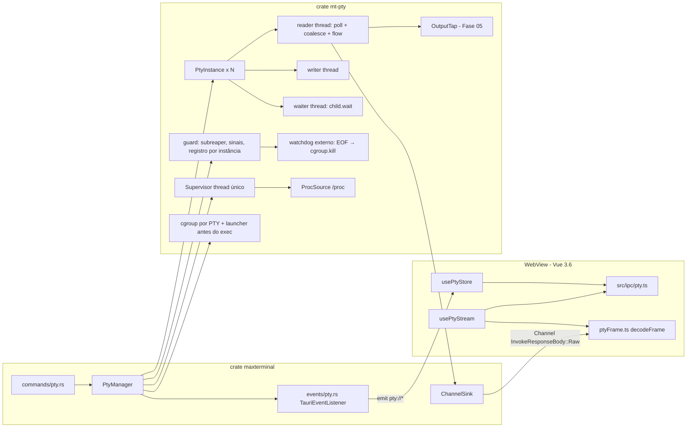
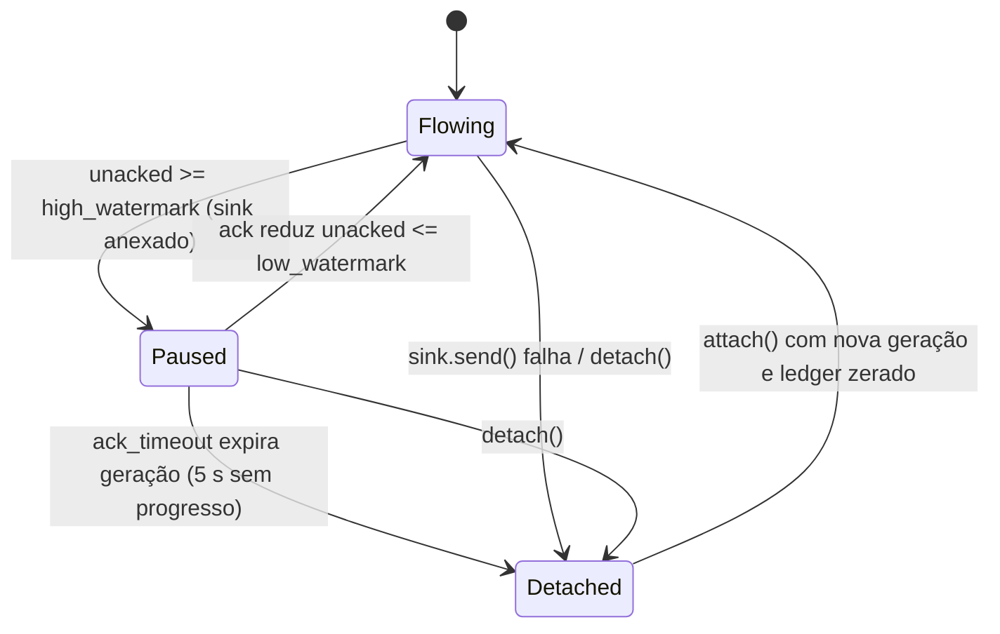
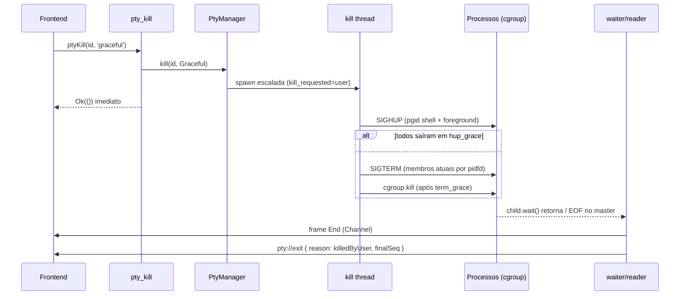
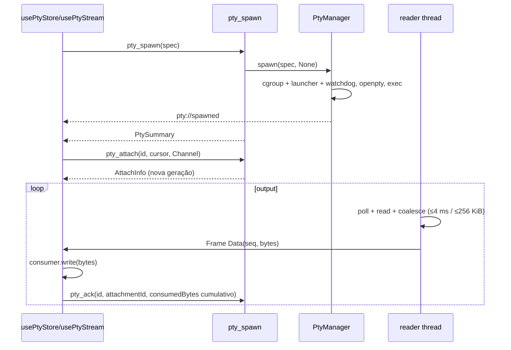

# Fase 02 — Especificação Técnica: Core PTY e Supervisão de Processos

> Contratos consumidos: Fase 01 (`mt-core::{MtError, PtyId, TabId, PaneId}`, pipeline `tauri-specta`).
> Contratos expostos: comandos `pty_*`, eventos `pty://*`, frames binários do Channel, API Rust de `PtyManager`
> (consumida pelas Fases 04, 05, 07, 08, 09, 13 e 17).

---

## 1. Visão Geral da Arquitetura



Princípios:
- `mt-pty` **não depende de Tauri**. A integração ocorre por duas traits: `OutputSink` (dados de alto volume) e
  `PtyEventListener` (eventos de ciclo de vida de baixo volume). Isso permite testar tudo com `cargo test` puro.
- Nenhuma operação bloqueante roda em thread do runtime Tauri/tokio: leitura, escrita e `wait` têm threads dedicadas;
  comandos IPC só enfileiram/consultam estado.
- Toda identificação usa **`(boot_id, pid, start_time)`**; sinalização usa pidfd validado. Reconsultar `/proc` e depois
  chamar `kill(pid)` ainda tem corrida TOCTOU. Cgroup é a fronteira de posse, `/proc` é observabilidade (§7.6).
- Dependência de fase única: **01**. Não importar `mt-db`, `mt-shell`, stores de abas nem componentes da Fase 04.
- Trechos Rust abaixo são contratos/esboços, não código pronto para compilar. Herdar edition/MSRV/lints da Fase 01;
  chamadas Linux devem usar wrappers seguros compatíveis com `unsafe_code = forbid`.

---

## 2. Crate `mt-pty` — Tipos Públicos

### 2.1. Configuração (`config.rs`)
```rust
#[derive(Debug, Clone)]
pub struct PtyConfig {
    pub max_ptys: usize,                 // 256
    pub read_buffer_size: usize,         // 64 KiB por read(2)
    pub coalesce_window: Duration,       // 4 ms
    pub max_frame_bytes: usize,          // 256 KiB
    pub high_watermark: usize,           // 1 MiB não confirmados → pausa
    pub low_watermark: usize,            // 256 KiB → retoma
    pub ack_timeout: Duration,           // 5 s com crédito pendente sem progresso → invalida conexão
    pub replay_capacity: usize,          // 1 MiB por PTY
    pub write_queue_capacity: usize,     // 1024 mensagens
    pub write_queue_bytes: usize,        // 4 MiB, incluindo pedido em execução
    pub max_write_bytes: usize,          // 1 MiB por pedido
    pub global_buffer_budget: usize,     // 256 MiB reservados entre todos os PTYs
    pub write_chunk_bytes: usize,        // 4 KiB
    pub hup_grace: Duration,             // 1 s
    pub term_grace: Duration,            // 2 s
    pub shutdown_hup_grace: Duration,    // 300 ms (encerramento do app)
    pub shutdown_term_grace: Duration,   // 700 ms
    pub supervisor_interval: Duration,   // 1 s
    pub tombstone_ttl: Duration,         // 60 s (PTY saído continua consultável)
    pub thread_stack_size: usize,        // 256 KiB
    pub registry_dir: PathBuf,           // $XDG_RUNTIME_DIR/maxterminal/<instance_id>, sem fallback persistente
    pub orphan_sweep_on_startup: bool,   // true
}
impl Default for PtyConfig { /* valores acima */ }
```

### 2.2. Tipos de domínio (`types.rs`) — todos `Serialize + Deserialize + specta::Type`, `#[serde(rename_all = "camelCase")]`
```rust
pub struct PtySize { pub rows: u16, pub cols: u16, pub pixel_width: u16, pub pixel_height: u16 }

/// Dono opaco do PTY. A Fase 02 apenas armazena; a Fase 07 preenche.
pub struct PtyOwner { pub tab_id: Option<TabId>, pub pane_id: Option<PaneId> }

pub struct SpawnSpec {
    pub shell: Option<String>,               // caminho absoluto ou nome resolvido no PATH (agentes CLI, Fase 13)
    pub args: Vec<String>,                   // se vazio e login=true → ["-l"] (bash/zsh) / ["--login"] (fish)
    pub login: bool,                         // padrão true
    pub cwd: Option<String>,                 // None → $HOME
    pub env: BTreeMap<String, String>,       // sobrepõe o ambiente herdado (após EnvPolicy)
    pub env_remove: Vec<String>,             // chaves a remover do ambiente herdado
    pub size: PtySize,
    pub owner: PtyOwner,
}

#[serde(rename_all = "camelCase", tag = "kind")]
pub enum PtyStatus {
    Running,
    Exiting { since_ms: u64 },
    CleanupFailed { error: String },
    Exited { exit: ExitInfo }
}

pub enum ExitReason { Exited, Signaled, KilledByUser, Shutdown, ReaderFailed }

pub struct ExitInfo {
    pub code: Option<i32>,          // None quando terminou por sinal
    pub signal: Option<i32>,        // número do sinal (ex.: 9)
    pub signal_name: Option<String>,// "SIGKILL"
    pub reason: ExitReason,
    pub at_ms: u64,                 // epoch ms
}

pub enum KillMode { Graceful, Force }

pub struct ProcessIdentity { pub boot_id: String, pub pid: u32, pub start_time: u64 }

pub struct PtyPids { pub shell_pid: u32, pub pgid: u32, pub sid: u32, pub foreground_pgid: Option<u32> }

pub struct PtySummary {
    pub id: PtyId,
    pub owner: PtyOwner,
    pub shell: String,
    pub args: Vec<String>,
    pub cwd_initial: String,
    pub size: PtySize,
    pub status: PtyStatus,
    pub pids: PtyPids,
    pub attached: bool,
    pub created_at_ms: u64,
    pub bytes_out: u64,
    pub seq: u64,                    // último seq produzido, independente de conexão/replay
    pub revision: u64,               // ordem de alterações para reconciliar lista/eventos
}

pub enum ProcState { Running, Sleeping, DiskSleep, Stopped, TracingStop, Zombie, Dead, Idle, Unknown }

pub struct ProcessInfo {
    pub pid: u32, pub ppid: u32, pub pgid: u32, pub sid: u32, pub tpgid: i32,
    pub comm: String,
    pub cmdline: Vec<String>,        // vazio para kernel threads/zumbis
    pub exe: Option<String>,
    pub cwd: Option<String>,
    pub state: ProcState,
    pub start_time: u64,             // ticks desde o boot (campo 22 de /proc/pid/stat)
    pub rss_bytes: Option<u64>,
    pub threads: u32,
}

pub struct ProcessNode { pub info: ProcessInfo, pub children: Vec<ProcessNode> }

pub struct PtyProcessReport {
    pub pty_id: PtyId,
    pub pids: PtyPids,
    pub shell: Option<ProcessInfo>,
    pub foreground: Option<ProcessInfo>,     // líder do pgid de foreground (tcgetpgrp)
    pub tree: Option<ProcessNode>,           // raiz = shell
    pub owned_processes: Vec<ProcessInfo>,   // cgroup inteiro, inclusive processos fora da árvore PPID
    pub partial: bool,                       // amostra incompleta; não significa ausência de processos
    pub descendant_count: u32,
    pub sampled_at_ms: u64,
}
```

Enums de domínio serializam variantes em `camelCase`. Todos os contadores/cursores/`start_time` u64 expostos em JSON
usam newtype decimal-string com serde + metadados Specta compatíveis; TS recebe `string` e converte para `bigint`.
Não converter u64 para `number` nem enviar `bigint` diretamente pelo invoke. PIDs, dimensões e tamanhos u32 são números.
`PtyPids` informa agrupamento, não constitui credencial para sinalizar; internamente shell e membros têm `ProcessIdentity`.

### 2.3. Erros (`error.rs`)
```rust
#[derive(Debug, thiserror::Error)]
pub enum PtyError {
    #[error("PTY não encontrado: {0}")]                         NotFound(PtyId),
    #[error("Limite de {0} terminais simultâneos atingido")]      LimitReached(usize),
    #[error("Diretório inválido: {0}")]                          CwdInvalid(String),
    #[error("Shell não encontrado: {0}")]                        ShellNotFound(String),
    #[error("Variável de ambiente inválida: {0}")]               EnvInvalid(String),
    #[error("Dimensões inválidas: {rows}x{cols}")]               ResizeInvalid { rows: u16, cols: u16 },
    #[error("Falha ao iniciar o terminal: {0}")]                 SpawnFailed(String),
    #[error("O processo do terminal já foi finalizado")]         AlreadyExited,
    #[error("Fila de escrita cheia; o processo não está lendo a entrada")] WriteQueueFull,
    #[error("Falha de escrita no terminal: {0}")]                WriteFailed(String),
    #[error("Processo {0} não pertence a este terminal")]        PidNotOwned(u32),
    #[error("Informações de processo indisponíveis: {0}")]       ProcUnavailable(String),
    #[error("Falha ao encerrar processos: {0}")]                 KillFailed(String),
    #[error("Erro de E/S: {0}")]                                 Io(#[from] std::io::Error),
}
impl PtyError { pub fn code(&self) -> &'static str { /* "pty.not_found", "pty.limit_reached", "pty.cwd_invalid",
    "pty.shell_not_found", "pty.env_invalid", "pty.resize_invalid", "pty.spawn_failed", "pty.already_exited",
    "pty.write_queue_full", "pty.write_failed", "pty.pid_not_owned", "pty.proc_unavailable", "pty.kill_failed", "pty.io" */ } }
impl From<PtyError> for mt_core::MtError { /* code() + to_string() (pt-BR) + details opcional (ex.: { ptyId }) */ }
pub type PtyResult<T> = Result<T, PtyError>;
```

Adicionar códigos estáveis: `pty.containment_unavailable`, `pty.containment_failed`, `pty.cleanup_failed`,
`pty.attachment_stale`, `pty.ack_invalid`, `pty.cursor_invalid`, `pty.input_invalid`, `pty.shutting_down` e
`pty.runtime_dir_invalid`. `details` contém somente IDs, limites e identidades técnicas; nunca input/output/env.

---

## 3. Crate `mt-pty` — Traits e Pontos de Extensão

```rust
/// Destino dos frames de output (alto volume). Implementado por ChannelSink no binário.
pub trait OutputSink: Send + Sync + 'static {
    /// Não deve bloquear por mais que poucos ms. Err => sink considerado desanexado.
    fn send(&self, frame: Bytes) -> Result<(), SinkClosed>;
}
pub struct SinkClosed;

/// Eventos de ciclo de vida (baixo volume). Implementado por TauriEventListener.
pub trait PtyEventListener: Send + Sync + 'static {
    fn on_event(&self, event: &PtyEvent);
}

#[derive(Clone, Debug, Serialize, specta::Type)]
#[serde(tag = "type", rename_all = "camelCase")]
pub enum PtyEvent {
    Spawned { summary: PtySummary, revision: u64 },
    ForegroundChanged { pty_id: PtyId, pgid: Option<u32>, process: Option<ProcessInfo>, revision: u64 },
    Exited { pty_id: PtyId, owner: PtyOwner, exit: ExitInfo, final_seq: u64, revision: u64 },
    CleanupFailed { pty_id: PtyId, survivors: Vec<ProcessIdentity>, revision: u64 },
}

/// Tap somente leitura do output bruto (ponto de extensão da Fase 05 — parser OSC 133).
/// Chamado na thread de leitura, por frame coalescido, ANTES do envio ao sink.
/// Deve ser O(n), limitado e não bloqueante. Panic é falha interna; build abort depende do watchdog.
pub trait OutputTap: Send + Sync + 'static {
    fn on_output(&self, pty_id: PtyId, seq: u64, bytes: &[u8]);
    fn on_exit(&self, _pty_id: PtyId, _exit: &ExitInfo) {}
}

/// Fonte de dados de processos (real: /proc via `procfs`; testes: FakeProcSource).
pub trait ProcSource: Send + Sync + 'static {
    fn process(&self, pid: u32) -> PtyResult<Option<ProcessInfo>>;   // Ok(None) se o processo sumiu
    fn all_pids(&self) -> PtyResult<Vec<u32>>;
    fn identity(&self, pid: u32) -> PtyResult<Option<ProcessIdentity>>;
}

/// Abstração de sinais (real: pidfd validado; testes: RecordingSignaler).
pub trait Signaler: Send + Sync + 'static {
    fn signal(&self, process: &ProcessIdentity, sig: Signal) -> PtyResult<()>;
}

/// Política de ambiente herdado (Fase 17 estende para remover variáveis de AppImage).
pub trait EnvPolicy: Send + Sync + 'static {
    fn apply(&self, inherited: &mut BTreeMap<OsString, OsString>);
}
```

---

## 4. `PtyManager` — API Pública

```rust
pub struct PtyManager { inner: Arc<ManagerInner> }

struct ManagerInner {
    config: PtyConfig,
    ptys: parking_lot::RwLock<HashMap<PtyId, Arc<PtyInstance>>>,
    pid_snapshot: arc_swap::ArcSwap<Vec<TrackedProcess>>,  // diagnóstico; não autoriza kill por PID cru
    listeners: parking_lot::RwLock<Vec<Arc<dyn PtyEventListener>>>,
    taps: parking_lot::RwLock<Vec<Arc<dyn OutputTap>>>,
    subscribers: parking_lot::RwLock<Vec<EventSubscriber>>, // fila limitada individual, fan-out explícito
    proc: Arc<dyn ProcSource>, signaler: Arc<dyn Signaler>, env_policy: Arc<dyn EnvPolicy>,
    registry_file: RegistryFile,
    shutting_down: AtomicBool,
}

#[derive(Clone, Serialize, Deserialize)]
pub struct TrackedProcess { pub pty_id: PtyId, pub identity: ProcessIdentity, pub pgid: u32, pub sid: u32 }

impl PtyManager {
    pub fn new(config: PtyConfig) -> PtyResult<Self>;
    pub fn with_deps(config: PtyConfig, proc: Arc<dyn ProcSource>, signaler: Arc<dyn Signaler>,
                     env_policy: Arc<dyn EnvPolicy>) -> PtyResult<Self>;

    // --- ciclo de vida ---
    pub fn spawn(&self, spec: SpawnSpec, sink: Option<Arc<dyn OutputSink>>) -> PtyResult<PtySummary>;
    pub fn write(&self, id: PtyId, data: Bytes) -> PtyResult<()>;
    pub fn resize(&self, id: PtyId, size: PtySize) -> PtyResult<()>;
    pub fn kill(&self, id: PtyId, mode: KillMode) -> PtyResult<()>;          // não bloqueia; escalada em thread
    pub fn kill_and_wait(&self, id: PtyId, mode: KillMode, timeout: Duration) -> PtyResult<ExitInfo>;
    pub fn attach(&self, id: PtyId, sink: Arc<dyn OutputSink>, cursor: Option<OutputCursor>) -> PtyResult<AttachInfo>;
    pub fn detach(&self, id: PtyId, attachment_id: AttachmentId) -> PtyResult<()>;
    pub fn ack(&self, id: PtyId, attachment_id: AttachmentId, consumed_bytes: u64) -> PtyResult<()>;
    pub fn list(&self) -> Vec<PtySummary>;
    pub fn summary(&self, id: PtyId) -> PtyResult<PtySummary>;
    pub fn shutdown(&self, reason: ExitReason) -> ShutdownReport; // bloqueante, worker de ExitRequested

    // --- supervisão (consumida por Fases 05, 07, 08, 13) ---
    pub fn pids(&self, id: PtyId) -> PtyResult<PtyPids>;
    pub fn foreground_process(&self, id: PtyId) -> PtyResult<Option<ProcessInfo>>;
    pub fn process_tree(&self, id: PtyId) -> PtyResult<ProcessNode>;
    pub fn owned_processes(&self, id: PtyId) -> PtyResult<Vec<ProcessIdentity>>; // membership, inclusive daemons
    pub fn process_report(&self, id: PtyId) -> PtyResult<PtyProcessReport>;
    pub fn signal_process(&self, id: PtyId, process: ProcessIdentity, sig: Signal) -> PtyResult<()>;
    pub fn owner_of_process(&self, process: ProcessIdentity) -> Option<PtyId>; // Fase 08: porta → aba

    // --- extensão ---
    pub fn add_listener(&self, l: Arc<dyn PtyEventListener>);
    pub fn add_output_tap(&self, tap: Arc<dyn OutputTap>) -> TapHandle;      // drop do handle remove o tap
    pub fn subscribe(&self) -> crossbeam_channel::Receiver<PtyEvent>;

    // --- guards ---
    pub fn install_guards(&self) -> PtyResult<GuardHandle>;  // subreaper + panic hook + sinais + varredura
    pub fn emergency_kill_all(&self); // notifica watchdog por canal pré-aberto; sem locks de domínio
}

pub struct OutputCursor { pub next_seq: u64, pub byte_offset: u64 }
pub struct AttachInfo {
    pub attachment_id: AttachmentId, // UUID opaco, não reaproveitado
    pub replay_from: OutputCursor,
    pub live_from: OutputCursor,
    pub truncated: bool
}
pub struct ShutdownReport { pub completed: Vec<PtyId>, pub pending: Vec<PtyId> }
```

`AttachmentId` pertence a `mt-pty`; não adicionar domínio de sessão persistida. `spawn` aceita sink opcional na API
Rust, mas IPC inicia desanexado e retorna identidade antes do `pty_attach`, evitando output anterior à instalação do
consumidor. `kill` confirma aceitação, não conclusão; `kill_and_wait` retorna erro no deadline se cleanup incompleto.
`subscribe()` tem fila limitada por assinante: clonar receiver crossbeam distribui mensagens, **não** faz broadcast.
Overflow de eventos gera indicação de ressincronização; consumidor recupera snapshot/revisão pelo manager.

### 4.1. `PtyInstance` (`instance.rs`)
```rust
pub(crate) struct PtyInstance {
    id: PtyId, owner: PtyOwner, shell: String, args: Vec<String>, cwd_initial: PathBuf, created_at_ms: u64,
    master: parking_lot::Mutex<Box<dyn portable_pty::MasterPty + Send>>,  // resize, tcgetpgrp
    io_fd: OwnedFd,                                         // duplicado via wrapper seguro
    containment: ContainmentHandle,
    size: parking_lot::Mutex<PtySize>,
    tracked: TrackedProcess,                                // shell (pid, pgid=pid, sid=pid, start_time)
    writer_tx: crossbeam_channel::Sender<WriterMsg>,
    flow: Arc<FlowControl>,
    output: Arc<OutputState>,                               // sink atual + replay + seq
    status: parking_lot::RwLock<PtyStatus>,
    exit_slot: Arc<ExitSlot>,                               // preenchido pelo waiter; lido pelo reader
    kill_requested: AtomicU8,                               // 0 nenhum, 1 user, 2 shutdown
    last_foreground: AtomicI64,                             // -1 = desconhecido
    threads: parking_lot::Mutex<Vec<JoinHandle<()>>>,
}

enum WriterMsg { Data(Bytes), Close }

pub(crate) struct OutputState {
    attachment: parking_lot::Mutex<Option<AttachmentState>>, // geração, sink, cursores e ledger de ACK
    replay: parking_lot::Mutex<ReplayRing>,   // VecDeque<(seq, Bytes)> limitado por bytes
    next_seq: AtomicU64,
    bytes_out: AtomicU64,
}

pub(crate) struct FlowControl {
    unacked: parking_lot::Mutex<u64>,
    cv: parking_lot::Condvar,
    cancelled: AtomicBool,                    // shutdown/detach acordam cv e poll de I/O
}
```

---

## 5. Spawn (`spawn/`)

### 5.1. Algoritmo
1. Reservar capacidade atomicamente com o teste de shutdown; `shutting_down` → `pty.shutting_down`, limite →
   `LimitReached`. Reserva inclui spawns pendentes; RAII libera capacidade em qualquer falha.
2. **Shell**: `spec.shell` (absoluto → precisa existir e ser executável; relativo → `which` no `PATH` herdado) →
   `$SHELL` → `nix::unistd::User::from_uid(getuid()).shell` → `/bin/bash` → `/bin/sh`. Falha → `ShellNotFound`.
3. **Args**: preservar vetor sem concatenar shell script. Login somente para shells reconhecidos e compatíveis;
   não presumir `/bin/sh` aceita `-l`. Shell explicitamente inválido falha, sem fallback silencioso.
4. **cwd**: expandir `~`, `canonicalize`, exigir diretório legível → senão `CwdInvalid`. `None` → `$HOME`.
5. **Ambiente**: herdado do processo → `EnvPolicy::apply` (padrão remove `MAXTERMINAL_PTY_ID`, `VTE_VERSION`,
   `TERMINAL_EMULATOR`, `WEBKIT_*`, `GIO_LAUNCHED_DESKTOP_FILE*`) → `env_remove` → `env` do spec → variáveis
   forçadas: `TERM=xterm-256color`, `COLORTERM=truecolor`, `TERM_PROGRAM=MaxTerminal`,
   `TERM_PROGRAM_VERSION=<CARGO_PKG_VERSION>`, `MAXTERMINAL=1`, `MAXTERMINAL_PTY_ID=<uuid>`; se `LANG` ausente →
   `C.UTF-8`. Validação: chave `^[A-Za-z_][A-Za-z0-9_]*$`, chave e valor sem `\0`, valor ≤ 128 KiB → senão `EnvInvalid`.
6. Validar contenção, iniciar watchdog e criar cgroup exclusivo **antes** de executar código do usuário (§7.6).
   `native_pty_system().openpty(size)` → `CommandBuilder` do helper launcher → `slave.spawn_command`.
    Launcher fica bloqueado em canal privado, sem executar/forkar shell. Pai registra identidade, move launcher ao
    cgroup e confirma a posse com watchdog; autorização de `exec` ocorre apenas no passo 10. Ambiente/cwd/argv trafegam
   por canal privado limitado, nunca via linha de comando/log do helper. Linux fornece sessão/TTY controlador;
   confirmar `pid == pgid == sid` no teste de integração, não inferir posse apenas dessa igualdade.
7. Drop do `slave` no processo pai (essencial para receber EOF/EIO quando o último detentor do slave fechar).
8. Abrir pidfd e validar `/proc` ao redor da abertura; atualizar registro e publicar instância ainda bloqueada.
   Shell que sai imediatamente depois da autorização ainda deve produzir tombstone.
9. Iniciar threads (`std::thread::Builder` com `stack_size`, nomes `mt-pty-r-<id8>`, `mt-pty-w-<id8>`, `mt-pty-x-<id8>`).
10. Emitir `PtyEvent::Spawned` antes de liberar launcher; liberar exec (mesmo PID), receber confirmação/erro do helper
    e retornar snapshot atualizado. Falha de exec dispara rollback/exit correspondente; nunca publicar Spawned
    atrasado depois de Exited nem retornar estado Running inventado para shell que já terminou.

Em falha após criar filho, cancelar launcher, matar seu pidfd/cgroup, reapear e liberar todos os handles antes do erro.
Falha de rollback mantém registro e watchdog responsável; não perde a referência ao processo.

### 5.2. Logs
Logs de spawn contêm `pty_id`, duração e código; não registrar argumentos, comandos, `cwd` sensível ou valores de env.

---

## 6. I/O de Alto Volume (`io/`)

### 6.1. Formato de frame binário (v1)
Enviado como `InvokeResponseBody::Raw(Vec<u8>)` → chega ao JS como `ArrayBuffer`.
```
offset  tamanho  campo
0       1        version      = 0x01
1       1        kind         0x01 Data | 0x02 Replay | 0x03 Gap | 0x04 End
2       2        reserved     = 0
4       8        seq          u64 LE, sequência do frame original (primeiro Data = 1)
12      8        byte_offset  u64 LE, offset absoluto no stream bruto
20      4        len          u32 LE (tamanho do payload)
24      len      payload      Data/Replay: bytes brutos do PTY
                              Gap: u64 LE = quantidade de bytes descartados (replay truncado)
                              End: JSON UTF-8 de ExitInfo
```
`seq` cresce somente em Data original; Replay preserva seq/offset. `Gap` carrega seq/offset do primeiro frame retido
e quantidade exata de bytes perdidos desde o cursor solicitado; `End` usa `finalSeq` (último Data, 0 se vazio) e total
de bytes produzidos. `End` não consome crédito nem incrementa seq. Limite Data/Replay 256 KiB, Gap exatamente 8 bytes,
End JSON ≤ 4 KiB. Rejeitar versão/kind/reserved inválidos, overflow e comprimento diferente de `24 + len`.
O protocolo é versão 1 ainda não implementada; o layout de 24 bytes é seu contrato único.

### 6.2. Thread de leitura (`reader.rs`)
1. Reader é o único produtor de seq/offset e serializa attach/detach/publicação. ACK atualiza ledger independente;
   nenhum mutex do registro global, master ou replay fica retido durante envio, callback ou espera de crédito.
2. Poll do master e FD de cancelamento/controle. Sem crédito, aguardar ACK/controle; sem conexão, ler normalmente
   para replay/taps. Reservar espaço de frame antes de ler, nunca ultrapassar `max_frame_bytes` por somar read inteiro.
3. Acumular até 4 ms desde o primeiro byte **ou** 256 KiB; quando atingir tamanho, flush imediatamente. `EINTR`
   repete, `EAGAIN` retorna ao poll. `POLLHUP` drena bytes restantes antes do EOF; `EIO` Linux equivale a EOF do PTY.
4. Flush atribui seq/offset, chama taps uma vez, armazena frame imutável no ring, reserva crédito **antes** de enviar
   Data. Falha de send invalida somente aquela geração, libera seu ledger e passa a Detached.
5. EOF e status do waiter são condições independentes; coordenador de finalização aguarda cleanup confirmado.
   Falha de leitura inicia encerramento supervisionado (`ReaderFailed`), não deixa shell vivo por perder leitor.
6. Nenhuma conversão UTF-8; escapes/UTF-8 podem cruzar frames. `OutputTap` não recebe cabeçalho nem replay.

### 6.3. Controle de fluxo (`flow.rs`)

- Em `Paused`, a thread de leitura não lê: o buffer do kernel (≈ 4–64 KiB) enche e o `write(2)` do filho bloqueia —
  backpressure real até o produtor.
- Em `Detached`, leitura continua para taps/replay; perda dos bytes antigos é indicada por `Gap`. Timeout nunca
  continua enviando para Channel sem crédito, nem permite que ACK atrasado reative geração expirada.
- `AttachmentState = { id, sentBytes, consumedBytes, lastProgressAt, nextCursor, sink }`; counters por conexão.
  ACK informa total cumulativo de payload consumido (Data + Replay) desde esse attach, não delta nem offset global.
  Repetido/menor é no-op; maior que `sentBytes` é `pty.ack_invalid`; geração antiga é `pty.attachment_stale`.
- Crédito máximo 1 MiB; reservar antes do send e limitar reads ao orçamento. Retomar ao cair a ≤ 256 KiB.
  Replay também usa crédito; bytes de controle têm quantidade/tamanho limitados. Deadline só corre com bytes
  pendentes e sem progresso; não expirar um shell ocioso sem frames enviados.
- Ao expirar, o composable descarta a fila local daquela geração e reanexa a partir do último cursor consumido.
  Como GC do Channel JS não implica disconnect Rust, `pty_detach` é obrigatório; erro de send e timeout são fallback.

### 6.4. Escrita (`writer.rs`)
- Cada pedido tem ≤ 1 MiB, fila tem orçamento total de 4 MiB e até 1024 pedidos. Reservar bytes e uma posição
  atomicamente, enfileirar pedido inteiro e só então responder. Writer fragmenta em 4 KiB preservando ordem entre
  produtores. Erro de fila rejeita o pedido inteiro; não fazer pré-teste de `len` seguido de vários `try_send` sujeitos a corrida.
- Sucesso significa aceitação na fila, não leitura pelo shell. Fronteiras de pedidos não têm semântica no slave.
  Usar FD owned duplicado com API segura, I/O não bloqueante + `poll(POLLOUT, cancelFd)`, tratar escrita parcial,
  `EAGAIN` e `EINTR`. `write_all` bloqueante sem cancelamento não satisfaz shutdown com processo que não lê.
- `O_NONBLOCK` em descritores duplicados compartilha open-file-description; reader também trata `EAGAIN`.
  `MasterPty::take_writer()` só uma vez; auditar fechamento de todos os clones e contrato do wrapper Linux.
- Ao iniciar `Exiting`, recusar input/resize; cancelar fila e worker com erro explícito de fechamento. Não repetir
  automaticamente pedido cujo resultado IPC se perdeu, pois isso poderia duplicar teclas/comandos.

### 6.5. Resize
Valida `1 <= rows <= 1000`, `1 <= cols <= 1000`, pixels u16 (zero = desconhecido); aplicar também ao spawn.
Pedidos por PTY são serializados, idênticos deduplicados e tamanho publicado só após sucesso do ioctl.
`master.resize(size)` (`TIOCSWINSZ`, kernel notifica foreground) roda em worker/spawn_blocking, sem reter mutex
global; nenhum resize tardio acessa FD fechado/reutilizado. Resize em Exiting/Exited retorna erro. Debounce visual
é responsabilidade futura da Fase 04; correção não depende dele.

### 6.6. Attach e replay (`replay.rs`)
`attach(id, sink, cursor)` é serializado com flush: invalida geração anterior, captura ring + fronteira de live,
instala geração nova e responde `AttachInfo`. Snapshot tem referências imutáveis e limite 1 MiB; envio ocorre fora
do lock e sob crédito. Durante replay, pausar novas leituras quando necessário, sem fila live ilimitada.
Cursor significa **próximo** frame + offset absoluto já consumido; cursor futuro/inconsistente retorna
`pty.cursor_invalid`. `None` equivale à origem `(nextSeq=1, byteOffset=0)`; não restaura estado completo de TUI.
Se truncado, `Gap` avança cursor ao primeiro frame retido, seguido de Replay contíguo e então Data. Ring expulsa
frames inteiros, contabiliza bytes e seq cumulativos; nunca corta bytes silenciosamente dentro de frame.
Reattach de tombstone entrega replay + End sob o mesmo crédito. Detach antigo não remove conexão nova. Replay
reenvia bytes ao renderer, nunca reexecuta taps nem eventos de comando. ACKs não dependem do mutex de attach.

---

## 7. Encerramento, Kill e Garantia de Não-Órfãos

### 7.1. Thread waiter
`child.wait()` bloqueante → converte `portable_pty::ExitStatus` em `ExitInfo` (código ou sinal) → define `reason`
conforme `kill_requested` (`KilledByUser`, `Shutdown`, senão `Exited`/`Signaled`) → `exit_slot.set(info)` → sinaliza o
reader. Ao sair o shell, dispara `cleanup_session` (§7.3) para descendentes remanescentes.

Em `portable-pty 0.9`, `signal()` retorna `Option<&str>`, não número. Preservar texto em `signal_name`; mapear
para número somente se reconhecido na plataforma, deixando `signal=None` caso contrário. Se sinal presente,
`code=None`; não converter automaticamente `128+N` em sinal. Reaper não pode consumir o status do filho do waiter.

### 7.2. Plano de kill (`kill.rs`)
`KillPlan { hup_grace, term_grace, force }` tem uma execução por PTY; pedidos repetidos compartilham conclusão,
`Force` promove imediatamente a etapa, nunca cria escaladas concorrentes.
1. Transição `Running → Exiting` e recusa de write/resize; acordar reader/writer e invalidar conexão se necessário
   para impedir consumidor travado de bloquear cleanup. Preservar replay limitado e registrar truncamento.
2. Gracioso: obter grupos shell/foreground atuais; enviar HUP aos membros pertencentes ao cgroup por pidfds.
   Enviar CONT para permitir traps em jobs parados. PGIDs são agrupamento semântico, não handles duráveis;
   não usar `killpg` de PGID armazenado depois que líder morreu.
3. Aguardar `hup_grace` verificando cgroup; enviar TERM + CONT a todos os membros atuais e renovar enumeração
   durante `term_grace`. Snapshot único não cobre fork concorrente nem daemon já reparentado.
4. Se ainda populado ou `Force`, escrever `1` no `cgroup.kill` do handle registrado, incluindo subcgroups.
5. Confirmar `cgroup.events populated=0`, reapear filhos diretos/adotados e liberar todos os FDs de I/O e workers.
   Somente então produzir `Exited`. `cgroup.kill` solicitado não equivale a confirmação de saída.
6. Deadline saudável de 3,5 s; estado `D` pode resistir enquanto espera kernel. Retornar `CleanupFailed`, emitir
   `pty://cleanup-failed`, manter cgroup/registro/watchdog e nova tentativa. Nunca abandonar membro sobrevivente.

`pty_kill` em tombstone é no-op idempotente; tombstone permanece pelo TTL para reattach. Identificador inexistente
retorna `pty.not_found`. Encerramento por usuário é motivo; código/sinal observado do shell permanece separado.

### 7.3. Saída espontânea do shell
Quando o waiter registra saída, encerrar membros remanescentes do **cgroup**, mesmo sem PPID/sid/env original,
com TERM → KILL. EOF pode preceder ou suceder wait; coordenador único combina status + drenagem + cleanup.
Na conexão ativa saudável: enfileirar `Data* → End`; depois publicar evento global com `finalSeq`. Tauri não
garante ordem relativa entre transporte de Channel e eventos; frontend correlaciona pelo cursor e não descarta
output ao receber exit. Sem conexão, guardar End no tombstone. Sem ACK durante shutdown, invalidar geração e
conservar replay/Gap; jamais esperar UI indefinidamente para matar processos.

### 7.4. Guards (`guard/`)
| Guard | Implementação |
|-------|---------------|
| Subreaper | Instalar antes do primeiro spawn; adotados continuam identificados pelo cgroup, não por env. Não impede fork, setsid ou migração. |
| Reaper | Registro global de filhos com dono do wait: shell → waiter; watchdog/helper → controlador. Adotados confirmados → waitpid específico com WNOHANG. Nunca disputar filhos de Tauri/plugins ou usar waitpid(-1). |
| Registro | `$XDG_RUNTIME_DIR/maxterminal/<instance_id>/pty-registry.json`, diretório 0700/arquivo 0600, lock por instância, gravação atômica antes do exec. Campos: versão, boot_id, identidade do app/watchdog, PTY, caminho/identidade do cgroup. Sem conteúdo de terminal. |
| Recovery | Tomar lock de instância comprovadamente morta, validar boot e caminho sob subtree autorizado; contatar watchdog vivo ou limpar cgroup registrado. Registro adulterado/caminho fora da raiz não autoriza sinal. Não varrer env para inferir posse. |
| Panic | Hook encadeado apenas notifica FD pré-aberto. Com panic=abort, catch_unwind não salva o processo: watchdog reage a EOF. Snapshot de PID cru nunca é usado para kill de emergência. |
| Sinais | Handler apenas notifica worker por signal-hook; worker coordena shutdown. Nada de locks/alocação/IPC complexo no handler de sinal. |
| `ExitRequested` | `prevent_exit`, marcar shutting_down, executar shutdown em worker com escaladas paralelas; se completo, flag de conclusão + AppHandle::exit. Em falha, manter supervisão e expor erro. |
| `RunEvent::Exit` | Verifica conclusão; última salvaguarda notifica watchdog. Não iniciar longa espera bloqueante no event loop. |
| `CloseRequested` | Não chama kill; política da Fase 09 pode prevenir fechamento. Sem essa política, fechar última janela pode solicitar saída e então executar ExitRequested. |

### 7.5. Fluxo de kill


### 7.6. Contenção Linux e limite real da garantia

**Estratégia obrigatória no CachyOS:** subtree cgroup v2 delegado à instância, cgroup domain dedicado por PTY,
launcher bloqueado antes do exec e watchdog independente. Falhar spawn com `pty.containment_unavailable` se
delegação, `cgroup.kill`, pidfd ou diretório runtime seguro não estiverem disponíveis. Não anunciar modo reduzido
como equivalente à garantia sem órfãos.

`containment/` define `ContainmentProvider::create(PtyId) -> ContainmentHandle`,
`ContainmentHandle::{enroll_launcher, members, signal_members, kill_all, is_empty, release}` e
`WatchdogClient::{register, confirm_empty, shutdown}`. Handle conserva diretório/arquivos abertos e identidade do
cgroup, evitando resolver novamente caminho controlável no momento do kill. Provider real usa wrappers Linux
seguros; fake permite testes de timeout/fork/migração sem root.

- Provisionar subtree via delegação systemd de usuário na inicialização ou configuração de ambiente; validar
  escrita de `cgroup.procs`/`cgroup.kill`. App/watchdog ficam fora dos cgroups das cargas. Não mover o app inteiro
  temporariamente para um cgroup de PTY; threads paralelas poderiam gerar filhos no grupo errado.
- Launcher é modo interno do binário helper `mt-pty-helper`, sem Tauri, inicia sob `portable-pty`. Conecta a socket
  Unix privado 0600 em diretório 0700; pai valida credenciais do peer e PID/starttime. Não interpreta shell script,
  não faz fork e aguarda autorização limitada por timeout. Pai coloca o PID no cgroup, confirma watchdog/registro,
  envia argv/env/cwd por protocolo enquadrado limitado e libera exec. EOF/timeout antes da autorização termina helper.
  Descriptor de controle e todos os FDs do watchdog são fechados antes do exec; somente stdio/TTY esperado é herdado.
- Watchdog é processo separado que conhece handles dos grupos **antes** da liberação do shell. Canal exclusivo
  do app tem CLOEXEC e nenhuma cópia herdada pela carga. EOF por crash/SIGKILL → `cgroup.kill` de todos os grupos
  registrados → aguardar `populated=0`. Remover grupo somente após confirmação; se houver espera kernel, continuar
  monitorando e manter registro. App detecta morte do watchdog, bloqueia spawn e assume cleanup dos grupos vivos.
- `setsid`, `nohup`, double-fork, reparenting e limpeza de ambiente não mudam cgroup. Portanto continuam incluídos
  mesmo que nunca tenham aparecido em um snapshot `/proc`. `MAXTERMINAL_PTY_ID` é metadado, não mecanismo de posse.
- Não é sandbox contra processo privilegiado ou carga que deliberadamente migra de cgroup usando permissões do
  mesmo usuário. Serviços iniciados por daemon externo (Docker/systemd já existente) não são descendentes contidos.
  Documentar essas fronteiras: não reivindicar término desses serviços nem matar processos externos por heurística.
- Nenhum software pode prometer limpeza imediata sob falha simultânea app/watchdog, kernel travado ou energia
  interrompida. Recovery limpa grupos remanescentes após retorno; reboot invalida registros de outro `boot_id`.
  A garantia de fechamento bem-sucedido exige prova `populated=0` + reaping, nunca apenas lista `/proc` vazia.

### 7.7. Identidade, pidfds e grupos

Para sinal individual: confirmar identidade esperada → abrir pidfd → reler `start_time`/boot e membership do cgroup
→ abortar se divergir → enviar via `pidfd_send_signal`. O handle fixa o processo mesmo se PID for reutilizado
depois. Erros ESRCH significam processo já encerrado; EPERM/I/O são falha explícita. Comparação temporal sem pidfd
não remove a corrida entre leitura e kill. Para conjuntos, renovar membership; KILL final usa cgroup.kill, que
cobre forks concorrentes. Nunca sinalizar PGID 0/-1 ou grupo do próprio app.

---

## 8. Supervisão via `/proc` (`proc/`, `supervisor.rs`)

### 8.1. `ProcfsSource`
- `process(pid)`: `procfs::process::Process::new(pid)` → `stat()` (ppid, pgrp, session, tpgid, state, starttime,
  num_threads, rss × page_size), `cmdline()`, `exe()`, `cwd()`; `ENOENT`/`ESRCH` → `Ok(None)`; `EACCES` em campos
  opcionais → `None` no campo.
- `all_pids()`: `procfs::process::all_processes()` filtrando erros de corrida.
- Custo de `process_tree`: enumerar membros do cgroup, ler `stat` e montar índice `ppid → filhos`; detalhar somente
  membros. Ler identidade antes/depois dos campos para evitar misturar processos durante reutilização de PID.
  `tree` pode perder daemon reparentado; `owned_processes` cobre membership completo e `partial` indica limitações.

### 8.2. Foreground
Usar `tcgetpgrp` por wrapper Linux seguro; testar a semântica de `MasterPty::process_group_leader()` na versão fixada
antes de usá-lo como atalho (o nome não prova que seja foreground). O `foreground` do relatório é o
processo cujo `pid == foreground_pgid`; se o líder já saiu, usa o membro do grupo com maior `start_time`. Se
`foreground_pgid == shell_pgid`, apenas o grupo do shell está em foreground: builtin pode estar executando.
Não inferir prompt, comando finalizado ou exit code por isso; essa semântica pertence à Fase 05.

### 8.3. Supervisor (thread única `mt-pty-supervisor`)
A cada `supervisor_interval`:
1. Para cada PTY `Running`: `tcgetpgrp`; se mudou em relação a `last_foreground` → lê `ProcessInfo` do líder e emite
   `PtyEvent::ForegroundChanged` (deduplicado por `(pgid, start_time)`).
2. Executa o reaper de adotados (§7.4).
3. Expira tombstones com mais de `tombstone_ttl`, liberando replay/handles. Cancelar conexão remanescente ao expirar;
   PTY em `CleanupFailed` nunca expira. Verificar saúde do watchdog e deadlines de conexões.
O supervisor não lê `cmdline` de árvores inteiras periodicamente (custo proporcional apenas a mudanças).

---

## 9. Comandos Tauri IPC (`src-tauri/src/commands/pty.rs`)

Todos `async`, `#[tauri::command] #[specta::specta]`, estado `State<'_, Arc<PtyManager>>`, retorno `Result<T, MtError>`.
Operações potencialmente lentas (`spawn`, `process_info`) rodam em `tauri::async_runtime::spawn_blocking`.

| Comando | Argumentos (TS camelCase) | Retorno | Erros (`code`) |
|---------|---------------------------|---------|----------------|
| `pty_spawn` | `spec: SpawnSpec` | `PtySummary` desanexado | `pty.limit_reached`, `pty.cwd_invalid`, `pty.shell_not_found`, `pty.env_invalid`, `pty.spawn_failed`, `pty.containment_unavailable`, `pty.shutting_down` |
| `pty_write` | `ptyId: PtyId`, `input: PtyInput` | `void` | `pty.not_found`, `pty.already_exited`, `pty.input_invalid`, `pty.write_queue_full`, `pty.write_failed` |
| `pty_resize` | `ptyId`, `size: PtySize` | `void` | `pty.not_found`, `pty.resize_invalid`, `pty.already_exited` |
| `pty_kill` | `ptyId`, `mode?: KillMode` (padrão `graceful`) | `void` (escalada assíncrona; fim via `pty://exit`) | `pty.not_found`, `pty.kill_failed` |
| `pty_list` | — | `PtySummary[]` (vivos + tombstones) | — |
| `pty_process_info` | `ptyId` | `PtyProcessReport` | `pty.not_found`, `pty.proc_unavailable` |
| `pty_ack` | `ptyId`, `attachmentId`, `consumedBytes: string` decimal | `void` | `pty.not_found`, `pty.attachment_stale`, `pty.ack_invalid` |
| `pty_attach` | `ptyId`, `cursor?: OutputCursor`, `onOutput: Channel<ArrayBuffer>` | `AttachInfo` | `pty.not_found`, `pty.cursor_invalid` |
| `pty_detach` | `ptyId`, `attachmentId` | `void` | `pty.not_found` (geração antiga é no-op) |

Observações:
- `PtyInput` é enum Rust tag `kind`: `{ kind: 'text', text: string }` codificado uma vez como UTF-8 ou
  `{ kind: 'bytes', bytes: number[] }`, `Vec<u8>` validado. Input binário preserva 0–255; não converter string
  latin-1 em UTF-8. Limite por pedido medido **após** codificação; colagens maiores são fatiadas pelo wrapper.
- `pty_ack` é agregado ao atingir 32 KiB **ou** 16 ms (o que vier primeiro), após consumo; requests cumulativos
  podem ser coalescidos. Async callbacks de Channel não oferecem backpressure automaticamente.
- `ChannelSink::send` envia `BinaryPtyFrame(frame)`; seu `IpcResponse::body` produz
  `InvokeResponseBody::Raw(frame.to_vec())`. Erro → `SinkClosed`; `Ok` é somente aceitação pelo transporte,
  não prova entrega/renderização e **não** reduz `unacked`. Só `pty_ack` válido após consumo libera crédito.
- `TauriEventListener` mapeia cada variante para `pty://spawned`, `pty://foreground-changed`, `pty://exit` ou
  `pty://cleanup-failed`, com payload correspondente e revisão.

### 9.1. Eventos globais
| Evento | Payload (TS) | Frequência |
|--------|--------------|------------|
| `pty://spawned` | `{ summary: PtySummary, revision }` | 1 por spawn |
| `pty://exit` | `PtyExitEvent = { ptyId, owner, exit: ExitInfo, finalSeq, revision }` | 1 por PTY, após enfileirar `End` ou guardá-lo no tombstone |
| `pty://foreground-changed` | `{ ptyId, pgid: number \| null, process: ProcessInfo \| null }` | ≤ 1/s por PTY, só em mudança |
| `pty://cleanup-failed` | `{ ptyId, survivors: ProcessIdentity[], revision }` | mudança de estado, não spam periódico |

Todos os envelopes de eventos incluem revisão monotônica do registro; `Spawned` inclui `PtySummary` para permitir
upsert completo. Tipos `PtySpawnedEvent`, `PtyExitEvent`, `PtyForegroundChangedEvent`, `PtyCleanupFailedEvent` são
structs Rust exportadas; manter payloads do enum interno e dos DTOs sincronizados. Evento perdido requer `pty_list`.

### 9.2. Capabilities
`capabilities/default.json` → `windows: ["main"]`, permissões geradas para os nove comandos (`allow-pty-*`). Nenhuma outra
janela/webview remota pode invocar `pty_*`.
Registrar comandos próprios também no manifesto ACL do build conforme Fase 01; só citar nomes `allow-pty-*` não cria
permissões. Testar negação por outra janela e origem remota; não expor PID/sinal arbitrário pelo IPC desta fase.

### 9.3. Channel direto, bindings e Result

Usar o builder único da Fase 01, pins `specta = =2.0.0-rc.27`, `tauri-specta = =2.0.0-rc.27` e exportador compatível
definido por ela; não reintroduzir exemplos de RC22. `ErrorHandlingMode::Result` mantém erros como valores.
Assinaturas esquemáticas de comandos:

```rust
#[tauri::command]
#[specta::specta]
async fn pty_spawn(
    state: tauri::State<'_, Arc<PtyManager>>,
    spec: SpawnSpec
) -> Result<PtySummary, MtError> { /* executar spawn no worker, sem Channel dentro de SpawnSpec */ }

#[tauri::command]
#[specta::specta]
async fn pty_attach(
    state: tauri::State<'_, Arc<PtyManager>>,
    pty_id: PtyId,
    cursor: Option<OutputCursor>,
    on_output: tauri::ipc::Channel<BinaryPtyFrame>
) -> Result<AttachInfo, MtError> { /* instalar ChannelSink e retornar metadados */ }
```

Channel é **argumento direto** do comando. Não embutir em `SpawnSpec`, `AttachInfo`, outro DTO ou evento.
O objeto `{ info, channel }` dos wrappers TS é apenas resultado local da função JS, não payload serializado Rust.
`BinaryPtyFrame` é adaptador do binário, fora de `mt-pty`: implementa `IpcResponse` com corpo Raw e contrato Specta
opaco mapeado para `ArrayBuffer` no exportador. Não assumir que `InvokeResponseBody` implemente `specta::Type`,
nem trocar por `Vec<u8>` serializado em JSON para fazer o export compilar. O spike de integração deve provar
`Channel<ArrayBuffer>` gerado, corpo binário real, ausência de base64/array JSON e compatibilidade dos pins.

Comandos gerados retornam `{ status: 'ok', data: T } | { status: 'error', error: MtError }`; `src/ipc/pty.ts` usa
o `unwrap` central da Fase 01. Os `Promise<T>` abaixo são dos wrappers pós-unwrap. Rejeições de infraestrutura
Tauri/JS podem continuar `unknown` e não devem ser fingidas como `MtError`. A geração tipada não valida entrada
maliciosa: backend continua validando dimensões, bytes, cursores e ACKs.

---

## 10. Frontend (sem UI)

### 10.1. Contratos TypeScript
Gerados em `src/types/bindings.ts` (`SpawnSpec`, `PtySize`, `PtyOwner`, `PtySummary`, `PtyStatus`, `ExitInfo`,
`ExitReason`, `KillMode`, `PtyPids`, `ProcessInfo`, `ProcessNode`, `PtyProcessReport`, `AttachInfo`, `PtyEvent`).
Únicos tipos escritos à mão (não são structs Rust): o frame binário.
```ts
// src/ipc/ptyFrame.ts
export const enum PtyFrameKind { Data = 1, Replay = 2, Gap = 3, End = 4 }
export interface PtyFrame { kind: PtyFrameKind; seq: bigint; byteOffset: bigint; payload: Uint8Array }
export function decodeFrame(buffer: ArrayBuffer): PtyFrame;        // lança PtyFrameError se version !== 1 ou len inconsistente
export function decodeEnd(frame: PtyFrame): ExitInfo;
export function decodeGap(frame: PtyFrame): bigint;
export function encodeBinary(data: string): Uint8Array;            // code units 0–255; rejeitar valores maiores
```

### 10.2. Wrappers IPC (`src/ipc/pty.ts`)
```ts
export function ptySpawn(spec: SpawnSpec): Promise<PtySummary>;
export function ptyAttach(ptyId: PtyId, onFrame: (frame: PtyFrame) => void, cursor?: OutputCursor): Promise<{ info: AttachInfo; channel: Channel<ArrayBuffer> }>;
export function ptyDetach(ptyId: PtyId, attachmentId: AttachmentId): Promise<void>;
export function ptyWrite(ptyId: PtyId, input: PtyInput): Promise<void>;
export function ptyResize(ptyId: PtyId, size: PtySize): Promise<void>;
export function ptyKill(ptyId: PtyId, mode?: KillMode): Promise<void>;
export function ptyAck(ptyId: PtyId, attachmentId: AttachmentId, consumedBytes: string): Promise<void>;
export function ptyList(): Promise<PtySummary[]>;
export function ptyProcessInfo(ptyId: PtyId): Promise<PtyProcessReport>;
export function onPtyExit(cb: (e: PtyExitEvent) => void): Promise<UnlistenFn>;
export function onPtySpawned(cb: (e: PtySpawnedEvent) => void): Promise<UnlistenFn>;
export function onPtyForegroundChanged(cb: (e: PtyForegroundChangedEvent) => void): Promise<UnlistenFn>;
export function onPtyCleanupFailed(cb: (e: PtyCleanupFailedEvent) => void): Promise<UnlistenFn>;
```
Erros de domínio vêm no Result explícito gerado e são tratados pelo unwrap central; mensagens já em pt-BR.

### 10.3. Composable `usePtyStream` (`src/composables/usePtyStream.ts`) — consumido pela Fase 04
```ts
export interface PtyStreamConsumer {
    write: (bytes: Uint8Array) => Promise<void> | void;   // ex.: xterm.write(bytes, resolve)
    onGap?: (droppedBytes: bigint) => void;
    onEnd?: (exit: ExitInfo) => void;
}
export interface UsePtyStreamOptions { ptyId: Ref<PtyId | null>; consumer: PtyStreamConsumer; ackThresholdBytes?: number /* 32768 */ }
export function usePtyStream(opts: UsePtyStreamOptions): {
    attached: Readonly<Ref<boolean>>;
    lastSeq: Readonly<Ref<bigint | null>>;
    ended: Readonly<Ref<ExitInfo | null>>;
    attach: () => Promise<void>;     // cursor confirmado: nextSeq + byteOffset
    detach: () => Promise<void>;     // ptyDetach explícito, invalidação local imediata
};
```
- Fila FIFO limitada pela janela + frame; aguardar `consumer.write` antes de avançar cursor e ACK cumulativo.
  Usar timer para ACK pequeno; não depender só de requestAnimationFrame, suspenso em janelas ocultas.
- Instalar callback do Channel antes de invoke. Frames podem chegar antes da resposta `AttachInfo`: manter fila
  limitada e não enviar ACK até conhecer attachmentId. Callback captura token local de geração; callbacks tardios
  não alteram conexão nova. Se attach atrasado resolver após dispose, enviar detach para a geração que ele criou.
- `onScopeDispose` invalida token, cancela timer/fila/listeners e dispara detach com erro tratado; troca de `ptyId`
  reseta cursor para o novo PTY. Remontagem do mesmo consumidor pode usar cursor confirmado; renderer novo precisa
  replay desde origem disponível e aviso Gap. Um cursor sem estado de tela não restaura uma TUI.
- Exceção/rejeição em `consumer.write` não gera ACK nem avança cursor; desanexar e expor erro. Reattach não pode
  continuar escrevendo na mesma instância do renderer enquanto callback anterior ainda está pendente: invalidar
  renderer ou aguardar conclusão, pois cancelar Promise não desfaz bytes já renderizados.
- UI só confirma término do stream após End; evento global atualiza status independente, sem destruir fila de output.

### 10.4. Store `usePtyStore` (`src/stores/pty.ts`)
```ts
interface PtyState { ptys: Record<PtyId, PtySummary>; processReports: Record<PtyId, PtyProcessReport>; initialized: boolean }
getters:
    alive: (s) => PtySummary[]                         // running | exiting | cleanupFailed
    byTab: (s) => (tabId: TabId) => PtySummary[]
    exitOf: (s) => (ptyId: PtyId) => ExitInfo | null
actions:
    init(): Promise<void>                              // listeners primeiro, snapshot depois, reconciliar revisão
    spawn(spec: SpawnSpec): Promise<PtySummary>
    kill(ptyId, mode?): Promise<void>
    refreshProcessInfo(ptyId): Promise<PtyProcessReport>
    handleExit(e: PtyExitEvent): void                  // status → exited
    dispose(): void                                    // remove listeners
```
Store de estado **em memória** (sem cache/persistência do `@maxvue/max-pinia`); `TabStatus` **não** existe aqui
(Fase 05). Write/resize não passam pela store (caminho quente direto via `src/ipc/pty.ts`).
`init` compartilha Promise entre chamadas concorrentes; falha parcial remove listeners já registrados. Eventos
recebidos durante `pty_list` ficam em buffer limitado, aplicado por revisão; `Exited` não volta para Running por
resposta atrasada. Bytes, Channel, terminal e Promises ficam fora do estado reativo/serializável. Nenhum componente
visual de produção nesta fase; harness headless consome `usePtyStream`. Componentes de terminal pertencem à Fase 04.

---

## 11. Fluxos de Dados

### 11.1. Spawn + output


### 11.2. Reanexação (remontagem de componente / reload do WebView)
`usePtyStream.attach()` → `pty_attach(id, cursor confirmado, novoChannel)` → `Gap?` → `Replay*` → `Data*` ao vivo.
No reload completo do WebView, `usePtyStore.init()` chama `pty_list()` e a Fase 07 reassocia PTYs vivos às abas via `owner`.

---

## 12. Persistência

**Nenhuma tabela ou migration SQLite nesta fase.** O único artefato em disco é o arquivo efêmero
`$XDG_RUNTIME_DIR/maxterminal/<instance_id>/pty-registry.json` (identidades/cgroups, sem comandos, env ou output). Scrollback e
comandos serão persistidos pelas Fases 05/07 usando `mt_db::sanitizer::sanitize()` da Fase 03.

---

## 13. Performance

| Métrica | Meta | Como |
|---------|------|------|
| Vazão sustentada (sink com ack imediato) | ≥ 150 MB/s | `read` de 64 KiB, frames até 256 KiB, `Bytes` sem cópia até o encode, um `Vec` por frame. |
| Frames em rajada | teto por bytes, não 250/s | 4 ms **ou** 256 KiB: 150 MiB/s exige ao menos 600 frames/s de 256 KiB. |
| Latência de eco (ocioso) | p99 < 10 ms | flush imediato quando o buffer está vazio há > janela; `poll` acorda no primeiro byte. |
| Memória por PTY | orçamento explícito, ≤ 16 MiB incremental em teste isolado | 1 MiB ring + 1 MiB snapshot replay + 1 MiB trânsito + 4 MiB input + coalescing/encode/stacks/metadados; medir cópias Tauri/WebView separadas. |
| Custo do supervisor | medir p95 com 50 PTYs | foreground + membership/reaping/health; não presumir custo constante em 1 ms. |
| Comandos IPC | nunca bloqueiam o runtime | filas + `spawn_blocking`. |

Benchmark `benches/throughput.rs`: fixture determinística em raw com `AckingSink`, `SlowSink` e `NullSink`, reportando
MiB/s, frames/s, RSS, CPU, percentis e hardware/kernel. Com orçamento de 16 MiB/PTY, `max_ptys=256` não é orçamento
global aceitável automaticamente: reservar também pool global (padrão 256 MiB de buffers) e rejeitar sem capacidade.

---

## 14. Segurança

- Comandos `pty_*` permitidos apenas na janela `main` (capabilities Tauri v2).
- Validação estrita de env (chaves, `\0`, tamanho) e de `cwd` (canonicalize); shell precisa ser executável regular.
- Subreaper faz reaping; posse por cgroup e sinais por pidfd validado (§7.6–7.7).
- Env nunca é exposto por IPC nem usado como credencial de posse. Cmdline é memória transitória restrita ao próprio PTY.
- Logs nunca incluem output, valores de env, dados digitados ou `cmdline`, nem mesmo em debug.
- `pty-registry.json` com permissão `0600` em diretório `0700` do usuário.
- Frames decodificados com igualdade de comprimento, limites de kind e validação de cursores no frontend.

---

## 15. Estratégia de Testes

### 15.1. Unitários (`src/**` com `#[cfg(test)]`)
- `frame`: encode/decode ida e volta; `proptest` para payloads aleatórios.
- `flow`: transições da máquina de estados com relógio injetado (`Clock` trait) incluindo `ack_timeout`.
- `replay`: limite de bytes, cálculo de `Gap`, contiguidade de `seq` no attach.
- `spawn::env`: validação de chaves/valores, precedência herdado → policy → remove → spec → forçadas.
- `spawn::shell`: ordem de resolução com `PATH`/`$SHELL` falsos; args de login por shell.
- `kill`: `RecordingSignaler` + `FakeProcSource` verificam ordem HUP→TERM→KILL, graces, revalidação de `start_time`.
- `proc`: parsing de fixtures de `/proc/<pid>/stat` (inclui `comm` com espaços e parênteses) e montagem da árvore.

### 15.2. Integração (`tests/*.rs`, PTY real)
`spawn.rs` (critérios 4–7), `io.rs` (8–9, 14), `backpressure.rs` (10–13, 15), `kill.rs` (16–17), `orphans.rs` (18–20,
22–23), `panic_cleanup.rs` (21: o teste reexecuta o próprio binário com `MT_PTY_TEST_PANIC=1`, que cria PTYs e entra em
panic; o pai verifica `/proc`), `proc.rs` (25–28). Helper `wait_until(cond, timeout)` evita `sleep` fixo.

### 15.3. IPC
Testes com `tauri::test::mock_builder()` + `get_ipc_response` para os nove comandos e serialização de `MtError`.
Adicionar teste real Tauri/WebKitGTK confirmando `Channel<BinaryPtyFrame>` com corpo `Raw(...)` → `ArrayBuffer` e
ordem dos frames; mock não comprova transporte binário. Harness mínimo de teste desta fase, sem importar renderer 04.

### 15.4. Frontend (Vitest)
- `ptyFrame.spec.ts`: frames válidos/inválidos, `bigint` de `seq`, `End` com `ExitInfo`.
- `usePtyStream.spec.ts`: ordem, ACK cumulativo, cursor, detach, geração antiga, callbacks pendentes e End/evento invertidos.
- `pty.spec.ts`: `init` idempotente, `handleExit`, getters `alive`/`byTab` (com `vi.mock('@tauri-apps/api/core')`).

### 15.5. CI
`cargo test -p mt-pty -- --test-threads=4`, `cargo bench --no-run`, `pnpm test`, `pnpm typecheck` e checks da Fase 01.
Isolar subreaper/sinais/panic em subprocessos para não contaminar runner. Suite Linux obrigatória dispõe de cgroup
delegado; ausência falha claramente no job dedicado, não pula silenciosamente a prova de não-órfãos. Unitários com
fakes continuam headless. Job WebView real usa sessão gráfica virtual adequada, separada do Rust headless.

---

## 16. Integração posterior sem dependência reversa

### 16.1. Observação de bytes para a Fase 05
- Registrar `OutputTap` antes de spawn para observar desde o primeiro byte. Implementação mantém snapshot de taps
  fora de locks durante callbacks; remoção marca inativo e aguarda callback em andamento fora da thread de leitura.
  Remoção solicitada pelo próprio callback é diferida para evitar deadlock.
- `on_output(ptyId, seq, bytes)` recebe apenas dados novos, ordenados por PTY, inclusive quando renderer está
  desanexado. Replay/attach nunca chamam o tap outra vez. `on_exit` ocorre uma vez após último callback de bytes e
  cleanup confirmado. Sem PTY/shell existente, registro é válido e ocioso.
- Tap é observador confiável interno com custo limitado; não pode remover sequências OSC dos bytes renderizados,
  bloquear em SQLite/rede ou chamar manager recursivamente. Parser futuro guarda estado incremental entre frames;
  fronteira de frame não é linha, UTF-8 completo nem sequência OSC completa.
- Se o observador futuro precisar de worker, ele define fila limitada e política explícita de overflow/ressincronização;
  não descartar marcadores silenciosamente nem manter fila ilimitada. Fase 02 testa com tap fake e não importa parser.

### 16.2. Sessões das Fases 03/07
- `PtyId` identifica processo vivo; `SessionId` identifica registro persistido. O core não cria sessão nem conhece
  repositórios/migrations. `PtyOwner` guarda somente `tabId`/`paneId` opcionais e opacos, sem exigir store de abas.
- Composição futura liga `SessionId ↔ PtyId` fora de `mt-pty`, registra listeners/taps antes de executar e envia
  conteúdo ao sanitizer da Fase 03 **antes** de qualquer persistência. Nesta fase não há SQLite nem logging de bytes.
- “Iniciar nova Sessão”: consumidor futuro aguarda `kill_and_wait`/saída confirmada do PTY antigo, arquiva pela
  camada 03/07, cria novo PTY com novo ID e atualiza vínculo. Falha de cleanup bloqueia substituição silenciosa.
- Reload do WebView recupera PTYs vivos via `pty_list` e owner; reinício do processo backend não ressuscita PTY.
  Replay é memória transitória limitada, não histórico durável nem snapshot completo de tela.

### 16.3. Fontes consultadas e provas de integração
- [portable-pty 0.9 — MasterPty](https://docs.rs/portable-pty/0.9.0/portable_pty/trait.MasterPty.html): ownership de
  reader/writer, resize e FD opcional; validar backend Unix real.
- [portable-pty 0.9 — ExitStatus](https://docs.rs/portable-pty/0.9.0/portable_pty/struct.ExitStatus.html): sinal textual.
- [Tauri — InvokeResponseBody](https://docs.rs/tauri/latest/tauri/ipc/enum.InvokeResponseBody.html): `Raw(Vec<u8>)`.
- [Tauri Specta](https://specta.dev/docs/tauri-specta): Channel direto, pins RC27, Result explícito e builder único.
- [Linux — cgroup v2](https://docs.kernel.org/admin-guide/cgroup-v2.html): herança no fork, `cgroup.kill`,
  `cgroup.events/populated` e regras de delegação. Contenção não equivale a sandbox do mesmo usuário.
