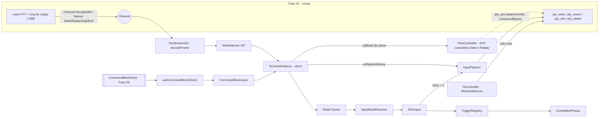
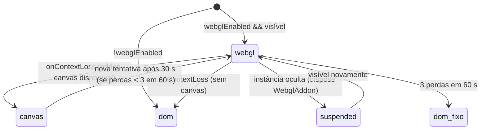
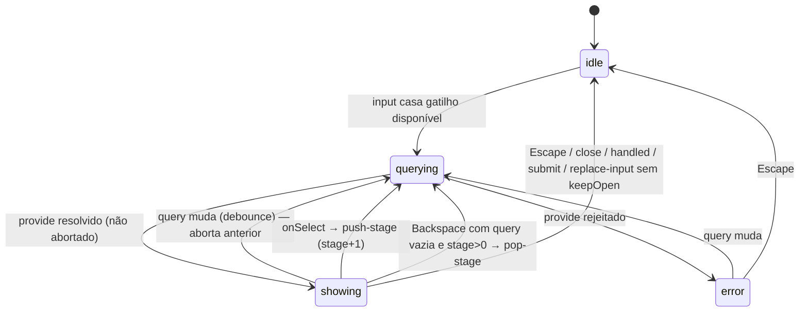
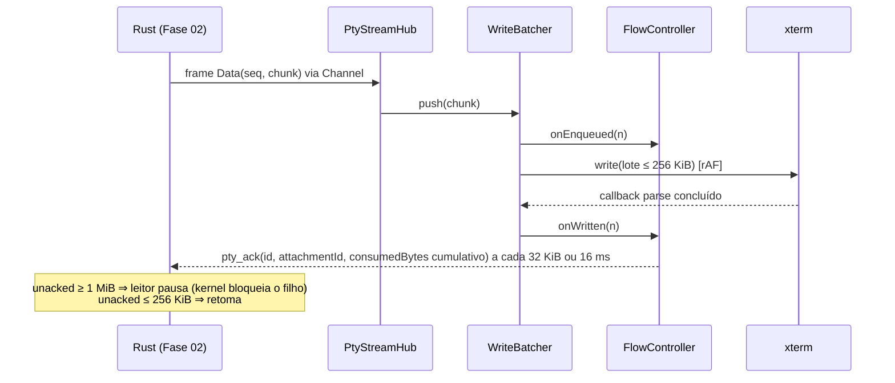

# Fase 04 — Motor de Terminal Híbrido · Especificação Técnica

> Complementa [`instructions.md`](./instructions.md). Contratos globais: [`../README.md`](../README.md) §2.
> Esta fase é **100% frontend**: consome os comandos `pty_*`, os frames binários do `Channel<ArrayBuffer>`
> (`src/ipc/ptyFrame.ts`) e o protocolo de backpressure/reanexação (`pty_ack` / `pty_attach`) da Fase 02,
> e expõe pontos de extensão para as Fases 05, 07, 09, 10, 11, 12, 13, 14 e 15.

---

## 1. Visão Geral da Arquitetura



Camadas:
1. **Stream** (`src/terminal/stream/`): único lugar que conhece `pty_*`.
2. **Engine** (`src/terminal/engine/`): classes TS puras, sem Vue, testáveis com xterm mockado.
3. **Extensões** (`extensions/`, `links/`, `triggers/`, `blocks/`, `input/`, `theme/`): registros globais.
4. **Estado reativo** (`src/stores/terminal.ts`, `src/stores/commandBlocks.ts`): somente dados
   serializáveis. Objetos `Terminal`/addons **nunca** entram em Pinia (Map não reativa + `markRaw`).
5. **Componentes** (`src/components/terminal/`): finos; delegam ao engine via composables.

---

## 2. Módulos Rust

**Nenhum crate de domínio, struct Rust, comando ou evento novo.** São consumidos
`mt-pty::{PtyManager, SpawnSpec, PtySize, PtySummary, AttachInfo, ExitInfo, KillMode}` e os
adaptadores `commands/pty.rs`, `ChannelSink` e `TauriEventListener` definidos na Fase 02.
`OutputTap` pertence ao backend e não deve ser instanciado para renderização: já existe um leitor por PTY.
Única integração Rust opcional nesta fase:
- `src-tauri/capabilities/default.json`: permissão `opener:allow-open-url` com escopo
  `[{ "url": "http://*" }, { "url": "https://*" }]` (se `tauri-plugin-opener` não existir na Fase 01,
  adicioná-lo em `src-tauri/Cargo.toml` e registrar em `lib.rs` — mudança mínima, sem lógica).

## 3. ADR-04-01 — `vue-web-terminal`

**Contexto.** O AGENTS.md cita `vue-web-terminal` como camada de blocos/input rico estilo Warp.
**Avaliação.** A biblioteca implementa um terminal *simulado* (renderiza saídas como elementos DOM a
partir de handlers JS), não um emulador VT: não interpreta sequências ANSI completas, alt-screen,
mouse tracking nem conversa com um PTY. Usá-la como renderer quebraria a fidelidade a TUIs (`vim`,
`htop`, agentes CLI). Usá-la apenas como "barra de input" traria todo o seu runtime (estilos próprios,
gerenciamento de histórico e de comandos) conflitando com UnoCSS/tokens `--max-*` e com o
`TriggerRegistry`.
**Decisão.** Integrar `vue-web-terminal` por um `VueWebTerminalAdapter` isolado na apresentação de
blocos/comandos, preservando xterm como único emulador VT e consumidor do stream do PTY. A biblioteca
entra como dependência da camada híbrida, conforme o escopo solicitado. Antes da implementação principal,
um spike obrigatório valida a versão compatível com Vue 3.6 e as APIs públicas de projeção de mensagens,
eventos de comando e composição visual. Não presumir a existência de modo headless ou props não verificadas.
**Fronteira do adaptador.** Recebe projeções de `CommandBlockFeed` e devolve intenções de entrada para
`InputPipeline`; não abre PTY, não registra outro leitor e não executa callbacks de demonstração da biblioteca.
O feed simulado permite validar essa integração antes da 05. Saídas são texto, nunca HTML externo.
`RichInput`, `CompletionPopup` e ações por bloco continuam contratos do aplicativo; o spike define a
composição pública que mantém um único editor ativo, evita eco duplicado e aplica os tokens Max.
**Critério de decisão.** A entrega exige uma demonstração real do adaptador com a biblioteca instalada.
Se a versão disponível impedir a composição ou conflitar com Vue 3.6, registrar a incompatibilidade
como bloqueio e submeter a alternativa de camada própria como mudança arquitetural explícita; não
retirar silenciosamente a dependência nem considerar o spike aprovado usando apenas um mock.
**Consequências.** O adaptador absorve diferenças de API e estilo, mantendo os contratos públicos do
motor independentes da biblioteca. O suporte anunciado a mensagens ANSI na biblioteca
não equivale a emulação VT completa. Sua API `createTerminal()`/`@exec-cmd` com callbacks
`success`/`failed` modela comandos e mensagens, não o ciclo contínuo de um PTY.

### 3.1. APIs verificadas e política de versões

Consulta em 29/10/2026: o Context7 foi acionado para xterm.js, vue-web-terminal e Tauri, mas retornou
`Monthly quota exceeded`. A validação complementar usa fontes oficiais; não se atribui confirmação
ao Context7. Fixar versões e pares compatíveis no lockfile da implementação, validando os `.d.ts`
instalados: referências `master` abaixo são móveis, não uma versão de dependência.

- [xterm — tipos públicos](https://github.com/xtermjs/xterm.js/blob/master/typings/xterm.d.ts):
  `write(Uint8Array, callback)`, `onBinary`, `paste`, `buffer.onBufferChange`, `modes`,
  `registerMarker`, `registerDecoration`, `linkHandler` (OSC 8).
- [WebGL](https://github.com/xtermjs/xterm.js/blob/master/addons/addon-webgl/typings/addon-webgl.d.ts):
  `WebglAddon`, `onContextLoss`, `dispose` e `clearTextureAtlas`.
- [Busca](https://github.com/xtermjs/xterm.js/blob/master/addons/addon-search/typings/addon-search.d.ts):
  `findNext`/`findPrevious`, `onDidChangeResults` **quando há decorações**, `highlightLimit`.
- [Fit](https://github.com/xtermjs/xterm.js/blob/master/addons/addon-fit/typings/addon-fit.d.ts) e
  [links](https://github.com/xtermjs/xterm.js/blob/master/addons/addon-web-links/typings/addon-web-links.d.ts):
  conferir `proposeDimensions()` e `WebLinksAddon(handler, options)` na versão instalada.
- [vue-web-terminal — README oficial](https://github.com/tzfun/vue-web-terminal): versão 3.x para Vue 3,
  comandos entregues ao desenvolvedor por `exec-cmd`; a composição com blocos/input é validada pelo spike do ADR.
- [Tauri v2 — Channels](https://v2.tauri.app/develop/calling-frontend/#channels): entrega ordenada
  para streaming; listeners retornam `Promise<UnlistenFn>` e exigem cleanup inclusive se a montagem for cancelada.

Carregar `@xterm/xterm/css/xterm.css` uma vez. Não usar `_core` nem opções removidas como
`windowsMode`. Configurar overview ruler somente pela API pública da versão fixada
(`overviewRuler` em versões anteriores; `scrollbar.width` nos tipos atuais consultados).
Unicode11 define largura de pontos de código; não garante sozinho clusters emoji ZWJ. Registrar
limitações por fonte/locale e não prometer alinhamento universal sem addon de graphemes compatível.

---

## 4. IPC Consumido / Criado

### 4.1. Contrato da Fase 02 (consumido — reconciliado com `02/spec.md` §6 e §9–§10)
Tipos compartilhados vêm de `src/types/bindings.ts` (`SpawnSpec`, `PtySize`, `PtySummary`, `ExitInfo`,
`AttachInfo`, `AttachmentId`, `OutputCursor`, `PtyInput`, `KillMode`). Só `src/terminal/stream/ptyClient.ts` importa wrappers de `src/ipc/pty.ts`
e o decoder de `src/ipc/ptyFrame.ts`; tipos podem ser importados por outros módulos sem duplicá-los.
Os documentos da Fase 02 são contratos planejados, não evidência de implementação já disponível.

| Comando (wrapper TS) | Assinatura IPC (não confundir com wrapper) | Uso na Fase 04 |
|----------------------|---------------------------|----------------|
| `pty_spawn` (`ptySpawn`) | `(spec: SpawnSpec) → PtySummary` desanexado | `ptyStreamHub.spawn()`; nenhum Channel no spawn |
| `pty_attach` (`ptyAttach`) | `(ptyId, cursor?: OutputCursor, onOutput: Channel<ArrayBuffer>) → AttachInfo` | único comando com Channel; `Gap?` → `Replay*` → `Data*` |
| `pty_detach` (`ptyDetach`) | `(ptyId, attachmentId) → ()` | fecha explicitamente a geração da assinatura |
| `pty_ack` (`ptyAck`) | `(ptyId, attachmentId, consumedBytes: string) → ()` | total cumulativo de Data + Replay **já parseados**, por conexão |
| `pty_write` (`ptyWrite`) | `(ptyId, input: PtyInput) → ()` | união discriminada text/bytes; preserva entrada binária |
| `pty_resize` (`ptyResize`) | `(ptyId, size: PtySize) → ()` | `FitController` (`{ rows, cols, pixelWidth, pixelHeight }`) |
| `pty_kill` (`ptyKill`) | `(ptyId, mode?: KillMode) → ()` | apenas playground (encerramento real é da Fase 07) |
| `pty_list` (`ptyList`) | `() → PtySummary[]` | reconciliação de status/revisão após perda de evento |
| evento `pty://exit` (`onPtyExit`) | `{ ptyId, owner, exit: ExitInfo, finalSeq, revision }` | estado de processo; banner aguarda drenagem até End/finalSeq |
| evento `pty://cleanup-failed` | `{ ptyId, survivors, revision }` | playground mantém erro de encerramento, sem declarar PTY limpo |

**Não existem** `pty_pause`/`pty_resume`: a pausa do leitor é decidida **no Rust** quando os bytes não
confirmados atingem `high_watermark` (1 MiB) e retomada ao cair a `low_watermark` (256 KiB); após 5 s sem
progresso de ACK com bytes pendentes, o backend expira a geração e entra em `Detached` (Fase 02 §6.3).
Leitura continua para o ring, sem enviar indefinidamente ao Channel antigo. O frontend confirma consumo.

```ts
// Adaptador sobre os wrappers efetivamente especificados em 02/spec.md §10.2:
// ptySpawn(spec) → Promise<PtySummary> (desanexado)
// ptyAttach(ptyId, onFrame, cursor?: OutputCursor) → Promise<{ info, channel }>
// ptyDetach(ptyId, attachmentId) → Promise<void>
// ptyAck(ptyId, attachmentId, consumedBytes: string) → Promise<void>
// Só ptyAttach recebe callback de frames decodificados e cria Channel localmente.
// Frames binários (escritos à mão na Fase 02 — src/ipc/ptyFrame.ts)
// PtyFrameKind.Data   → bytes ao vivo        PtyFrameKind.Replay → bytes do ring de replay
// PtyFrameKind.Gap    → decodeGap(frame) = bytes descartados (replay truncado)
// PtyFrameKind.End    → decodeEnd(frame) = ExitInfo (chegada pode cruzar pty://exit)
import { decodeFrame, decodeGap, decodeEnd, PtyFrameKind } from '@/ipc/ptyFrame';
```
Os bytes são opacos (UTF-8 e escapes podem cruzar frames); são entregues ao `xterm.write(Uint8Array)`, cujo
decodificador é incremental. O `usePtyStream` da Fase 02 (composable Vue) **não** é usado pelo engine, que é
TS puro sem escopo Vue: o `PtyStreamHub` reimplementa a mesma política (fila FIFO, ack após consumo, reanexação
por cursor confirmado `{ nextSeq, byteOffset }`). Regra invariável: **um único consumidor confirma (`ack`) por `PtyId`** — o assinante ativo
do hub; o `usePtyStream` fica disponível para consumidores Vue simples que não usem `HybridTerminal`.

### 4.2. Regras de integração da base 02 final

1. `PtyInput = { kind: 'text'; text: string } | { kind: 'bytes'; bytes: number[] }` é gerado do Rust.
   `encodeBinary(data): Uint8Array` rejeita code units fora de 0–255; não aplicar UTF-8 a onBinary.
2. `OutputCursor` contém `nextSeq` e `byteOffset` como strings decimais; `AttachInfo` contém
   `attachmentId`, `replayFrom`, `liveFrom`, `truncated`. Aritmética em `bigint` local, IPC em string;
   jamais converter u64 para number. Frame v1 tem cabeçalho **24 bytes**, `seq` e `byteOffset` u64 LE.
3. `Data` **e** `Replay` reservam crédito. ACK informa total cumulativo consumido desde esse attach,
   não delta nem offset global; repetido/menor é no-op. `Gap`/`End` não entram nessa soma.
4. `pty_detach` recebe `attachmentId`; detach antigo não derruba conexão nova. Desmontar apenas o host
   preserva stream; dispose definitivo desanexa explicitamente, independentemente de GC do Channel.
5. `pty.attachment_stale` invalida somente geração antiga. Repetir ACK cumulativo é seguro na mesma
   geração; manter um request em voo e coalescer o valor mais recente. `pty.ack_invalid` é falha de
   protocolo, não caso para retry cego. Callback atrasado nunca libera crédito da geração atual.
6. `ErrorHandlingMode::Result` da 01 gera `{ status: 'ok', data } | { status: 'error', error }`.
   Wrappers da 02 usam `call(command, factory)` ou alias central `unwrap(promise, command?)` de
   `src/ipc/core.ts`; engine consome `Promise<T>` pós-unwrap. Rejeições de infraestrutura continuam
   `unknown`, normalizadas pelo core; não forçar cast para MtError nem desempacotar Result duas vezes.

Esses contratos permitem implementar a 04 somente sobre **02/01**, sem parser 05 ou abas 07.

### 4.3. Comandos/eventos criados
- **Comandos Tauri:** nenhum.
- **Eventos globais:** nenhum. Eventos internos do frontend são expostos por callbacks/`Disposable`.

## 5. Tabelas SQLite

**Nenhuma.** Histórico local do `RichInput` é em memória por instância (persistência de comandos é
Fase 05/07 via Fase 03). Preferências de terminal ficam em memória com defaults (persistência: Fase 10).

---

## 6. Contratos TypeScript (`src/types/terminal.ts`)

Tipos exclusivos do frontend (não espelham structs Rust; ids vêm de `bindings.ts`).

```ts
import type { CommandBlockId, ExitInfo, OutputCursor, PaneId, ProjectId, PtyId } from './bindings';

export interface Disposable { dispose(): void }

export type RendererKind = 'webgl' | 'canvas' | 'dom';
export type InputMode = 'rich' | 'passthrough';
export type MouseTrackingMode = 'none' | 'x10' | 'vt200' | 'drag' | 'any';

export interface TerminalPreferences {
    fontFamily: string;          // default: 'JetBrainsMono Nerd Font, monospace'
    fontSize: number;            // 13
    lineHeight: number;          // 1.15
    letterSpacing: number;       // 0
    scrollback: number;          // 10000
    cursorStyle: 'block' | 'bar' | 'underline';
    cursorBlink: boolean;
    webglEnabled: boolean;       // true
    richInputEnabled: boolean;   // true
    macOptionIsMeta: false;      // fixo: Linux
}

export interface FlowConfig {
    ackThresholdBytes: number;   // 32 * 1024 — confirma ao acumular (igual ao usePtyStream da Fase 02)
    ackIntervalMs: number;       // 16 — ou a cada intervalo, o que vier primeiro (nunca antes do consumo)
    pausedHintBytes: number;     // 1024 * 1024 — espelha high_watermark da Fase 02 (apenas indicador de UI)
    frameBudgetBytes: number;    // 256 * 1024 por frame de render
}

export interface TerminalModes {
    altScreen: boolean;
    mouseTracking: MouseTrackingMode;
    bracketedPaste: boolean;
    applicationCursorKeys: boolean;
}

export interface TerminalInstanceState {
    paneId: PaneId;
    ptyId: PtyId;
    cols: number;
    rows: number;
    renderer: RendererKind;
    modes: TerminalModes;
    inputMode: InputMode;                 // resultado do InputModeResolver
    inputModeOverride: InputMode | null;  // escolha manual do usuário
    title: string;                        // OSC 0/2, truncado a 256 chars
    visible: boolean;
    focused: boolean;
    flow: { paused: boolean; pendingBytes: number; droppedBytes: string; cursor: OutputCursor | null }; // u64 em decimal
    search: { open: boolean; query: string; resultIndex: number; resultCount: number };
    exit: ExitInfo | null;                // de bindings.ts (Fase 02): code, signal, signalName, reason, atMs
    themeUi: TerminalTheme['ui'];         // cores locais do painel; viram variáveis CSS em `.hybrid-terminal`
}

// ---------- Tema (preenchido pela Fase 10) ----------
export interface TerminalTheme {
    id: string;
    name: string;
    source: 'builtin' | 'tabby' | 'custom';
    colors: {
        foreground: string; background: string; cursor: string; cursorAccent: string;
        selectionBackground: string; selectionForeground?: string; selectionInactiveBackground?: string;
        ansi: [string, string, string, string, string, string, string, string,   // 0–7
               string, string, string, string, string, string, string, string];  // 8–15
    };
    ui: { blockBackground: string; blockBorder: string; blockHeaderBackground: string; richInputBackground: string; richInputBorder: string };
}
export interface TerminalThemeProvider { getActiveTheme(): TerminalTheme; onChange(cb: (t: TerminalTheme) => void): Disposable }

// ---------- Contexto compartilhado com extensões ----------
export interface TerminalContext {
    paneId: PaneId;
    ptyId: PtyId;
    projectId: ProjectId | null;   // preenchido a partir da Fase 06/07 via TerminalContextProvider
    cwd: string | null;            // preenchido pela Fase 05 (OSC 7/133) quando disponível
    extra: Readonly<Record<string, unknown>>; // fases futuras (ex.: stack 'laravel' pela Fase 14)
}
export type TerminalContextProvider = (base: Pick<TerminalContext, 'paneId' | 'ptyId'>) => Partial<TerminalContext>;

// ---------- Extensões ----------
export interface TerminalExtension {
    id: string;
    activate(instance: TerminalInstanceHandle): Disposable | void;
}
/** Visão restrita da instância exposta a extensões (sem acesso ao pipeline interno). */
export interface TerminalInstanceHandle {
    readonly paneId: PaneId;
    readonly ptyId: PtyId;
    readonly xterm: import('@xterm/xterm').Terminal; // permite parser.registerOscHandler, decorations
    sendInput(text: string): Promise<void>;        // envia texto ao PTY (passa pelo InputPipeline)
    getContext(): TerminalContext;
}

// ---------- Links ----------
export interface TerminalLinkHandler {
    id: string;
    priority: number;                                  // maior primeiro
    /** regex aplicada pelo addon-web-links ou ILinkProvider próprio (Fase 09 para caminho:linha) */
    match: RegExp;
    accepts(uri: string): boolean;
    activate(event: MouseEvent, uri: string, ctx: TerminalContext): void | Promise<void>;
}

// ---------- Modo de input ----------
export interface InputModeHint { mode: InputMode; priority: number; reason: string }
export type InputModeHintProvider = (ctx: TerminalContext, modes: TerminalModes) => InputModeHint | null;

// ---------- Gatilhos / autocompletar ----------
export interface CompletionItem {
    id: string;
    label: string;                 // texto principal (pt-BR quando for UI)
    description?: string;
    detail?: string;               // texto à direita (ex.: atalho, escopo 'Global')
    icon?: string;                 // nome Iconify para MaxIcon
    section?: string;              // id da seção
    kind: 'value' | 'action';      // 'action' = ex.: "Criar comando"
    pinned?: 'bottom';             // fixado ao final independentemente do filtro
    disabled?: boolean;
    payload?: unknown;             // opaco para a Fase 04
}
export interface CompletionSection { id: string; label: string; order: number }
export interface CompletionResult {
    items: CompletionItem[];
    sections?: CompletionSection[];
    emptyMessage?: string;         // default: 'Nenhum resultado'
    stageLabel?: string;           // breadcrumb da etapa (ex.: 'Harness › Modelo')
    /** true ⇒ o provider recusa o texto apesar do prefixo casar (ex.: `/usr/bin/env`, `> saida.txt`):
     *  a sessão volta a `idle` sem renderizar popup e `Enter` envia o texto literal ao shell. */
    passthrough?: boolean;
    /** ao resolver, a sessão chama `provide` novamente com a mesma query (ex.: catálogo assíncrono carregado).
     *  Evita o timeout de 5 s em carregamentos lentos: o provider responde já com "Carregando…". */
    refreshAfter?: Promise<unknown>;
}
export interface TriggerQuery {
    prefix: string;                // ex.: '>>'
    query: string;                 // texto após o prefixo
    input: string;                 // linha completa
    cursor: number;
    stage: number;                 // 0 = primeira etapa
    stageState: unknown;           // estado acumulado das etapas (definido pelo gatilho)
}
export type TriggerSelectOutcome =
    | { kind: 'replace-input'; text: string; cursor?: number; keepOpen?: boolean }
    | { kind: 'submit'; text: string }                     // envia ao PTY como comando
    | { kind: 'push-stage'; stageState: unknown; initialQuery?: string }
    | { kind: 'handled' }                                  // gatilho tratou (ex.: abriu modal)
    | { kind: 'close' };
export interface TriggerDefinition {
    id: string;                    // 'ai.nl', 'artisan', 'groups', 'shortcuts'
    prefix: string;                // '@' | '?' | '>' | '>>' | '/' (qualquer string não vazia sem espaço)
    label: string;                 // exibido no cabeçalho do popup
    debounceMs?: number;           // default 80
    isAvailable(ctx: TerminalContext): boolean | Promise<boolean>;
    provide(q: TriggerQuery, ctx: TerminalContext, signal: AbortSignal): CompletionResult | Promise<CompletionResult>;
    onSelect(item: CompletionItem, q: TriggerQuery, ctx: TerminalContext): TriggerSelectOutcome | Promise<TriggerSelectOutcome>;
    onSubmitWithoutSelection?(q: TriggerQuery, ctx: TerminalContext): TriggerSelectOutcome | Promise<TriggerSelectOutcome>;
}

// ---------- Blocos de comando (preenchidos pela Fase 05) ----------
export type CommandBlockStatus = 'running' | 'success' | 'error' | 'aborted';
export interface CommandBlockModel {
    id: CommandBlockId;
    paneId: PaneId;
    command: string;               // texto bruto para exibição local; sanitização apenas ao persistir (Fase 03)
    cwd: string | null;
    startedAt: number;             // epoch ms
    finishedAt: number | null;
    exitCode: number | null;
    status: CommandBlockStatus;
    /** Índices no buffer normal no momento do evento; não são IDs estáveis após trim/reflow. */
    promptLine: number;
    outputStartLine: number | null;
    outputEndLine: number | null;
    meta: Readonly<Record<string, unknown>>; // ex.: resumo de diagnóstico (Fase 12)
}
export interface CommandBlockFeed {
    /** Fase 05 chama na ordem: begin → (output) → end. `line` omitido = cursor atual. */
    begin(paneId: PaneId, init: { id: CommandBlockId; command: string; cwd: string | null; startedAt: number; line?: number }): void;
    markOutputStart(paneId: PaneId, id: CommandBlockId, line?: number): void;
    end(paneId: PaneId, id: CommandBlockId, result: { exitCode: number | null; finishedAt: number; line?: number }): void;
    patchMeta(paneId: PaneId, id: CommandBlockId, meta: Record<string, unknown>): void;
    clear(paneId: PaneId): void;   // reset explícito de sessão; não inferir pelo texto do comando `clear`
}
export interface BlockAction {
    id: string;                    // 'copy-command', 'inspect' (Fase 11), 'diagnose' (Fase 12)
    label: string;                 // pt-BR
    icon: string;
    order: number;
    when(block: CommandBlockModel): boolean;
    run(block: CommandBlockModel, ctx: TerminalContext): void | Promise<void>;
}
```

---

## 7. Engine (`src/terminal/engine/`)

### 7.1. `TerminalInstance`
```ts
class TerminalInstance implements TerminalInstanceHandle {
    constructor(opts: { paneId: PaneId; ptyId: PtyId; prefs: TerminalPreferences; theme: TerminalTheme; flow: FlowConfig });
    attach(host: HTMLElement): void;   // 1ª vez: xterm.open(host-interno); depois: move o elemento interno
    detach(): void;                    // remove do DOM, mantém buffer; libera WebGL (rendererManager.suspend)
    setVisible(v: boolean): void;
    focus(): void;
    applyTheme(t: TerminalTheme): void;
    applyPreferences(p: Partial<TerminalPreferences>): void;
    paste(text: string): void;         // usa xterm.paste → respeita bracketed paste
    dispose(): void;                   // dispõe addons, extensões, assinaturas do hub; idempotente
}
```
Opções xterm fixas: `allowProposedApi: true` (APIs propostas da versão fixada), `allowTransparency: false`,
`scrollback: prefs.scrollback`, `convertEol: false`, `rightClickSelectsWord: true`,
`macOptionIsMeta: false`, `minimumContrastRatio: 1`, `drawBoldTextInBrightColors: true`,
overview ruler de 8 px conforme §3.1. Addons carregados na ordem: `Unicode11Addon` (+
`unicode.activeVersion = '11'`) → `FitAddon` → `SearchAddon({ highlightLimit: 2000 })` →
`WebLinksAddon(handler, { urlRegex })` → renderer (`rendererManager`) → extensões registradas.
Chamar `open` uma vez por instância no mesmo documento, com host mensurável, antes de carregar WebGL.
O renderer e as decorações nunca chamam `pty_write`, e o input nunca chama `xterm.write` para eco local.
O eco vem exclusivamente do PTY. Extensões recebem xterm para APIs públicas de observação/parser,
mas não podem cadastrar outro encaminhamento `onData`, outro stream, nem consumir sequências VT
existentes: handlers observadores retornam `false` para preservar o comportamento nativo.

### 7.2. `WriteBatcher`
- `push(frame: { seq: bigint; byteOffset: bigint; bytes: Uint8Array })`: guarda bytes e fronteiras de frame;
  Data e Replay liberam crédito igual ao payload parseado. Acumula `queuedBytes += len`; agenda flush se
  não agendado. Visível → `requestAnimationFrame`; oculto (`document.hidden` ou `visible=false`) →
  `setTimeout(flush, 16)` (rAF é suspenso em páginas ocultas e acumularia backlog).
- `flush()`: concatena até `frameBudgetBytes` em um único `Uint8Array`; pode dividir UTF-8/CSI/OSC
  porque o parser incremental do xterm preserva o estado entre chamadas. Não criar `TextDecoder`
  por chunk, nem remover ANSI, normalizar CR/LF ou reconstruir bytes a partir de texto.
- No máximo **um write em voo**; agendar o próximo após callback de parse e oportunidade de render.
  Concatenar frames inteiros até 256 KiB (máximo de um frame da base); não dividir um frame entre
  lotes, para preservar fronteira de recuperação. UTF-8 pode cruzar frames sem problema.
  Cursor confirmado só avança após parse: `nextSeq = seq + 1n`, `byteOffset = offset + payload.length`,
  ambos convertidos em decimal. `onWriteParsed` não substitui callback por lote para ACK.
- `pendingBytes` e crédito consumido contam Data e Replay (§4.2).
  Fila + write em voo limitados à janela de 1 MiB, com metadados de controle limitados separadamente;
  violação interrompe a conexão com erro visível, sem descartar silenciosamente bytes ao vivo.

### 7.3. `FlowController` (confirmação de consumo → backpressure no Rust)
```ts
interface AckSink { ack(consumedBytes: string): Promise<void> } // captura PtyId + AttachmentId
class FlowController {
    constructor(cfg: FlowConfig, sink: AckSink, onState: (s: { paused: boolean; pendingBytes: number }) => void);
    onEnqueued(n: number): void;   // pending += n (bytes recebidos do Channel, ainda não parseados)
    onWritten(n: number): void;    // pending -= n; consumedTotal += BigInt(n); Data e Replay
    tick(): void;                  // após 16 ms com consumo ainda não confirmado → flushAck()
    flushAck(): void;              // sink.ack(consumedTotal.toString()); nunca zera total da geração
    reset(): void;                 // só ao trocar AttachmentId: total da nova conexão começa em zero
}
```
- O backend (Fase 02) pausa a leitura quando `unacked >= high_watermark` (1 MiB) e retoma em
  `<= low_watermark` (256 KiB). Como o ack só sai **após** o callback de `xterm.write`, a pressão do parser
  chega ao processo filho via buffer do kernel — sem comando de pausa explícito.
- `paused` (indicador de UI) é **estimado** no frontend: `pending + ackEmTrânsito >= pausedHintBytes`; não é
  fonte de verdade, apenas alimenta o indicador do playground e `flow.paused`.
- `pendingBytes` = bytes recebidos do Channel ainda não processados pelo parser do xterm.
- `Replay` e `Data` geram ACK cumulativo após parse; `Gap`/`End` não geram crédito.
  Flush ao consumir mais 32 KiB desde último envio ou após 16 ms, serializado; um ACK repetido na
  mesma geração é idempotente. Não enviar ACK antes de conhecer `AttachInfo.attachmentId`.
- Instância oculta continua parseando via `setTimeout` e confirmando. Suspensão do WebView/SO ainda pode
  ultrapassar 5 s: ao retomar, usar attach com barreira de geração e cursor confirmado para recuperar
  replay ou exibir `Gap`. Timers não são garantia contra suspensão do processo.
- Atualização reativa do estado (`useTerminalStore`) é **throttled** a 250 ms para não reagir por chunk.

### 7.4. `PtyStreamHub` (`src/terminal/stream/ptyStreamHub.ts`)
```ts
interface PtySink {
    onData(frame: { seq: bigint; byteOffset: bigint; bytes: Uint8Array }): Promise<void>; // resolve após parse
    onGap(droppedBytes: bigint): void;          // replay truncado
    onExit(exit: ExitInfo): void;               // após drenar Data/Replay anteriores; idempotente
}
const ptyStreamHub: {
    spawn(spec: SpawnSpec): Promise<PtySummary>;           // ptySpawn desanexado; sem Channel nem ACK
    subscribe(ptyId: PtyId, sink: PtySink): Promise<Disposable>; // wrapper ptyAttach(id, onFrame, cursor)
    release(ptyId: PtyId): void;                           // descarta rota após exit + dispose da view
};
```
Regras:
- **Spawn desanexado:** o ring de 1 MiB cobre o intervalo entre `ptySpawn(spec)` e a montagem da view.
  Não criar Channel, descartador ou ACK no spawn. Primeiro `subscribe` usa cursor undefined (origem),
  recebe todo replay disponível e Gap se bytes anteriores já foram expulsos do ring.
- `subscribe` chama `ptyAttach(ptyId, onFrame, cursor)`; backend envia `Gap?` → `Replay*` → `Data*`
  sob o mesmo crédito e retorna `AttachInfo`. Instalar rota/token local antes do wrapper; callbacks
  podem chegar antes de sua Promise resolver, ficando em fila limitada até attachmentId ser conhecido.
  Manter cursor recebido separado do confirmado pelo parse. Reanexar a **mesma instância** só depois
  de concluir seu write em voo, usando cursor confirmado; descartam-se frames ainda não parseados
  da geração anterior, recuperados por replay. Se callback não concluir, destruir o renderer antes
  de criar outro com replay da origem. Cancelar Promise não desfaz bytes já escritos no xterm.
  Instância nova nunca usa cursor de buffer destruído; callbacks antigos não atualizam a nova geração.
- Um único assinante ativo por `PtyId` (o `TerminalInstance`); segundo `subscribe` lança
  `MtTerminalError('stream.already_subscribed')` em DEV e PROD. `dispose` invalida token imediatamente,
  cancela fila/timers e chama `ptyDetach(ptyId, attachmentId)` com erro tratado. Se attach resolver
  após dispose, desanexar o attachmentId retornado; nunca confiar no GC para desconectar Rust.
- `Gap` ⇒ banner externo `[MaxTerminal: N bytes descartados antes da exibição]`, soma decimal em
  `flow.droppedBytes`; nunca injetar aviso dentro de UTF-8/OSC em andamento ou do framebuffer da TUI.
  Avançar cursor à fronteira `seq/byteOffset` indicada pelo Gap; depois exigir continuidade de seq e
  offset entre Data/Replay. Duplicata inesperada ou salto sem Gap é erro de protocolo, não byte a
  confirmar novamente. Se houve perda entre bytes de uma sequência, exigir reset explícito antes
  de continuar no mesmo parser; conteúdo recuperado continua identificado como parcial.
  Replay de um ring truncado não é snapshot VT: não reconstrói cursor/modos/alt-screen exatamente.
  Após perda, marcar visualização como parcial; reset explícito do emulador pode iniciar novo replay,
  com aviso e solicitação de redraw ao aplicativo, sem prometer restauração perfeita.
- `End` entra na mesma FIFO e só publica saída após callbacks anteriores e flush final de ACK.
  `pty://exit` bloqueia novas entradas, mas não antecipa o descarte da fila. Se End não chegar,
  reconciliar pelo tombstone via attach; não presumir ordenação entre eventos globais e Channel.
- `decodeFrame` lançando `PtyFrameError` (versão desconhecida/tamanho inconsistente) ⇒ log `error`, frame
  interrompe o stream, contador `stream.frame_errors` no playground e recuperação explícita;
  não seguir como se o parser tivesse recebido bytes íntegros.

### 7.5. `InputPipeline`
- `xterm.onData(s)` enfileira `{ kind: 'text', text: s }`; `onBinary(s)` usa `encodeBinary(s)`
  e envia `{ kind: 'bytes', bytes: Array.from(bytes) }`, preservando 0–255 e rejeitando code units maiores.
  Não concatenar itens binários e texto antes de codificar.
  Um único listener de cada tipo por instância; `onKey` observa, nunca faz uma segunda escrita.
  Flush em `queueMicrotask`, fila FIFO única serializada para teclado, colagem, respostas VT e RichInput.
- Escritas com mais de 64 KiB **codificados** são fatiadas em blocos de até 64 KiB (sem partir pares substitutos UTF-16) enviados
  sequencialmente (await). `pty.write_queue_full` ⇒ espera 10 ms e tenta de novo (até 50 tentativas) antes de
  parar a fila com aviso e quantidade aceita; não repetir o comando inteiro nem enviar sufixo incompleto.
  Retentar só `write_queue_full` porque a base garante rejeição atômica; falhas ambíguas não são retentadas.
- `paste(text)` chama `xterm.paste(text)` e deixa **apenas** `onData` encaminhar ao PTY; não enviar
  também o retorno pelo pipeline. No RichInput, colar altera o rascunho, sem enviar bytes até submit.
- `sendLine(text)` é uma operação atômica da fila: usa o caminho de paste do xterm para normalização
  e bracketed paste, seguido por um único `\r` de execução. Não adicionar envelopes manualmente
  além dos gerados por `paste`. `Enter` com `isComposing` não executa; duplo Enter durante submit é deduplicado.
  Em entrada multilinha sem bracketed paste ativo, avisar que o shell pode executar linhas separadamente.
- Limite da fila de entrada: 1 MiB codificado; rejeitar nova operação inteira ao exceder, mantendo rascunho.
  Enquanto colagem está em voo, permitir cancelar partes ainda não enviadas e enviar Ctrl+C depois da parte
  já aceita, fechando eventual envelope de paste antes do interrupt. Não intercalar teclas no meio do envelope.
- `pty.not_found`/`pty.already_exited` bloqueiam entrada; `ExitInfo` vem de evento/consulta, nunca é inventado.

### 7.6. `RendererManager`

- Instanciação de `WebglAddon` em `try/catch` (WebKitGTK pode lançar sem WebGL2) → fallback imediato.
- `onContextLoss` → `addon.dispose()` → fallback → `xterm.refresh(0, rows - 1)`.
- Caminho obrigatório e independente de pacote opcional: WebGL → DOM nativo. Canvas é otimização
  opcional somente se existir par compatível no lockfile. Um import literal de pacote ausente pode
  falhar no bundler mesmo dentro de `if`: separar implementação opcional por alias de build ou omiti-la.
- Falha no construtor e perda de contexto compartilham cooldown; nunca criar dois addons WebGL simultâneos.
  `dispose` do renderer não recria xterm, não limpa buffer e não reanexa stream. Suspensão libera atlas,
  listeners e timer de retry; renderizadores ocultos usam DOM sem manter contextos GPU.

### 7.7. `FitController`
`ResizeObserver(host)` → debounce **50 ms** (trailing) → `fitAddon.proposeDimensions()`; ignora
`undefined`, `cols < 2`, `rows < 1` ou host oculto → se `(cols, rows)` mudou: `xterm.resize` e
`ptyResize(ptyId, { rows, cols, pixelWidth: 0, pixelHeight: 0 })`; dimensões em pixels só são preenchidas
se houver API pública compatível, nunca `_core`. Limites da Fase 02: `1..=1000`
(valores acima são truncados no frontend); chamadas concorrentes são serializadas (última vence).
Também reage a `applyPreferences` (fonte/tamanho) e a `document.fonts.ready`.
Guardar tamanho desejado separado do confirmado pelo IPC: falha mantém resize pendente mesmo
quando `xterm.cols/rows` já coincidem. Usar trailing + `maxWait` de 100 ms para arraste contínuo.

### 7.8. `ModeTracker`
Fontes: `xterm.buffer.onBufferChange` (`active.type === 'alternate'`), `xterm.modes`
(`mouseTrackingMode`, `bracketedPasteMode`, `applicationCursorKeysMode`) amostrado após cada
`write` concluído (callback do batcher, no máximo 1×/frame) e `xterm.onTitleChange`. Emite
`onModesChange(modes)` somente quando algo muda.

### 7.9. `TerminalInstanceRegistry`
`Map<PaneId, TerminalInstance>` em módulo (não reativo). API: `getOrCreate(opts)`, `get(paneId)`,
`dispose(paneId)`, `forEach`. Garante que trocar de aba/rota **não** recria o xterm. Instâncias são
descartadas apenas por `dispose(paneId)` (chamado pela Fase 07 ao fechar painel) ou no playground.

---

## 8. Registros de Extensão

| Registro | Arquivo | API | Consumidores futuros |
|----------|---------|-----|----------------------|
| Extensões de terminal | `extensions/terminalExtensions.ts` | `registerTerminalExtension(ext): Disposable` — ativa em instâncias existentes e futuras | 05 (OSC 133/7 se parseado no front), 09 (links de arquivo), 13 (detecção de pausa de agente) |
| Links | `links/linkHandlerRegistry.ts` | `registerLinkHandler(h): Disposable` | 09 (`caminho:linha` → editor) |
| Contexto | `extensions/terminalContext.ts` | `registerContextProvider(p): Disposable`; `getContext(paneId)` faz merge na ordem de registro | 05 (cwd), 07 (projectId), 14 (stack) |
| Dicas de modo | `input/inputModeResolver.ts` | `registerInputModeHint(p): Disposable` | 05 (prompt ativo ⇒ `rich`; comando em execução ⇒ `passthrough`), 13 (agente CLI ⇒ `passthrough`) |
| Gatilhos | `triggers/triggerRegistry.ts` | `triggerRegistry.register(def): Disposable` | 12 (`@`, `?`), 14 (`>`, `/`), 15 (`>>`) |
| Ações de bloco | `blocks/blockActionRegistry.ts` | `registerBlockAction(a): Disposable` | 11 ("Inspecionar"), 12 ("Diagnóstico") |
| Tema | `theme/themeService.ts` | `setThemeProvider(p)`; default = Max Navy/Teal | 10 |
| Feed de blocos | `stores/commandBlocks.ts` | `useCommandBlocksStore().feed: CommandBlockFeed` | 05 |

### 8.1. `TriggerRegistry`
```ts
class TriggerRegistry {
    register(def: TriggerDefinition): Disposable; // TriggerConflictError se prefixo já registrado
    list(): readonly TriggerDefinition[];
    /** Match apenas na posição 0 da linha; maior prefixo vence; '\\' + prefixo = literal. */
    match(input: string): { def: TriggerDefinition; query: string } | null;
    onChange(cb: () => void): Disposable;
}
export const triggerRegistry: TriggerRegistry;          // singleton da app
export function createTriggerRegistry(): TriggerRegistry; // testes
```
Validação de `prefix`: não vazio, sem whitespace/controles, até 32 caracteres (limite defensivo,
sem hardcode dos cinco gatilhos conhecidos). IDs e prefixos são únicos. Ordenação interna por
`prefix.length desc`. `isAvailable` falso ⇒ o texto é tratado como entrada comum (ex.: `>` fora de
projeto Laravel vira redirecionamento literal).
Escolher primeiro o maior prefixo **registrado**, depois consultar disponibilidade. Se `>>`
estiver indisponível ou recusar a query, não reinterpretar como `>`; enviar o literal.
`\>`/`\?` apenas suprimem popup: preservar a barra ao enviar ao shell. Para redirecionamento literal
`> arquivo`, usar Escape (que não altera texto), não remover barras implicitamente.
Sem provider, `>`, `>>`, `@`, `?` e `/` são entrada comum. O playground registra fixtures para todos
os cinco, sem chamadas à IA, Artisan, grupos ou atalhos ainda inexistentes.

### 8.2. `CompletionSession` (máquina de estados)

- Ordenação final: itens por `section.order`, mantendo a ordem do provider dentro da seção; itens
  `pinned: 'bottom'` sempre ao final (mesmo com lista vazia — ex.: "Criar grupo de comandos local").
- Filtragem é responsabilidade do provider (cada fase sabe seu ranking); a Fase 04 oferece o utilitário
  `fuzzyFilter(items, query, key = 'label')` em `triggers/fuzzy.ts` (subsequência + bônus de início de palavra).
- Timeout de provider: 5 s → estado `error` com mensagem "Tempo esgotado ao carregar sugestões".
- `CompletionResult.passthrough === true` ⇒ transição `querying → idle` sem popup; o texto segue como entrada
  comum até a próxima mudança de query.
- `CompletionResult.refreshAfter` ⇒ ao resolver (e se a query não mudou e a sessão não foi abortada), nova
  chamada a `provide` com a mesma `TriggerQuery`; rejeição é ignorada (mantém o resultado atual).
- **Supressão pós-Escape:** `Escape` com popup aberto suprime o gatilho **naquele painel** até a linha ficar
  vazia ou o prefixo ser apagado (permite digitar `> arquivo` literal sem o popup reabrir a cada tecla).
- Cada consulta carrega `{ paneId, generation, triggerId, stage, input, cursor }`. A geração muda
  em qualquer alteração de contexto, modo, prefixo, cancelamento, remoção do provider ou dispose.
  Abortar `provide` e ignorar respostas antigas mesmo se o provider desrespeitar `AbortSignal`;
  aplicar a mesma checagem a `isAvailable`, `refreshAfter` e `onSelect` assíncronos.
- `onSelect` é single-flight: botão/Enter ficam desabilitados até concluir; efeitos do provider já
  iniciados não podem ser desfeitos pelo motor, mas resultados tardios não submetem entrada em outro PTY.
  Seleção nunca dispara também `onSubmitWithoutSelection`; ações `disabled` são puladas no teclado.
- Erros e timeouts não submetem automaticamente texto. Em modo passthrough a sessão é cancelada;
  rascunho e posição do cursor permanecem no painel para eventual retorno ao modo rico.

---

## 9. Stores Pinia

### 9.1. `useTerminalStore` (`src/stores/terminal.ts`)
```ts
state: {
    instances: Record<PaneId, TerminalInstanceState>;
    preferences: TerminalPreferences;
    flowConfig: FlowConfig;
    activePaneId: PaneId | null;
}
getters: {
    instance: (paneId) => TerminalInstanceState | undefined;
    isPassthrough: (paneId) => boolean;          // inputMode === 'passthrough'
    activeInstance: TerminalInstanceState | null;
    webglCount: number;                          // instâncias com renderer 'webgl'
}
actions: {
    register(paneId, ptyId): void;               // cria estado inicial; chamado por useTerminal
    unregister(paneId): void;
    patch(paneId, partial: Partial<TerminalInstanceState>): void; // usado só pelo engine
    setInputModeOverride(paneId, mode: InputMode | null): void;
    toggleInputMode(paneId): void;
    setPreferences(p: Partial<TerminalPreferences>): void;        // propaga a todas as instâncias
    openSearch(paneId): void; closeSearch(paneId): void;
    setActive(paneId | null): void;
}
```
Sem `options.save` do max-pinia (nada persistido nesta fase).

### 9.2. `useCommandBlocksStore` (`src/stores/commandBlocks.ts`)
```ts
state: { byPane: Record<PaneId, { order: CommandBlockId[]; blocks: Record<CommandBlockId, CommandBlockModel> }>; maxBlocksPerPane: number /* 500 */ }
getters: { blocksOf: (paneId) => CommandBlockModel[]; lastBlock: (paneId) => CommandBlockModel | null; runningBlock: (paneId) => CommandBlockModel | null }
actions: { feed: CommandBlockFeed /* implementa begin/markOutputStart/end/patchMeta/clear */; pruneEvicted(paneId, firstValidLine: number): void }
```
- `end` com `exitCode === 0` ⇒ `success`; `!= 0` ⇒ `error`; `null` ⇒ `aborted`.
- `IMarker` é a âncora autoritativa, armazenada fora da Pinia: `marker.line` acompanha trim/reflow e
  `marker.onDispose` remove bloco/decorações. `baseY` é início do viewport no buffer, não contador
  acumulado de linhas descartadas; não usá-lo para inferir eviction. `pruneEvicted` recebe somente
  informação validada pelo registro de markers. Limite de 500 blocos libera os mais antigos.
- **O mapeamento para `TabStatus` não é feito aqui** (é da Fase 05).

### 9.3. Geometria e captura de blocos

- `begin` cria marker com offset `line - (buffer.normal.baseY + buffer.normal.cursorY)`; ausência de
  `line` usa cursor atual. Só criar em buffer normal e para linha ainda retida. `markOutputStart` e
  `end` mantêm markers separados; operações duplicadas por ID são idempotentes, `end` sem `begin`
  é ignorado com diagnóstico, sem fabricar comando.
- Feed deve ser aplicado **na fronteira correta de parse**. Eventos de parser Rust da futura 05
  podem chegar antes/depois de Channel; precisarão de `seq` mais offset ou observação OSC no parser
  xterm, sem bloquear o parser esperando seu próprio callback. A 04 fornece extensões e feed;
  não presume que o cursor atual ainda corresponde a um evento IPC antigo.
- Decorações não reservam linhas na grade: não inserir newlines, alterar row height ou deslocar
  cursor para acomodar cabeçalhos. Usar gutter/overlay compacto com `pointer-events: none` fora
  dos botões; detalhes expansíveis em painel adjacente fora da grade. Popups não capturam mouse TUI.
- `Copiar saída` percorre `buffer.normal.getLine(i).translateToString(...)` entre markers válidos,
  concatena linhas com `isWrapped` sem nova quebra e preserva quebras reais. Copia **texto renderizado
  retido**, sem ANSI, não bytes brutos nem uma transcrição completa após trim. Desabilitar ou informar
  saída parcial se limites forem descartados. Não manter segunda cópia ilimitada de output no store.
- Entrar em alternate-screen oculta apenas blocos e input; não remove markers do buffer normal.
  Sair restaura o mesmo xterm, viewport e blocos ainda retidos. Nenhum segundo emulador é criado.

---

## 10. Componentes Vue (`src/components/terminal/`)

Todos em `<template>` → `<script setup lang="ts">` → `<style lang="scss" scoped>`, tags de abertura em
linha única, textos pt-BR, cores apenas via tokens `--max-*`/`--background-*` ou `TerminalTheme`.

| Componente | Props | Emits | Slots / Notas |
|-----------|-------|-------|---------------|
| `HybridTerminal.vue` | `paneId: PaneId`, `ptyId: PtyId`, `visible?: boolean = true`, `richInput?: boolean = true` | `exit: [ExitInfo]`, `restart-requested: []`, `title-change: [string]`, `focus: []` | slot `block-actions` repassado; compõe os componentes abaixo |
| `TerminalView.vue` | `paneId`, `ptyId`, `visible` | `ready: [TerminalInstanceHandle]`, `exit`, `title-change`, `modes-change: [TerminalModes]` | `role="application"`, `aria-label="Terminal"`; host com `contain: strict` |
| `TerminalSearchBar.vue` | `paneId` | `close: []` | inputs: busca, toggles "Aa", "Palavra", ".*", botões ↑/↓, contador "n de m" / "Sem resultados" |
| `RichInput.vue` | `paneId`, `disabled?: boolean` | `submit: [string]`, `mode-toggle: []` | `role="combobox"`, `aria-expanded`, `aria-controls`, `aria-activedescendant`; textarea autoexpansível (máx. 8 linhas) |
| `CompletionPopup.vue` | `items: CompletionItem[]`, `sections?: CompletionSection[]`, `activeIndex: number`, `loading: boolean`, `error: string \| null`, `title: string`, `stageLabel?: string`, `emptyMessage?: string` | `select: [CompletionItem]`, `hover: [number]` | slot `item` com `{ item, active }`; `role="listbox"`; rolagem mantém ativo visível; virtualização acima de 200 itens |
| `CompletionItem.vue` | `item`, `active`, `id: string` | `select`, `hover` | `role="option"`, `aria-selected`, `aria-disabled` |
| `CommandBlock.vue` | `block: CommandBlockModel`, `entry: VueWebTerminalProjectedEntry`, `actions: BlockAction[]`, `compact?: boolean` | `action: [actionId: string]` | slot `actions` com `{ block }` (após as ações registradas); usa a projeção do adaptador para comando truncado, duração e badge; mantém `block` para ações/metadados |
| `CommandBlockLayer.vue` | `paneId: PaneId`, `getContext: () => TerminalContext`, `onInputIntent: (commandText: string) => Promise<void>` | — | possui a única chamada de `useCommandBlocks` por painel; usa markers da store e cria decorações; monta `CommandBlock` com `block` + `entry` via `Teleport` no elemento da decoração dentro de `.hybrid-terminal`; oculto quando `altScreen` |
| `TerminalExitBanner.vue` | `exit: ExitInfo` | `restart-requested: []` | "Processo encerrado (código X)" ou "Processo encerrado pelo sinal SIGKILL" (`signalName`) + botão "Reiniciar" (ação real na Fase 07) |
| `InputModeToggle.vue` | `paneId` | — | alterna override; tooltip "Input rico" / "Modo direto (raw)" |

Cores do badge de bloco: `running` → `--max-success-500`, `success` → `--max-success-500` (contorno),
`error` → `--max-danger-500`, `aborted` → `--max-warning-500`.

### 10.1. Composables (`src/composables/terminal/`)
- `useTerminal(paneId, ptyId, hostRef, visibleRef)` → `{ handle, state, focus, paste }`: obtém/ cria
  instância no registry, `attach` em `onMounted`, `detach` em `onBeforeUnmount` (sem `dispose`), sincroniza
  `visible` → `setVisible`.
- `useTerminalSearch(paneId)` → `{ query, options, next, prev, close, resultIndex, resultCount }`
  usando `searchAddon.onDidChangeResults`; decorações com `--max-warning-*`/`--max-primary-*`.
  Resolver tokens CSS para cores aceitas (`#RRGGBB` nas decorações), habilitar decorações para receber
  o evento; índice interno 0-based vira `+1` na UI. `resultIndex === -1` com limite excedido não significa
  zero resultados: mostrar "Limite de destaques atingido". Regex inválida mostra erro local sem derrubar terminal.
- `useRichInput(paneId)` → `{ text, cursor, history, onKeydown, submit, completion }`; histórico local
  (máx. 200, sem duplicatas consecutivas).
- `useCompletion(paneId, textRef, cursorRef)` → encapsula `CompletionSession`; expõe
  `{ open, items, sections, activeIndex, loading, error, move(delta), confirm(), cancel() }`.
- `useCommandBlocks(paneId, { getContext, onInputIntent })` → blocos, entradas projetadas pelo `VueWebTerminalAdapter` (`projectedEntries`) + ações filtradas.

### 10.2. Atalhos (`src/terminal/keybindings.ts`)
| Atalho | Ação | Escopo |
|--------|------|--------|
| `Ctrl+Shift+C` / `Ctrl+Shift+V` | copiar seleção / colar | xterm (via `attachCustomKeyEventHandler`) |
| `Ctrl+Shift+F` | abrir busca | painel |
| `Ctrl+Shift+I` | alternar input rico/raw | painel |
| `Shift+arrasto` | seleção mesmo com mouse tracking | nativo do xterm |
| `↑`/`↓` (popup fechado) | histórico local | RichInput |
| `↑`/`↓`, `PageUp/PageDown`, `Home/End`, `Enter`/`Tab`, `Escape` | navegar/selecionar/fechar | CompletionPopup |
| `Ctrl+C` no RichInput vazio | envia `\x03` ao PTY | RichInput |

`Ctrl+C` sem seleção nunca é interceptado pelo xterm (vai ao PTY). Todos os demais atalhos não
listados chegam ao processo.

---

## 11. Fluxos de Dados

### 11.1. Saída (rajada)


### 11.2. Entrada no modo rico
1. Usuário digita em `RichInput`; `useCompletion` testa `triggerRegistry.match(text)`.
2. Sem gatilho: `Enter` ⇒ `inputPipeline.sendLine(text)`; texto entra no histórico; campo limpa.
   Para a Fase 05, o eco do comando aparece normalmente no xterm (o shell imprime o prompt + linha).
3. Com gatilho: popup abre; `Enter` ⇒ `onSelect` ⇒ aplica `TriggerSelectOutcome`; `submit` ⇒ `sendLine`.
4. `Enter` sem item ativo ⇒ `onSubmitWithoutSelection` (se definido; ex.: `?` envia pergunta à IA) senão
   envia o texto literal ao shell.

### 11.3. Resolução de modo
```
altScreen = true     ─┐ ⇒ passthrough
mouseTracking ≠ none ─┤ ⇒ passthrough
override do usuário  ─┤ ⇒ escolha manual (fora das condições acima)
dicas registradas    ─┤ ⇒ maior priority vence (empate: última registrada)
default              ─┘ ⇒ rich (se preferences.richInputEnabled) senão passthrough
```
Override é **limpo** automaticamente quando o alt-screen muda (entrar/sair de TUI), para não prender
o usuário em um modo. Em `passthrough`, o RichInput fica oculto e o foco vai ao xterm; clicar no
xterm em modo rico também foca o xterm (digitação direta é sempre possível).
Preservar rascunho; devolver foco ao input ao sair somente se ele o possuía antes e o painel estiver
ativo, sem roubar foco de busca/modal. TuIs que não usam alt-screen continuam acessíveis pelo toggle
manual; não inferir estado de comando a partir de texto ou de nomes de executáveis nesta fase.

### 11.4. Ciclo de vida
```
HybridTerminal mount → registry.getOrCreate → attach(host mensurável) → instala listeners → hub.subscribe → fit → pty_resize inicial
troca de aba        → visible=false → detach parcial (WebGL suspenso, batcher em setTimeout, acks continuam)
volta               → visible=true  → renderer restaurado → fit → refresh
reload do WebView   → registry vazio → nova instância → hub.subscribe(cursor = undefined) → replay disponível do ring
exit do processo    → bloqueia entrada → drena fila até End → state.exit preenchido → banner; atalhos de UI disponíveis
fechamento (F.07)   → registry.dispose(paneId) → hub.release(ptyId) → store.unregister
```

O playground implementa hoje spawn/close/restart usando **somente** a 02: `PtyOwner` com `tabId: null`
e `paneId` local, sem projeto, SQLite, TabStore ou parser OSC 133. Ao reiniciar, aguardar saída do PTY
antigo, drenar, liberar registry/feed e criar **novo PtyId**. Fechar definitivamente solicita
`pty_kill` e observa conclusão; `dispose` de Vue/renderer não é sinônimo de kill.
Erro de spawn/attach desfaz recursos parciais. Desmontagem durante Promise de assinatura chama cleanup
assim que ela resolver; não deixa listeners tardios vivos. `getOrCreate` rejeita reutilizar `paneId`
com `ptyId` diferente até encerramento explícito. `dispose` cancela timers/rAF/observers, consultas,
decorações, handlers e addons; unlisten global é removido quando o último consumidor sai.

---

## 12. Tratamento de Erros

Erros do frontend usam `MtTerminalError extends Error { code: string; details?: unknown }` com mensagem
pt-BR; erros vindos do IPC mantêm o `MtError` (`{ code, message, details }`) e são exibidos via
`Toast.show({ title, severity })` do `@maxvue/max-components-ui` somente quando acionáveis.

| Situação | Código | Comportamento |
|----------|--------|---------------|
| `pty_write`/`pty_resize` em PTY encerrado | `pty.already_exited` / `pty.not_found` (Fase 02) | bloqueia entrada, reconcilia ExitInfo sem inventar código |
| Fila de escrita cheia | `pty.write_queue_full` (Fase 02) | retry 10 ms (até 50×); depois interrompe fila com aviso externo |
| Falha de `pty_resize` transitória | qualquer outro | log `warn`; nova tentativa no próximo resize |
| WebGL indisponível/perda de contexto | `terminal.renderer_fallback` | fallback silencioso; badge no playground; log `info` |
| Assinatura duplicada no hub | `stream.already_subscribed` | rejeita em DEV e PROD; não substitui consumidor ativo |
| Replay truncado (frame `Gap`) | `stream.replay_gap` | banner externo com bytes descartados, visualização parcial |
| Frame binário inválido | `stream.frame_invalid` (`PtyFrameError`) | interrompe stream, diagnóstico sem payload e recuperação explícita |
| Provider de gatilho rejeita/expira | `trigger.provider_failed` / `trigger.timeout` | estado `error` no popup ("Falha ao carregar sugestões"), sem toast |
| Conflito de prefixo | `trigger.conflict` | `TriggerConflictError` no `register` (detectado em testes) |
| Ação de bloco lança | `block_action.failed` | toast `severity: 'error'` com a mensagem pt-BR |
| Link recusado (esquema fora da allowlist) | `link.rejected` | ignorado; nenhum handler ativado |
| Extensão lança em `activate` | `extension.activate_failed` | isola: log `error`, demais extensões seguem |

---

## 13. Performance

- **Orçamentos:** lote até 256 KiB, um write em voo, yield entre lotes; p95 de trabalho JS do batcher
  abaixo de 8 ms no hardware de referência. Medir `performance.now` e intervalos rAF; usar
  `PerformanceObserver` `longtask` apenas quando suportado no WebKitGTK. Com 256 KiB/rAF a 60 Hz o
  teto teórico é 15 MiB/s: não exigir 30 MB/s desse desenho. Registrar throughput real e versões
  de hardware/driver/WebKit; bloquear entrega por perda, crescimento ilimitado ou input > 500 ms,
  não por meta de throughput incompatível com o orçamento.
- Nada de reatividade por chunk: store atualizado no máximo a cada 250 ms (fluxo) e 1×/frame (modos).
- `markRaw` em qualquer referência a xterm/addons que transite por componentes.
- `ResizeObserver` debounced (50 ms) e resize deduplicado.
- WebGL somente em instâncias visíveis (limite de contextos do WebKitGTK).
- `CommandBlockLayer`: decorações só para blocos no viewport ± 1 tela; reposicionamento via
  `onRender` do xterm (sem polling); `CompletionPopup` virtualizado acima de 200 itens.
- Concatenação de chunks com um único `Uint8Array` pré-alocado por flush (sem `Array.concat`).
- Input: coalescência por microtask, fatias de 64 KiB para colagens grandes.

## 14. Segurança

- **Links:** handler padrão aceita apenas `http:`/`https:` validados por `new URL()`; ativação exige
  `Ctrl+Clique`; abertura via `@tauri-apps/plugin-opener` com capability restrita. `file:`, `javascript:`,
  `data:` e esquemas customizados são ignorados (Fase 09 registra handler próprio para caminhos).
  Aplicar a mesma política a `Terminal.options.linkHandler` para OSC 8: addon-web-links sozinho
  não controla hyperlinks enviados por escapes. Mostrar destino real no hover como texto.
- **OSC 52 (clipboard remoto):** desabilitado (nenhum addon de clipboard carregado); processos não podem
  ler/escrever a área de transferência.
- **Títulos (OSC 0/2) e textos de blocos:** sempre interpolados como texto (`{{ }}`), nunca `v-html`;
  truncados (título 256, comando exibido 4096 caracteres).
- **Colar:** RichInput só modifica rascunho; xterm direto usa a semântica do aplicativo. Sem bracketed
  paste ativo, colar quebras pode executar comandos no shell; não prometer proteção que não existe.
- **Sanitização:** esta fase não persiste nada; quem gravar comando/scrollback (Fases 05/07) deve passar
  por `mt_db::sanitizer::sanitize()` (README §2.5). "Copiar saída" copia o texto renderizado do buffer local
  (ação do próprio usuário), conforme limites de texto renderizado em §9.3.
- **CSP:** nenhum `eval`/`new Function`; addons carregados de pacotes locais, sem CDN.

---

## 15. Estratégia de Testes

### 15.1. Unitários (Vitest, `environment: 'jsdom'`)
- xterm mockado em `tests/terminal/mocks/xtermMock.ts` (`write(data, cb)` com callback assíncrono
  controlável, `modes`, `buffer.onBufferChange`, `onData`, `registerMarker`, `registerDecoration`).
- `vi.useFakeTimers()` + stub de `requestAnimationFrame` para `writeBatcher`, `fitController`,
  `completionSession` (debounce/timeout).
- `ptyClient` mockado com `vi.mock('@/terminal/stream/ptyClient')`; frames construídos com um helper
  `encodeTestFrame(kind, seq, payload)` espelhando o layout v1 da Fase 02 §6.1; `ResizeObserver` stub.
- Casos-chave de contrato com a Fase 02:
  - `flowController.spec.ts`: `ack` só após `onWritten` (nunca no `onEnqueued`); 1 ack ao atingir 32 KiB;
    ack por intervalo de 16 ms com resto > 0; acks cumulativos serializados de Replay + Data; `reset()`
    somente ao trocar attachmentId; repetir total não duplica consumo no backend.
   - `ptyStreamHub.spec.ts`: spawn desanexado sem Channel/ACK; `subscribe`
     chama wrapper `ptyAttach(id, onFrame, cursor)` com undefined na 1ª vez e cursor confirmado
     ao recuperar a mesma instância; detach antigo não encerra geração nova; `Gap` mostra banner sem bytes sintéticos;
    `Replay` precede `Data` na entrega; `End` chama `onExit` após drenar uma vez
    (mesmo com `pty://exit` duplicado).
   - `inputPipeline.spec.ts`: `onBinary` preserva 0x80/0xff com `PtyInput.kind = 'bytes'`;
     colagem > 64 KiB vira N writes sequenciais; `write_queue_full` retenta só o item rejeitado;
     não duplica eco/submit/paste, IME não executa e fila excedida preserva rascunho.
- Bytes UTF-8 de 2/3/4 bytes divididos em todos os offsets, CSI/OSC partidos, CR sem LF,
  alternate-screen dentro de lote, resize/reflow de markers e busca durante rajada.
- `End` e evento global em ordens de chegada invertidas; dispose durante attach; callback antigo
  após nova geração; replay parcial sem promessa de restauração VT; seq acima de `MAX_SAFE_INTEGER`.
- Sem importar módulos 05/07, montar playground, spawn shell real, trocar duas instâncias,
  input rico/direto, gatilhos fictícios dos cinco prefixos e feed simulado; contar **um leitor Rust,
  um stream ativo, um encaminhamento de teclado e um write de saída por lote**.
- Arquivos: `writeBatcher.spec.ts`, `flowController.spec.ts`, `ptyStreamHub.spec.ts`,
  `fitController.spec.ts`, `rendererManager.spec.ts`, `inputPipeline.spec.ts`, `modeTracker.spec.ts`,
  `triggerRegistry.spec.ts`, `completionSession.spec.ts`, `fuzzy.spec.ts`, `inputModeResolver.spec.ts`,
  `linkHandlerRegistry.spec.ts`, `blockActionRegistry.spec.ts`, `terminalStore.spec.ts`,
  `commandBlocksStore.spec.ts`, `instanceRegistry.spec.ts` (100 montagens/desmontagens sem vazamento:
  contagem de assinaturas ativas volta a 0).

### 15.2. Componentes (`@vue/test-utils`)
`CompletionPopup.spec.ts`, `RichInput.spec.ts`, `CommandBlock.spec.ts`, `TerminalSearchBar.spec.ts`,
`TerminalExitBanner.spec.ts` — teclado, ARIA, slots, emits; snapshot leve apenas de estrutura.

### 15.3. Integração manual guiada (playground `/dev/terminal`)
Painel do playground com: seletor de shell, botão "2 instâncias" (teste de abas), "Perder contexto
WebGL", "Registrar gatilho de teste" (`?` fictício com 3 etapas e item `pinned`), "Feed de blocos
simulado" (begin/end com exit 0 e 1), métricas (renderer, `cols×rows`, `pendingBytes`, `paused`,
long tasks). Fixtures em `tests/fixtures/terminal/`:
- `truecolor.py` — gradiente RGB 24 bits em 3 linhas;
- `unicode-width.txt` — tabela com emoji ZWJ, CJK, combinantes, box-drawing;
- `burst.sh` — `seq 1 3000000; yes MaxTerminal | head -c 200M > /dev/stdout`;
- `mouse-report.py` — habilita SGR mouse (`ESC[?1006h ESC[?1003h`) e imprime eventos recebidos.

### 15.4. Fora desta fase
E2E automatizado com `tauri-driver`/WebDriver e benchmarks formais de rajada versionados: **Fase 17**.
