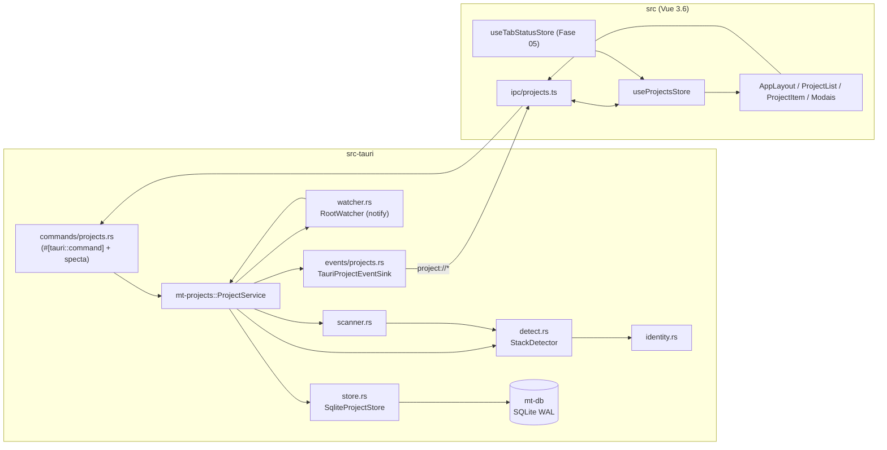

# Fase 06 — Especificação Técnica: Projetos e Layout de 2 Colunas

> Escopo e critérios de aceite: [`instructions.md`](./instructions.md). Contratos globais: [`../README.md`](../README.md) §2.
> Cobre AGENTS.md §4 (layout) e §4.1 (exceto o badge 🟣 Issues, Fase 16).

---

## 1. Visão Arquitetural



Princípios:
- `mt-projects` **não depende de Tauri**: emite eventos por uma trait (`ProjectEventSink`) e persiste por outra
  (`ProjectStore`). O crate binário faz a cola. Isso permite testes com sinks/stores em memória.
- Toda E/S de disco (varredura, detecção, `notify`) roda fora da thread principal (`spawn_blocking` / thread do
  debouncer); comandos IPC são `async`.
- Nenhum processo é executado dentro das pastas dos projetos (detecção puramente por leitura de arquivos).

### 1.1. Contratos de entrada e fronteiras

| Base | Contrato efetivamente consumido |
|------|--------------------------------|
| 01 | ids de `mt-core`, `MtError`, bindings gerados, `src/ipc/core.ts::unwrap`, componentes e tokens Max |
| 03 | Repositórios tipados; `Db::read/write` privados ao crate; `DbSetup`/`SettingDescriptor`; migration SQL da fase; `useSetting`, `SettingsSchema`, `src/ipc/db.ts` |
| 05 | `useTabStatusStore.byTab`, `countsFor`, `TabStateSnapshot.badgeBucket/revision`, `SeenRequest` por execução/revisão; `useTabSeenTracker` |

A Fase 06 não depende de `mt-tabs`, templates ou GitHub. `projects` nasce sem template; a Fase 07 ativa a
invariante de template padrão conforme §12.1. Não consultar `sessions` para inferir dono de aba, nem gravar
`sessions.project_id` por similaridade de caminho. Vínculos são explícitos, em memória nesta fase.

---

## 2. Crate `mt-projects`

### 2.1. `Cargo.toml`
```toml
[package]
name = "mt-projects"
edition = "2024"

[dependencies]
mt-core = { path = "../mt-core" }
mt-db = { path = "../mt-db" }
serde = { workspace = true, features = ["derive"] }
serde_json = { workspace = true }
specta = { workspace = true }
tokio = { workspace = true, features = ["rt", "sync", "time", "macros"] }
tracing = { workspace = true }
notify = "8"
notify-debouncer-full = "0.5"
dirs = "6"
async-trait = "0.1"
uuid = { workspace = true, features = ["v7", "serde"] }

[dev-dependencies]
tempfile = "3"
tokio = { workspace = true, features = ["test-util", "rt-multi-thread"] }
```

### 2.2. `model.rs`
```rust
use mt_core::ids::ProjectId;
use serde::{Deserialize, Serialize};
use specta::Type;

/// Identificador de "Pasta de Projetos". Segue o mesmo padrão de newtype Uuid v7 de `mt-core`
/// (definido localmente pois é exclusivo deste domínio).
#[derive(Debug, Clone, Copy, PartialEq, Eq, Hash, Serialize, Deserialize, Type)]
#[serde(transparent)]
pub struct ProjectRootId(pub uuid::Uuid);

#[derive(Debug, Clone, Copy, PartialEq, Eq, Hash, Serialize, Deserialize, Type)]
#[serde(rename_all = "snake_case")]
pub enum StackKind { Tauri, VscodeExtension, Laravel, Vue, Rust, Python, Unknown }

#[derive(Debug, Clone, Copy, PartialEq, Eq, Serialize, Deserialize, Type)]
#[serde(rename_all = "snake_case")]
pub enum IdentitySource { Auto, Manual }

#[derive(Debug, Clone, Copy, PartialEq, Eq, Serialize, Deserialize, Type)]
#[serde(rename_all = "snake_case")]
pub enum DiscoveryMode { Suggest, AutoImport }

#[derive(Debug, Clone, Copy, PartialEq, Eq, Serialize, Deserialize, Type)]
#[serde(rename_all = "snake_case")]
pub enum WatchStatus { Watching, Disabled, Missing, Error }

#[derive(Debug, Clone, PartialEq, Eq, Serialize, Deserialize, Type)]
pub struct ProjectIdentity {
    pub icon: String,      // nome Iconify "prefixo:nome", ex.: "logos:laravel"
    pub color: String,     // "#RRGGBB" maiúsculo
    pub stack: StackKind,
    pub detected: Vec<StackKind>, // todas as stacks encontradas, em ordem de prioridade
}

#[derive(Debug, Clone, Serialize, Deserialize, Type)]
#[serde(rename_all = "camelCase")]
pub struct Project {
    pub id: ProjectId,
    pub title: String,
    pub icon: String,
    pub color: String,
    pub path: String,               // caminho absoluto canônico
    pub root_id: Option<ProjectRootId>,
    pub stack: StackKind,
    pub identity_source: IdentitySource,
    pub sort_order: i64,
    pub missing: bool,              // pasta não existe mais no disco
    pub created_at: i64,            // epoch ms UTC
    pub updated_at: i64,
}

#[derive(Debug, Clone, Serialize, Deserialize, Type)]
#[serde(rename_all = "camelCase")]
pub struct ProjectRoot {
    pub id: ProjectRootId,
    pub path: String,
    pub discovery_mode: DiscoveryMode,
    pub watch_enabled: bool,
    pub watch_status: WatchStatus,  // runtime, não persistido
    pub created_at: i64,
    pub updated_at: i64,
}

#[derive(Debug, Clone, Deserialize, Type)]
#[serde(rename_all = "camelCase")]
pub struct NewProject {
    pub path: String,                    // aceita "~/..."
    pub title: Option<String>,           // padrão: nome da pasta
    pub icon: Option<String>,            // padrão: identidade detectada
    pub color: Option<String>,
}

#[derive(Debug, Clone, Default, Deserialize, Type)]
#[serde(rename_all = "camelCase")]
pub struct ProjectPatch {
    pub title: Option<String>,
    pub icon: Option<String>,
    pub color: Option<String>,
    /// `true` volta a identidade para `auto` e re-detecta.
    pub reset_identity: Option<bool>,
}

#[derive(Debug, Clone, Deserialize, Type)]
#[serde(rename_all = "camelCase")]
pub struct NewProjectRoot {
    pub path: String,
    pub discovery_mode: DiscoveryMode,
    pub import_existing: bool,           // importa as subpastas atuais imediatamente
    pub watch_enabled: bool,             // checkbox do modal; padrão da UI: true
}

#[derive(Debug, Clone, Default, Deserialize, Type)]
#[serde(rename_all = "camelCase")]
pub struct ProjectRootPatch {
    pub discovery_mode: Option<DiscoveryMode>,
    pub watch_enabled: Option<bool>,
}

/// Subpasta encontrada e ainda não cadastrada.
#[derive(Debug, Clone, Serialize, Deserialize, Type)]
#[serde(rename_all = "camelCase")]
pub struct DiscoveredFolder {
    pub root_id: ProjectRootId,
    pub path: String,
    pub suggested_title: String,
    pub identity: ProjectIdentity,
    pub discovered_at: i64,
}

#[derive(Debug, Clone, Serialize, Type)]
#[serde(rename_all = "camelCase")]
pub struct RootImportReport {
    pub root: ProjectRoot,
    pub imported: Vec<Project>,
    pub suggested: Vec<DiscoveredFolder>,
    pub skipped: u32,                    // ocultas, arquivos, já cadastradas, dispensadas
    pub warnings: Vec<ScanWarning>,      // erros localizados; mensagens pt-BR, sem conteúdo de arquivos
    pub complete: bool,                  // scan incompleto não prova desaparecimento
}
```

`Project.root_id` é apenas a origem primária de cadastro, não prova exclusividade nem presença no disco.
`project_root_entries` (§5) registra todos os aliases/origens. Na criação, escolher a raiz elegível mais antiga
(`created_at`, desempate por id); cadastro já existente preserva `root_id`. Excluir a raiz torna o campo `NULL`;
outras origens continuam válidas. Não reatribuir silenciosamente autoria em cada scan.

```rust
#[derive(Debug, Clone, Serialize, Type)]
#[serde(rename_all = "camelCase")]
pub struct ScanWarning { pub path: String, pub code: String, pub message: String }

#[derive(Debug, Clone, Serialize, Type)]
#[serde(rename_all = "camelCase")]
pub struct ProjectSnapshot {
    pub epoch: String,                 // UUID do processo; não é ProjectId
    pub revision: u32,                 // revisão global do catálogo em runtime
    pub projects: Vec<Project>,
    pub roots: Vec<ProjectRoot>,
    pub discovered: Vec<DiscoveredFolder>,
}
```
`DiscoveredFolder.root_id` é a origem representante da sugestão por caminho canônico (mesmo desempate).
Ao remover essa raiz, recalcular representante nas origens restantes. Todas as listas usam ordenação estável:
projetos `(sort_order, id)`, raízes `(created_at, id)`, sugestões `(root_id, path)`.

### 2.3. `paths.rs`
```rust
/// Expande "~" e "~/" com `dirs::home_dir()`; rejeita caminhos relativos.
pub fn expand_home(input: &str) -> Result<PathBuf, MtError>;
/// `expand_home` + `std::fs::canonicalize`; exige diretório existente.
pub fn canonical_dir(input: &str) -> Result<PathBuf, MtError>;
/// Nome começa com '.' (inclui `.worktrees`, `.max-code-worktrees`, `.git`).
pub fn is_hidden(name: &OsStr) -> bool;
/// Título padrão: nome do último componente, sem alterações de caixa.
pub fn default_title(path: &Path) -> String;
```
Regras: caminhos de identidade armazenados sempre canônicos (symlinks resolvidos) em UTF-8; caminho não UTF-8 →
`project.path_not_utf8`. A raiz `/` e o próprio `$HOME` não podem ser projetos (`project.path_forbidden`), mas
`$HOME/GitHub` pode ser raiz. `/` também é recusada como Pasta de Projetos; `$HOME` como raiz exige seleção
explícita e continua filtrando ocultas. Não expandir `$VAR`, `~outro_usuario`, glob ou URI; rejeitar NUL e caminho
relativo. Comparação case-sensitive por bytes UTF-8 canônicos no Linux, sem lowercase/normalização Unicode.

Symlink de entrada para diretório fora da raiz é aceito, mas só seu alvo direto é candidato, sem recursão.
Guardar `entry_path` absoluto lexical (raiz canônica + basename) separado do `canonical_path`; deduplicar
primeiro por destino, depois pelo `UNIQUE(projects.path)`. Ciclos/links quebrados não geram candidatos;
symlink apontando para a própria raiz ou ancestral é ignorado para evitar autoimportação. O filtro de ocultas
ocorre no nome de entrada e também impede destinos dentro de `.git`, `.worktrees` e `.max-code-worktrees` na
descoberta automática. Cadastro individual explícito continua permitido para diretórios de worktree.

Remover um alias não significa perder o projeto: `missing` resulta de `metadata` do `Project.path` armazenado.
Somente `NotFound`/`NotADirectory` confirma ausência; `PermissionDenied`/I/O gera aviso e preserva o último
valor. Reaparecimento no mesmo caminho preserva id e identidade. Rename do diretório real mantém o cadastro
antigo como ausente e apresenta o novo caminho como candidato; não inferir identidade por inode ou basename.
Redirecionar symlink não transfere id/histórico: o antigo destino permanece cadastrado e o novo é candidato.

### 2.4. `detect.rs` — Auto-detecção de stack

```rust
pub trait StackRule: Send + Sync {
    fn kind(&self) -> StackKind;
    /// Recebe um snapshot pré-lido da pasta (sem novo I/O por regra).
    fn matches(&self, probe: &FolderProbe) -> bool;
}

/// Leitura única e limitada dos marcadores na raiz da pasta.
pub struct FolderProbe {
    pub has_artisan: bool,
    pub has_composer_json: bool,
    pub package_json: Option<serde_json::Value>, // None se ausente, > 1 MiB ou inválido
    pub has_tauri_conf: bool,  // src-tauri/tauri.conf.json (aceita também .json5 e Tauri.toml)
    pub has_pyproject: bool,
    pub has_requirements: bool,
    pub has_cargo_toml: bool,
    pub complete: bool,
    pub warnings: Vec<ScanWarning>,
}

impl FolderProbe {
    pub fn read(dir: &Path) -> std::io::Result<Self>;
}

pub struct StackDetector { rules: Vec<Box<dyn StackRule>> } // já ordenadas por prioridade
pub struct DetectionReport { pub detected: Vec<StackKind>, pub complete: bool, pub warnings: Vec<ScanWarning> }

impl StackDetector {
    pub fn default_rules() -> Self;
    /// Retorna todas as stacks que casam, na ordem de prioridade; vazio → [Unknown].
    pub fn detect(&self, dir: &Path) -> DetectionReport;
}
```

| Prioridade | Stack | Regra (todos os arquivos na raiz da pasta, exceto Tauri) |
|-----------:|-------|-----------------------------------------------------------|
| 1 | `tauri` | `src-tauri/tauri.conf.json` (ou `tauri.conf.json5` / `Tauri.toml` em `src-tauri/`) |
| 2 | `vscode_extension` | `package.json` com `engines.vscode` (string) |
| 3 | `laravel` | arquivo `artisan` **e** `composer.json` |
| 4 | `vue` | `package.json` com chave `vue` em `dependencies`, `devDependencies` ou `peerDependencies` |
| 5 | `rust` | `Cargo.toml` |
| 6 | `python` | `pyproject.toml` **ou** `requirements.txt` |
| — | `unknown` | nenhuma regra casou |

Justificativa da ordem: Tauri contém Vue e Cargo; extensões VS Code podem usar Vue em webviews; Laravel costuma
trazer Vue no `package.json`; Rust e Python são marcadores mais genéricos. A stack primária é `detected[0]`.
Garantias: conjunto fixo de marcadores (incluindo as três variantes Tauri), uma leitura limitada de
`package.json` por probe. Não prometer contagem de syscalls: canonicalização e variantes exigem operações
adicionais. Erros individuais geram avisos e não pânico; probe incompleto não rebaixa identidade já conhecida.
Marcadores são arquivos regulares verificados com `symlink_metadata`; não abrir FIFO/device ou symlink como
`package.json`. Ler no máximo 1 MiB + 1 byte e rejeitar excesso mesmo se o arquivo crescer após `metadata`.
No Linux, abrir com não seguimento de links e modo não bloqueante, validar tipo no handle antes da leitura
(adaptador de `OpenOptionsExt`, flags da dependência POSIX adotada na 01); repetir validação se houve troca.

### 2.5. `identity.rs` — Ícone e cor

```rust
pub struct IdentityMap;

impl IdentityMap {
    pub fn for_stack(stack: StackKind) -> Option<(&'static str, &'static str)>;
    /// Identidade final: mapa da stack primária ou fallback determinístico.
    pub fn resolve(canonical_path: &Path, detected: Vec<StackKind>) -> ProjectIdentity;
    pub fn fallback(canonical_path: &Path) -> (&'static str, &'static str);
}

pub fn validate_icon(icon: &str) -> Result<(), MtError>;   // ^[a-z0-9]+(-[a-z0-9]+)*:[a-z0-9]+(-[a-z0-9]+)*$, ≤ 64
pub fn validate_color(color: &str) -> Result<String, MtError>; // ^#[0-9A-Fa-f]{6}$ → normaliza p/ maiúsculas
pub fn validate_title(title: &str) -> Result<String, MtError>; // trim, 1..=120 chars, sem controle
fn fnv1a_64(bytes: &[u8]) -> u64;
```

Mapa (inspirado no `max-big-icon-pack`, ícones da coleção `logos`):

| Stack | Ícone | Cor |
|-------|-------|-----|
| `tauri` | `logos:tauri` | `#FFC131` |
| `vscode_extension` | `logos:visual-studio-code` | `#007ACC` |
| `laravel` | `logos:laravel` | `#FF2D20` |
| `vue` | `logos:vue` | `#42B883` |
| `rust` | `logos:rust` | `#CE422B` |
| `python` | `logos:python` | `#3776AB` |

Fallback (`unknown`): `h = fnv1a_64(caminho_canônico_utf8)`; `icon = FALLBACK_ICONS[h % 12]`,
`color = FALLBACK_COLORS[(h >> 32) % 12]`.
- `FALLBACK_ICONS`: `mdi:folder`, `mdi:folder-star`, `mdi:folder-code`, `mdi:folder-heart`, `mdi:folder-cog`,
  `mdi:folder-wrench`, `mdi:folder-table`, `mdi:folder-text`, `mdi:folder-multiple`, `mdi:folder-network`,
  `mdi:folder-zip`, `mdi:folder-file`.
- `FALLBACK_COLORS`: 12 hex de alto contraste sobre o tema Max Navy/Teal (`#14B8A6`, `#0EA5E9`, `#6366F1`,
  `#A855F7`, `#EC4899`, `#F43F5E`, `#F97316`, `#EAB308`, `#84CC16`, `#22C55E`, `#06B6D4`, `#64748B`).
"Aleatório determinístico": o mesmo caminho sempre gera a mesma identidade, sem estado global nem RNG.
FNV-1a 64 usa offset `14695981039346656037`, primo `1099511628211` e multiplicação `wrapping_mul`.
O resultado é gravado em `projects.icon/color` na criação, nunca recalculado apenas ao renderizar/reiniciar.
Mudança de paleta entre releases não altera cadastros existentes. Re-detecção explícita com reset pode mudar
a identidade; re-detecção automática só substitui fallback quando passa de `unknown` para stack reconhecida.
Título é independente da origem visual: editar apenas título mantém `identity_source`. Preview não persiste.
Modal envia `icon/color` apenas quando editados pelo usuário (não enviar valores de preview como overrides).
`reset_identity=true` junto com `icon/color` é inválido (`project.invalid_patch`).

### 2.6. `store.rs` — Persistência
```rust
#[async_trait::async_trait]
pub trait ProjectStore: Send + Sync + 'static {
    async fn load_catalog(&self) -> Result<CatalogRows, MtError>;
    async fn find_project_by_path(&self, path: &str) -> Result<Option<Project>, MtError>;
    /// Uma operação de domínio = uma transação; não expor passos parcialmente commitados.
    async fn commit(&self, mutation: CatalogMutation) -> Result<CommitResult, MtError>;
}

pub struct SqliteProjectStore { repo: mt_db::repos::projects::ProjectsRepo }
pub enum CatalogMutation {
    Add(NewProjectRow),
    Update(Project),
    Remove { id: ProjectId, dismiss: Vec<DismissedRow> },
    Reorder(Vec<ProjectId>),
    AddRoot { root: ProjectRootRow, reconciliation: ReconcileBatch },
    UpdateRoot(ProjectRootRow),
    RemoveRoot(ProjectRootId),
    Reconcile(ReconcileBatch),
    Accept(Vec<NewProjectRow>),
    Dismiss(Vec<DismissedRow>),
}
```
Tipos internos (não exportar via IPC): `ProjectRootRow` = raiz sem `watch_status`; `NewProjectRow` contém
projeto validado e origens a retirar de dismissed; `DismissedRow` = `(root_id, canonical_path, dismissed_at)`;
`CatalogRows` contém projetos/raízes/entries/dispensados. `ReconcileBatch` carrega upserts de origens,
remoções de origens confirmadas por scan completo, projetos inseridos/atualizados e alterações de `missing`.
`CommitResult` contém linhas finais e ids alterados, lidos **na mesma transação**, para compor eventos.

`SqliteProjectStore` converte domínio ↔ rows e delega ao novo repo **tipado** `mt-db/src/repos/projects.rs`,
adicionado pela Fase 06. Somente esse módulo interno usa `Db::read/write` (`pub(crate)` na 03): `load_catalog`
usa transação de leitura consistente e `commit` usa writer. Não chamar métodos privados a partir de
`mt-projects`, expor executor SQL genérico, abrir outra conexão ou inverter a dependência mt-db → mt-projects.
Tipos de persistência (`StoredProject`, `StoredRoot`, `StoredRootEntry`, `ProjectMutation`, `ProjectCommit`)
vivem no módulo do repo e não são DTOs Specta; enums/ids/título sanitizado são convertidos no adaptador.
`ProjectsRepo::new(db)`, `load_catalog()` e `commit(ProjectMutation)` são a API pública tipada
aditiva desta fase. `ProjectMutation` espelha os casos de `CatalogMutation`, com rows de persistência locais;
`ProjectCommit` contém as rows finais/ids alterados. Não receber string SQL do crate consumidor.
Closures internas possuem dados owned (`Send + 'static`), SQL parametrizado e `prepare_cached`; não acessar
conexão bruta do writer nem adicionar `with_conn`. `DbError` é convertido para `MtError` no adaptador;
restrições de caminho são mapeadas para `project.duplicate_path` / `project_root.duplicate_path`.
Ordenação nova usa `MAX(sort_order)+1` dentro da transação; `reorder` exige conjunto completo sem duplicatas,
reescreve 0..n-1 e retorna `project.reorder_mismatch` se auto-import alterou o conjunto antes do commit.
Não usar `INSERT OR REPLACE` (apagaria ids/FKs). Fluxo automático usa conflito de caminho como no-op e relê
a linha existente; cadastro manual duplicado retorna erro. Aceitação em lote deduplica paths antes do write.

`RootEntryRow { root_id: ProjectRootId, entry_path: String, canonical_path: String, observed_at: i64 }`
espelha a tabela de origens. O coordenador revalida geração da raiz e filtros de cadastro/dispensa contra o
estado **atual**, não o snapshot anterior à E/S; re-detecção só aplica patch visual se identidade ainda for
auto/unknown. Assim scan atrasado não desfaz edição manual, recria projeto removido nem sugere pasta recém
dispensada. A varredura produz observações, não comandos de overwrite de linhas inteiras desatualizadas.

```rust
// mt-db/src/repos/projects.rs — extensão interna, não exportada aos produtores de conteúdo.
pub(crate) trait ProjectInsertContributor: Send + Sync + 'static {
    fn after_insert(&self, tx: &rusqlite::Transaction<'_>, project: &StoredProject) -> Result<(), DbError>;
}
```
Registro de contributors é interno a `mt-db`, vazio nesta fase. Repositórios futuros adicionados ao mesmo
crate podem participar de uma transação sem expor `Connection`/closure SQL a `mt-projects`, Tauri ou frontend.

### 2.7. `scanner.rs`
```rust
pub struct ScanEntry { pub entry_path: PathBuf, pub canonical_path: PathBuf, pub name: String }
pub struct ScanSnapshot {
    pub entries: Vec<ScanEntry>,
    pub warnings: Vec<ScanWarning>,
    pub complete: bool,
}

/// Lista subpastas de nível 1: somente diretórios (symlink para diretório é aceito e canonicalizado),
/// ignora ocultas e links quebrados; registra erros de leitura sem tratá-los como remoção.
pub fn scan_level1(root: &Path) -> Result<ScanSnapshot, MtError>;

pub struct ScanDiff { pub upserted_entries: Vec<ScanEntry>, pub removed_entry_paths: Vec<String> }
/// Não remove origens quando current.complete == false; presença do projeto é verificada separadamente.
pub fn diff(current: &ScanSnapshot, previous: &[RootEntryRow]) -> ScanDiff;
```

Varredura por `read_dir`, nunca walk recursivo. Um `HashSet` de caminhos canônicos deduplica detecção/importação,
mas todos os aliases válidos permanecem em `entries`. Ordenação lexical estável por `(name, entry_path)`.
Erro em `read_dir` da raiz retorna `project_root.scan_failed`; erro em item gera `complete=false` e warning.
Link comprovadamente quebrado pode retirar aquela origem; falha de permissão não é link quebrado.
No boot, origins persistidas são referência para diff, nunca prova de presença atual.

Reconciliação valida também projetos cadastrados sem origem atual e sugestões existentes. Uma sugestão só
permanece se pelo menos uma origem elegível ainda apontar para o destino; scan parcial mantém pendência até
confirmação. Projetos não são apagados por reconciliação. Dispensados persistem mesmo com pasta ausente e
não ressurgem quando ela retorna; cadastro explícito remove dispensas daquele destino em todas as raízes.
Se várias raízes observam o mesmo destino, ele é elegível quando ao menos uma origem não foi dispensada;
importar automaticamente se uma dessas origens está em `auto_import`, senão sugerir uma única vez.
Dispensar/remover projeto grava a dispensa em todas as origens atualmente conhecidas; cadastrar outra raiz
posteriormente pode voltar a oferecer esse destino (dispensa é por raiz). Desabilitar monitoramento conserva
as sugestões já vistas e permite aceitação manual; não descobre novas pastas até rescan explícito/reativação.

### 2.8. `watcher.rs` — Auto-descoberta
```rust
pub enum WatchSignal {
    RootChanged(ProjectRootId),          // lote debounced de eventos no nível 1
    RootMissing(ProjectRootId),
    WatchError(ProjectRootId, String),
}

pub struct RootWatcher {
    debouncers: HashMap<ProjectRootId, Debouncer<RecommendedWatcher, RecommendedCache>>,
    tx: tokio::sync::mpsc::Sender<WatchSignal>,
    dirty_roots: Arc<Mutex<HashSet<ProjectRootId>>>,
}

impl RootWatcher {
    pub const DEBOUNCE: Duration = Duration::from_millis(500);
    pub const SETTLE: Duration = Duration::from_millis(1500);
    pub fn new(tx: mpsc::Sender<WatchSignal>) -> Self;
    pub fn watch(&mut self, id: ProjectRootId, path: &Path) -> Result<(), MtError>; // NonRecursive
    pub fn unwatch(&mut self, id: ProjectRootId);
}
```
Comportamento:
1. `notify_debouncer_full::new_debouncer(DEBOUNCE, None, handler)` e
   `debouncer.watch(path, RecursiveMode::NonRecursive)` (API 0.5). Observar raiz e pai para detectar
   remoção/rename; compartilhar watches de pais quando possível, não observar descendentes recursivamente.
2. Callback considera eventos da própria raiz, filhos diretos e, no watch do pai, somente a entrada da raiz;
   observa todos os paths em rename. Erros/`need_rescan` invalidam toda a raiz. Antes de `try_send` (canal 64),
   marcar raiz em `dirty_roots`; o consumidor drena esse conjunto a cada 1 s. Fila cheia não perde a invalidação.
3. `ProjectService` coalesce sinais por raiz: ao receber `RootChanged`, agenda varredura após `SETTLE`; novos sinais
   durante a espera reiniciam o timer (máx. 5 s de atraso total).
4. Raiz ausente → `RootMissing` → `watch_status = Missing`, re-tentativa com backoff exponencial 5 s → 60 s.
5. Reconciliação periódica a cada 30 s em raízes habilitadas cobre sinais perdidos, mudança do alvo de symlink
   externo e marcadores adicionados dentro de projeto depois do `git clone` (NonRecursive não os observa).
   Reavaliar projetos `auto/unknown` e sugestões pendentes nesses ciclos; no foco, solicitar reconciliação
   coalescida e conferir presença de todos os projetos. Raízes desabilitadas só escaneiam no comando manual;
   seu status é `Disabled` e timers/retries não as reativam.
6. Um scan em voo por raiz; guardar contador de geração. Remover/desabilitar/alterar raiz incrementa geração;
   conclusão antiga é descartada antes de qualquer commit. Registrar watcher antes do scan inicial; eventos
   durante scan deixam dirty para um próximo ciclo. Varreduras/detecção usam semáforo global de 8 workers.
7. `shutdown()` cancela timers/tasks, fecha fila e libera debouncers fora da thread da UI; não há emissões após
   encerramento. Re-tentativa de watch não cria watchers duplicados; watcher com erro é liberado antes da troca.

Metas de 3 s valem para criação isolada em filesystem local saudável. Rajadas têm teto de agendamento de 5 s
mais duração do scan; recuperação periódica leva até 30 s mais scan. Número de eventos do SO não é contrato.

### 2.9. `events.rs`
```rust
#[derive(Debug, Clone, Serialize, Type)]
#[serde(rename_all = "camelCase")]
pub struct ProjectDiscoveredPayload {
    pub root_id: ProjectRootId,
    pub mode: DiscoveryMode,                 // suggest → em `folders`; auto_import → em `imported`
    pub folders: Vec<DiscoveredFolder>,
    pub imported: Vec<Project>,
}

#[derive(Debug, Clone, Copy, Serialize, Type)]
#[serde(rename_all = "snake_case")]
pub enum RemovedKind { ProjectMissing, SuggestionGone }

#[derive(Debug, Clone, Serialize, Type)]
#[serde(rename_all = "camelCase")]
pub struct ProjectRemovedPayload {
    pub root_id: Option<ProjectRootId>,
    pub kind: RemovedKind,
    pub path: String,
    pub project_id: Option<ProjectId>,
}

#[derive(Debug, Clone, Serialize, Type)]
#[serde(tag = "kind", rename_all = "snake_case")]
pub enum ProjectChangedPayload {
    Upserted { projects: Vec<Project> },
    Deleted { ids: Vec<ProjectId> },
    Reordered { ids: Vec<ProjectId> },
}

#[derive(Debug, Clone, Serialize, Type)]
#[serde(tag = "kind", rename_all = "snake_case")]
pub enum ProjectRootChangedPayload {
    Upserted { root: ProjectRoot },
    Deleted { id: ProjectRootId },
}

#[derive(Debug, Clone, Serialize, Type)]
#[serde(rename_all = "camelCase")]
pub struct ProjectEvent<T> { pub epoch: String, pub revision: u32, pub payload: T }

pub trait ProjectEventSink: Send + Sync + 'static {
    fn discovered(&self, p: ProjectEvent<ProjectDiscoveredPayload>);
    fn removed(&self, p: ProjectEvent<ProjectRemovedPayload>);
    fn changed(&self, p: ProjectEvent<ProjectChangedPayload>);
    fn root_changed(&self, p: ProjectEvent<ProjectRootChangedPayload>);
}
```
`ProjectRemovedPayload` significa alteração de disponibilidade/sugestão, não exclusão do cadastro; esta usa
`ProjectChangedPayload::Deleted`. Dispensa/aceitação elimina pendência e emite `SuggestionGone` para invalidar
consumidores. Projetos autoimportados em `discovered.imported` podem também aparecer em `changed`: mesma
revisão, sem duplicação por id. Atualização da identidade de sugestão também emite `discovered` (upsert por path).

### 2.10. `service.rs` — Orquestração e pontos de extensão
```rust
/// Executado antes de excluir um projeto do cadastro. A Fase 07 registra um hook que encerra abas/PTYs
/// do projeto (Diretriz §4: nenhum processo órfão). Erro em hook aborta a remoção.
#[async_trait::async_trait]
pub trait ProjectRemovalHook: Send + Sync + 'static {
    async fn before_remove(&self, id: ProjectId) -> Result<(), MtError>;
}

pub struct ProjectService {
    store: Arc<dyn ProjectStore>,
    sink: Arc<dyn ProjectEventSink>,
    detector: StackDetector,
    watcher: Mutex<RootWatcher>,
    pending: RwLock<HashMap<String, DiscoveredFolder>>,     // sugestões em memória (recalculáveis)
    watch_status: RwLock<HashMap<ProjectRootId, WatchStatus>>,
    removal_hooks: RwLock<Vec<Arc<dyn ProjectRemovalHook>>>,
    // Coordenação serial de commits, pending, revisão e snapshot; nunca manter lock durante scan/hook.
    coordinator: CatalogCoordinator,
}

impl ProjectService {
    pub fn new(store: Arc<dyn ProjectStore>, sink: Arc<dyn ProjectEventSink>) -> Arc<Self>;
    /// Carrega raízes, inicia watchers, faz varredura inicial (sugestões + marcação de `missing`).
    pub async fn start(self: &Arc<Self>) -> Result<(), MtError>;
    pub async fn shutdown(&self);
    pub async fn snapshot(&self) -> Result<ProjectSnapshot, MtError>;
    pub fn register_removal_hook(&self, hook: Arc<dyn ProjectRemovalHook>);
    /// Lease compartilhada por projeto; remoção usa exclusão mútua no mesmo gate.
    pub async fn acquire_activity(&self, id: ProjectId) -> Result<ProjectActivityGuard, MtError>;

    pub async fn list(&self) -> Result<Vec<Project>, MtError>;
    pub async fn add(&self, input: NewProject) -> Result<Project, MtError>;
    pub async fn update(&self, id: ProjectId, patch: ProjectPatch) -> Result<Project, MtError>;
    pub async fn remove(&self, id: ProjectId) -> Result<(), MtError>;
    pub async fn reorder(&self, ids: Vec<ProjectId>) -> Result<(), MtError>;
    pub async fn redetect(&self, id: ProjectId) -> Result<Project, MtError>;
    pub async fn preview_identity(&self, path: String) -> Result<ProjectIdentity, MtError>;
    pub async fn refresh_missing(&self) -> Result<Vec<Project>, MtError>;

    pub async fn list_roots(&self) -> Result<Vec<ProjectRoot>, MtError>;
    pub async fn add_root(&self, input: NewProjectRoot) -> Result<RootImportReport, MtError>;
    pub async fn update_root(&self, id: ProjectRootId, patch: ProjectRootPatch) -> Result<ProjectRoot, MtError>;
    pub async fn remove_root(&self, id: ProjectRootId) -> Result<(), MtError>;
    pub async fn rescan_root(&self, id: ProjectRootId) -> Result<RootImportReport, MtError>;

    pub async fn list_discovered(&self) -> Result<Vec<DiscoveredFolder>, MtError>;
    pub async fn accept_discovered(&self, paths: Vec<String>) -> Result<Vec<Project>, MtError>;
    pub async fn dismiss_discovered(&self, paths: Vec<String>) -> Result<(), MtError>;
}
```
Regras de negócio:
- `add`: canonicaliza; se já existe → `project.duplicate_path`; se a pasta estiver dentro de uma raiz cadastrada
  (pai direto ou alias observado), `root_id` é preenchido; remove sugestão e dispensas em todas as raízes.
- Ícone/cor informados no `add`/`update` → `identity_source = manual`. `manual` **nunca** é sobrescrito por
  re-detecção automática; `reset_identity = true` volta para `auto`.
- Re-detecção automática ocorre na reconciliação periódica para projetos `auto/unknown` e sugestões; não
  sobrescreve manual. `redetect` atualiza stack detectada, preserva ícone/cor manuais; reset explícito restaura auto.
- `remove`: reserva id como `removing`, executa hooks em ordem de registro sem transação/lock do catálogo,
  depois `Remove { id, dismiss }` grava exclusão e dispensas para **todas** as origens na mesma transação.
  Falha libera reserva e conserva cadastro. Hooks devem ser idempotentes: rollback de SQL não religa PTYs já
  encerrados. Novos vínculos de runtime devem respeitar a reserva quando a Fase 07 ativar o hook.
- Pasta de projeto desaparece → `set_missing(true)` + `removed(ProjectMissing)`; reaparece → `missing = false` +
  `changed(Upserted)`. Projetos `missing` permanecem para preservar histórico (Fase 07).
- Projetos avulsos (sem raiz) são verificados quanto a `missing` em `start()` e ao focar a janela
  (`project_refresh_missing`).

#### Importação e transações
- `import_existing=true` importa o snapshot inicial mesmo em `suggest`; `false` respeita `discovery_mode`
  (em `auto_import` importa, em `suggest` só sugere). O modal explica isso e oculta a opção redundante no modo
  automático. `watch_enabled=false` não impede esse scan inicial explícito nem rescan manual.
- Preparar scan/detecção antes do write; `AddRoot` grava raiz, origens e projetos elegíveis em uma transação.
  Falha de varredura pode cadastrar raiz acessível com `complete=false`/warnings e nenhum falso removido;
  falha de banco reverte tudo. Watcher falhar não desfaz cadastro: retorno tem `watch_status=error` e warning.
- Aceitar/dispensar paths exige sugestão conhecida, origem elegível e recanonicalização imediatamente antes
  da mutação; destino diferente/inexistente retorna `project.discovery_stale` e agenda scan. Se outro fluxo
  já cadastrou o mesmo destino, aceitar é sucesso idempotente. Validar todo lote antes de commit; erro impede
  lote inteiro. `project.discovery_not_found` não oculta falhas parciais.
- Coordenador serializa commits e publicação do novo estado; mutações de memória só após sucesso do banco.
  `epoch` nasce no processo, `revision` incrementa uma vez por alteração observável (inclusive pending/status
  de watcher); eventos do mesmo commit compartilham revisão. No limite de u32, trocar epoch e reiniciar revisão.
  Snapshot é construído sob o coordenador sem misturar versões; nunca manter guard síncrono cruzando await.
- Emit falhar não reverte commit; snapshots e refresh no foco/periódico recuperam a UI. Nenhuma chamada
  externa/hook/evento executa dentro da closure da transação SQLite.

`ProjectActivityGuard` é uma lease RAII opaca sobre o gate por projeto; revalida existência após adquiri-lo.
Remoção adquire lease exclusiva antes de marcar `removing` e executar hooks; operações com lease prévia
terminam antes disso, e novas aquisições são recusadas enquanto removendo. Não manter lease em toda a vida
do PTY: consumidores futuros usam apenas durante criar/vincular, liberando antes de emitir sucesso.
Hooks de remoção não readquirem lease para o mesmo projeto. Cadastro sem consumidores funciona sem hooks.

`ProjectsRepo::new(db)` usa o registro estático interno de contributors da versão de `mt-db`, preparado
**antes** de aceitar comandos. Cada inserção efetivamente nova (manual,
aceitação, importação inicial ou auto-import) invoca contributors na mesma transação após INSERT; conflito
idempotente não invoca. Falha reverte lote inteiro. Esse callback síncrono só executa SQL via `tx`, sem I/O de
filesystem, await, eventos ou recursão em `Db::write`; é a única extensão permitida dentro da transação.
Na Fase 06 a lista está vazia; nenhuma tabela/função de templates é conhecida pelo repo ou por `mt-projects`.

---

## 3. Comandos Tauri IPC (`src-tauri/src/commands/projects.rs`)

Todos `async`, anotados com `#[tauri::command] #[specta::specta]`, retornando `Result<T, MtError>`, com estado
`State<'_, Arc<ProjectService>>`.

| Comando | Args (camelCase no TS) | Retorno | Erros (`code`) |
|---------|------------------------|---------|----------------|
| `project_snapshot` | — | `ProjectSnapshot` (visão consistente) | `db.*` |
| `project_list` | — | `Vec<Project>` (ordenado por `sort_order`) | `db.*` |
| `project_add` | `input: NewProject` | `Project` | `project.path_not_found`, `project.path_not_directory`, `project.path_forbidden`, `project.path_not_utf8`, `project.duplicate_path`, `project.invalid_title`, `project.invalid_icon`, `project.invalid_color` |
| `project_update` | `id: ProjectId, patch: ProjectPatch` | `Project` | `project.not_found`, `project.invalid_*` |
| `project_remove` | `id: ProjectId` | `()` | `project.not_found`, `project.removal_blocked` (hook falhou; `details` = mensagem do hook) |
| `project_reorder` | `ids: Vec<ProjectId>` | `()` | `project.reorder_mismatch` (conjunto ≠ cadastro) |
| `project_redetect` | `id: ProjectId` | `Project` | `project.not_found`, `project.path_not_found` |
| `project_preview_identity` | `path: String` | `ProjectIdentity` | `project.path_*` |
| `project_refresh_missing` | — | `Vec<Project>` (apenas alterados) | `db.*` |
| `project_root_list` | — | `Vec<ProjectRoot>` | `db.*` |
| `project_root_add` | `input: NewProjectRoot` | `RootImportReport` | `project.path_*`, `project_root.duplicate_path`, `project_root.watch_failed` (não fatal: retorna `watch_status = error` e loga `warn`) |
| `project_root_update` | `id, patch: ProjectRootPatch` | `ProjectRoot` | `project_root.not_found` |
| `project_root_remove` | `id: ProjectRootId` | `()` | `project_root.not_found` |
| `project_root_rescan` | `id: ProjectRootId` | `RootImportReport` | `project_root.not_found`, `project_root.missing` |
| `project_discovery_list` | — | `Vec<DiscoveredFolder>` | — |
| `project_discovery_accept` | `paths: Vec<String>` | `Vec<Project>` | `project.discovery_not_found`, `project.discovery_stale`, `db.*` |
| `project_discovery_dismiss` | `paths: Vec<String>` | `()` | `project.discovery_not_found`, `project.discovery_stale`, `db.*` |

Mensagens (`message`) em pt-BR, ex.: `"A pasta \"{path}\" já está cadastrada como projeto."`,
`"Não foi possível monitorar a pasta \"{path}\": limite de inotify atingido."`.
Registro: `tauri_specta::collect_commands![...]` no builder da Fase 01; `ProjectService::start()` é chamado em
`setup()` via `tauri::async_runtime::spawn` (não bloqueia a abertura da janela).
Todos os ids de raiz são `ProjectRootId`. Mutação retorna somente após commit; wrappers aguardam resync antes
de atualizar seleção/modais. Limitar vetores a 1000 paths por chamada de descoberta e rejeitar entradas inválidas
antes do trabalho de disco (`project.invalid_argument`); importação de raiz usa scan interno, não esse limite.
`project_root.watch_failed` é código de warning no relatório, **não** `Err` após cadastro bem-sucedido.

## 4. Eventos emitidos

| Evento | Payload | Quando |
|--------|---------|--------|
| `project://discovered` | `ProjectEvent<ProjectDiscoveredPayload>` | Candidatos novos/atualizados e importados, agrupados por raiz |
| `project://removed` | `ProjectEvent<ProjectRemovedPayload>` | Ausência confirmada ou retirada de sugestão |
| `project://changed` | `ProjectEvent<ProjectChangedPayload>` | Mutação no cadastro, inclusive missing/restauração/reordenação |
| `project://root-changed` | `ProjectEvent<ProjectRootChangedPayload>` | Upsert/status ou exclusão de raiz |

Eventos são de baixo volume e usam `AppHandle::emit`, conforme README §2.2; agrupar upserts/importados e
coalescer invalidações no frontend. Não garantir uma emissão total por raiz: um commit pode afetar catálogo,
raízes e sugestões. Fonte de verdade da UI é `project_snapshot`; os quatro eventos invalidam esse snapshot.
Esse protocolo deliberadamente evita aplicar resposta IPC antiga sobre evento mais novo. `*_list` permanece
disponível para consultas específicas, mas não compõe a hidratação principal em três consultas inconsistentes.

---

## 5. SQLite — Migration `mt-db/migrations/NNNN_06_projects.sql`

`NNNN` = próximo número livre da sequência no momento da implementação.

```sql
-- Fase 06: projetos, pastas de projetos e sugestões dispensadas
CREATE TABLE project_roots (
    id              TEXT    PRIMARY KEY NOT NULL,           -- Uuid v7
    path            TEXT    NOT NULL UNIQUE,                -- caminho canônico
    discovery_mode  TEXT    NOT NULL DEFAULT 'suggest'
                    CHECK (discovery_mode IN ('suggest', 'auto_import')),
    watch_enabled   INTEGER NOT NULL DEFAULT 1 CHECK (watch_enabled IN (0, 1)),
    created_at      INTEGER NOT NULL,                       -- epoch ms UTC
    updated_at      INTEGER NOT NULL
) STRICT;

CREATE TABLE projects (
    id               TEXT    PRIMARY KEY NOT NULL,          -- ProjectId (Uuid v7)
    title            TEXT    NOT NULL CHECK (length(title) BETWEEN 1 AND 120),
    icon             TEXT    NOT NULL,                      -- Iconify "prefixo:nome"
    color            TEXT    NOT NULL CHECK (color GLOB '#[0-9A-F][0-9A-F][0-9A-F][0-9A-F][0-9A-F][0-9A-F]'),
    path             TEXT    NOT NULL UNIQUE,
    root_id          TEXT    NULL REFERENCES project_roots(id) ON DELETE SET NULL,
    stack            TEXT    NOT NULL DEFAULT 'unknown'
                     CHECK (stack IN ('tauri','vscode_extension','laravel','vue','rust','python','unknown')),
    identity_source  TEXT    NOT NULL DEFAULT 'auto' CHECK (identity_source IN ('auto', 'manual')),
    sort_order       INTEGER NOT NULL,
    missing          INTEGER NOT NULL DEFAULT 0 CHECK (missing IN (0, 1)),
    created_at       INTEGER NOT NULL,
    updated_at       INTEGER NOT NULL
) STRICT;

CREATE INDEX idx_projects_sort_order ON projects (sort_order, id);
CREATE INDEX idx_projects_root_id    ON projects (root_id) WHERE root_id IS NOT NULL;

-- Uma origem lexical pode mudar de destino; vários aliases podem apontar para o mesmo projeto.
-- Sem FK para projects: sugestões/dispensados também possuem origem antes de virar cadastro.
CREATE TABLE project_root_entries (
    root_id        TEXT NOT NULL REFERENCES project_roots(id) ON DELETE CASCADE,
    entry_path     TEXT NOT NULL,
    canonical_path TEXT NOT NULL,
    observed_at    INTEGER NOT NULL,
    PRIMARY KEY (root_id, entry_path)
) STRICT, WITHOUT ROWID;
CREATE INDEX idx_root_entries_canonical ON project_root_entries (canonical_path, root_id);

CREATE TABLE project_discovery_dismissed (
    root_id     TEXT    NOT NULL REFERENCES project_roots(id) ON DELETE CASCADE,
    path        TEXT    NOT NULL,
    dismissed_at INTEGER NOT NULL,
    PRIMARY KEY (root_id, path)
) STRICT, WITHOUT ROWID;
CREATE INDEX idx_discovery_dismissed_path ON project_discovery_dismissed (path);
```
Notas:
- `sort_order` não é `UNIQUE` para permitir reordenação em transação única (`UPDATE ... SET sort_order = ?` por id);
  a consistência é garantida por `reorder()` que reescreve 0..n-1.
- Fases posteriores (07: tabs/templates/sessões; 16: cache de issues) referenciam `projects(id)` com FK própria e
  decidem a política `ON DELETE` em suas migrations; o `ProjectRemovalHook` cobre o encerramento em runtime.
- `updated_at` é atribuído pelo serviço em cada mutação efetiva; sem trigger recursivo. Timestamp não serve
  como revisão (dois writes podem ocorrer no mesmo milissegundo). Mudanças de identidade persistem junto à stack.
- `UNIQUE(path)` resolve dedup global; índice de origens resolve aliases/remover dispensas; índice de ordem
  atende listagem estável; FK de raiz evita origens órfãs. Não adicionar FTS de projetos nesta fase.
- Migração aplicada após 03/05, no runner da 03, sem tabelas futuras. `foreign_key_check` e upgrade/reopen
  obrigatórios; usar banco temporário em arquivo nos testes de WAL, não `:memory:` para testar WAL.
- Caminhos operacionais precisam permanecer exatos para abrir/canonicalizar; não mascarar a chave de dedup.
  Títulos são texto livre e passam por `SanitizedText::new` da 03 antes do armazenamento (revalidar limite
  após sanitização). Logs/mensagens de erro passam pelo redator da 03; não logar manifests ou paths completos
  por padrão. Não presumir que nomes de arquivos/títulos são incapazes de conter segredos.

### 5.1. Settings da fase

`mt_projects::register_db(&mut DbSetup)` registra os descritores abaixo antes de `Db::open` (não executa DDL
nem depende da Fase 07). `src/types/projectSettings.ts` estende `SettingsSchema` via declaration merging.

| Chave | Tipo TS / JSON | Default | Validação Rust |
|-------|----------------|---------|----------------|
| `projects.selected_id` | `ProjectId \| null` | `null` | null ou UUID válido; existência é resolvida após snapshot |
| `layout.columns.left_size` | `number` | `22` | número finito 15..45 |

Ambas não sensíveis. Usar `useSetting`/`useSettingsStore` e `src/ipc/db.ts`, sem novo repositório de settings.
Após exclusão, selecionar próximo item na ordem anterior, senão anterior, senão null; o mesmo vale para
exclusão externa detectada por snapshot. Seleção carregada inexistente vira primeiro projeto ou null, gravada
depois de hidratar. Não gravar default durante loading, nem sobrescrever escolha do usuário por leitura tardia.

---

## 6. Arquitetura Frontend

### 6.1. Contratos TypeScript
Os tipos `Project`, `ProjectRoot`, `ProjectRootId`, `StackKind`, `DiscoveryMode`, `WatchStatus`,
`ProjectIdentity`, `DiscoveredFolder`, `RootImportReport`, `ProjectDiscoveredPayload`, `ProjectRemovedPayload`,
`ProjectChangedPayload`, `ProjectRootChangedPayload`, `ProjectEvent`, `ProjectSnapshot`, `ScanWarning` vêm
**exclusivamente** de `src/types/bindings.ts`. Tipos locais (somente frontend):

```ts
// src/stores/projects.ts
import type { ProjectId, TabId } from '@/types/bindings';

export interface ProjectStatusCounters {
    running: number;
    continuous: number;
    finished: number; // apenas abas com seen === false
    error: number;    // apenas abas com seen === false
    idle: number;     // idle + finished/error já vistos
}

// src/composables/useProjectBadgeRegistry.ts — slot de extensão (Fase 16 registra 'github-issues')
export interface ProjectBadgeProvider {
    id: string;
    order: number;                                   // nativos ocupam 10..50; Fase 16 usa 60
    icon: string;                                    // Iconify
    colorVar: string;                                // ex.: '--max-primary-500'
    count: (projectId: ProjectId) => number | null;  // getter síncrono reativo; null = não aplicável
    tooltip: (count: number) => string;              // pt-BR
}

export interface ProjectBadgeRegistry {
    register(provider: ProjectBadgeProvider): () => void;
    providers: Readonly<Ref<readonly ProjectBadgeProvider[]>>;
}
```
Registry é por instância da aplicação (provide/inject), não singleton de módulo compartilhado entre testes.
Ids únicos; duplicata retorna erro de programação, `order >= 60`, empate por id. `register` devolve disposer
idempotente, associado ao scope do consumidor. `count` só lê estado reativo; nenhum fetch/IPC durante render.
Aceitar apenas inteiros finitos positivos; null/zero oculta, valores inválidos são ignorados com diagnóstico
de desenvolvimento. Fase 16 registra `github-issues`, `order:60`, token roxo do tema e texto "Issues abertas";
sem provider, não há badge roxo, placeholder de contagem nem consulta GitHub nesta fase.

### 6.2. `src/ipc/projects.ts`
Funções finas sobre `commands.*` geradas pelo `tauri-specta` (`projectList()`, `projectAdd(input)`, …) que
usam `unwrap` de `src/ipc/core.ts` e preservam erro tipado da Fase 01, mais:
```ts
export function onProjectDiscovered(cb: (p: ProjectEvent<ProjectDiscoveredPayload>) => void): Promise<UnlistenFn>;
export function onProjectRemoved(cb: (p: ProjectEvent<ProjectRemovedPayload>) => void): Promise<UnlistenFn>;
export function onProjectChanged(cb: (p: ProjectEvent<ProjectChangedPayload>) => void): Promise<UnlistenFn>;
export function onProjectRootChanged(cb: (p: ProjectEvent<ProjectRootChangedPayload>) => void): Promise<UnlistenFn>;
export function pickFolder(title: string): Promise<string | null>; // @tauri-apps/plugin-dialog, directory: true
```
Plugin dialog é inicializado no Rust e permitido para a janela principal; cancelar retorna null e não dispara
preview/cadastro. Usar APIs geradas de eventos ou adapter tipado `listen`, com nomes fixos da tabela §4.

### 6.3. Store `useProjectsStore` (`src/stores/projects.ts`)
```ts
state: {
    projects: Project[];                          // ordenado por sortOrder
    roots: ProjectRoot[];
    discovered: DiscoveredFolder[];
    selectedId: ProjectId | null;                 // persistido em settings 'projects.selected_id'
    tabOwner: Record<TabId, ProjectId>;           // preenchido pela Fase 07 (attachTab)
    activeTabByProject: Record<ProjectId, TabId | null>; // preenchido pela Fase 07
    loading: boolean;
    error: string | null;                         // mensagem pt-BR do último MtError
    epoch: string | null;
    revision: number;
}
getters: {
    selectedProject: Project | null;
    projectById: (id: ProjectId) => Project | undefined;
    discoveredByRoot: Map<ProjectRootId, DiscoveredFolder[]>;
    countersByProject: Map<ProjectId, ProjectStatusCounters>; // ver §6.4
    countersFor: (id: ProjectId) => ProjectStatusCounters;    // zeros se ausente (objeto congelado compartilhado)
}
actions: {
    init(): Promise<void>;                 // listeners prontos + snapshot + selectedId; idempotente
    resync(): Promise<void>;               // single-flight com flag dirty; substituição atômica
    select(id: ProjectId | null): void;    // grava settings com debounce 200 ms
    addProject(input: NewProject): Promise<Project>;
    updateProject(id: ProjectId, patch: ProjectPatch): Promise<Project>;
    removeProject(id: ProjectId): Promise<void>; // seleção passa ao vizinho
    reorder(ids: ProjectId[]): Promise<void>;    // espera commit + snapshot; desabilita gesto concorrente
    redetect(id: ProjectId): Promise<Project>;
    addRoot(input: NewProjectRoot): Promise<RootImportReport>;
    updateRoot(id: ProjectRootId, patch: ProjectRootPatch): Promise<ProjectRoot>;
    removeRoot(id: ProjectRootId): Promise<void>;
    rescanRoot(id: ProjectRootId): Promise<RootImportReport>;
    acceptDiscovered(paths: string[]): Promise<void>;
    dismissDiscovered(paths: string[]): Promise<void>;
    // Pontos de extensão para a Fase 07
    attachTab(tabId: TabId, projectId: ProjectId): void;
    detachTab(tabId: TabId): void;
    setActiveTab(projectId: ProjectId, tabId: TabId | null): void;
    // Eventos só invalidam; payloads não são aplicados como outra fonte de verdade.
    invalidate(event: { epoch: string; revision: number }): void;
    applySnapshot(snapshot: ProjectSnapshot): void;
}
```
Setup store Pinia integrada ao `@maxvue/max-pinia`, sem cache persistente que duplique SQLite. Cada mutação
aguarda o comando e `resync`; retorno serve para id/resultado do modal, nunca para upsert de linha antiga.
`applySnapshot` substitui catálogo/raízes/sugestões conjuntamente; mesma epoch com revisão menor é descartada.
Não comparar timestamps. Coalescer chamadas concorrentes de init/resync; se evento chegar durante requisição,
guardar dirty/maior revisão e repetir até snapshot alcançá-la. Reinício troca epoch e requer snapshot novo.
Manter token de ciclo de vida para descartar promises concluídas depois de dispose.

`attachTab` valida projeto existente, é idempotente para mesmo par e rejeita reatribuição a outro projeto sem
`detachTab`. `detachTab` limpa também aba ativa; `setActiveTab` só aceita tab pertencente ao projeto. Snapshot
que exclui projeto limpa vínculos locais, mas nunca encerra PTY por conta própria (hook backend é a barreira).
Durante Fase 06 pura, mapas ficam vazios em produção; fixtures explicitamente vinculam abas para validar
contadores. Não materializar uma aba fake por projeto para fazer aparecer badge cinza.

### 6.4. Agregação de contadores
```ts
const countersByProject = computed(() => {
    const out = new Map<ProjectId, ProjectStatusCounters>();
    for (const [tabId, projectId] of Object.entries(tabOwner.value)) {
        const entry = tabStatusStore.byTab[tabId];
        if (!entry || !projectById(projectId)) continue;
        const c = out.get(projectId) ?? emptyCounters();
        c[entry.badgeBucket]++;
        out.set(projectId, c);
    }
    return out;
});
```
Complexidade O(abas) por mudança; um único `computed` para toda a lista. Erro "agente aguardando intervenção" chega
como bucket `error` pela Fase 05/13 e é contado sem tratamento especial. Não percorrer `panes`, contar
`status` e `badgeBucket` separadamente ou somar sessões históricas. Regra `finished/error` já vistos → `idle`
é responsabilidade da 05; sua prioridade entre painéis também. `countsFor` da 05 serve de oráculo nos testes.
Invariante: soma dos cinco campos de um projeto = número de TabIds distintos vinculados com snapshot conhecido.
Uma aba sem snapshot não vira idle por suposição; aba fechada/destacada deixa imediatamente a contagem.
Para estabilidade referencial, reutilizar objeto anterior somente se seus cinco campos forem iguais, mantendo
computed puro e sem mutar contadores anteriores. Não usar memoização que ignore mudanças do registry de Issues.

### 6.5. Regra de "visualizado" — `useProjectTabFocus`
```ts
import type { PaneId, SeenRequest } from '@/types/bindings';

export interface ProjectPresentationSource {
    visiblePaneIds: Readonly<Ref<readonly PaneId[]>>;
    presentedConclusions: Readonly<Ref<readonly SeenRequest[]>>;
}

export function useProjectTabFocus(source?: ProjectPresentationSource): void;
```
Computa `activeTabId` a partir de `selectedId`, `activeTabByProject` e `tabOwner`, retornando null se vínculo
inexistente; integra seleção e fonte de apresentação ao **único** `useTabSeenTracker` da Fase 05. Não
implementar ACK concorrente, editar `seen` em projects ou montar tracker em cada item da lista.

Contrato atual da 05: `setFocus(FocusSnapshot)` inclui aba, `visiblePaneIds`, foco/visibilidade da janela e
`focusRevision` monotônica. Foco **não** aplica Seen. Somente após o renderer apresentar uma conclusão,
enviar `SeenRequest` da execução/revisão observada via tracker; aba continuamente focada precisa novo ACK
para cada conclusão. Sem confirmação do backend, não projetar toda a aba como vista. Perder foco/visibilidade
cancela ACK pendente e envia perda imediatamente (sem debounce de blur); revisão de foco evita IPC atrasado.

`ProjectPresentationSource` é extensão local da 06: arrays vazios por padrão. Playground/testes podem prover
evidência de apresentação; a 07 fornece o adapter do renderer real. A lista/placeholder de projetos **não**
gera `presentedConclusions` a partir de mera chegada de snapshot. Aceitar só requests do projeto/aba ativos,
pane visível e geração ainda atual; validação final da 05 impede que ACK atrasado marque nova execução.
Contagem continua por aba, ACK por pane/execução: ver um pane não confirma os outros panes ocultos.
Sem Fase 07, mapas/fonte permanecem vazios e nenhuma visualização fictícia é emitida.

### 6.6. `useLayoutPersistence`
```ts
export function useLayoutPersistence(key = 'layout.columns.left_size'): {
    leftSize: Ref<number>;                         // % — padrão 22, limites 15..45
    onResized: (e: unknown) => void;               // adapter da versão fixada de splitpanes
    ready: Ref<boolean>;
    flush: () => Promise<void>;
};
```
Usar `useSetting('layout.columns.left_size', 22, { debounceMs: 300 })` da 03; não adicionar segundo debounce.
Renderizar o divisor quando `ready`; valor não numérico/NaN/infinito usa 22, finito fora do limite é clampado.
Confirmar major no lockfile: splitpanes recente emite `{ panes: [{ min, max, size }], ... }`; versões antigas
usam array. Adapter testa o payload da versão instalada, sem supor que array é o formato atual.
Só aceitar duas panes com size finito e usar a primeira; payload inesperado não persiste valor default.
`@resized` agenda persistência (não cada pixel de `@resize`); flush via contrato da 03 no descarte/fechamento
controlado, sem depender de promessa assíncrona em `beforeunload`. Escritas por chave serializadas para a
última intenção vencer; erro mantém layout utilizável e permite nova gravação, sem ciclo de resize → setting.

### 6.7. `useProjectEvents`
Registra os 4 listeners **antes** do primeiro snapshot, aguarda todos e só então conclui init. Registro é
idempotente por aplicação; em falha parcial libera listeners já criados. Um listener cuja Promise resolve
após unmount executa unlisten imediatamente. Limpa timers/foco/listeners de DOM/Tauri em dispose.
Evento → `invalidate` → resync coalescido 50 ms; intervalo visível de 30 s recupera último evento perdido.
`visibilitychange` para visible e foco chamam resync com throttle de 2 s, `project_refresh_missing` e rescan
coalescido das raízes habilitadas. Nenhum listener próprio para `tab://state-changed`: isso pertence à 05.

### 6.8. Componentes

| Componente | Props | Emits | Responsabilidade |
|------------|-------|-------|------------------|
| `AppLayout.vue` | — | — | `<Splitpanes class="mt-columns" :horizontal="false" @resized="onResized">` com `<Pane :size="leftSize" :min-size="15" :max-size="45">` → `ProjectList`, e `<Pane :size="100 - leftSize">` → `ProjectWorkspace`. Monta `useProjectEvents`, `useProjectTabFocus` e aguarda hidratação de layout |
| `ProjectList.vue` | — | — | Cabeçalho com botões "Adicionar projeto" e "Adicionar pasta de projetos"; `ProjectDiscoveryPanel` quando houver sugestões; lista de `ProjectItem` com arrastar-e-soltar nativo (HTML5 DnD) e alternativa por teclado (`Alt+↑/↓`); `ProjectEmptyState` quando vazio; navegação `↑/↓/Enter` |
| `ProjectItem.vue` | `project: Project`, `counters: ProjectStatusCounters`, `selected: boolean` | `select: [id: ProjectId]`, `edit: [id: ProjectId]`, `remove: [id: ProjectId]`, `redetect: [id: ProjectId]` | `MaxIcon :icon="project.icon"` em fundo da cor do projeto (alfa 0,15); título truncado com tooltip de caminho; `missing` com texto "Pasta não encontrada no disco"; menu Editar, Re-detectar identidade, Remover do MaxTerminal. Sem `v-memo` baseado apenas em timestamp; manter reatividade dos providers |
| `ProjectStatusBadges.vue` | `projectId: ProjectId`, `counters: ProjectStatusCounters`, `compact?: boolean` | — | Renderiza na ordem: running (`--max-success-500`, "Executando"), continuous (`--max-info-500`, "Execução contínua"), finished (`--max-warning-500`, "Finalizado"), error (`--max-danger-500`, "Com erro"), idle (cinza neutro `--background-500`, "Parado"); oculta contagem 0; depois os providers do registry ordenados por `order`; `aria-label` "2 abas executando" |
| `ProjectDiscoveryPanel.vue` | `items: DiscoveredFolder[]` | `accept: [paths: string[]]`, `dismiss: [paths: string[]]` | Lista colapsável "Novas pastas encontradas (N)" com preview de ícone/cor, "Adicionar", "Dispensar", "Adicionar todas" |
| `ProjectAddModal.vue` | `visible: boolean` | `update:visible: [v: boolean]`, `created: [p: Project]` | `MaxModal`; botão "Escolher pasta" (`pickFolder`) ou campo de caminho; ao definir caminho chama `project_preview_identity` (debounce 250 ms) e pré-preenche título/ícone/cor editáveis; erros pt-BR inline |
| `ProjectRootModal.vue` | `visible: boolean`, `root?: ProjectRoot` | `update:visible`, `saved: [r: RootImportReport \| ProjectRoot]` | Caminho (somente na criação), modo de descoberta (rádio "Sugerir novas pastas" / "Importar automaticamente"), checkbox "Importar subpastas existentes agora", "Monitorar alterações"; na edição: "Varrer agora" e "Remover pasta de projetos" (projetos permanecem) |
| `ProjectEditModal.vue` | `visible: boolean`, `project: Project` | `update:visible`, `saved: [p: Project]` | Título, ícone (campo Iconify + preview `MaxIcon` + sugestões de `projectIdentity.ts`), cor (`input type="color"` + paleta fallback); "Restaurar identidade automática" (`resetIdentity: true`) |
| `ProjectEmptyState.vue` | — | `add-project: []`, `add-root: []` | Mensagem "Nenhum projeto cadastrado" e atalhos |
| `ProjectWorkspace.vue` | `project: Project \| null` | — | Placeholder: cabeçalho com ícone/título/caminho e área com `<slot />` + texto "Selecione um projeto"; a Fase 07 substitui o conteúdo do slot pela barra de abas/terminal sem alterar a assinatura |

Estilo: UnoCSS attributify + SCSS scoped; a cor do projeto entra via `:style="{ '--project-color': project.color }"`;
badges com `border-radius: 9999px`, fonte tabular (`font-variant-numeric: tabular-nums`), contraste AA.
Placeholder distingue "Selecione um projeto" (null), projeto selecionado (identidade e área vazia) e pasta
ausente (aviso); não oferece botão de nova aba antes da ativação da 07. Importar CSS base de splitpanes uma
vez; raiz ocupa altura disponível, panes com `min-width:0; min-height:0`, lista com scroll próprio e divisor
visível. Duas colunas lado a lado usam `horizontal=false` (prop true empilha verticalmente).
Se versão instalada maximiza ao double-click, desabilitar essa opção para preservar 15..45. Divisor tem
foco visível, role separator, aria-orientation vertical e ajuste por teclado; aproveitar suporte nativo da
versão instalada ou oferecer controle acessível de proporção, sem depender de seletor DOM interno frágil.
Lista usa lista semântica com botões, seleção anunciada, tabindex móvel e ações contextuais separadas; não
colocar botões aninhados. Atalhos ignoram input/textarea/contenteditable; modais restauram foco ao acionador.
Preview de caminho usa token de requisição: resposta antiga após troca de caminho/fechamento é descartada.
MaxIcon usa coleção offline registrada; ícone sintaticamente válido mas ausente usa `mdi:folder`, sem fetch.

---

## 7. Fluxos de Dados

### 7.1. Adicionar Pasta de Projetos
```mermaid
sequenceDiagram
    participant U as Usuário
    participant M as ProjectRootModal
    participant S as useProjectsStore
    participant C as project_root_add
    participant P as ProjectService
    participant W as RootWatcher
    U->>M: escolhe ~/GitHub, modo=suggest, importar existentes
    M->>S: addRoot(input)
    S->>C: invoke
    C->>P: add_root
    P->>P: canonical_dir + preparar raiz validada
    P->>W: registrar watch com geração (antes do scan; sinais ficam dirty)
    P->>P: scan_level1 → detect/identity (spawn_blocking, até 8 em paralelo)
    P->>P: commit AddRoot (raiz + origens + projetos, 1 transação)
    P-->>S: RootImportReport
    P--)S: project://changed {upserted} + project://root-changed
    S->>P: project_snapshot via IPC (resync consistente)
    S-->>M: fecha modal; lista atualizada
```

### 7.2. Nova subpasta criada no disco
```
mkdir ~/GitHub/novo
  → inotify IN_CREATE (nível 1) → debouncer 500 ms → handler filtra (não oculto, pai == raiz)
  → WatchSignal::RootChanged(root) → ProjectService aguarda SETTLE 1,5 s (reinicia se chegarem sinais; teto 5 s)
  → scan_level1 + diff de origens; dedup destinos contra cadastro/pendentes/dispensados
  → added: detect + identity
      ├─ modo suggest     → commit origens → pending upsert → emit discovered
      └─ modo auto_import → commit origens + projetos → emit discovered + changed
  → origem removida: validar destino canônico; ausência confirmada → missing=true + removed/changed
  → sugestão sem origem elegível: pending.remove → removed(SuggestionGone)
  → frontend invalida → project_snapshot → substituição atômica
```

### 7.3. Status de aba → badge → visualizado
```
Fase 05: tab://state-changed → useTabStatusStore.byTab[tabId] = snapshot { badgeBucket:'error', ... }
  → countersByProject (computed) recalcula → ProjectItem(project X) mostra 🔴 1
Usuário seleciona X; Fase 07 chama setActiveTab(X, tabId)
  → useProjectTabFocus → tracker da 05: ativo ∧ visível ∧ focado → setFocus(FocusSnapshot)
  → renderer apresenta conclusão → tracker envia SeenRequest(execução, revisão observada)
  → backend valida ACK → snapshot agregado atualizado → novo badgeBucket → 🔴 some
  → ⚪ +1 apenas se bucket agregado virou idle (outro painel pode manter running/continuous)
```

### 7.4. Remoção de projeto
```
ProjectItem "Remover do MaxTerminal" → confirmação (MaxPopoverConfirm) → store.removeProject(id)
  → project_remove → reserva removing → hooks → transação DELETE + dismissed de todas as origens
  → project://changed { deleted } → resync → store remove, seleção vai ao vizinho
Falha em hook → MtError project.removal_blocked → toast pt-BR, nada é removido
```

---

## 8. Tratamento de Erros

- Backend: `MtError::new(code, mensagem_pt_br).with_details(json!({ "path": … }))`. Erros de I/O em itens
  individuais da varredura são registrados (`tracing::warn!`) e contados em `skipped`, sem abortar o lote.
- Watcher: falha de `watch()` → `WatchStatus::Error` + `project://root-changed`; não impede o cadastro.
  ENOSPC (limite inotify) produz mensagem específica orientando `fs.inotify.max_user_watches`.
- Concorrência: `UNIQUE(path)` é a última barreira contra corridas entre auto-import e `project_add` manual; o
  serviço captura a violação e retorna o projeto existente no fluxo automático (idempotência).
- Frontend: actions capturam erro IPC tipado da Fase 01, preenchem `store.error` e exibem toast com a
  `message` do backend; validação client-side espelha regex de ícone/cor/título para feedback imediato, mas o backend
  é a autoridade. Reordenação espera commit; em `reorder_mismatch` recarrega catálogo e permite tentar novamente.
  Se comando commitou mas resync falhou, informar "Alteração salva; atualização da lista pendente" e tentar
  novamente o snapshot, não o cadastro. Erro inicial de leitura tem retry distinto de lista vazia.

## 9. Performance

| Métrica | Meta | Como |
|---------|------|------|
| Importar raiz com 300 subpastas | < 800 ms (SSD) | detecção em `spawn_blocking` com `Semaphore(8)`, inserção em 1 transação |
| Detecção por pasta | conjunto fixo de marcadores, ≤ 1 MiB + 1 byte lido | `FolderProbe` único, limite no reader |
| Evento disco → UI | ≤ 3 s isolado; rajada ≤ 5 s + scan; recuperação ≤ 30 s + scan | medir separadamente os três cenários |
| Watches inotify | 2 por raiz (raiz + pai) | `NonRecursive` |
| Agregação com 500 projetos e 200 abas | < 4 ms por mudança de status no host de referência | `computed` único + compartilhamento de objetos inalterados |
| Boot | `project_list` < 20 ms para 500 projetos | índice `idx_projects_sort_order`, `prepare_cached` |

`ProjectService::start()` roda após a janela abrir; snapshot inicial pode preceder o primeiro scan, eventos
invalidam e completam a lista. Benchmarks registram hardware/FS/carga; metas não são timeouts rígidos de CI.
Filesystem remoto/bloqueado não deve prender UI; semáforo limita E/S, e gerações descartam resultados tardios.

## 10. Segurança

- Somente leitura das pastas; nenhum `Command::new` no crate (verificado por teste `grep` no CI:
  `! grep -rn "process::Command" src-tauri/crates/mt-projects/src`).
- Caminhos canonicalizados; proibidos `/` e `$HOME` como projeto; rejeição de caminhos relativos.
- `package.json` lido conforme §2.4 (tipo no handle, limite efetivo, sem symlink/FIFO); `serde_json` com limite
  padrão de recursão, sem habilitar parsing ilimitado.
- Ícone validado por regex antes de chegar ao `MaxIcon` (impede strings arbitrárias no renderizador); ícones de
  coleções offline, sem requisição de rede.
- Cores validadas por regex e injetadas apenas como valor de custom property CSS.
- Capabilities Tauri: comandos `project_*` e `project_root_*` autorizados para janela `main` pela integração
  ACL da 01; testar rejeição de origem remota/janela não autorizada. Plugin dialog permite `open`; wrapper usa
  `directory:true`, mas validação backend de diretório é obrigatória (capability não valida esse argumento).
- Remover projeto/raiz nunca apaga arquivos (teste dedicado verifica que a pasta continua existindo).

## 11. Estratégia de Testes

### 11.1. Rust (`cargo test -p mt-projects`)
- `detect.rs` (unitários com `tempfile::TempDir`): uma fixture por stack; combinações de prioridade (Tauri+Vue+Cargo,
  Laravel+Vue, VS Code+Vue, Rust+Python, Laravel sem `composer.json` → não Laravel); `package.json` inválido,
  > 1 MiB, diretório chamado `package.json`; `vue` apenas em `peerDependencies`.
- `identity.rs`: tabela stack → ícone/cor; vetores conhecidos de FNV e estabilidade após restart/alteração de
  paleta; validações de ícone/cor/título (unicode/controle), reset conflitante, edição apenas de título e preview.
- `paths.rs`: `~` e `~/x`, relativo rejeitado, symlink canonicalizado, `/` e `$HOME` proibidos.
- `scanner.rs`: ocultas/arquivo/subnível, link quebrado/circular, alias fora da raiz, dois aliases para um
  destino, raízes sobrepostas, symlink redirecionado, rename e scan parcial. Simular `PermissionDenied` por
  adapter de filesystem (chmod não prova o caso quando testes rodam como root). Remover alias não marca alvo
  ainda existente como missing; observação desconhecida não é exclusão.
- `store.rs` (SQLite em memória com migrations da `mt-db` aplicadas): CRUD, `duplicate_path`, `reorder`
  transacional e `reorder_mismatch`, `ON DELETE SET NULL` de raiz, `CASCADE` de origens/dismissed, `CHECK` de cor.
  Testar upgrade a partir de 03+05 sem 07, rollback em falha injetada, `foreign_key_check`, índices e constraints
  pela introspecção SQLite. Arquivo temporário para validar WAL/reopen; memória apenas para SQL puro.
- `service.rs` com `MemorySink` (grava eventos num `Vec`) e `FailingHook`: identidade manual preservada na
  re-detecção; `unknown` re-detectado após criação de `Cargo.toml`; remoção bloqueada por hook; dismiss persiste
  entre instâncias do serviço.
- `service.rs`: lote duplicado/concorrente com add manual, aceitar após auto-import como sucesso, sugestão
  stale aborta lote, exclusão+dispensa atômicas, limpeza de pending em aceitar/dispensar/remoção de raiz.
  Contributor fake que insere registro de teste prova rollback conjunto sem tabela/serviço real da Fase 07;
  falha de hook conserva projeto e gate é liberado; aquisição durante remoção é recusada.
- `events.rs`: serialização camelCase e variantes snake_case, `root-changed::Deleted`, eventos pós-commit,
  ausência de evento em rollback, mesma revisão por transação e snapshot coerente com pending/roots.
- `tests/watcher.rs` (`#[tokio::test(flavor = "multi_thread")]`, timeout 10 s): criação, rajada de 20 pastas,
  ocultas/arquivos/subníveis ignorados, remoção → missing, remoção da raiz → `WatchStatus::Missing`.
- Scheduler com relógio fake: canal cheio, flag dirty, evento final perdido, rescan em 30 s, retry 5..60 s,
  suspensão/re-ativação, scan finalizando depois de excluir raiz, shutdown sem tasks/watchers sobrando.
  Teste real inotify valida convergência em timeout 10 s, não número exato de callbacks do kernel.

### 11.2. Frontend (Vitest, `tests/frontend/projects/`)
- `projects.store.spec.ts`: snapshots idempotentes; `reorder` rejeitado mantém ordem e recarrega;
  `removeProject` move seleção; `countersByProject` com `useTabStatusStore` real/mocado (todas as combinações de
  buckets; aba sem dono ou sem snapshot ignorada). Fixture com três painéis na mesma aba conta uma vez;
  bucket fornecido pela 05 prevalece sobre status bruto. Verificar soma e igualdade com `countsFor`.
- `useProjectTabFocus.spec.ts`: tracker real da 05; foco sozinho não marca, render de conclusão envia ACK
  exato, janela oculta/sem foco e pane oculto não confirmam; troca/remoção cancelam pendências sem debounce
  de blur; ACK de execução anterior não marca conclusão nova; erro IPC não altera seen de outra geração.
- `useProjectEvents.spec.ts`: evento durante snapshot, resposta antiga depois de exclusão, gaps e mudança
  de epoch, falha parcial de listeners, mount/unmount durante registro assíncrono, polling de recuperação.
- `useLayoutPersistence.spec.ts`: debounce (10 eventos → 1 gravação), limites 15..45, formato da versão
  instalada, payload inválido/NaN, leitura tardia e flush; rejeição de settings exposta sem travar divisor.
- `ProjectStatusBadges.spec.ts`: zeros ocultos, ordem, tokens CSS aplicados, `aria-label` pt-BR, provider
  registrado (simulando Fase 16) após os nativos; alteração reativa de Issues sem mudança do projeto, disposer,
  isolamento entre instâncias e rejeição de id duplicado. Provider não altera contadores de abas.
- `ProjectItem.spec.ts`: `MaxIcon` recebe `project.icon`; estado `missing`; emits do menu de contexto.
- `ProjectAddModal.spec.ts`: preview com debounce/retorno fora de ordem, cancelamento do seletor, preservação
  auto/manual, erro `project.duplicate_path` inline; não executar cadastro duas vezes por double-click.

### 11.3. Manual
Roteiro do `instructions.md` §5.2 no CachyOS com diretório de fixtures, cobrindo também teclado, ausência do
plugin de templates e reinício. Nunca remover/mover projeto real para demonstrar ausência.

---

## 12. Pontos de Extensão para Fases Posteriores

| Ponto | Consumidor | Contrato |
|-------|------------|----------|
| `useProjectsStore.attachTab/detachTab/setActiveTab` | Fase 07 | Vínculo aba→projeto e aba ativa (alimenta badges e "visualizado") |
| `ProjectWorkspace.vue` `<slot />` + prop `project` | Fase 07 | Substitui o placeholder pela barra de abas e terminais |
| `ProjectRemovalHook` | Fase 07 (e 13 para worktrees de agentes) | Encerrar PTYs/abas antes do `DELETE` |
| `ProjectInsertContributor` (interno a mt-db) | Repo de templates adicionado pela Fase 07 em mt-db | Criar default na mesma transação do projeto após ativar schema/backfill da 07 |
| `ProjectService::acquire_activity` | Fase 07 | Lease de criação/vínculo excluída mutuamente com remoção |
| `ProjectPresentationSource` | Fase 07 | Pane visível e conclusões efetivamente renderizadas para ACK da Fase 05 |
| `useProjectBadgeRegistry().register(provider)` | Fase 16 | Badge 🟣 Issues (`order: 60`) |
| `useProjectsStore.select(id)` | Fase 11 | Focar projeto vindo do MaxCode (`maxterminal://`) |
| `Project.stack` | Fases 14 (Laravel → `>`), 13 (templates de agentes) | Leitura somente; nenhuma nova stack sem atualizar `detect.rs` e o `CHECK` via nova migration |
| `project://discovered` | Fase 09 | Notificação nativa opcional de novas pastas |

### 12.1. Ativação posterior de Templates Padrão (responsabilidade da Fase 07)

1. A Fase 06 é entregue/testada com zero templates e workspace placeholder. O botão "Adicionar projeto"
   chama apenas `project_add`; `Project` não inclui `defaultTemplateId` nem FK para tabela futura.
2. A Fase 07 cria seu schema e faz backfill transacional de **todos** os projetos existentes, incluindo missing
   e importados: criar default somente onde não existe, sem sobrescrever escolha válida. Reexecução/restart
   não duplica templates; constraint própria da 07 garante no máximo um padrão por projeto.
3. Antes de iniciar watchers/aceitar comandos de cadastro, a 07 adiciona seu repo de templates a `mt-db` e
   registra internamente sua implementação de `ProjectInsertContributor` (sem exportar SQL genérico).
   Isso cobre manual, importação inicial, auto-import e aceitar sugestão; projeto
   e default são commitados juntos. Eventos de criação, sujeitos a perda, não são gatilho único desse requisito.
4. Somente após migrations/backfill e contributor prontos a 07 habilita criação/abertura de abas e substitui o
   slot. Se a ativação falha, não habilitar workspace parcialmente inicializado; reportar erro da fase dona.
5. A 07 registra `ProjectRemovalHook` e usa `acquire_activity` durante abertura/vínculo. Seu hook encerra PTYs
   e limpa vínculos segundo suas FKs; a 06 não importa tipos/serviços `Tab`, `Template` ou `Session` futuros.

### 12.2. Referências de API e verificação de versão

- `notify-debouncer-full` 0.5.0: <https://docs.rs/notify-debouncer-full/0.5.0/notify_debouncer_full/>
  (`new_debouncer`, `Debouncer::watch`, `RecommendedCache`; dependência notify ^8).
- Splitpanes: <https://github.com/antoniandre/splitpanes> e fonte
  <https://github.com/antoniandre/splitpanes/blob/main/src/components/splitpanes/splitpanes.vue>.
  Fonte consultada em 29/10/2026 usa `panes` no payload; fixar versão/lockfile da 01 e testar o adapter,
  pois `main` não é garantia de compatibilidade de uma release antiga.
- Consulta Context7 tentada nesta revisão, indisponível por cota mensal; contratos acima conferidos nas
  fontes primárias. APIs MaxVue devem seguir a versão local vinculada na 01, sem inventar props/helpers.
