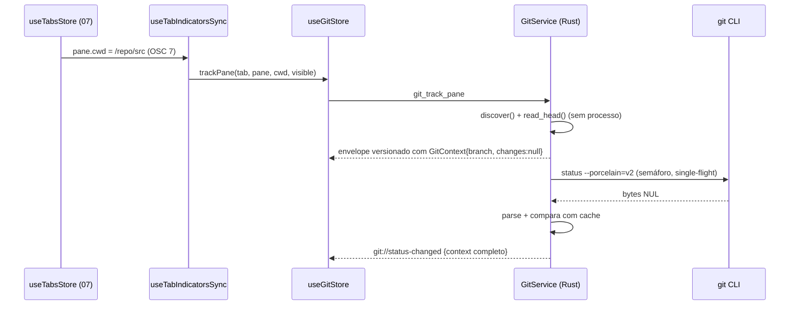
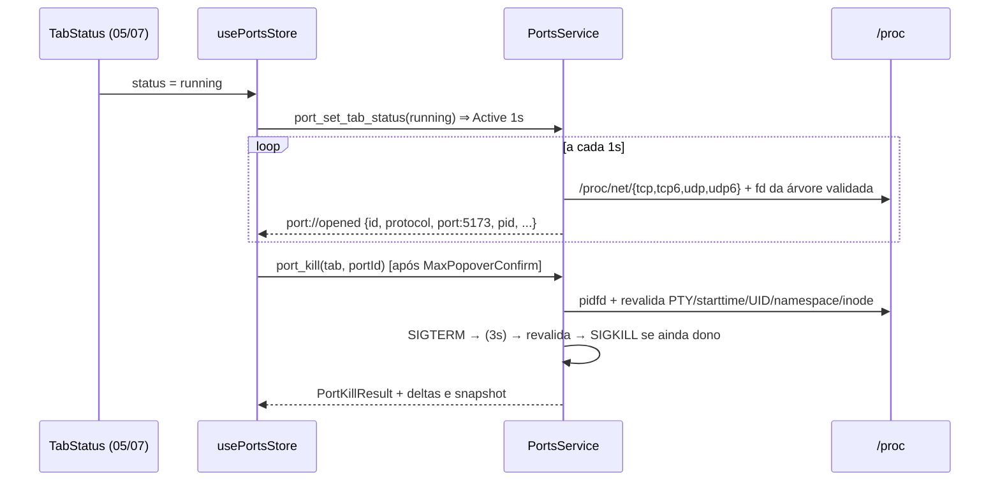

# Fase 08 — Especificação Técnica: Git/Worktree e Portas Ativas

> Escopo e critérios de aceite: [`instructions.md`](./instructions.md). Contratos globais: [`../README.md`](../README.md) §2.
> Todos os tipos expostos ao frontend derivam `serde::Serialize/Deserialize` + `specta::Type` com
> `#[serde(rename_all = "camelCase")]` e são exportados para `src/types/bindings.ts` via `tauri-specta`.

---

## 1. Visão Geral da Arquitetura

### 1.1. Componentes

```
┌──────────────────────────── Frontend (Vue 3.6) ─────────────────────────────┐
│ useTabsStore (Fase 07) ──watch──> useTabIndicatorsSync ──> useGitStore       │
│        │                                   └────────────> usePortsStore      │
│ TabBar (Fase 07) #indicators slot ──> TabIndicators.vue                      │
│                                        ├─ GitIndicator.vue                   │
│                                        ├─ WorktreeBadge.vue                  │
│                                        └─ PortBadge.vue (MaxPopoverConfirm)  │
└──────────────── invoke / listen ─────────────────────────────────────────────┘
┌──────────────────────── crate binário `maxterminal` ────────────────────────┐
│ commands/git.rs   commands/ports.rs   events/{git,ports}.rs                  │
│ adapters/{process_tree,indicators,exact_process_signaler,port_opener}.rs    │
└───────────────┬───────────────────────────────────────┬──────────────────────┘
        ┌───────▼────────┐                       ┌──────▼────────┐
        │    mt-git      │                       │   mt-ports    │
        │ GitService     │                       │ PortsService  │
        │ RepoCache      │                       │ Poller        │
        │ RepoWatcher    │                       │ procnet/fdmap │
        │ GitRunner(CLI) │                       │ Killer/Opener │
        │ WorktreeManager│                       └──────┬────────┘
        └───────┬────────┘                              │
           git CLI + inotify                 /proc/net/{tcp,tcp6,udp,udp6}, fd
```

### 1.2. Princípios
- **Autoridade Rust:** o registro da Fase 07 determina aba/painel/PTY e a Fase 02 valida os processos.
  `IndicatorWorkspaceObserver` registra spawn, saída e fechamento mesmo com WebView desmontada.
  `useTabIndicatorsSync` reconcilia as projeções da UI, fornece visibilidade e solicita refresh; IDs
  recebidos por IPC nunca autorizam um processo sem validação contra esses registros.
- **Nada bloqueia a thread principal:** todo trabalho roda em `tokio` (`spawn_blocking` para leituras de
  `/proc` e para o parser, `tokio::process` para `git`).
- **Estado efêmero:** nenhuma tabela SQLite; tudo é recomputável.

### 1.3. Contratos consumidos de fases anteriores

| Fase | Contrato | Uso |
|------|----------|-----|
| 01 | `mt_core::{MtError, TabId, PaneId, PtyId, ProjectId}` | Erros e ids |
| 02 | `PtyManager::{summary, process_report, descendant_pids, owner_of_pid, add_listener}`, `ProcessInfo.start_time`, `PtyOwner` | `ProcessTreeSource` e `CwdFallback`; identidade do shell vem de `process_report().shell`, não só de `PtyPids.shell_pid` |
| 05 | `TabStatus`; `cwd` por painel (OSC 7); fim de comando (OSC 133 `D`) refletido na store | Polling adaptativo e gatilho de refresh Git |
| 07 | `WorkspaceLifecycleObserver`, `WorkspaceManager::{register_observer, pane_pty, workspace_snapshot}`, `useTabsStore.tabsById`, `TabView.panes` e slot `#indicators="{ tab }"` | Registro backend e sincronização/renderização; status consumido separadamente da 05 |
| 03 (transitiva) | `sanitizer::sanitize` | Erros sanitizados na borda IPC, sem dependência de SQLite nos crates de coleta |

Os adaptadores são a **única** superfície que conhece nomes concretos das Fases 02/07; se esses nomes mudarem,
só os adaptadores mudam.

`PaneView.pty_id` pode ser `None`; a 08 não inventa PTY nem coleta PID sem vínculo. O adaptador traduz
campos `snake_case`/`camelCase` conforme os bindings efetivamente gerados pela 07, sem redeclarar DTOs.
`WorkspaceLifecycleObserver` não fornece mudança de cwd nem fim de cada comando: o adaptador escuta também eventos
de shell da 05 por `ptyId`, atualiza cwd somente local/validado e agenda refresh para **aquele painel**.
Fallback de cwd usa o shell do PTY (não um filho temporariamente em outro diretório).

`PtyProcessTreeAdapter` e `git_track_pane` recebem o mesmo `Arc<WorkspaceManager>` e consultam
`pane_pty(tab_id, pane_id).await`. O comando Git repassa o `Option<PtyId>` real ao serviço;
`verify_pane_ownership` é assíncrono e recusa divergência antes do rastreamento de portas.
O observador consome `WorkspaceLifecycleSignal::{PaneSpawned, PaneExited, TabClosed, TabLayoutChanged}`,
validando geração e ordem, sem depender dos eventos IPC da WebView.

**Contrato pré-spawn 07 ↔ 08:** `GitWorkspaceSpawnHook` implementa `WorkspaceSpawnHook` da Fase 07,
instalado por `WorkspaceManager::with_spawn_hooks` antes de compartilhar o manager/restore. Seu guard
possui `CwdReservationGuard` adquirido por `GitService::reserve_cwd(...).await?`; confirma `track_pane`
antes da publicação e só então libera o token. Em erro, a operação para o PTY antes de rollback/Drop;
`Blocked` mantém a reserva. O observador reconcilia posteriormente, sem constituir essa barreira.
Contrato completo e adaptador: `07/03/spec.md` §3.4 e `03/spec.md` §3.6; nenhum campo adicional em
`SpawnContext`/`ResolvedSpawn` nem dependência `mt-git` na trait da Fase 07.

**Extensão local da 08:** `ExactProcessSignaler` (§3.5) consulta a supervisão da 02 e mantém pidfd durante
a operação. A assinatura existente `signal_process(id, pid, sig)` não promete essa atomicidade; a 08
implementa o adaptador, sem presumir uma nova API já entregue pela 02. `PortUrlOpener` (§3.6) pertence
integralmente à 08 e pode ser reutilizado pela 09, jamais consumido dela.

---

## 2. Crate `mt-git`

### 2.1. Decisão: `git` CLI vs `gix` vs `git2`

| Critério | `git` CLI (porcelain v2) | `gix` | `git2` (libgit2) |
|----------|--------------------------|-------|------------------|
| Fidelidade (index v4, sparse-checkout, untracked cache, `includeIf`, extensões de worktree) | Referência | Boa, mas `status` ainda incompleto em casos de borda (submódulos, filtros) | Atrasada em extensões recentes |
| Dependências nativas | Nenhuma (binário já exigido pelo usuário) | Rust puro, árvore de deps grande (+tempo de build) | Biblioteca C (`libgit2`, `openssl`/`libssh2`) |
| `worktree add/remove` | Completo; política explícita de hooks na operação automatizada | Parcial | Parcial, semântica diferente |
| Custo por chamada | ~5–40 ms (fork+exec) | Menor | Menor |
| Isolamento de falhas | Processo separado, timeout/kill trivial | Mesmo processo | Mesmo processo (FFI) |

**Escolha:** `git` CLI para `status` e operações de worktree, combinado com **leitura direta de arquivos**
(`.git`, `HEAD`, `commondir`, `gitdir`) em Rust puro para descoberta, detecção de worktree e pintura inicial
sem processo. O custo de fork é amortizado por cache, debounce e single-flight. A abstração `GitRunner`
permite trocar por `gix` no futuro (Fase 17, se benchmarks exigirem) sem alterar `GitService`.

### 2.2. Tipos públicos (`src/types.rs`)

```rust
/// Chave do cache: gitdir canônico da worktree (em worktrees vinculadas, `.git/worktrees/<nome>`).
#[derive(Debug, Clone, PartialEq, Eq, Hash, Serialize, Deserialize, specta::Type)]
pub struct RepoKey(pub String);

#[derive(Debug, Clone, PartialEq, Serialize, Deserialize, specta::Type)]
#[serde(rename_all = "camelCase")]
pub struct GitContext {
    pub repo_key: RepoKey,
    /// Raiz do working tree atual (toplevel).
    pub work_tree: String,
    pub branch: GitBranch,
    /// `None` quando o status completo ainda não foi calculado ou falhou (modo degradado).
    pub changes: Option<GitChanges>,
    pub upstream: Option<GitUpstream>,
    pub worktree: Option<GitWorktree>,
    pub degraded: Option<DegradedReason>,
    /// Epoch ms do cálculo, apenas para exibição; ordenação usa o envelope versionado (§4.2).
    pub computed_at: i64,
}

#[derive(Debug, Clone, PartialEq, Serialize, Deserialize, specta::Type)]
#[serde(tag = "kind", rename_all = "camelCase", rename_all_fields = "camelCase")]
pub enum GitBranch {
    Named { name: String, oid: Option<String> },   // oid None => repositório sem commits
    Detached { short_oid: String, oid: String },
    Unborn { name: String },                        // `# branch.oid (initial)`
}

#[derive(Debug, Clone, Default, PartialEq, Serialize, Deserialize, specta::Type)]
#[serde(rename_all = "camelCase")]
pub struct GitChanges {
    pub staged: u32,
    pub unstaged: u32,
    pub untracked: u32,
    pub conflicted: u32,
}
impl GitChanges { pub fn is_dirty(&self) -> bool { self.staged + self.unstaged + self.untracked + self.conflicted > 0 } }

#[derive(Debug, Clone, PartialEq, Serialize, Deserialize, specta::Type)]
#[serde(rename_all = "camelCase")]
pub struct GitUpstream { pub name: String, pub ahead: Option<u32>, pub behind: Option<u32>, pub gone: bool }

#[derive(Debug, Clone, Copy, PartialEq, Eq, Serialize, Deserialize, specta::Type)]
#[serde(rename_all = "camelCase")]
pub enum WorktreeKind { MaxCode, Project, Other }

#[derive(Debug, Clone, PartialEq, Serialize, Deserialize, specta::Type)]
#[serde(rename_all = "camelCase")]
pub struct GitWorktree {
    pub name: String,            // último componente do gitdir (`.git/worktrees/<name>`)
    pub kind: WorktreeKind,      // por caminho: `/.max-code-worktrees/` > `/.worktrees/` > Other
    pub main_work_tree: Option<String>, // resolvido por Git; None em principal bare/desconhecida
}

#[derive(Debug, Clone, Copy, PartialEq, Eq, Serialize, Deserialize, specta::Type)]
#[serde(rename_all = "camelCase")]
pub enum DegradedReason { GitNotFound, Timeout, UnsafeRepository, CommandFailed, WatchUnavailable }

#[derive(Debug, Clone, PartialEq, Serialize, Deserialize, specta::Type)]
#[serde(rename_all = "camelCase")]
pub struct WorktreeEntry {
    pub path: String,
    pub head_oid: Option<String>,
    pub branch: Option<String>,  // sem `refs/heads/`
    pub is_main: bool,
    pub is_detached: bool,
    pub is_locked: bool,
    pub is_prunable: bool,
    pub kind: Option<WorktreeKind>, // None para a principal
}

#[derive(Debug, Clone, Serialize, Deserialize, specta::Type)]
#[serde(rename_all = "camelCase")]
pub struct WorktreeCreateRequest {
    pub repo_path: String,
    pub name: String,                 // ^[A-Za-z0-9._-]{1,100}$, sem `..`
    pub location: WorktreeLocation,
    pub new_branch: Option<String>,   // `-b <branch>`; validado com `git check-ref-format --branch`
    pub base: Option<String>,         // commit-ish; default HEAD
    pub ensure_gitignore: bool,       // garante regra na worktree criada, nunca edita a principal
}

#[derive(Debug, Clone, Copy, Serialize, Deserialize, specta::Type)]
#[serde(rename_all = "camelCase")]
pub enum WorktreeLocation { MaxCode /* <repo>/.max-code-worktrees/<name> */, Project /* <repo>/.worktrees/<name> */ }
```

### 2.3. Descoberta (`src/discover.rs`)

```rust
pub struct RepoLocation {
    pub work_tree: PathBuf,
    pub git_dir: PathBuf,          // gitdir da worktree atual
    pub common_dir: PathBuf,       // == git_dir na principal
    pub worktree: Option<GitWorktree>,
}

/// Sobe a partir de `cwd` até achar `.git`; respeita `GIT_CEILING_DIRECTORIES` e para na raiz.
pub fn discover(cwd: &Path) -> Result<Option<RepoLocation>, GitError>;
/// Lê `HEAD` (simbólico ou SHA) sem executar processo.
pub fn read_head(location: &RepoLocation) -> Result<GitBranch, GitError>;
pub fn classify_worktree(path: &Path) -> WorktreeKind;
```

Algoritmo:
1. Canonicalizar `cwd` e buscar `.git` nos ancestrais. Diretório `.git` fornece o gitdir; arquivo contém
   `gitdir: <p>`, resolvido relativamente à pasta do arquivo. Limitar tamanho e detectar ciclos/symlinks.
2. Resolver `commondir` relativamente ao gitdir real. **Comprovar** worktree vinculada por gitdir distinto
   do commondir, entrada administrativa correspondente e arquivo reverso `<gitdir>/gitdir` apontando
   para o `.git` encontrado. Um submódulo/gitdir separado sem esse vínculo continua sem badge.
3. Quando Git está disponível, confirmar os caminhos com invocações separadas de `rev-parse
   --absolute-git-dir`, `rev-parse --path-format=absolute --git-common-dir` e `rev-parse --show-toplevel`.
   Usar `worktree list --porcelain -z` para a principal; **não** inferir que o pai do commondir é a raiz
   (gitdir separado e principal bare quebram essa hipótese). Divergência ⇒ descartar descoberta provisória.
4. Só então `classify_worktree(work_tree)` verifica componentes `.max-code-worktrees`/`.worktrees`;
   fora deles, `Other`. Repositório comum dentro de uma pasta com esses nomes não ganha badge.
5. `HEAD` pertence ao gitdir; refs compartilhadas e `packed-refs` ao commondir. Resolver refs simbólicas
   com limite/ciclo; 40/64 hex ⇒ `Detached`. Ref ausente em armazenamento `files` válido ⇒ `Unborn`.
   Armazenamento desconhecido/reftable usa CLI; sem CLI, manter nome com `oid: None`, não fingir unborn.
6. Cwd fora de repo ⇒ `None`. Bare não oferece status de working tree; não subir até um repo externo.
   Caminhos ficam como `PathBuf`/bytes internamente; caminho não representável no IPC UTF-8 ⇒ erro explícito,
   nunca usar conversão com perdas como chave ou alvo de operação.

### 2.4. Execução do `git` (`src/runner.rs`)

```rust
#[async_trait::async_trait]
pub trait GitRunner: Send + Sync + 'static {
    async fn status(&self, work_tree: &Path) -> Result<PorcelainStatus, GitError>;
    async fn run(&self, cwd: &Path, args: &[&OsStr], timeout: Duration) -> Result<Output, GitError>;
}

pub struct CliGitRunner { git_bin: Option<PathBuf>, status_timeout: Duration /* 5s */ }
```

Invocação de status (argumentos como vetor, **nunca** via shell):
```
git -C <work_tree> --no-optional-locks -c core.fsmonitor=false -c color.status=false \
    status --porcelain=v2 --branch -z --untracked-files=all --ignore-submodules=none
```
Ambiente: `GIT_OPTIONAL_LOCKS=0`, `GIT_TERMINAL_PROMPT=0`, `LC_ALL=C`, `GIT_PAGER=cat`; `stdin` nulo;
`kill_on_drop(true)`. Timeout ⇒ `GitError::Timeout`. `stderr` contendo `detected dubious ownership` ⇒
`GitError::UnsafeRepository`. `git_bin` resolvido uma vez (`which`) na inicialização; `None` ⇒ `GitNotFound`.
Remover variáveis herdadas que redirecionem repositório/configuração (`GIT_DIR`, `GIT_WORK_TREE`,
`GIT_COMMON_DIR`, `GIT_INDEX_FILE`, `GIT_CONFIG_COUNT` e seus pares chave/valor, `GIT_CONFIG_PARAMETERS`).
Timeout cancela, mata **e aguarda** o filho; stdout/stderr são drenados com limites (status: 16 MiB;
excesso ⇒ `git.output_limit`, modo degradado). Não executar fetch nem rede para ahead/behind.

### 2.5. Parser porcelain v2 (`src/porcelain.rs`)

```rust
#[derive(Debug, Default, PartialEq)]
pub struct PorcelainStatus {
    pub oid: Option<String>,        // None para `(initial)`
    pub head: Option<String>,       // None para `(detached)`
    pub upstream: Option<String>,
    pub ahead_behind: Option<(u32, u32)>,
    pub changes: GitChanges,
}
pub fn parse(bytes: &[u8]) -> Result<PorcelainStatus, GitError>;
```

Regras (registros separados por NUL):
- `# branch.oid <sha|(initial)>`, `# branch.head <nome|(detached)>`, `# branch.upstream <u>`, `# branch.ab +A -B`.
- `1 XY …` e `2 XY …`: `X != '.'` ⇒ `staged += 1`; `Y != '.'` ⇒ `unstaged += 1`. Em `2`, o **próximo**
  registro NUL é o caminho original e deve ser consumido e ignorado.
- `u XY …` ⇒ `conflicted += 1`. `? <path>` ⇒ `untracked += 1`. `! …` ignorado.
- Submódulo `S<c><m><u>`: `m`/`u` marca `unstaged` uma única vez por registro mesmo com `Y == '.'`.
  `--untracked-files=all` conta arquivos, não diretórios condensados. Nunca dividir paths por espaço/linha.
- Ausência de `branch.ab` deixa contagens `None`; só marcar `gone` após confirmar que a ref upstream
  configurada não existe (não confundir unborn/erro de resolução). Registros desconhecidos são ignorados.

### 2.6. Cache e serviço (`src/cache.rs`, `src/lib.rs`)

```rust
pub struct GitService {
    runner: Arc<dyn GitRunner>,
    cache: RepoCache,
    watcher: RepoWatcher,
    panes: DashMap<PaneId, PaneBinding>,
    sem: Arc<Semaphore>,                 // 4 execuções de git simultâneas
    emitter: Arc<dyn GitEventSink>,
}

struct PaneBinding {
    tab_id: TabId, pty_id: Option<PtyId>, cwd: PathBuf, repo: Option<RepoKey>, visible: bool,
    generation: u32, revision: u32,
}

struct RepoEntry {
    location: RepoLocation,
    context: Option<GitContext>,
    refcount: usize,
    inflight: Option<Shared<BoxFuture<'static, Result<GitContext, GitError>>>>, // single-flight
    dirty_again: bool,       // novo gatilho chegou durante inflight ⇒ re-executa ao terminar
    observed_signature: Option<String>, // coalescer conteúdo repetido; nunca suprimir mudança externa
    released_at: Option<Instant>, // refcount 0 ⇒ descarte após 60 s
}

pub trait GitEventSink: Send + Sync + 'static {
    fn status_changed(&self, payload: GitStatusChanged);
}

impl GitService {
    pub fn new(runner: Arc<dyn GitRunner>, emitter: Arc<dyn GitEventSink>) -> Self;
    /// Associa/atualiza o painel ao `cwd`; retorna contexto imediato (do cache ou leitura de HEAD).
    pub async fn track_pane(self: &Arc<Self>, tab_id: TabId, pane_id: PaneId, pty_id: Option<PtyId>, cwd: PathBuf, visible: bool) -> Result<GitStatusChanged, GitError>;
    pub fn untrack_pane(&self, pane: PaneId);
    pub fn set_visible(&self, tab: Option<TabId>);
    /// Agenda recomputação (debounced 150 ms) do repo do painel.
    pub fn request_refresh(&self, pane: PaneId, reason: RefreshReason);
    pub async fn status_once(&self, cwd: &Path) -> Result<Option<GitContext>, GitError>;
    pub fn panes_inside(&self, path: &Path) -> Vec<PaneId>; // usado por worktree remove
}

#[derive(Debug, Clone, Copy, Serialize, Deserialize, specta::Type)]
#[serde(rename_all = "camelCase")]
pub enum RefreshReason { CommandFinished, WindowFocus, Watcher, Periodic, Manual }
```

`track_pane`: se o `cwd` mudou para o mesmo repo, apenas atualiza o binding; se mudou de repo, decrementa
o refcount anterior e incrementa o novo (criando watch). O retorno imediato usa `read_head` quando não há
contexto em cache (`changes: None`), e um status completo é agendado em seguida.
Cada binding guarda `generation`; tarefas capturam esse valor e só publicam se o painel ainda aponta
para o mesmo repo/cwd/PTY. Untrack invalida a geração antes de cancelar tarefas. Nenhum lock de mapa é
mantido durante subprocessos/E/S. Refcount zero remove watchers imediatamente; cache expira em 60 s.

### 2.7. Watcher (`src/watcher.rs`)

```rust
pub struct RepoWatcher { inner: Mutex<notify::RecommendedWatcher>, tx: mpsc::Sender<RepoKey> }
impl RepoWatcher {
    pub fn watch(&self, key: &RepoKey, loc: &RepoLocation) -> Result<(), GitError>;
    pub fn unwatch(&self, key: &RepoKey);
}
```
- Caminhos observados (`RecursiveMode::NonRecursive`): `git_dir/` (captura `HEAD`, `index`, `MERGE_HEAD`),
  `common_dir/` (captura `packed-refs`, `FETCH_HEAD`), `common_dir/refs/heads/` e
  `common_dir/refs/remotes/<upstream-remote>/` quando houver upstream.
- Filtro: ignorar nomes terminados em `.lock`, `ORIG_HEAD` e eventos `Access`.
- Debounce por repo: 300 ms *trailing* (`tokio::time::sleep` reiniciado a cada evento), teto de 1 s
  (*max wait*) para rajadas longas (ex.: `git rebase`).
- Falha em `watch` (ex.: `ENOSPC` de inotify) ⇒ `DegradedReason::WatchUnavailable` e polling de 5 s
  apenas desse repo enquanto houver painel visível.
- Para refs `feature/foo`, observar também os diretórios pais da ref efetiva, recriando watches após
  rename/remoção. Observar configuração, `.git` e seus pais para redescobrir worktree movida/reparada.
  Mudança no commondir invalida todas as worktrees vinculadas; index/HEAD só a worktree correspondente.
- Watch de working tree é opcional e limitado (excluir `.git`, dependências e build); correção do dirty
  externo é garantida por reconciliação: 30 s visível, 120 s oculto com painéis vivos, pausa sem bindings.
  Foco/cwd/fim de comando antecipam refresh. Falha de watch em repo oculto usa 30 s. Timeout repetido
  aplica backoff 5/15/30 s, mantendo contexto anterior marcado degradado até recuperar.
- Evento durante consulta marca `dirty_again`; não existe janela cega de supressão após `status`.

### 2.8. Gestão de worktrees (`src/worktree.rs`)

```rust
#[async_trait::async_trait]
pub trait WorktreeManager: Send + Sync {
    async fn list(&self, repo_path: &Path) -> Result<Vec<WorktreeEntry>, GitError>;
    async fn create(&self, req: WorktreeCreateRequest) -> Result<WorktreeEntry, GitError>;
    async fn remove(&self, path: &Path, force: bool) -> Result<(), GitError>;
    async fn prune(&self, repo_path: &Path) -> Result<(), GitError>;
}
pub struct CliWorktreeManager { runner: Arc<dyn GitRunner>, service: Weak<GitService> }
```
- `list`: `git worktree list --porcelain -z`; blocos separados por NUL duplo com chaves
  `worktree`, `HEAD`, `branch`, `detached`, `locked`, `prunable`, `bare`. Primeira entrada = principal.
- `create`: valida nome (regex + sem `..`, `/`, `\0`), resolve destino pela `location` a partir do
  *main work tree*, falha com `git.worktree_exists` se o diretório existir; valida `new_branch` com
  `git check-ref-format --branch`; executa `git worktree add [-b <branch>] -- <path> [<base>]`
  (timeout 120 s). `base` é resolvida antes para OID com `rev-parse --verify --end-of-options <base>^{commit}`;
  não inserir revisão não validada como opção. Desabilitar hooks com `-c core.hooksPath=/dev/null` nesta
  operação automatizada. Se `ensure_gitignore`, acrescenta a regra à **nova worktree**, deixando alteração
  explícita para o consumidor integrar; a principal precisa ignorar o contêiner previamente (ou erro
  `git.worktree_container_not_ignored`). Não modificar arquivos da principal silenciosamente.
- `remove`: recusa principal, worktree bloqueada e worktree em uso pelo registro backend da 07
  (`git.worktree_in_use`, mesmo com `force`); `force` só permite dirty explicitamente confirmado pelo
  consumidor. Resolver entrada pelo caminho canônico e serializar add/remove/prune por commondir.
  Revalidar ausência de painéis/PTYs sob a mesma exclusão usada para reservar cwd na abertura de aba;
  `reserve_cwd` insere o token sob leitura de `cwd_gate`; `remove` adquire mutex de `common_dir` → escrita
  desse gate, revalida caminho/uso e mantém escrita até término/reap do subprocesso. A aquisição da
  reserva é assíncrona e revalida cwd após aguardar; o guard não retém locks durante spawn/vida do shell.
  Registro ativo precede Drop do token, sem lacuna; `prune` usa a mesma exclusão (`01/spec.md` §3.8).
  Depois executar `git worktree remove [--force] -- <path>`; nunca remover pasta arbitrária recursivamente.
- `prune`: usar primeiro `git worktree prune --dry-run --verbose`, proteger entradas em uso/bloqueadas,
  revalidar sob exclusão e remover apenas metadados obsoletos. Principal bare/desconhecida pode listar,
  mas criar retorna `git.worktree_root_unavailable` até existir raiz de destino validada.
- Toda operação concluída dispara `request_refresh(Manual)` nos painéis do repo afetado.

Exemplo (doc-test) para Fases 13/16:
```rust
let entry = manager.create(WorktreeCreateRequest {
    repo_path: "/home/u/GitHub/App".into(), name: "issue-42".into(),
    location: WorktreeLocation::MaxCode, new_branch: Some("fix/issue-42".into()),
    base: None, ensure_gitignore: true,
}).await?;
assert!(entry.path.ends_with(".max-code-worktrees/issue-42"));
```

### 2.9. Erros (`src/error.rs`)

```rust
#[derive(Debug, thiserror::Error)]
pub enum GitError {
    #[error("Git não encontrado no PATH")] NotFound,
    #[error("Diretório não é um repositório Git")] NotARepo,
    #[error("Comando git excedeu o tempo limite")] Timeout,
    #[error("Repositório com proprietário divergente (safe.directory)")] UnsafeRepository,
    #[error("Falha ao executar git: {stderr}")] CommandFailed { code: Option<i32>, stderr: String },
    #[error("Nome inválido: {0}")] InvalidName(String),
    #[error("Worktree já existe: {0}")] WorktreeExists(String),
    #[error("Worktree em uso por abas abertas")] WorktreeInUse(Vec<PaneId>),
    #[error("Não é possível remover a worktree principal")] WorktreeIsMain,
    #[error("Falha de E/S: {0}")] Io(#[from] std::io::Error),
    #[error("Saída do git inválida: {0}")] Parse(String),
}
```
Mapeamento `code` de `MtError`: `git.not_found`, `git.not_a_repo`, `git.timeout`, `git.unsafe_repository`,
`git.command_failed`, `git.invalid_name`, `git.worktree_exists`, `git.worktree_in_use`, `git.worktree_is_main`,
`git.io`, `git.parse`, `git.output_limit`, `git.worktree_container_not_ignored`, `git.worktree_root_unavailable`,
`git.worktree_locked`, `git.path_encoding` (adicionar variantes correspondentes ao enum ao implementar).
`stderr` é sanitizado no adaptador via `mt_db::sanitizer::sanitize()` antes de truncar a 2 KiB e compor `details`.

---

## 3. Crate `mt-ports`

### 3.1. Tipos públicos (`src/types.rs`)

```rust
#[derive(Debug, Clone, Copy, PartialEq, Eq, Hash, Serialize, Deserialize, specta::Type)]
#[serde(rename_all = "camelCase")]
pub enum IpFamily { V4, V6 }

#[derive(Debug, Clone, Copy, PartialEq, Eq, Hash, Serialize, Deserialize, specta::Type)]
#[serde(rename_all = "camelCase")]
pub enum PortProtocol { Tcp, Udp }

/// Token opaco de uma observação; nunca reutilizar após fechamento/troca de dono.
#[derive(Debug, Clone, PartialEq, Eq, Hash, Serialize, Deserialize, specta::Type)]
pub struct PortId(pub String);

#[derive(Debug, Clone, PartialEq, Eq, Hash, Serialize, Deserialize, specta::Type)]
#[serde(rename_all = "camelCase")]
pub struct PortAddress { pub ip: String, pub family: IpFamily, pub is_loopback: bool, pub is_wildcard: bool }

#[derive(Debug, Clone, PartialEq, Eq, Serialize, Deserialize, specta::Type)]
#[serde(rename_all = "camelCase")]
pub struct ListeningPort {
    pub id: PortId,
    pub protocol: PortProtocol,
    pub port: u16,
    pub addresses: Vec<PortAddress>, // agrupar só sockets do mesmo dono, PTY e protocolo
    pub pid: i32,
    pub start_time: String,          // ticks decimais, sem perda de u64 no JavaScript
    pub process_name: String,        // `/proc/<pid>/comm`
    pub pty_id: PtyId,
    pub pane_id: PaneId,
    pub tab_id: TabId,
    pub can_open_browser: bool,
    pub can_kill: bool,
    pub shared_socket: bool,         // há outros detentores conhecidos do inode
    pub detected_at: i64,            // epoch ms
}

#[derive(Debug, Clone, Copy, PartialEq, Eq, Serialize, Deserialize, specta::Type)]
#[serde(rename_all = "camelCase")]
pub enum KillOutcome { Terminated, Killed, AlreadyGone, SocketReleased /* vivo, mas liberou o socket */ }

#[derive(Debug, Clone, Serialize, Deserialize, specta::Type)]
#[serde(rename_all = "camelCase")]
pub struct PortKillResult {
    pub outcome: KillOutcome,
    pub remaining: Vec<ListeningPort>, // donos ainda presentes após nova varredura
}

#[derive(Debug, Clone, Copy, PartialEq, Eq)]
pub enum PollMode { Active /* 1s */, Lingering /* 5s */, IdleProbe /* 30s */, Off }
```

Identidade interna de socket: `(netns_inode, protocol, family, local_addr, port, inode)`.
Identidade de dono: `(pty_id, binding_generation, pid, start_time)`. `PortId` é gerado no backend para
o conjunto `(dono, protocol, port)` e aponta para `TrackedPort { view, owner, root, uid, netns,
sockets: Vec<SocketIdentity> }`. Mudança no conjunto de identidades de sockets invalida o token e emite
`closed` + `opened` com novo ID; isso cancela confirmações pendentes. `updated` cobre nome/flags e
compartilhamento, não troca de socket/dono. Mesmo número em TCP/UDP, dois painéis ou `SO_REUSEPORT` produz registros
distintos. FD herdado por dois processos produz dois donos, nunca "o primeiro PID encontrado".

### 3.2. Parser `/proc/net/{tcp,tcp6,udp,udp6}` (`src/procnet.rs`)

```rust
pub struct ListenSocket {
    pub inode: u64, pub port: u16, pub addr: IpAddr, pub uid: u32,
    pub protocol: PortProtocol, pub family: IpFamily, pub netns_inode: u64,
}
pub fn parse_proc_net(content: &str, family: IpFamily, protocol: PortProtocol, netns: u64) -> Vec<ListenSocket>;
pub fn read_listen_sockets() -> Result<SocketRead, PortsError>;
// SocketRead distingue tabelas completas, ausentes por IPv6 desativado e falhas de leitura.
```
Formato de linha (após o cabeçalho): `sl local_address rem_address st tx:rx tr:when retrnsmt uid timeout inode …`.
- TCP: filtrar `st == "0A"` (LISTEN). UDP: incluir sockets vinculados com porta local > 0 e inode > 0
  (estados usuais `07` não conectado e `01` conectado); não exigir `0A` nem prometer servidor HTTP.
  `inode == 0` ou porta zero ⇒ ignorar; sockets UDP de cliente também são bindings e o tooltip explica isso.
- `local_address` = `IP:PORTA` em hex; porta é big-endian (`u16::from_str_radix`).
- IPv4: 8 hex, `u32` em ordem do host little-endian ⇒ `Ipv4Addr::from(u32::from_str_radix(..).swap_bytes())`.
  Ex.: `0100007F` ⇒ `127.0.0.1`.
- IPv6: 32 hex = 4 palavras de 32 bits, cada uma little-endian; inverter bytes de cada palavra.
  `::ffff:a.b.c.d` permanece `V6` com endereço IPv6 canônico; normalização visual não altera identidade.
- Filtrar `uid == geteuid()` (processos do próprio usuário). Linhas malformadas são descartadas com `trace!`.
- Leitura com buffer reutilizado (`String::with_capacity(64 KiB)`), executada em `spawn_blocking`.
- `/proc/net` representa o namespace do app. Comparar `/proc/<pid>/ns/net` com `/proc/self/ns/net`;
  divergência ⇒ estado não suportado, nunca associar inode/porta entre namespaces. UDP6/tcp6 ausentes
  por IPv6 desativado são opcionais; falha de permissão/parsing sistemática mantém snapshot anterior
  marcado `stale`, em vez de emitir `closed` como se o conjunto fosse vazio.

### 3.3. Árvore de processos (`src/tree.rs`) e mapa de fds (`src/fdmap.rs`)

```rust
#[derive(Debug, Clone, Copy, PartialEq, Eq, Hash)]
pub struct ProcId { pub pid: i32, pub starttime: u64 } // campo 22 de /proc/<pid>/stat

pub trait ProcessTreeSource: Send + Sync + 'static {
    /// PID raiz (shell) do PTY, se vivo.
    fn root(&self, pty: PtyId) -> Result<Option<ProcId>, PortsError>;
    /// Raiz + todos os descendentes vivos.
    fn descendants(&self, pty: PtyId, root: ProcId) -> Result<Vec<ProcId>, PortsError>;
    /// Reconsulta supervisor e /proc; inclui adotados apenas quando a 02 comprova a posse.
    fn owns(&self, pty: PtyId, process: ProcId) -> Result<bool, PortsError>;
}

/// Implementação de referência lendo /proc/<pid>/task/*/children; usada nos testes e como fallback.
pub struct ProcfsTreeSource;

pub struct FdOwner { pub proc: ProcId, pub comm: String }
/// Para cada pid, varre /proc/<pid>/fd/* (readlink "socket:[N]") e cruza com `wanted`.
pub fn map_inodes(pids: &[ProcId], wanted: &HashSet<u64>) -> Result<HashMap<u64, Vec<FdOwner>>, PortsError>;
pub fn read_starttime(pid: i32) -> Option<u64>;
```
`root` consulta `process_report().shell` e valida `summary().owner` contra aba/painel; `descendants`
adapta `descendant_pids(pty)` (pares PID/start_time), adicionando a raiz validada. `owner_of_pid` é só
índice auxiliar, nunca prova suficiente sem `start_time`/UID e geração. Reparentamento só mantém vínculo
quando o supervisor confirma o processo adotado; não inferir dono apenas por PGID ou variável de ambiente.

Ler `stat` antes/depois de `fd/`; diferença de campo 22 descarta amostra. Parser de `stat` respeita `comm`
com espaços e parênteses, sem split ingênuo desde o início da linha. `fd/` só é varrido com `wanted`
não vazio. `ENOENT` é corrida normal; `EACCES` marca coleta parcial e desabilita ações até recuperar.
Essas leituras não são transação: a ação destrutiva faz nova validação independente (§3.5).

### 3.4. Poller (`src/poller.rs`)

```rust
pub struct PortsService {
    tree: Arc<dyn ProcessTreeSource>,
    signaler: Arc<dyn ExactProcessSignaler>,
    opener: Arc<dyn PortUrlOpener>,
    tabs: Mutex<HashMap<TabId, TabTracking>>,
    epoch: String,
    emitter: Arc<dyn PortEventSink>,
    wake: Notify,
}

struct TabTracking {
    panes: HashMap<PaneId, PanePortBinding>,
    status: TabStatus,                 // espelho do TabStatus da Fase 05 (mt-core)
    mode: PollMode,
    next_due: Instant,
    known: HashMap<PortId, TrackedPort>,
    revision: u32,
}

struct PanePortBinding { pty_id: PtyId, root: ProcId, generation: u32 }

pub trait PortEventSink: Send + Sync + 'static {
    fn opened(&self, event: PortOpened);
    fn updated(&self, event: PortUpdated);
    fn closed(&self, event: PortClosed);
    fn snapshot(&self, snapshot: PortSnapshot);
    // O serviço atribui epoch/revision atomicamente antes de enfileirar para emissão (§4.2).
}

impl PortsService {
    pub fn spawn(tree: Arc<dyn ProcessTreeSource>, signaler: Arc<dyn ExactProcessSignaler>,
        opener: Arc<dyn PortUrlOpener>, emitter: Arc<dyn PortEventSink>) -> Arc<Self>;
    pub fn track_pane(&self, tab: TabId, pane: PaneId, pty: PtyId) -> Result<PortSnapshot, PortsError>;
    pub fn untrack_pane(&self, tab: TabId, pane: PaneId);   // emite `closed` das portas do painel
    pub fn set_tab_status(&self, tab: TabId, status: TabStatus);
    pub fn ports_for_tab(&self, tab: TabId) -> PortSnapshot;
    pub async fn scan_now(&self, tab: TabId) -> Result<PortSnapshot, PortsError>;
}
```

Regras de agendamento:
- Algum painel executando, ou aba `running | continuous` ⇒ `Active` (1 s); status agregado de erro
  não pode esconder irmão executando. Sem informação por painel, usar `process_report` de foreground.
- `idle | finished | error` com descendente vivo ou `known` não vazio ⇒ `Lingering` (5 s).
- PTY vivo sem descendentes/portas ⇒ `IdleProbe` (30 s); sem PTY vivo ⇒ `Off`.
- Toda transição de status dispara uma varredura imediata da aba (`wake.notify_one()`), o que garante
  detectar fechamentos quando o comando termina.
- Spawn, troca de PTY, mudança de foreground, fim de cada comando, foco e refresh manual também
  colocam `next_due = now` antes de acordar. A descoberta de descendentes ocorre mesmo sem sockets,
  permitindo que um job faça bind segundos depois de retornar ao prompt. Visibilidade não suspende
  monitoramento de processos contínuos/descendentes em abas ocultas.

Laço único (tokio task):
```
loop {
  sleep_until(min(next_due de abas não-Off)) ou wake.notified()
  due = abas com next_due <= agora
  if due.is_empty() { continue }
  sockets = read_listen_sockets()            // UMA leitura para todas as abas devidas
  wanted  = {inodes de sockets}
  for tab in due:
    pids   = ∪ tree.descendants(pty, raiz validada de tree.root(pty)) para cada painel
    owners = map_inodes(pids, wanted)
    atual  = agrupa por dono + protocolo + porta, preservando sockets e painel
    diff(tab.known, atual) ⇒ emite opened/updated/closed; tab.known = atual
    recalcula mode e next_due
}
```
Sem abas devidas não há leitura de `/proc`. Fazer E/S fora dos locks, single-flight por aba e validar
geração do binding antes de aplicar o resultado. Untrack invalida tokens e emite fechamentos mesmo que
um scan esteja em andamento; `track_pane` repetido é idempotente. Limitar concorrência dos fd scans e
descartar tarefas ao shutdown; falha de coleta usa backoff até 30 s sem publicar conjunto vazio.
Logs `debug!(target: "mt_ports::poller", scanned_tabs, sockets, elapsed_us)`.

### 3.5. Encerramento (`src/killer.rs`)

```rust
pub async fn kill_port_owner(svc: &PortsService, tab: TabId, id: PortId) -> Result<PortKillResult, PortsError>;

/// Implementado no adaptador da 08; usa registro da 02 e pidfd Linux, nunca killpg.
pub trait ExactProcessSignaler: Send + Sync {
    fn acquire(&self, pty: PtyId, root: ProcId, owner: ProcId) -> Result<ProcessHandle, PortsError>;
    fn signal(&self, handle: &ProcessHandle, signal: Signal) -> Result<(), PortsError>;
    fn has_exited(&self, handle: &ProcessHandle) -> Result<bool, PortsError>;
}
// ProcessHandle retém OwnedFd do pidfd, PtyId, raiz e dono; somente backend, nunca serializado.
```
1. Receber `PortId` mostrado na confirmação; sob exclusão por `(pty, pid, starttime)`, capturar o registro
   e sua geração. Token desconhecido ⇒ `ports.not_tracked`; jamais buscar novo dono pelo número da porta.
2. Revalidar vínculo aba/painel/PTY na 07 e `PtyOwner` na 02, PTY vivo, raiz original, dono ainda
   supervisionado, UID efetivo e namespace iguais. Recusar qualquer shell raiz, PID do app, PID ≤ 1.
3. Abrir `pidfd_open(pid, 0)`. Após adquirir o fd, reler `stat`/starttime e confirmar identidade, posse,
   namespace e inode em `fd/` **e** tabela de sockets (mesmo protocolo/endereço/porta). Se morreu antes
   da aquisição ⇒ `AlreadyGone`; identidade mudou ⇒ `ports.owner_gone`. `ENOSYS`/bloqueio de pidfd ⇒
   `ports.safe_signal_unavailable`, sem fallback para `kill(pid)` sujeito a reuso entre leitura e sinal.
4. Imediatamente antes de SIGTERM, repetir a validação de registro, geração, UID e socket; enviar com
   `pidfd_send_signal` pelo mesmo handle. `EPERM` ⇒ `ports.permission_denied`; `ESRCH` ⇒ `AlreadyGone`.
5. Esperar até 3 s observando pidfd (poll assíncrono ou worker; resolução ≤ 100 ms). Pidfd legível ou
   processo zumbi confirma saída, mesmo que `/proc/<pid>` exista ⇒ `Terminated`.
6. Ainda vivo: repetir **todas** as verificações, inclusive inode. Se liberou o socket ⇒ `SocketReleased`
   e não enviar SIGKILL. Se token/PTY/UID mudou ⇒ abortar. Se ainda dono, SIGKILL pelo **mesmo pidfd**;
   esperar até 1 s ⇒ `Killed`, ou `ports.kill_timeout` se não confirmou saída. Nenhum grupo é sinalizado.
7. Nova varredura publica os deltas e preenche `remaining`; encerrar um dono pode deixar outro dono do
   mesmo inode/porta vivo. `PortKillResult` não promete que a porta ficou livre nem mata o substituto.

`pidfd` elimina a corrida de **reuso do PID**, não torna atômica a posse do socket: revalidar antes de cada
sinal reduz a janela de TOCTOU e sempre limita efeito à identidade de processo explicitamente selecionada.
O usuário encerra esse processo inteiro, incluindo suas outras portas; o popover informa isso.
Irmãos e descendentes não selecionados continuam sob supervisão da 02; adotados são colhidos pelo reaper
da 02 quando terminarem. A 08 não chama `waitpid(-1)` nem disputa `wait` com shell/PtyManager.

### 3.6. Abertura no navegador (`src/opener.rs`)

```rust
pub trait PortUrlOpener: Send + Sync {
    fn open(&self, url: &str) -> Result<(), PortsError>;
}
pub async fn open_in_browser(svc: &PortsService, tab: TabId, id: PortId) -> Result<(), PortsError>;
```
Revalidar token e socket vivo. TCP loopback/wildcard: URL HTTP local construída no backend, sem aceitar
URL, protocolo ou executável enviado pela UI. Dual-stack confirmado pode usar `http://localhost:PORT`;
IPv4 exclusivo usa `http://127.0.0.1:PORT`, IPv6 exclusivo `http://[::1]:PORT`; outro endereço de loopback
usa seu literal. Wildcards `0.0.0.0`/`::` nunca aparecem como destino. Bind exclusivo em IP de LAN e UDP
exibem badge, mas retornam `ports.not_browser_compatible`; não apontar localhost para outro processo.
Não inferir HTTPS pelo número da porta nem fazer sondagens HTTP ativas; o tooltip diz "Abrir endereço
HTTP local" (TCP não garante HTTP). Revalidar impede token vencido, mas não garante posse após entregar
o URL ao navegador; nenhuma credencial/ação automatizada é enviada.

`src-tauri/src/adapters/port_opener.rs` implementa a trait com `tauri-plugin-opener` v2, dependência
direta do crate binário. Registrar `.plugin(tauri_plugin_opener::init())` **na Fase 08**, uma única vez:
```rust
use tauri_plugin_opener::OpenerExt;

// Dentro do adaptador; o serviço já validou e construiu a URL local.
app.opener().open_url(url, None::<&str>).map_err(|e| PortsError::OpenerFailed(e.to_string()))?;
```
Executar operação bloqueante do adaptador em `spawn_blocking`. Capabilities autorizam `port_open_browser`
apenas na janela `main`; frontend não recebe `opener:default` nem acesso genérico a `open_url`. Chamadas
Rust do plugin não substituem validação do comando customizado. O crate `mt-ports` permanece sem Tauri.
Falha do handler padrão ⇒ `ports.opener_failed`, mensagem pt-BR. A 09 poderá reutilizar o plugin já registrado.

### 3.7. Erros

```rust
#[derive(Debug, thiserror::Error)]
pub enum PortsError {
    #[error("/proc indisponível: {0}")] ProcUnavailable(std::io::Error),
    #[error("Porta não pertence a esta aba")] NotTracked,
    #[error("O processo dono da porta já não existe")] OwnerGone,
    #[error("Sem permissão para encerrar o processo")] PermissionDenied,
    #[error("Recusado: o processo é o shell da aba")] KillRootRefused,
    #[error("O processo não encerrou após SIGKILL")] KillTimeout,
    #[error("Falha ao abrir o navegador padrão: {0}")] OpenerFailed(String),
    #[error("Este socket não oferece endereço HTTP local")] NotBrowserCompatible,
    #[error("Sinalização segura indisponível neste sistema")] SafeSignalUnavailable,
    #[error("Monitoramento parcial; atualize antes de agir")] SnapshotStale,
}
```
Códigos: `ports.proc_unavailable`, `ports.not_tracked`, `ports.owner_gone`, `ports.permission_denied`,
`ports.kill_root_refused`, `ports.kill_timeout`, `ports.opener_failed`, `ports.not_browser_compatible`,
`ports.safe_signal_unavailable`, `ports.snapshot_stale`. UID/namespace/posse divergente retorna
`ports.not_tracked`; token de identidade substituída retorna `ports.owner_gone`.

---

## 4. IPC (crate binário)

### 4.1. Comandos

| Comando | Args | Retorno | Erros |
|---------|------|---------|-------|
| `git_track_pane` | `tabId: TabId, paneId: PaneId, cwd: Option<String>, visible: bool` | `GitStatusChanged` | `git.io`, `pane.not_found` (`cwd` None ⇒ shell via `CwdFallback`, Fase 02) |
| `git_untrack_pane` | `paneId: PaneId` | `()` | — |
| `git_set_visible_tab` | `tabId: Option<TabId>` | `()` | — (`None` quando janela oculta/sem aba) |
| `git_refresh` | `paneId: PaneId, reason: RefreshReason` | `()` | — (resultado chega por evento) |
| `git_status` | `cwd: String` | `Option<GitContext>` | `git.timeout`, `git.unsafe_repository`, `git.not_found`, `git.command_failed` |
| `git_worktree_list` | `repoPath: String` | `Vec<WorktreeEntry>` | `git.not_a_repo`, `git.command_failed` |
| `git_worktree_create` | `req: WorktreeCreateRequest` | `WorktreeEntry` | `git.invalid_name`, `git.worktree_exists`, `git.command_failed`, `git.timeout` |
| `git_worktree_remove` | `path: String, force: bool` | `()` | `git.worktree_is_main`, `git.worktree_in_use`, `git.command_failed` |
| `git_worktree_prune` | `repoPath: String` | `()` | `git.command_failed` |
| `port_track_pane` | `tabId: TabId, paneId: PaneId, ptyId: PtyId` | `PortSnapshot` | `ports.not_tracked` (registro de posse divergente) |
| `port_untrack_pane` | `tabId: TabId, paneId: PaneId` | `()` | — |
| `port_set_tab_status` | `tabId: TabId, status: TabStatus` | `()` | — |
| `port_list` | `tabId: TabId` | `PortSnapshot` | `ports.proc_unavailable` |
| `port_refresh` | `tabId: TabId` | `PortSnapshot` | `ports.proc_unavailable` |
| `port_open_browser` | `tabId: TabId, portId: PortId` | `()` | `ports.not_tracked`, `ports.snapshot_stale`, `ports.not_browser_compatible`, `ports.opener_failed` |
| `port_kill` | `tabId: TabId, portId: PortId` | `PortKillResult` | `ports.not_tracked`, `ports.owner_gone`, `ports.permission_denied`, `ports.kill_root_refused`, `ports.kill_timeout`, `ports.safe_signal_unavailable`, `ports.snapshot_stale` |

`port_open_browser` exige que a porta pertença à aba, impedindo uso do comando como abridor genérico de URLs.
Todos os comandos são `async` e retornam `Result<T, MtError>`.
Comandos de track/status são idempotentes e validados na autoridade Rust; status da UI é apenas dica
de agendamento, nunca autorização. Untrack da UI não remove supervisão de PTY ainda registrado na 07:
libera a assinatura/visibilidade; saída/fechamento autoritativos encerram o binding. Todas as permissões
de comandos são restritas à janela local `main`; nenhuma webview remota recebe acesso.

### 4.2. Eventos

| Evento | Payload | Emissão |
|--------|---------|---------|
| `git://status-changed` | `GitStatusChanged` | Para **cada painel** ligado ao repo quando muda estruturalmente, ou sai de repo (`context: null`) |
| `port://opened` | `PortOpened { epoch, revision, tabId, port: ListeningPort }` | Novo token de porta |
| `port://updated` | `PortUpdated { epoch, revision, tabId, port: ListeningPort }` | Mesmo token, nome/flags/compartilhamento mudaram |
| `port://closed` | `PortClosed { epoch, revision, tabId, paneId, portId }` | Token invalidado por desaparecimento, saída ou troca de PTY |
| `port://snapshot` | `PortSnapshot` | Reconciliação completa ou alteração da saúde da coleta |

```rust
// Serialize/Deserialize + specta::Type + rename_all = "camelCase" em todos estes DTOs.
pub struct GitStatusChanged {
    pub epoch: String, pub revision: u32, pub generation: u32,
    pub tab_id: TabId, pub pane_id: PaneId, pub cwd: String, pub context: Option<GitContext>,
}
pub struct PortSnapshot {
    pub epoch: String, pub revision: u32, pub tab_id: TabId,
    pub ports: Vec<ListeningPort>, pub stale: bool, pub error: Option<MtError>,
}
```
`epoch` é UUID da instância do serviço; `revision` monotônica por painel Git/aba de portas, incrementada
para **cada** delta (inclusive tombstones/null), e o snapshot tem a revisão após todos os deltas. Reinício
ou overflow muda epoch e exige snapshot completo; não comparar epochs lexicograficamente. A geração Git
muda com o binding cwd/PTY; tarefas antigas não publicam. `computedAt`/relógio do SO não ordena mensagens.
Listeners são instalados antes dos snapshots; bufferizar deltas durante carga, aplicar snapshot e então
somente revisões superiores. Duplicatas são idempotentes; lacunas/epoch desconhecida provocam recarga,
sem aplicar delta isolado. Eventos de abas/painéis já fechados são ignorados. Uma varredura pode emitir
vários deltas em um lote lógico; não afirmar limite de um evento por segundo. Emissão Tauri tipada,
direcionada à janela `main`, sem incluir FDs, inodes ou caminhos de `/proc` no IPC.

---

## 5. Banco de Dados

**Nenhuma tabela, índice ou migration.** Status Git e portas são estados efêmeros, derivados do sistema de
arquivos e de `/proc`, sempre recomputáveis. Apenas operações explícitas de worktree escrevem metadados
Git e eventualmente `.gitignore` da nova worktree; nenhum snapshot Git/portas é persistido.

---

## 6. Frontend

### 6.1. Wrappers IPC (`src/ipc/git.ts`, `src/ipc/ports.ts`)
Funções finas sobre `commands`/`events` gerados por `tauri-specta`, convertendo `Result` em exceção tipada
`MtIpcError` (contrato da Fase 01). Exemplo:
```ts
export const gitTrackPane = (tabId: TabId, paneId: PaneId, cwd: string | null, visible: boolean): Promise<GitStatusChanged> => unwrap(commands.gitTrackPane(tabId, paneId, cwd, visible));
export const onGitStatusChanged = (cb: (p: GitStatusChanged) => void): Promise<UnlistenFn> => events.gitStatusChanged.listen((e) => cb(e.payload));
```

### 6.2. `useGitStore` (`src/stores/git.ts`)

```ts
interface GitState {
    contextByPane: Record<PaneId, GitContext | null>;
    loadingPanes: Record<PaneId, boolean>;
    listening: boolean;
}

getters:
    contextForPane: (s) => (paneId: PaneId) => GitContext | null;
    contextForTab: (s) => (tab: TabView) => GitContext | null; // resolve painel ativo via adaptador da 07
    isDirty: (s) => (paneId: PaneId) => boolean;      // changes != null && soma > 0

actions:
    init(): Promise<void>;                              // registra listener de git://status-changed (idempotente)
    trackPane(tabId: TabId, paneId: PaneId, cwd: string | null, visible: boolean): Promise<void>;
    untrackPane(paneId: PaneId): Promise<void>;
    setVisibleTab(tabId: TabId | null): Promise<void>;
    refresh(paneId: PaneId, reason: RefreshReason): Promise<void>;
    worktreeList(repoPath: string): Promise<WorktreeEntry[]>;           // ponto de extensão p/ 13/16
    worktreeCreate(req: WorktreeCreateRequest): Promise<WorktreeEntry>; // ponto de extensão p/ 13/16
    worktreeRemove(path: string, force?: boolean): Promise<void>;
    dispose(): void;
```
Guardar envelope/revisão/geração por painel além de `contextByPane`. Ao mudar cwd, limpar o indicador
antigo imediatamente e serializar chamadas track por painel (com token local de intenção): resposta de
intenção substituída é ignorada; eventos ficam em buffer até o envelope do binding atual. Tombstone
`context: null` também tem revisão. `dispose` remove listeners, watchers e buffers; `init` compartilha
uma Promise entre chamadas concorrentes. Seguir o protocolo de snapshot/evento do §4.2.
Store **sem** cache persistente MaxPinia (estado volátil).

### 6.3. `usePortsStore` (`src/stores/ports.ts`)

```ts
interface PortsState {
    portsByTab: Record<TabId, ListeningPort[]>;   // ordenado por porta
    killing: Record<string, boolean>;             // chave PortId, nunca só número da porta
    snapshots: Record<TabId, PortSnapshot>;       // epoch/revision/saúde
}

getters:
    portsForTab: (s) => (tabId: TabId) => ListeningPort[];
    portsForProject: (s) => (projectId: ProjectId) => ListeningPort[]; // agrega via useTabsStore (uso futuro)

actions:
    init(): Promise<void>;                               // listeners opened/updated/closed/snapshot antes de list
    trackPane(tabId: TabId, paneId: PaneId, ptyId: PtyId): Promise<void>;
    untrackPane(tabId: TabId, paneId: PaneId): Promise<void>;
    setTabStatus(tabId: TabId, status: TabStatus): Promise<void>;
    openInBrowser(tabId: TabId, portId: PortId): Promise<void>;
    kill(tabId: TabId, portId: PortId): Promise<PortKillResult>;
    refresh(tabId: TabId): Promise<void>;
    dispose(): void;
```
Lista ordenada por `(port, protocol, paneId, pid)`, deduplicada por `PortId`. `finally` libera `killing`,
inclusive se aba fechar durante invoke. Snapshot `stale` mantém badges marcados "Atualização indisponível"
e desabilita ações; `refresh` recupera. `SocketReleased` informa "Socket liberado; processo continua vivo";
`remaining` informa outros donos, sem prometer liberação total. Stores são Pinia voláteis, sem persistência.

### 6.4. Composable `useTabIndicatorsSync` (`src/composables/useTabIndicatorsSync.ts`)
Montado uma vez no layout do workspace (Fase 07). Responsabilidades:
- Projeção rasa derivada de `useTabsStore().tabsById` e de cada `TabView.panes` (id, aba, cwd, PTY): painel novo ⇒
  `gitStore.trackPane` + `portsStore.trackPane`; removido ⇒ `untrack*`; `cwd` alterado ⇒ `gitStore.trackPane`.
- Status vem de `useTabStatusStore` da 05 ⇒ `portsStore.setTabStatus`. Fim de **cada** comando por PTY
  agenda refresh do painel correspondente, mesmo quando a aba agregada continua `running` por outro painel.
- `watch` da aba ativa ⇒ `gitStore.setVisibleTab`.
- `useWindowFocus()` (`@maxvue/max-use`) ⇒ ao ganhar foco, `refresh(..., 'windowFocus')` da aba visível.
- Debounce de 100 ms em mudanças de `cwd` (evita rajadas de `cd`).
- Mudança de `ptyId` no mesmo painel remove assinatura antiga, invalida tokens e rastreia novo PTY apenas
  se não nulo; `pane://pty-replaced`, `pane://exited`, nova sessão e `tab://closed` fazem parte do diff.
  Inicialização começa com snapshot da 07, reconcilia serviços já ativos via observador Rust; desmontagem
  libera assinaturas de UI sem interromper jobs. `onScopeDispose` limpa timers/unlisteners e tokens locais.

### 6.5. Componentes (`src/components/indicators/`)

**`TabIndicators.vue`** — inserido em `<template #indicators="{ tab }">` da `TabBar`.
```ts
defineProps<{ tab: TabView; compact?: boolean }>();   // TabView exportado pela Fase 07
```
Renderiza `GitIndicator` (se contexto), `WorktreeBadge` (se `context.worktree`) e até 3 `PortBadge`;
excedente em chip `+N` que abre lista acessível com as mesmas ações; tooltip sozinho não permite encerrar
uma quarta porta. Git reflete painel ativo; portas agregam todos os painéis e mostram sua origem.

**`GitIndicator.vue`**
```ts
const props = defineProps<{ context: GitContext; compact?: boolean }>();
```
- `MaxIcon` `mdi:source-branch` (ou `mdi:source-commit` em `detached`); nome truncado em 24 caracteres.
- Ponto `dirty` em `--max-warning-500`; limpo sem ponto. Conflitos ⇒ ponto `--max-danger-500`.
- `↑A ↓B` quando `upstream` com valores > 0; `upstream.gone` ⇒ ícone `mdi:cloud-off-outline`.
- `degraded` ⇒ ícone discreto (`mdi:clock-alert-outline` / `mdi:alert-outline`) com tooltip pt-BR:
  `Timeout` "Status do Git excedeu o tempo limite"; `GitNotFound` "Git não encontrado — status reduzido";
  `UnsafeRepository` "Repositório bloqueado por safe.directory"; `WatchUnavailable` "Monitoramento indisponível — atualização periódica".
- Tooltip (`v-tooltip`): "Branch: x · Preparados: N · Modificados: N · Não rastreados: N · Conflitos: N".

**`WorktreeBadge.vue`**
```ts
defineProps<{ worktree: GitWorktree }>();
```
Ícone `mdi:file-tree`; cor `--max-primary-500` (`maxCode`), `--max-info-500` (`project`), neutra (`other`);
texto = `worktree.name`; tooltip "Worktree de <main_work_tree>"; se principal ausente, "Worktree vinculada".

**`PortBadge.vue`**
```ts
const props = defineProps<{ port: ListeningPort; tabId: TabId }>();
const emit = defineEmits<{ open: [portId: PortId]; kill: [portId: PortId] }>();
```
- Corpo `:<porta>` (cor `--max-info-500`) e protocolo; botão de abrir somente se `canOpenBrowser`,
  `emit('open', port.id)` ⇒ `portsStore.openInBrowser`.
- Botão `mdi:close` envolto em `MaxPopoverConfirm` com mensagem
  "Encerrar <processName> (PID <pid>)? Todas as portas desse processo serão afetadas." e botão "Encerrar"
  ⇒ `emit('kill', port.id)`. Capturar o token ao abrir confirmação; alteração de identidade cancela popover.
- Estado `killing` ⇒ spinner e botões desabilitados. Tooltip: endereços (`127.0.0.1`, `::`) e processo.
- Botões HTML separados (não aninhados), `aria-label` pt-BR e Enter/Espaço; `stopPropagation` evita
  selecionar/fechar a aba ao agir. `canKill == false` mostra motivo (raiz, coleta parcial ou pidfd ausente).
- SFCs seguem template → script setup TS → SCSS scoped, 4 espaços, tags em linha única e tokens semânticos.

### 6.6. Contratos TypeScript
Todos os tipos (`GitContext`, `GitBranch`, `GitChanges`, `GitUpstream`, `GitWorktree`, `WorktreeKind`,
`DegradedReason`, `WorktreeEntry`, `WorktreeCreateRequest`, `WorktreeLocation`, `RefreshReason`,
`GitStatusChanged`, `ListeningPort`, `PortId`, `PortProtocol`, `PortSnapshot`, `PortKillResult`, `PortAddress`,
`IpFamily`, `KillOutcome`, `PortOpened`, `PortUpdated`, `PortClosed`)
são importados de `@/types/bindings`. É proibido redeclará-los.

---

## 7. Fluxos de Dados

### 7.1. Mudança de diretório / abertura de aba


### 7.2. Alteração externa no repositório
```
git checkout (outro terminal) → inotify(HEAD) → filtro (acesso/.lock) → debounce 300ms (máx 1s)
  → single-flight status → diff estrutural → git://status-changed para todos os painéis do repo
```

### 7.3. Detecção e encerramento de porta


---

## 8. Tratamento de Erros
- Erros de **descoberta/status automático** nunca viram exceção na UI: viram `degraded` no `GitContext`
  e `warn!` no log (com rate-limit de 1 log/min por repo).
- Erros de **ações do usuário** (`port_kill`, `port_open_browser`, `git_worktree_*`) retornam `MtError` e
  são exibidos via `Toast.show({ title, severity: 'error' })` com a `message` pt-BR.
- `cwd` removido do disco (pasta apagada) ⇒ `track_pane` retorna `None` e emite `context: null`.
- `/proc/net/tcp6` ausente (IPv6 desativado) não é erro. `/proc` inteiro inacessível ⇒ `ports.proc_unavailable`
  uma única vez e poller entra em backoff de 30 s.
- *Panics* em tasks são capturados (`JoinHandle` monitorado); o poller é reiniciado com `error!`.

## 9. Performance
| Métrica | Orçamento |
|---------|-----------|
| Pintura inicial do branch (leitura de `HEAD`) | < 2 ms |
| `git status` repo médio (≈ 5 k arquivos) | < 40 ms; timeout 5 s |
| Tick do poller com 20 abas ativas / 2 000 sockets no sistema | < 3 ms de CPU |
| CPU com abas ociosas sem descendentes/portas | < 0,5% média/60 s; reconciliação 30 s |
| Eventos `git://status-changed` | só em mudança estrutural |
| Memória por repo em cache | medir DTO/cache separadamente dos buffers/watchers e reportar pico |

Técnicas: semáforo global de 4 processos `git`; single-flight por repo com `dirty_again`; leitura única de
`/proc/net` por tick; `fd/` lido apenas para PIDs das árvores quando há sockets TCP/UDP do próprio UID;
descarte de cache 60 s após refcount zero; Git periódico de 30 s visível/120 s oculto. Orçamentos são
metas medidas em hardware/fixtures registrados, não invariantes de testes unitários sujeitos a ruído de CI.

## 10. Segurança
- Nenhum comando montado via shell; argumentos sempre em vetor, separados por `--` antes de caminhos.
- `-c core.fsmonitor=false`, `--no-optional-locks`, `GIT_TERMINAL_PROMPT=0`: desabilitam fsmonitor externo,
  escrita opcional de index e prompts; não constituem sandbox de todas as configurações Git.
- Validação estrita de nomes de worktree/branch; destino sempre dentro de `<main>/.max-code-worktrees` ou
  `<main>/.worktrees` (verificação pós-canonicalização de que o caminho final é filho do diretório esperado).
- `port_kill` restrito a identidade da árvore da aba, UID/namespace validados; pidfd impede reuso de PID,
  revalidação de inode/geração antes de cada sinal e proibição de sinalizar shell raiz/app/irmãos.
- `port_open_browser` aceita só token rastreado da aba; URL local derivada do socket, nunca da UI.
- `stderr` do git sanitizado (`mt_db::sanitizer::sanitize`) antes de ir para `MtError.details` (URLs de remote
  podem conter tokens).

## 11. Estratégia de Testes

### 11.1. Rust — `mt-git`
- **Unitários** (`porcelain.rs`): fixtures binárias em `tests/fixtures/porcelain/` gravadas de saídas reais
  (`clean.bin`, `mixed.bin`, `rename.bin`, `conflict.bin`, `detached.bin`, `initial.bin`, `no_upstream.bin`,
  `gone.bin`, `utf8_spaces.bin`); *property test* (`proptest`) garantindo que entrada arbitrária não causa panic.
- **Integração** (`tests/discover.rs`, `tests/worktree.rs`): `tempfile::TempDir` + `git init`, commits,
  `git worktree add .max-code-worktrees/wt-1`, submódulo local; verifica `GitWorktree.kind/name/main_work_tree`,
  `list/create/remove/prune`, erros `invalid_name`, `worktree_is_main`, `worktree_in_use`, `.gitignore` idempotente
  somente na nova worktree, principal imutável, reserva de cwd contra corrida entre remoção e abertura.
- **Watcher** (`tests/watcher.rs`): escreve `HEAD` e verifica um único evento após debounce; escrita de
  `index.lock` não dispara; 50 escritas em 200 ms ⇒ 1 refresh (teto de 1 s respeitado).
- **Runner**: `FakeGitRunner` para testar single-flight (10 `request_refresh` concorrentes ⇒ 1 execução +
  no máximo 1 reexecução), timeout e mapeamento de `dubious ownership`.

### 11.2. Rust — `mt-ports`
- **Unitários** (`procnet.rs`): fixtures `proc_net_tcp.txt` / `proc_net_tcp6.txt` com LISTEN e ESTABLISHED,
  `proc_net_udp.txt`/`proc_net_udp6.txt` vinculados/conectados, IPv4-mapeado, linhas truncadas e namespaces
  divergentes; benchmark com 10 000 linhas em `--release`, separado de teste determinístico.
- **Poller** com `FakeTreeSource` + fonte de sockets injetável (trait interna `SocketSource`) e
  `tokio::time::pause()`: cadência 1 s/5 s/30 s/off, bind atrasado, status agregado com irmão ativo,
  diff sem duplicatas, saída/troca PTY emite `closed`, falha parcial mantém `stale` e não fecha falsamente.
- **Integração real** (`tests/live_listen.rs`): `std::net::TcpListener::bind("127.0.0.1:0")` no próprio processo
  de teste com `ProcfsTreeSource` enraizado em `std::process::id()` ⇒ porta detectada com `pid` correto.
- **Killer** (`#[ignore]` sem `python3`): processo que encerra com SIGTERM ⇒ `Terminated`; processo que ignora
  SIGTERM ⇒ `Killed` em ~3 s; PID substituído (`starttime` adulterado no snapshot) ⇒ `OwnerGone`; PID raiz ⇒ `KillRootRefused`.
- **TOCTOU determinístico:** fake de `ExactProcessSignaler` + barreiras entre leitura, acquire e signal;
  substituir PID após acquire, inode antes de SIGKILL, UID/namespace e PTY durante confirmação. Nenhum sinal
  atinge identidade diferente. Socket liberado ⇒ `SocketReleased`; processo zumbi conta como saída.
- **Múltiplos donos:** mesma porta em protocolos/painéis distintos, socket herdado, `SO_REUSEPORT` e processo
  externo na mesma porta/endereço diferente; a ação sinaliza somente o dono selecionado. Testar pidfd
  indisponível sem fallback e reap sem disputar `waitpid` da 02. TCP real + UDP real em integração.
- **Opener:** fake captura URL IPv4/IPv6/wildcard; UDP, LAN exclusivo, token antigo e coleta parcial recusados;
  teste de integração com plugin registrado na 08 e janela `main`, antes de qualquer módulo da 09.

### 11.3. Frontend (Vitest + Vue Test Utils)
- `git.spec.ts`: `vi.mock('@/ipc/git')`; `trackPane` popula `contextByPane`; evento fora de ordem é descartado;
  `untrackPane` limpa; `worktreeCreate` repassa erro `MtIpcError`.
- `ports.spec.ts`: `opened`/`closed` mantêm lista ordenada e sem duplicatas; `kill` marca/desmarca `killing`
  e exibe toast conforme `PortKillResult`; `portsForProject` agrega abas do projeto. Testar `updated`,
  snapshot/delta fora de ordem, lacuna, reload, tombstone, troca de epoch e fechamento durante invoke.
- `useTabIndicatorsSync.spec.ts`: painel criado/removido/`cwd` alterado ⇒ chamadas corretas; transição
  `running → finished` ⇒ `refresh('commandFinished')` e `setTabStatus`.
- Componentes: `GitIndicator` (named/detached/unborn, dirty, conflito, ahead/behind, degradado),
  `WorktreeBadge` (3 tipos), `PortBadge` (clique ⇒ `open`; confirmação ⇒ `kill`; estado desabilitado),
  `TabIndicators` (overflow `+N`). Verificar textos pt-BR e ausência de cores fora dos tokens `--max-*`.
- Git: dois `cd` com respostas invertidas, `context:null` atrasado, branch `feature/foo`, status em andamento
  durante evento externo, commondir separado e principal bare. Fim de comando de painel inativo atualiza
  seu repo; remontagem não duplica listeners; `ptyId:null` nunca registra processo.

## 12. Pontos de Extensão para Fases Posteriores
- **Fase 13:** `WorktreeManager::create` + `git_worktree_create` para isolar Agentes CLI; `GitService::status_once`
  para StatusLine; `useGitStore().contextForTab` para telemetria.
- **Fase 16:** `git_worktree_list` para localizar a worktree/branch da issue antes de abrir a aba; `GitContext.repoKey`
  e `work_tree` para correlacionar o projeto ao repositório.
- **Fase 09:** `PortEventSink` pode ganhar segundo assinante; reutiliza plugin opener já registrado pela 08.
  A 08 compila e abre URLs independentemente da 09.
- **Fase 17:** `GitRunner` permite benchmark/troca por backend `gix`; métricas `tracing` dos alvos
  `mt_git::*` e `mt_ports::poller` alimentam os benchmarks.

## 13. Referências de API e Dependências

- [Git rev-parse](https://git-scm.com/docs/git-rev-parse): gitdir absoluto, commondir, toplevel e
  `--verify --end-of-options` para revisões fornecidas pelo usuário.
- [Tauri v2 Opener](https://v2.tauri.app/plugin/opener/): registro do plugin, `OpenerExt::open_url` no Rust
  e distinção entre permissões de comandos JS e validação de comandos customizados.
- [Linux pidfd_open(2)](https://man7.org/linux/man-pages/man2/pidfd_open.2.html): handle estável de processo,
  sinalização com pidfd e detecção de saída via poll; somente o pai apropriado faz reap.

Context7 consultado para Git/Tauri, mas indisponível por cota mensal; referências oficiais acima usadas
como fallback. Fixar versões compatíveis no lockfile da implementação e validar MSRV do plugin opener.
Dependências diretas do DAG continuam **02 e 07**; 01/03/05 são transitivas. Extensões novas desta fase:
`ExactProcessSignaler`, `PortUrlOpener`, reserva de cwd para mutações de worktree e envelopes versionados.
