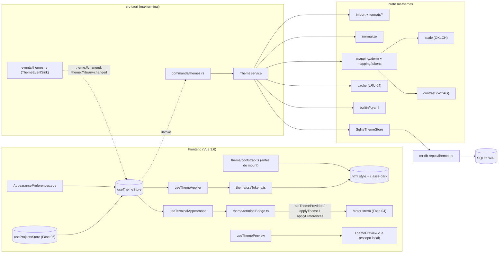
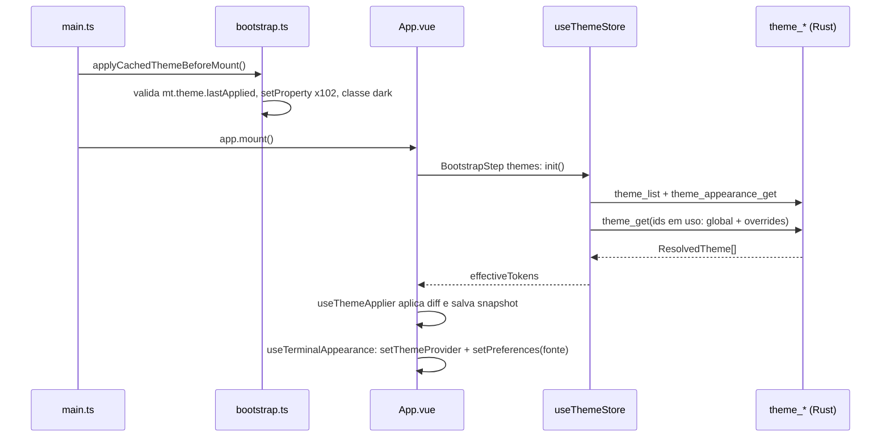
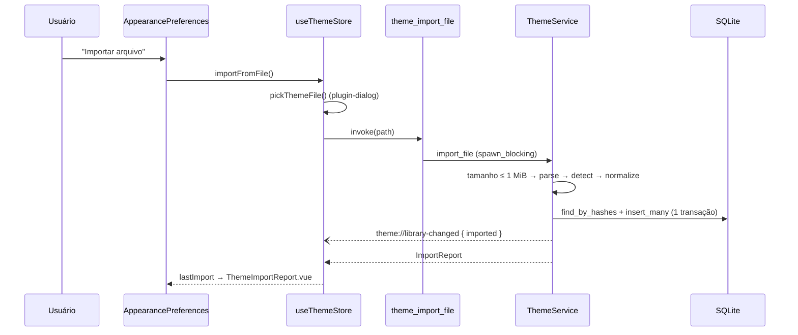
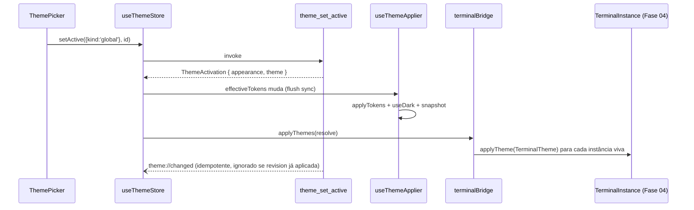

# Fase 10 — Temas e Importador Tabby — Especificação Técnica (`spec.md`)

> Escopo funcional, critérios de aceite (CA-01…CA-35) e riscos (R-01…R-12): [`./instructions.md`](./instructions.md).
> Contratos compartilhados: [`../README.md`](../README.md) §2. Fonte da verdade: [`../../AGENTS.md`](../../AGENTS.md)
> §2 "Temas e Cores" e Diretriz §3 (tokens semânticos `--max-*`).

---

## 1. Visão Geral da Arquitetura

### 1.1. Camadas



### 1.2. Princípios

- `mt-themes` **não depende de `tauri`** (regra da Fase 01 §2.2): depende apenas de `mt-core` e `mt-db`. A ponte Tauri
  (comandos, eventos, diálogos) vive no crate binário.
- O modelo canônico é `ColorScheme` (16 ANSI + fg/bg/cursor/seleção). **Tudo** o que chega à UI (tokens CSS, `ITheme`)
  é derivado no Rust a partir de `Rgb` validado — o frontend nunca recebe strings de cor cruas vindas de arquivo.
- Troca de tema é **puramente visual**: nenhum PTY é reiniciado, nenhum scrollback é descartado (CA-24).
- O frontend recebe `ResolvedTheme` completo (esquema + `XtermTheme` + `ThemeTokens` + contraste) em uma chamada; o
  store mantém cache local, de modo que trocar de projeto não gera IPC quando o tema já foi resolvido.

### 1.3. `src-tauri/crates/mt-themes/Cargo.toml`

```toml
[package]
name = "mt-themes"
version.workspace = true
edition.workspace = true
rust-version.workspace = true
publish = false

[dependencies]
mt-core.workspace = true
mt-db.workspace = true
serde = { workspace = true, features = ["derive"] }
serde_json.workspace = true
serde_yaml_ng = "0.10"          # validar manutenção e compatibilidade no lockfile
yaml-rust2 = "0.10"            # scanner limitado antes da desserialização; validar versão no spike
specta.workspace = true
thiserror.workspace = true
tracing.workspace = true
sha2 = "0.10"
walkdir = "2"
rustix = { version = "1", features = ["fs"] } # abertura Linux com flags e fstat, sem unsafe próprio
lru = "0.12"
uuid = { workspace = true, features = ["v5", "v7", "serde"] }
tokio = { workspace = true, features = ["rt", "sync"] }

[dev-dependencies]
insta = { version = "1", features = ["yaml", "json"] }
proptest = "1"
tempfile = "3"
rstest = "0.23"
tokio = { workspace = true, features = ["macros", "rt-multi-thread"] }

[lints]
workspace = true
```

---

## 2. Contratos Consumidos de Fases Anteriores

| Fase | Contrato (nome exato) | Uso nesta fase |
|------|-----------------------|----------------|
| 01 | `mt_core::{MtError, MtResult, ErrorCode}`, `MtError::{new, with_details, invalid_argument, not_found}`, `mt_core::ids::ProjectId`, `AppPaths` | erros `theme.*`, FK de projeto |
| 01 | `specta.rs::builder()` (`collect_commands!`/`collect_events!`), `commands/mod.rs`, `BINDINGS_PATH` | registro de 9 comandos e 2 eventos |
| 01 | `src/ipc/core.ts` (`call`, `MtIpcError`), `src/types/errors.ts` (`errorMessages`), `useIpcError()`, `src/styles/theme.scss` (fallback), `--mt-font-mono` | wrappers IPC, mensagens pt-BR, fallback pré-carregamento |
| 03 | `mt_db::Db::{read, write}`, `DbError` → `MtError` (`db.*`), runner `migrations/NNNN_FF_desc.sql`, tabelas `STRICT`, datas em Unix ms, FKs com `ON DELETE` explícito | migration `NNNN_10_themes.sql`, repositório |
| 04 | `TerminalTheme`, `TerminalThemeProvider`, `setThemeProvider(p)` (`src/terminal/theme/themeService.ts`), `TerminalInstance.applyTheme/applyPreferences`, `TerminalInstanceRegistry.forEach/get`, `TerminalPreferences`, `useTerminalStore().setPreferences`, `registerTerminalExtension`, `getContext(paneId).projectId`, `TerminalInstanceHandle.xterm` | aplicação ao vivo em todas as instâncias |
| 06 | tabela `projects(id)`, `useProjectsStore` (`projects`, `selectedId`, `selectedProject`), evento `project://changed` (`{ kind: 'deleted', ids }`) | `project_themes` (FK `CASCADE`), tema por projeto |
| 09 (opcional) | `src/components/preferences/{PreferencesDialog.vue, registry.ts}` com `registerPreferencesSection({ id, label, icon, component, order })`; `useWindowStore().openPreferences(section)` | Reutilizar se disponível; sem 09, criar contêiner mínimo previsto em I-15. Não torna 09 pré-requisito do DAG 04/06 → 10. |

### 2.1. Divergências resolvidas (adaptadores isolados)

| # | Divergência | Resolução |
|---|-------------|-----------|
| D-01 | Store de projetos pertence à Fase 06. | Usar `useProjectsStore`, sem criar alias singular. |
| D-02 | `TerminalTheme` da Fase 04 é estruturado (`colors.ansi[16]`, `source`), não um espelho plano de `ITheme`. | `XtermTheme` espelha os campos usados de `ITheme`; `terminalBridge.toTerminalTheme(r: ResolvedTheme): TerminalTheme` converte e valida comprimento da tupla. CA-05 verifica **ambos** (§12.2). |
| D-03 | `TerminalPreferences` (Fase 04) não tem `fontWeight`, `fontWeightBold`, `ligatures`. | O bridge aplica esses três via `handle.xterm.options` e addon sob demanda; os demais via `applyPreferences` (que já re-fita). Nenhum tipo da Fase 04 é alterado. |
| D-04 | `TerminalThemeProvider.getActiveTheme()` é global (sem `paneId`). | Tema por projeto aplicado por uma `TerminalExtension` (`theme.project-override`) que consulta `getContext().projectId` na ativação e pelo bridge a cada mudança. |
| D-05 | Fases 03/09 usam `unwrap(...)` e a Fase 01 define `call(command, request)`. | `src/ipc/themes.ts` usa `call` (Fase 01); se o helper real se chamar `unwrap`, ajusta-se só esse arquivo. |
| D-06 | A Fase 03 não lista `src/repos/`, embora o README cite `mt-db (… repos/ …)`. | Criar `mt-db/src/repos/mod.rs` se ausente (**novo nesta fase**), com `pub mod themes;`. O repo usa apenas tipos primitivos (`ThemeRow`) para não criar dependência `mt-db → mt-themes`. |
| D-07 | A paleta ANSI pode atribuir qualquer matiz aos índices red/green. | O ajuste de primary está em §3.8; escalas de status vêm das fixtures Max confiáveis, conforme CA-13. |

---

## 3. Crate `mt-themes`

### 3.1. Módulos

```
mt-themes/src/
├── lib.rs           # re-exports públicos
├── error.rs         # ThemeError, codes::*, From<ThemeError> for MtError
├── ids.rs           # ThemeId (v5 p/ builtins, v7 p/ importados), ContentHash
├── color.rs         # Rgb, Rgba, parse_color, ColorParseError
├── oklch.rs         # sRGB ⇄ OKLab ⇄ OKLCH, gamut mapping
├── contrast.rs      # relative_luminance, contrast_ratio, WcagLevel, ContrastReport
├── scheme.rs        # ColorScheme, AnsiPalette, ThemeAppearance, ThemeOrigin, ThemeWarning
├── normalize.rs     # RawScheme → NormalizedScheme (avisos, expansão de paleta, hash)
├── scale.rs         # rampas 50–950 e --background-0…950
├── formats/         # SchemeParser + parsers Tabby/xterm/Windows Terminal + detect
├── mapping/         # xterm.rs (XtermTheme) e tokens.rs (ThemeTokens)
├── builtin/         # mod.rs + 6 YAML embutidos (include_str!)
├── import.rs        # import_file / import_dir com ImportLimits
├── export.rs        # ThemeExportFormat → String; escrita atômica
├── cache.rs         # ResolvedCache (LRU por ContentHash)
└── service.rs       # ThemeService, ThemeStore, SqliteThemeStore, ThemeEventSink, DTOs de aparência
```

### 3.2. Erros (`error.rs`)

```rust
pub mod codes {
    use mt_core::ErrorCode;
    pub const NOT_FOUND: ErrorCode = ErrorCode("theme.not_found");
    pub const INVALID_COLOR: ErrorCode = ErrorCode("theme.invalid_color");
    pub const INVALID_PALETTE: ErrorCode = ErrorCode("theme.invalid_palette");
    pub const INVALID_SCHEME: ErrorCode = ErrorCode("theme.invalid_scheme");
    pub const PARSE_FAILED: ErrorCode = ErrorCode("theme.parse_failed");
    pub const UNSUPPORTED_FORMAT: ErrorCode = ErrorCode("theme.unsupported_format");
    pub const FILE_TOO_LARGE: ErrorCode = ErrorCode("theme.file_too_large");
    pub const FILE_UNREADABLE: ErrorCode = ErrorCode("theme.file_unreadable");
    pub const PATH_INVALID: ErrorCode = ErrorCode("theme.path_invalid");
    pub const DIR_LIMIT_EXCEEDED: ErrorCode = ErrorCode("theme.dir_limit_exceeded");
    pub const BUILTIN_READONLY: ErrorCode = ErrorCode("theme.builtin_readonly");
    pub const EXPORT_FAILED: ErrorCode = ErrorCode("theme.export_failed");
    pub const INVALID_FONT: ErrorCode = ErrorCode("theme.invalid_font");
    pub const INVALID_APPEARANCE: ErrorCode = ErrorCode("theme.invalid_appearance");
    pub const INVALID_TOKEN: ErrorCode = ErrorCode("theme.invalid_token");
    pub const PROJECT_NOT_FOUND: ErrorCode = ErrorCode("theme.project_not_found");
}

#[derive(Debug, thiserror::Error)]
pub enum ThemeError {
    #[error("cor inválida em {field}: \"{value}\"")]
    InvalidColor { field: String, value: String },          // value truncado a 64 chars
    #[error("paleta com {found} cores; são necessárias ao menos 8")]
    InvalidPalette { found: usize },
    #[error("esquema inválido: campo obrigatório \"{field}\" ausente")]
    InvalidScheme { field: &'static str },
    #[error("não foi possível interpretar o arquivo: {reason}")]
    ParseFailed { reason: String },
    #[error("formato de tema não reconhecido")]
    UnsupportedFormat,
    #[error("arquivo excede {limit} bytes")]
    FileTooLarge { limit: u64 },
    #[error("não foi possível ler o arquivo")]
    FileUnreadable(#[source] std::io::Error),
    #[error("caminho inválido: {reason}")]
    PathInvalid { reason: &'static str },
    #[error("temas embutidos não podem ser alterados ou excluídos")]
    BuiltinReadonly,
    #[error("falha ao exportar: {reason}")]
    ExportFailed { reason: String },
    #[error("fonte inválida: {reason}")]
    InvalidFont { reason: String },
    #[error("valor inválido para {field}: {reason}")]
    InvalidAppearance { field: &'static str, reason: String },
    #[error("token inválido: {key}")]
    InvalidToken { key: String },
    #[error("tema não encontrado")]
    NotFound,
    #[error("projeto não encontrado")]
    ProjectNotFound,
    #[error(transparent)]
    Db(#[from] mt_db::DbError),
}
```

`impl From<ThemeError> for MtError`: mensagem pt-BR ao usuário (ex.: `"A cor \"#ggg\" em colors[3] é inválida."`),
`details` = `{ "field": "colors[3]" }` para `InvalidColor`, `{ "found": 5 }` para `InvalidPalette`,
`{ "limit": 1048576 }` para `FileTooLarge`; `Db` delega ao `From<DbError>` da Fase 03, exceto violação de FK em
`project_themes.project_id`, mapeada para `theme.project_not_found`. Nunca inclui caminho completo nem conteúdo do arquivo.

### 3.3. Ids (`ids.rs`)

```rust
/// Identificador de tema (novo nesta fase). Builtins: Uuid v5 estável por `slug`; importados: Uuid v7.
#[derive(Clone, Copy, Debug, PartialEq, Eq, Hash, PartialOrd, Ord, Serialize, Deserialize, specta::Type)]
#[serde(transparent)]
pub struct ThemeId(pub uuid::Uuid);

/// Namespace fixo para ids de builtins (nunca alterar).
pub const BUILTIN_NAMESPACE: uuid::Uuid = uuid::uuid!("6f1c2a4e-9b3d-4c57-8e21-5a7d0c9e4b13");
/// `ThemeId::builtin("max-navy-teal")` = b5907b11-f15c-5886-b803-f1fb94bc4c9d (usado no DEFAULT do SQL).
pub const DEFAULT_THEME_ID: ThemeId = ThemeId(uuid::uuid!("b5907b11-f15c-5886-b803-f1fb94bc4c9d"));

impl ThemeId {
    pub fn builtin(slug: &str) -> Self { Self(uuid::Uuid::new_v5(&BUILTIN_NAMESPACE, slug.as_bytes())) }
    pub fn new_imported() -> Self { Self(uuid::Uuid::now_v7()) }
}

/// SHA-256 hex (64 chars minúsculos) do JSON canônico das cores (nome excluído) — base da deduplicação.
#[derive(Clone, Debug, PartialEq, Eq, Hash, Serialize, Deserialize, specta::Type)]
#[serde(transparent)]
pub struct ContentHash(pub String);
```

Teste de invariante: `ThemeId::builtin("max-navy-teal") == DEFAULT_THEME_ID`.

### 3.4. Cores (`color.rs`)

```rust
#[derive(Clone, Copy, Debug, PartialEq, Eq, Hash)]
pub struct Rgb { pub r: u8, pub g: u8, pub b: u8 }          // serde: "#rrggbb" minúsculo
#[derive(Clone, Copy, Debug, PartialEq, Eq, Hash)]
pub struct Rgba { pub rgb: Rgb, pub a: u8 }                  // serde: "#rrggbb" se a = 255, senão "#rrggbbaa"

pub struct ParsedColor { pub rgb: Rgb, pub alpha: Option<u8> }

#[derive(Debug, PartialEq, Eq)]
pub enum ColorParseError { Empty, BadHex, OutOfRange, UnsupportedFunction, Malformed }

/// Gramática aceita (case-insensitive, espaços ao redor de tokens ignorados):
///   #rgb | #rgba | #rrggbb | #rrggbbaa
///   rgb(N, N, N)   | rgba(N, N, N, A)    N = inteiro 0–255  OU  todos percentuais 0–100% (decimais)
///   A = 0–1 (decimal) ou 0–100%
/// Rejeita: hsl()/hwb()/nomes CSS/"transparent", mistura inteiro+percentual, valores fora do intervalo.
pub fn parse_color(input: &str) -> Result<ParsedColor, ColorParseError>;

impl Rgb {
    pub fn to_hex(self) -> String;                           // "#aabbcc"
    pub fn to_linear(self) -> [f64; 3];                      // sRGB → linear (IEC 61966-2-1)
    pub fn from_linear(c: [f64; 3]) -> Option<Self>;          // None se fora do gamut (> 1e-4 de tolerância)
}
```

- Percentuais convertidos com `round(p * 2.55)` (`66.7%` → 170, `73.3%` → 187, `80%` → 204 ⇒ CA-07).
- `Rgb`/`Rgba` exportados ao TS como `string` (`impl specta::Type` delegando a `String`; alternativamente
  `#[specta(type = String)]` nos campos), mantendo `bindings.ts` sem objetos `{r,g,b}`.

### 3.5. OKLCH (`oklch.rs`)

```rust
#[derive(Clone, Copy, Debug, PartialEq)]
pub struct Oklch { pub l: f64, pub c: f64, pub h: f64 }      // l ∈ [0,1], c ≥ 0, h em graus [0,360)

pub fn rgb_to_oklch(c: Rgb) -> Oklch;                        // matrizes de Björn Ottosson (OKLab)
pub fn oklch_to_rgb_clamped(c: Oklch) -> Rgb;                 // gamut mapping: reduz croma por bisseção
pub fn in_srgb_gamut(c: Oklch) -> bool;
```

Gamut mapping: mantém `l` e `h`, bisseção em `c ∈ [0, c₀]` por até 20 iterações até `in_srgb_gamut` com ε = 1e-4;
o resultado final é arredondado para 8 bits. Garante "todas as cores dentro do gamut sRGB" (CA-14).

### 3.6. Contraste WCAG (`contrast.rs`)

```rust
pub fn relative_luminance(c: Rgb) -> f64;                    // 0.2126 R + 0.7152 G + 0.0722 B (linear)
pub fn contrast_ratio(a: Rgb, b: Rgb) -> f64;                // (L1 + 0.05) / (L2 + 0.05), L1 ≥ L2

#[derive(Clone, Copy, Debug, PartialEq, Eq, Serialize, Deserialize, specta::Type)]
#[serde(rename_all = "SCREAMING_SNAKE_CASE")]
pub enum WcagLevel { Aaa, Aa, AaLarge, Fail }                // ≥7 | ≥4.5 | ≥3 | <3

#[derive(Clone, Debug, Serialize, Deserialize, specta::Type)]
#[serde(rename_all = "camelCase")]
pub struct ContrastEntry { pub pair: String, pub ratio: f64, pub level: WcagLevel }  // pair: "foreground/background", "ansi[1]/background", "--max-primary-500/--max-primary-content"

#[derive(Clone, Debug, Serialize, Deserialize, specta::Type)]
#[serde(rename_all = "camelCase")]
pub struct ContrastReport {
    pub foreground_background: ContrastEntry,
    pub ansi: Vec<ContrastEntry>,          // 16 entradas contra o background
    pub scales: Vec<ContrastEntry>,        // 5 entradas -500 / -content
    pub interaction: Vec<ContrastEntry>,   // cursor/fundo, cursorAccent/cursor, seleção composta/foreground
    pub status_surfaces: Vec<ContrastEntry>, // badges/textos nas superfícies efetivamente usadas
    pub low_contrast: bool,                // foreground/background < 4.5 → badge "Contraste baixo" (CA-31)
}

pub fn build_report(scheme: &ColorScheme, tokens: &ThemeTokens) -> ContrastReport;
```

`ratio` arredondado a 2 casas apenas na serialização; testes comparam o `f64` (CA-12:
`contrast_ratio(#777777, #ffffff) ≈ 4.478`).
Para seleção com alfa, compor sobre o background em sRGB antes de calcular luminância; usar
`selectionForeground ?? foreground` como texto. Relatar também seleção inativa. Não inferir acessibilidade
da UI apenas de foreground/background: texto normal exige 4,5:1, indicadores não textuais 3:1 e foco visível.
Contraste baixo gera aviso, sem recolorir silenciosamente ANSI ou elevar `minimumContrastRatio` da Fase 04.

### 3.7. Modelo normalizado (`scheme.rs`)

```rust
pub const ANSI_NAMES: [&str; 16] = ["black","red","green","yellow","blue","magenta","cyan","white",
    "brightBlack","brightRed","brightGreen","brightYellow","brightBlue","brightMagenta","brightCyan","brightWhite"];

#[derive(Clone, Copy, Debug, PartialEq, Eq, Hash, Serialize, Deserialize, specta::Type)]
#[serde(transparent)]
pub struct AnsiPalette(pub [Rgb; 16]);                       // TS: string[] (tupla de 16 validada no Rust)

#[derive(Clone, Debug, PartialEq, Eq, Hash, Serialize, Deserialize, specta::Type)]
#[serde(rename_all = "camelCase")]
pub struct ColorScheme {
    pub name: String,                      // 1–120 chars, trim, sem caracteres de controle
    pub foreground: Rgb,
    pub background: Rgb,
    pub cursor: Rgb,                       // default: foreground (aviso cursor_defaulted)
    pub cursor_accent: Rgb,                // default: background
    pub selection_background: Rgba,        // default: foreground com alfa 0x4d
    pub selection_foreground: Option<Rgb>,
    pub ansi: AnsiPalette,
}

#[derive(Clone, Copy, Debug, PartialEq, Eq, Serialize, Deserialize, specta::Type)]
#[serde(rename_all = "snake_case")]
pub enum ThemeAppearance { Dark, Light }   // dark ⇔ relative_luminance(background) ≤ 0.179

#[derive(Clone, Copy, Debug, PartialEq, Eq, Serialize, Deserialize, specta::Type)]
#[serde(rename_all = "snake_case")]
pub enum ThemeOrigin { Builtin, TabbyConfig, TabbyScheme, XtermJson, WindowsTerminal }

#[derive(Clone, Copy, Debug, PartialEq, Eq, Serialize, Deserialize, specta::Type)]
#[serde(rename_all = "snake_case")]
pub enum ThemeWarningCode {
    AlphaIgnored, PaletteExpanded, PaletteTruncated, LowContrast, ScaleBaseAdjusted,
    UnknownFieldsIgnored, NameMissing, NameTruncated, CursorDefaulted,
}

#[derive(Clone, Debug, PartialEq, Serialize, Deserialize, specta::Type)]
#[serde(rename_all = "camelCase")]
pub struct ThemeWarning { pub code: ThemeWarningCode, pub field: Option<String>, pub message: String } // pt-BR

impl ColorScheme {
    pub fn appearance(&self) -> ThemeAppearance;
    pub fn content_hash(&self) -> ContentHash; // sha256(JSON canônico sem `name`, chaves ordenadas)
}
```

### 3.8. Rampas (`scale.rs`) — inclui o "ajuste de luminância" referido no CA-13

```rust
pub const SCALE_STEPS: [u16; 11] = [50, 100, 200, 300, 400, 500, 600, 700, 800, 900, 950];
pub const SEMANTIC_SCALES: [&str; 5] = ["primary", "success", "warning", "danger", "info"];
pub const PRIMARY_ANSI_INDEX: usize = 6;

pub struct Scale { pub steps: [(u16, Rgb); 11], pub content: Rgb, pub base_adjusted: bool }

pub fn generate_scale(base: Rgb) -> Scale;
pub fn background_ramp(bg: Rgb, appearance: ThemeAppearance) -> Vec<(u16, Rgb)>; // 0,25,…,950 (39 passos)
pub fn pick_content(c500: Rgb, c950: Rgb) -> Rgb;
```

Algoritmo de `generate_scale` (OKLCH, hue constante):
1. `b = rgb_to_oklch(base)`. **Ajuste de base:** se `b.l ∉ [0.45, 0.75]`, `b.l = clamp(b.l, 0.45, 0.75)` e
   `base_adjusted = true` (gera aviso `scale_base_adjusted` com `field = "--max-<escala>-500"`). Sem ajuste, o
   passo 500 de primary é **exatamente** o cyan ANSI normalizado (CA-13).
2. Lado claro (400→50): `l = b.l + (0.985 − b.l)·t`, `t = [0.18, 0.36, 0.56, 0.76, 0.88]`;
   croma `c = b.c·k`, `k = [0.92, 0.80, 0.62, 0.42, 0.28]`.
3. Lado escuro (600→950): `l = b.l − (b.l − 0.13)·t`, `t = [0.16, 0.34, 0.52, 0.70, 0.82]`;
   `k = [0.95, 0.88, 0.78, 0.66, 0.58]`.
4. Cada passo passa por `oklch_to_rgb_clamped`. Como `t` é estritamente crescente e `b.l ∈ [0.45,0.75]` está entre
   os extremos, a monotonicidade de `l` é garantida por construção (CA-14); teste de propriedade confirma após o
   arredondamento para 8 bits (tolerância 0 em ordem, verificada sobre o `l` recalculado).
5. `pick_content`: `#ffffff` se `contrast(c500, #ffffff) ≥ 4.5`; senão o passo 950 se `≥ 4.5`; senão `#000000`.
   Para qualquer cor, `max(contrast(branco), contrast(preto)) ≥ √21 ≈ 4.58`, logo sempre há `-content` ≥ 4.5:1.

`background_ramp` (mesma semântica do `MaxComponentsUi`): passo `0 = background`. Escuro: `l(s) = l₀ + (1 − l₀)·min(s/850, 1)`
(o passo 850 é branco, como na rampa escura do `MaxComponentsUi`; 875–950 saturam em `#ffffff`). Claro:
`l(s) = l₀ − (l₀ − 0.16)·(s/900)` com clamp em 0.12. Croma `c(s) = c₀·(1 − 0.85·s/950)`, hue do background.

**Proteção semântica obrigatória:** gerar somente primary pela paleta ANSI; copiar success/warning/danger/info
das fixtures Max claro/escuro, incluindo `-content`. Arquivo importado não aceita `tokenOverrides` como autoridade.
Para o badge parado, o token `--background-500` é neutro (croma zero), mesmo que o fundo importado seja saturado;
os demais passos preservam ordem de luminância. Usar nomes/ícones além da cor. Identidade `project.color`,
tokens de labels e contagens de status não são modificados. Validar legibilidade nas superfícies escolhidas;
ajustes de contraste da UI conservam a família semântica e jamais alteram a paleta do terminal.

### 3.9. Formatos (`formats/`)

```rust
/// Esquema ainda não normalizado: strings cruas com caminho de campo para mensagens de erro.
pub struct RawScheme {
    pub name: Option<String>,
    pub foreground: Option<String>, pub background: Option<String>,
    pub cursor: Option<String>, pub cursor_accent: Option<String>,
    pub selection: Option<String>, pub selection_foreground: Option<String>,
    pub colors: Vec<String>,               // ordem ANSI 0..N
    pub origin: ThemeOrigin,
    pub field_prefix: String,              // ex.: "terminal.customColorSchemes[1]."
    pub unknown_fields: Vec<String>,
}

pub trait SchemeParser: Send + Sync {
    fn id(&self) -> ThemeOrigin;
    /// Retorna true se o documento (já convertido em serde_json::Value) tem a forma deste formato.
    fn detect(&self, doc: &serde_json::Value) -> bool;
    fn parse(&self, doc: &serde_json::Value, file_stem: &str) -> Result<Vec<Result<RawScheme, ThemeError>>, ThemeError>;
}

pub struct ParserRegistry { parsers: Vec<Box<dyn SchemeParser>> } // ordem = prioridade de detecção
impl ParserRegistry {
    pub fn default_set() -> Self; // TabbyConfig, TabbyScheme, WindowsTerminal, XtermJson
    pub fn register(&mut self, p: Box<dyn SchemeParser>); // ponto de extensão (R-01)
}
```

Formatos e regras de detecção (`detect.rs`, primeiro que casar vence):

| Ordem | Origem | Forma reconhecida | Mapeamento |
|-------|--------|-------------------|------------|
| 1 | `tabby_config` | objeto com `terminal` objeto contendo `colorScheme`, `lightColorScheme` ou `customColorSchemes` | um `RawScheme` por `terminal.colorScheme`, `terminal.lightColorScheme` (se existir) e cada item de `terminal.customColorSchemes[]`; nome ausente → `"<arquivo> — esquema ativo"` / `"— esquema claro"` com `name_missing` |
| 2 | `tabby_scheme` | objeto com `colors` (array ou mapa nomeado) e `foreground` ou `background`; **ou** array não vazio de candidatos | `name`, `foreground`, `background`, `cursor`, `cursorAccent`, `selection`, `selectionForeground`, `colors[]` |
| 3 | `windows_terminal` | objeto com `purple` + `brightPurple`, ou `cursorColor`/`selectionBackground` + `brightBlack`; ou `{ "schemes": [...] }` | `purple`→magenta, `cursorColor`→cursor, `selectionBackground`→seleção |
| 4 | `xterm_json` | objeto com as 16 chaves `black`…`brightWhite` usando `magenta` | `ITheme` 1:1; `name` opcional, senão nome do arquivo; `extendedAnsi` ignorado (aviso `unknown_fields_ignored`) |
| — | — | qualquer outro (`{"foo":1}`, escalar, array vazio) | `theme.unsupported_format` (CA-10) |

Fixture representativa do formato Tabby (`config.yaml`, versão declarada 3):

```yaml
version: 3
terminal:
  colorScheme:
    name: Tabby Default
    foreground: '#cacaca'
    background: '#171717'
    cursor: '#bbbbbb'
    colors: ['#000000', '#ff615a', '#b1e969', '#ebd99c', '#5da9f6', '#e86aff', '#82fff7', '#dedacf',
             '#313131', '#f58c80', '#ddf88f', '#eee5b2', '#a5c7ff', '#ddaaff', '#b7fff9', '#ffffff']
  customColorSchemes:
    - { name: Meu Navy, foreground: '#e5eaf0', background: '#17293d', cursor: '#2ea4bc', colors: [...] }
```

**Variações e ambiguidade:** `colorScheme`/`lightColorScheme` podem ser objeto, `null` (ignorar) ou nome
(resolver somente entre `customColorSchemes` do mesmo documento, por igualdade exata). Nome sem correspondência
ou repetido com conteúdos diferentes gera falha naquele campo; não inventar paleta a partir do nome. Seleção
referenciando custom já extraído é duplicata no relatório. Mapas `colors` aceitam exclusivamente as 16 chaves
de `ANSI_NAMES`, ordenadas por esse contrato, nunca pela ordem de um mapa; nomes parcialmente ausentes falham.
Arrays 8–15 seguem §3.10. `selection` e `selectionBackground` são aliases; se ambos existirem e diferirem após
normalização, falhar no candidato. `selectionForeground: null` equivale a ausência. Cada candidato de coleção
é validado isoladamente, com caminho `terminal.customColorSchemes[2].colors[3]`; erro sintático do documento
inteiro aborta o arquivo. Config de Tabby não exporta conexões, perfis, credenciais ou atalhos ao banco/log.

**Leitura limitada** (comum a todos): verificar arquivo regular, tamanho ≤ 1 MiB e ler no máximo 1 MiB + 1;
UTF-8 obrigatório, BOM opcional. Antes de materializar YAML, scanner de eventos interrompe em profundidade > 32,
> 65.536 nós ou escalar > 16 KiB, rejeita âncoras, aliases, merges `<<`, tags customizadas e múltiplos documentos.
Não contar caracteres `&`/`*` em texto (podem estar em strings/comentários); usar tokens sintáticos.
Um visitor limitado para JSON aplica os mesmos tetos de profundidade/nós/escalar. Em ambos rejeitar chaves
duplicadas antes de convertê-las a `Value`; não desativar limites internos de recursão. Limitar a 256 candidatos
por arquivo. Chaves desconhecidas são ignoradas, sem armazenar seus valores; limites continuam valendo para elas.
O adaptador de scanner é critério de entrada: se a biblioteca escolhida só validar depois da alocação,
substituí-la por parser incremental antes de entregar CA-09. `spawn_blocking` evita bloqueio da UI, mas não
cancela parser nem limita memória por si só; meta de tempo é benchmark, os tetos estruturais são a garantia.

### 3.10. Normalização (`normalize.rs`)

```rust
pub struct NormalizedScheme { pub scheme: ColorScheme, pub origin: ThemeOrigin, pub warnings: Vec<ThemeWarning> }
pub fn normalize(raw: RawScheme) -> Result<NormalizedScheme, ThemeError>;
```

Regras (na ordem):
1. `foreground`/`background` ausentes → `InvalidScheme`. Cada cor passa por `parse_color`; erro →
   `InvalidColor { field: "<prefixo>colors[3]" }` (CA-07).
2. Alfa em fg/bg/cursor/cursorAccent/ANSI → descartado com `alpha_ignored` (ex.: `#abcd` em `foreground`). Alfa em
   `selection` é preservado em `Rgba`.
3. Paleta: `< 8` → `InvalidPalette`; `8` → expande para 16 com `palette_expanded`: `bright[i] = oklch(l + 0.08
   (clamp ≤ 0.95), c·1.05, h)` de `normal[i]`, exceto `brightBlack = mix(black, foreground, 0.35)`; `9–15` → completa os
   faltantes pela mesma regra (`palette_expanded`); `> 16` → usa 16 primeiras com `palette_truncated` (CA-08).
4. Nome: trim, remove caracteres de controle, > 120 chars → trunca com `name_truncated`; vazio após limpeza
   usa nome do arquivo (ou "Tema importado") com `name_missing`. Nunca persistir o documento bruto.
5. `contrast(fg, bg) < 4.5` → `low_contrast` (o tema é importado mesmo assim).

### 3.11. Mapeamento xterm (`mapping/xterm.rs`)

```rust
/// Espelho de `ITheme` do @xterm/xterm (somente campos usados).
#[derive(Clone, Debug, PartialEq, Serialize, Deserialize, specta::Type)]
#[serde(rename_all = "camelCase")]
pub struct XtermTheme {
    pub foreground: String, pub background: String, pub cursor: String, pub cursor_accent: String,
    pub selection_background: String,
    #[serde(skip_serializing_if = "Option::is_none")] #[specta(optional)]
    pub selection_foreground: Option<String>,
    pub selection_inactive_background: String,  // selection com alfa reduzido à metade
    pub black: String, pub red: String, pub green: String, pub yellow: String,
    pub blue: String, pub magenta: String, pub cyan: String, pub white: String,
    pub bright_black: String, pub bright_red: String, pub bright_green: String, pub bright_yellow: String,
    pub bright_blue: String, pub bright_magenta: String, pub bright_cyan: String, pub bright_white: String,
}

impl From<&ColorScheme> for XtermTheme { /* 1:1 */ }
impl TryFrom<&XtermTheme> for ColorScheme { type Error = ThemeError; /* via parse_color */ }
```

`selection_inactive_background` é derivado (não participa do roundtrip; a reconversão o ignora — CA-11).
`TryFrom<&XtermTheme>` usa nome padrão "Tema importado"; para exportação com nome preservado, o adaptador
recebe o nome separado. O hash exclui nome/origem/avisos e inclui todas as cores normalizadas, inclusive alfa
e ausência explícita de `selectionForeground`. Comparar projeção de cores, não igualdade integral de structs.

### 3.12. Mapeamento de tokens (`mapping/tokens.rs`)

```rust
#[derive(Clone, Debug, PartialEq, Serialize, Deserialize, specta::Type)]
#[serde(rename_all = "camelCase")]
pub struct ThemeTokens {
    pub appearance: ThemeAppearance,
    /// "--background-0" → "#17293d". Chaves pertencem ao conjunto exato abaixo; valores hex validados.
    pub vars: std::collections::BTreeMap<String, String>,
}

pub type TokenOverrides = std::collections::BTreeMap<String, Rgb>;

pub fn tokens_from_scheme(s: &ColorScheme, overrides: Option<&TokenOverrides>) -> (ThemeTokens, Vec<ThemeWarning>);
pub fn scheme_from_tokens(name: &str, t: &ThemeTokens) -> Result<ColorScheme, ThemeError>;
```

Conjunto gerado por `tokens_from_scheme` (102 variáveis):
- `--background-{0,25,…,950}` (39) de `background_ramp`.
- `--max-{primary,success,warning,danger,info}-{50…950}` (55) + `--max-<escala>-content` (5): primary por
  `generate_scale`, outras escalas pelas fixtures Max do modo efetivo (proteção de status em §3.8).
- `--mt-terminal-background`, `--mt-terminal-foreground`, `--mt-terminal-selection` (3) — usados pela camada de
  blocos e pelo `RichInput` (Fase 04), prefixo `--mt-` permitido pelo stylelint da Fase 01.
- `overrides` substituem chaves geradas **após** a geração (builtins); chave fora do conjunto → `InvalidToken`.
  Imports não podem definir overrides, mesmo que o arquivo use envelope parecido com builtin.

`scheme_from_tokens` (exportar paleta Max como esquema Tabby): `background = --background-0`; `foreground` = passo da
rampa de maior contraste com `--background-0` (850 no escuro, 900 no claro); ANSI normais: red = `danger-500`,
green = `success-500`, yellow = `warning-500`, blue = `info-500`, cyan = `primary-500`, magenta = OKLCH de `info-500`
com `h + 60°`, black = `--background-100` (escuro) / `--background-800` (claro), white = inverso; brilhantes = `-300`
de cada escala, brightBlack = `--background-300`/`-600`, brightWhite = foreground; `cursor = primary-400`.
Essa projeção é deliberadamente com perdas. `theme_export(tabby_*)` exporta sempre `ResolvedTheme.scheme`,
nunca `scheme_from_tokens`, preservando as cores importadas e seu hash.

### 3.13. Builtins (`builtin/`)

```rust
pub struct BuiltinTheme { pub slug: &'static str, pub source: &'static str }  // source = include_str!("…yaml")
pub const BUILTINS: [BuiltinTheme; 6] = [/* max-navy-teal, max-light, dracula, nord, solarized-dark, solarized-light */];

#[derive(Deserialize)]
#[serde(rename_all = "camelCase", deny_unknown_fields)]
pub struct BuiltinDocument {
    pub slug: String,
    pub builtin_version: u32,
    pub name: String,
    pub license: String,                               // "MIT" / "MIT (Dracula)" etc. (R-10)
    pub scheme: serde_json::Value,                     // parseado pelo TabbySchemeParser
    #[serde(default)] pub token_overrides: BTreeMap<String, String>,
}
pub fn load_builtins() -> Result<Vec<(BuiltinDocument, NormalizedScheme, TokenOverrides)>, ThemeError>;
```

`max-navy-teal.yaml` (trecho; os `tokenOverrides` completos são gerados uma única vez a partir de
`@maxvue/max-components-ui/src/themes/{tokens,colors}.scss` modo escuro e conferidos pelo teste do CA-16):

```yaml
# Max Navy/Teal — tema padrão do MaxTerminal. Licença: MIT (MaxTerminal).
slug: max-navy-teal
builtinVersion: 1
name: Max Navy/Teal
license: MIT
scheme:
  foreground: '#e5eaf0'
  background: '#17293d'
  cursor: '#2ea4bc'
  cursorAccent: '#17293d'
  selection: '#00768e80'
  selectionForeground: '#ffffff'
  colors: ['#0d1b2a', '#ef4444', '#10b981', '#f59e0b', '#0ea5e9', '#a78bfa', '#2ea4bc', '#d5dde6',
           '#74869a', '#f87171', '#34d399', '#fbbf24', '#38bdf8', '#c4b5fd', '#56c2d7', '#ffffff']
tokenOverrides:
  --max-primary-100: '#56c2d7'
  --max-primary-500: '#00768e'
  --max-primary-950: '#00152a'
  --max-primary-content: '#ffffff'
  --max-success-500: '#10b981'
  --max-danger-500: '#ef4444'
  --max-warning-500: '#f59e0b'
  --max-info-500: '#0ea5e9'
  --background-0: '#17293d'
  --background-25: '#233549'
  # … demais passos da rampa escura até --background-850: '#ffffff'
```

O ciano ANSI (`#2ea4bc`, contraste 5,03:1 sobre o fundo) difere de `--max-primary-500` (`#00768e`, 2,8:1 — ilegível
como texto de terminal); a exceção do CA-13 vale apenas para importados, builtins usam `tokenOverrides`.
Builtins são imutáveis (trigger SQL + `BuiltinReadonly`).

### 3.14. Importação (`import.rs`)

```rust
pub struct ImportLimits {
    pub max_file_bytes: u64, pub max_depth: usize, pub max_files: usize,
    pub max_total_bytes: u64, pub max_entries: usize, pub max_schemes: usize,
}
impl Default for ImportLimits { /* 1 MiB, 4, 500, 64 MiB, 10.000 entradas, 2.000 esquemas/lote */ }

pub struct ParsedFile { pub file: String, pub schemes: Vec<NormalizedScheme>, pub failures: Vec<ImportFailure> }

pub fn parse_file(path: &Path, limits: &ImportLimits, reg: &ParserRegistry) -> Result<ParsedFile, ThemeError>;
pub fn scan_dir(root: &Path, limits: &ImportLimits) -> (Vec<PathBuf>, Vec<ImportLimitHit>);
```

`scan_dir`: `WalkDir::new(root).max_depth(4).follow_links(false)`, ignora ocultos (`.git`, `node_modules`), aceita
apenas arquivos regulares `.yaml/.yml/.json` (demais ignorados sem erro, contados em `skippedFiles`); ao atingir 500
arquivos ou 64 MiB acumulados para e registra `ImportLimitHit { code: "theme.dir_limit_exceeded", limit }` (CA-22).
`file` nos relatórios é o caminho **relativo à raiz escolhida** (ou o nome do arquivo), nunca absoluto.
Contar também diretórios e arquivos ignorados em `max_entries`: limite de arquivos válidos sozinho não contém
varredura com milhões de itens não elegíveis. Ordenação determinística por caminho relativo; limite de bytes
contabiliza bytes efetivamente lidos. Processar e descartar documento a cada arquivo, com no máximo 2.000
esquemas normalizados por lote e 500 detalhes de aviso/erro (demais agregados em contadores).
No Linux abrir arquivos com flags sem seguir symlink e não bloqueantes, verificar `fstat` de arquivo regular
antes de ler; rejeitar FIFO/dispositivo e links na raiz ou durante varredura. Não canonicalizar um link e depois
tratá-lo como arquivo permitido. Métodos de abertura seguros ficam em `import.rs`, sem `unsafe` próprio.

### 3.15. Exportação (`export.rs`)

```rust
#[derive(Clone, Copy, Debug, Serialize, Deserialize, specta::Type)]
#[serde(rename_all = "snake_case")]
pub enum ThemeExportFormat { TabbyYaml, TabbyJson, XtermJson, CssTokens }

pub fn render(theme: &ResolvedTheme, format: ThemeExportFormat) -> Result<String, ThemeError>;
pub fn write_atomic(dest: &Path, format: ThemeExportFormat, content: &str) -> Result<PathBuf, ThemeError>;
```

- `tabby_yaml`/`tabby_json`: objeto `TerminalColorScheme` do Tabby com **todos** os campos (`cursorAccent`,
  `selection` com alfa, `selectionForeground`) ⇒ reimportação gera o mesmo `ContentHash` (CA-11, CA-23).
- `xterm_json`: `XtermTheme` + `name`. `css_tokens`: `:root { --…: #…; }` ordenado (via `ThemeTokens.vars`).
- `write_atomic`: exige caminho absoluto, pai existente, extensão compatível (`.yaml/.yml`, `.json`, `.css`) → senão
  `ExportFailed`; grava `<dest>.tmp-<uuid>` com `0644` e `rename`.

### 3.16. Cache (`cache.rs`)

`ResolvedCache` usa chave `(ThemeId, ContentHash, overridesHash, mappingVersion, canonicalTokensVersion)`
e 64 entradas. `ThemeId` evita devolver nome/origem/builtin de outro registro com cores iguais; hashes de
overrides são SHA-256 do JSON canônico. Mudanças de biblioteca, algoritmo ou builtin invalidam antes de publicar
eventos. Alternativamente cachear só cores/tokens derivados e montar `summary` a cada leitura, nunca reutilizar
metadados por hash de cores apenas.

### 3.17. Serviço (`service.rs`)

```rust
#[derive(Clone, Debug, Serialize, Deserialize, specta::Type)]
#[serde(rename_all = "camelCase")]
pub struct ThemeSummary {
    pub id: ThemeId, pub slug: Option<String>, pub name: String,
    pub appearance: ThemeAppearance, pub origin: ThemeOrigin, pub builtin: bool,
    pub background: String, pub foreground: String, pub swatch: Vec<String>, // 8 ANSI normais
    pub fg_bg_contrast: f64, pub low_contrast: bool, pub created_at: i64,
}

#[derive(Clone, Debug, Serialize, Deserialize, specta::Type)]
#[serde(rename_all = "camelCase")]
pub struct ResolvedTheme {
    pub summary: ThemeSummary, pub scheme: ColorScheme, pub xterm: XtermTheme,
    pub tokens: ThemeTokens, pub contrast: ContrastReport, pub warnings: Vec<ThemeWarning>,
}

#[derive(Clone, Copy, Debug, PartialEq, Eq, Serialize, Deserialize, specta::Type)]
#[serde(rename_all = "snake_case")]
pub enum FontWeight {
    Normal, Bold,
    #[serde(rename = "100")] W100, #[serde(rename = "200")] W200, #[serde(rename = "300")] W300,
    #[serde(rename = "400")] W400, #[serde(rename = "500")] W500, #[serde(rename = "600")] W600,
    #[serde(rename = "700")] W700, #[serde(rename = "800")] W800, #[serde(rename = "900")] W900,
}

#[derive(Clone, Debug, PartialEq, Serialize, Deserialize, specta::Type)]
#[serde(rename_all = "camelCase")]
pub struct TerminalFontSettings {
    pub font_family: String,      // ^[A-Za-z0-9 ,'"._-]{1,200}$, ≤ 8 famílias; default "JetBrainsMono Nerd Font, monospace"
    pub font_size: f32,           // 8.0–32.0, passo 0.5; default 13
    pub line_height: f32,         // 1.0–2.0; default 1.15
    pub letter_spacing: f32,      // -2.0–10.0 px; default 0
    pub font_weight: FontWeight,  // default normal
    pub font_weight_bold: FontWeight, // default bold
    pub ligatures: bool,          // default false (R-07)
}

#[derive(Clone, Debug, Default, Deserialize, specta::Type)]
#[serde(rename_all = "camelCase")]
pub struct TerminalFontPatch {
    pub font_family: Option<String>, pub font_size: Option<f32>, pub line_height: Option<f32>,
    pub letter_spacing: Option<f32>, pub font_weight: Option<FontWeight>,
    pub font_weight_bold: Option<FontWeight>, pub ligatures: Option<bool>,
}

#[derive(Clone, Debug, Serialize, Deserialize, specta::Type)]
#[serde(rename_all = "camelCase")]
pub struct ProjectThemeOverride { pub project_id: ProjectId, pub theme_id: ThemeId }

#[derive(Clone, Debug, Serialize, Deserialize, specta::Type)]
#[serde(rename_all = "camelCase")]
pub struct AppearanceState {
    pub active_theme_id: ThemeId,
    pub apply_project_theme_to_ui: bool,      // default true
    pub font: TerminalFontSettings,
    pub project_overrides: Vec<ProjectThemeOverride>,
    pub revision: u32,                       // monotônica; updated_at não ordena eventos
    pub updated_at: i64,
}

#[derive(Clone, Debug, Default, Deserialize, specta::Type)]
#[serde(rename_all = "camelCase")]
pub struct AppearancePatch { pub apply_project_theme_to_ui: Option<bool>, pub font: Option<TerminalFontPatch> }

#[derive(Clone, Debug, Serialize, Deserialize, specta::Type)]
#[serde(tag = "kind", rename_all = "snake_case")]
pub enum ThemeScope { Global, Project { #[serde(rename = "projectId")] project_id: ProjectId } }

#[derive(Clone, Debug, Serialize, specta::Type)]
#[serde(rename_all = "camelCase")]
pub struct ThemeActivation { pub appearance: AppearanceState, pub theme: Option<ResolvedTheme> }

#[derive(Clone, Debug, Serialize, specta::Type)]
#[serde(rename_all = "camelCase")]
pub struct ThemeDeleteResult { pub appearance: AppearanceState, pub active_changed: bool, pub projects_cleared: Vec<ProjectId> }

#[derive(Clone, Debug, Serialize, specta::Type)]
#[serde(rename_all = "camelCase")]
pub struct ThemeExportResult { pub content: String, pub suggested_file_name: String, pub written_path: Option<String> }

#[derive(Clone, Debug, Serialize, specta::Type)]
#[serde(rename_all = "camelCase")]
pub struct ImportReport {
    pub imported: Vec<ThemeSummary>,
    pub duplicates: Vec<ImportDuplicate>,     // { file, name, existingId, existingName }
    pub failures: Vec<ImportFailure>,         // { file, code, message, field? }
    pub warnings: Vec<ImportWarning>,         // { file, themeName, warning: ThemeWarning }
    pub scanned_files: u32, pub skipped_files: u32,
    pub total_failures: u32, pub total_warnings: u32, // totais exatos, independentes do limite de detalhes
    pub limits_hit: Vec<ImportLimitHit>,      // { code, limit }
    pub truncated_details: u32,              // avisos/erros omitidos após o teto de detalhes
    pub duration_ms: u64,
}

// totalFailures e totalWarnings contam todas as ocorrências antes de limitar os arrays de detalhes.
// ThemeImportReport usa esses totais no resumo, nunca failures.length/warnings.length quando há
// truncamento. truncatedDetails informa apenas quantos detalhes foram omitidos; não substitui os totais.

#[derive(Clone, Debug, Serialize, specta::Type)]
#[serde(rename_all = "camelCase")]
pub struct ImportFailure {
    pub file: String, pub code: String, pub message: String, pub field: Option<String>,
}
#[derive(Clone, Debug, Serialize, specta::Type)]
#[serde(rename_all = "camelCase")]
pub struct ImportDuplicate {
    pub file: String, pub name: String, pub existing_id: ThemeId, pub existing_name: String,
}
#[derive(Clone, Debug, Serialize, specta::Type)]
#[serde(rename_all = "camelCase")]
pub struct ImportWarning { pub file: String, pub theme_name: String, pub warning: ThemeWarning }
#[derive(Clone, Debug, Serialize, specta::Type)]
#[serde(rename_all = "camelCase")]
pub struct ImportLimitHit { pub code: String, pub limit: u64 }

/// Registro interno; não exportar conteúdo de arquivo bruto nem caminho absoluto.
pub struct ThemeRecord {
    pub id: ThemeId, pub slug: Option<String>, pub scheme: ColorScheme,
    pub origin: ThemeOrigin, pub builtin_version: Option<u32>, pub schema_version: u32,
    pub source_name: Option<String>, pub content_hash: ContentHash,
    pub token_overrides: Option<TokenOverrides>, pub warnings: Vec<ThemeWarning>,
    pub created_at: i64, pub updated_at: i64,
}

pub type ThemeFuture<'a, T> = std::pin::Pin<Box<dyn std::future::Future<Output = Result<T, ThemeError>> + Send + 'a>>;

pub trait ThemeStore: Send + Sync + 'static {
    fn list(&self) -> ThemeFuture<'_, Vec<ThemeRecord>>;
    fn get(&self, id: ThemeId) -> ThemeFuture<'_, ThemeRecord>;
    fn find_by_hash<'a>(&'a self, hashes: &'a [ContentHash]) -> ThemeFuture<'a, HashMap<ContentHash, (ThemeId, String)>>;
    fn insert_many<'a>(&'a self, rows: &'a [ThemeRecord]) -> ThemeFuture<'a, ()>;            // 1 transação
    fn delete(&self, id: ThemeId) -> ThemeFuture<'_, DeleteOutcome>;                      // ativo → DEFAULT_THEME_ID na mesma transação
    fn sync_builtins<'a>(&'a self, rows: &'a [ThemeRecord]) -> ThemeFuture<'a, BuiltinSync>; // upsert por slug + builtin_version
    fn appearance(&self) -> ThemeFuture<'_, AppearanceState>;
    fn apply_appearance_patch<'a>(&'a self, patch: &'a AppearancePatch) -> ThemeFuture<'a, AppearanceState>;
    fn activate_theme<'a>(&'a self, scope: &'a ThemeScope, id: Option<ThemeId>) -> ThemeFuture<'a, AppearanceState>;
    fn set_project_theme(&self, p: ProjectId, t: Option<ThemeId>) -> ThemeFuture<'_, ()>;
}
/// Adaptador assíncrono sobre `mt_db::repos::themes`; aguarda `Db::read/write` da Fase 03.
pub struct SqliteThemeStore { db: mt_db::Db }

pub trait ThemeEventSink: Send + Sync + 'static {
    fn changed(&self, p: ThemeChangedPayload);
    fn library_changed(&self, p: ThemeLibraryChangedPayload);
}

pub struct ThemeService {
    store: Arc<dyn ThemeStore>, sink: Arc<dyn ThemeEventSink>,
    parsers: ParserRegistry, limits: ImportLimits, cache: ResolvedCache,
    mutations: tokio::sync::Mutex<()>, // serializa commits e publicação dos eventos deste domínio
}
impl ThemeService {
    pub fn new(store: Arc<dyn ThemeStore>, sink: Arc<dyn ThemeEventSink>) -> Self;
    /// Semeia/atualiza builtins e garante a linha de appearance_settings. Chamado no setup.
    pub async fn start(&self) -> MtResult<()>;
    pub async fn list(&self) -> MtResult<Vec<ThemeSummary>>;
    pub async fn get(&self, id: ThemeId) -> MtResult<ResolvedTheme>;
    pub async fn appearance(&self) -> MtResult<AppearanceState>;
    pub async fn update_appearance(&self, patch: AppearancePatch) -> MtResult<AppearanceState>;
    pub async fn import_file(&self, path: PathBuf) -> MtResult<ImportReport>;
    pub async fn import_dir(&self, path: PathBuf) -> MtResult<ImportReport>;
    pub async fn set_active(&self, scope: ThemeScope, id: Option<ThemeId>) -> MtResult<ThemeActivation>;
    pub async fn delete(&self, id: ThemeId) -> MtResult<ThemeDeleteResult>;
    pub async fn export(&self, id: ThemeId, f: ThemeExportFormat, dest: Option<PathBuf>) -> MtResult<ThemeExportResult>;
    pub fn register_parser(&mut self, p: Box<dyn SchemeParser>); // antes de Arc::new (ponto de extensão)
}
```

O serviço aguarda cada `ThemeFuture` com `.await`; futures boxed preservam o uso de `Arc<dyn ThemeStore>`.
O adaptador converte/clona os dados de entrada para valores próprios antes de capturá-los nas closures
`Send + 'static` de `Db::read/write`. Os helpers SQL de §6.1 permanecem síncronos dentro dessas closures;
o executor da 03 administra o trabalho bloqueante. Não usar `block_on` nem envolver uma future não aguardada
em `spawn_blocking`; este último fica restrito a parse/normalização e leitura de arquivos desta fase.

Regras de negócio:
- `import_*`: parse + normalização em `spawn_blocking`; deduplicação por `ContentHash` contra o banco **e** dentro do
  próprio lote; inserção em uma transação; emite `theme://library-changed { imported }` só se `imported` ≠ ∅.
  `import_file` com falha total (nenhum esquema válido) retorna `Err` com o código da primeira falha; sucesso parcial
  retorna `Ok` com `failures`. `import_dir` retorna relatório para falhas de arquivos; falha de banco/commit
  retorna `Err(db.*)`, nunca anuncia importações não persistidas.
- `set_active(Global, None)` → `core.invalid_argument`; `set_active(Project, None)` remove a sobreposição.
- `delete`: builtin → `BuiltinReadonly`; se ativo global, `active_theme_id = DEFAULT_THEME_ID` na mesma transação e
  `theme://changed { reason: active_theme_deleted }`; `project_themes` cai por `CASCADE` (lista retornada em
  `projects_cleared`, lida antes do `DELETE`) (CA-20).
- `sync_builtins`: insere ausentes; atualiza quando `builtin_version` do YAML > banco. Igualdade de cores com um
  importado não autoriza excluir o registro nem trocar suas referências; overrides e identidade podem diferir.
- Toda mutação relê o estado atual dentro da transação e aplica apenas o patch solicitado, incrementa `revision`
  com overflow verificado e atualiza `updated_at`. O helper SQL `save_appearance` não grava snapshot antigo montado fora da
  transação. Deduplicação/insert são atômicos, inclusive com chamadas concorrentes; empate por hash prioriza
  builtin, depois `created_at/id`, sem trocar referências existentes. Eventos saem somente após commit.
- Exclusão que afeta apenas overrides também emite `theme://changed` com a nova aparência completa; o evento
  de biblioteca sozinho não basta. Remoção de projeto é reconciliada ao receber `project://changed` e reler
  aparência, pois o CASCADE pertence à transação da Fase 06. Não incrementar revisão por mera leitura.

---

## 4. Comandos Tauri IPC (`src-tauri/src/commands/themes.rs`)

Todos `async`, `#[tauri::command] #[specta::specta]`, estado `State<'_, Arc<ThemeService>>`, retorno
`Result<T, MtError>`; permitidos apenas para a janela `main`.

| Comando | Args (camelCase no TS) | Retorno | Erros (`code`) |
|---------|------------------------|---------|----------------|
| `theme_list` | — | `Vec<ThemeSummary>` (builtins primeiro, depois nome sem caixa) | `db.*` |
| `theme_get` | `id: ThemeId` | `ResolvedTheme` | `theme.not_found` |
| `theme_appearance_get` | — | `AppearanceState` | `db.*` |
| `theme_appearance_update` | `patch: AppearancePatch` | `AppearanceState` | `theme.invalid_font`, `theme.invalid_appearance` |
| `theme_import_file` | `path: String` | `ImportReport` | `theme.path_invalid`, `theme.file_too_large`, `theme.file_unreadable`, `theme.parse_failed`, `theme.unsupported_format`, `theme.invalid_color`, `theme.invalid_palette`, `theme.invalid_scheme` |
| `theme_import_dir` | `path: String` | `ImportReport` | `theme.path_invalid` (não absoluto / não diretório), `db.*` |
| `theme_set_active` | `scope: ThemeScope, themeId: ThemeId \| null` | `ThemeActivation` | `theme.not_found`, `theme.project_not_found`, `core.invalid_argument` |
| `theme_delete` | `id: ThemeId` | `ThemeDeleteResult` | `theme.builtin_readonly`, `theme.not_found` |
| `theme_export` | `id: ThemeId, format: ThemeExportFormat, destPath: String \| null` | `ThemeExportResult` | `theme.not_found`, `theme.export_failed` |

```rust
#[tauri::command]
#[specta::specta]
pub async fn theme_set_active(
    svc: tauri::State<'_, Arc<ThemeService>>,
    scope: ThemeScope,
    theme_id: Option<ThemeId>,
) -> Result<ThemeActivation, MtError> {
    svc.set_active(scope, theme_id).await.inspect_err(|e| tracing::error!(code = e.code.0, "theme_set_active"))
}
```

Caminhos recebidos (vindos de `@tauri-apps/plugin-dialog`) são validados no comando: absolutos, UTF-8,
checagem de links antes da canonicalização e abertura validada pelo descritor (§3.14), tipo correto — senão
`theme.path_invalid`. Na exportação canonicalizar o pai existente, pois o arquivo destino pode não existir.
`capabilities/default.json` ganha `dialog:allow-open`
e `dialog:allow-save` (o plugin já é registrado pela Fase 06 para `pickFolder`; se não estiver, registrar em `lib.rs`).
Registro: `collect_commands![… themes::theme_list, …, themes::theme_export]` no `specta.rs`.

**Inicialização** (`lib.rs`, após `Db::open`): construir `ThemeService`, registrar parsers, envolver em `Arc`,
registrar como estado e iniciar `start()` em tarefa assíncrona. Seed/repositório rodam no executor bloqueante
da Fase 03; uma barreira de readiness impede comandos de lerem tabelas parcialmente semeadas. Não usar
`block_on` de E/S no setup da UI nem prometer seed < 10 ms. Falha mantém o fallback CSS Max Navy/Teal e
retorna erro acionável; retentativa de inicialização é idempotente, sem listeners/seed duplicados.

---

## 5. Eventos emitidos (`src-tauri/src/events/themes.rs`)

| Evento | Payload | Quando |
|--------|---------|--------|
| `theme://changed` | `ThemeChangedPayload` | `set_active`, `update_appearance`, exclusão do tema ativo, atualização de builtin ativo |
| `theme://library-changed` | `ThemeLibraryChangedPayload` | importação com novos temas, exclusão, sincronização de builtins com mudanças |

```rust
#[derive(Clone, Copy, Debug, Serialize, specta::Type)]
#[serde(rename_all = "snake_case")]
pub enum ThemeChangeReason { ActiveChanged, ProjectOverrideChanged, AppearanceUpdated, ActiveThemeDeleted, BuiltinUpdated }

#[derive(Clone, Debug, Serialize, specta::Type)]
#[serde(rename_all = "camelCase")]
pub struct ThemeChangedPayload { pub reason: ThemeChangeReason, pub scope: Option<ThemeScope>, pub appearance: AppearanceState }

#[derive(Clone, Debug, Serialize, specta::Type)]
#[serde(tag = "kind", rename_all = "snake_case")]
pub enum ThemeLibraryChangedPayload {
    Imported { ids: Vec<ThemeId>, revision: u32 },
    Deleted { ids: Vec<ThemeId>, revision: u32 },
    BuiltinsSynced { inserted: Vec<ThemeId>, updated: Vec<ThemeId>, revision: u32 },
}
```

Os payloads vivem em `mt-themes` (sem Tauri); `events/themes.rs` declara newtypes `#[serde(transparent)]` com
`#[derive(tauri_specta::Event)]` e o nome `theme://…` (mecanismo da Fase 01/03), além de `TauriThemeSink`
implementando `ThemeEventSink` via `emit`. Volume baixo ⇒ `emit` global (README §2.2). O payload nunca carrega
`ResolvedTheme` (o frontend busca via `theme_get` usando cache).
Frontend mantém cursores distintos para aparência e biblioteca; dois eventos de domínios lógicos diferentes
com a mesma revisão devem ser processados. Lacuna detectada solicita `theme_list` e `theme_appearance_get`.
Listeners são instalados antes do snapshot inicial; respostas atrasadas nunca substituem revisão mais nova.

---

## 6. SQLite — Migration `mt-db/migrations/NNNN_10_themes.sql`

`NNNN` = próximo número livre no merge.

```sql
-- Fase 10: biblioteca de temas, configurações de aparência e sobreposição de tema por projeto.
CREATE TABLE themes (
    id                    TEXT    PRIMARY KEY NOT NULL,                 -- ThemeId (v5 builtin / v7 importado)
    slug                  TEXT    NULL UNIQUE
                          CHECK (slug IS NULL OR (length(slug) BETWEEN 2 AND 64 AND slug NOT GLOB '*[^a-z0-9-]*')),
    name                  TEXT    NOT NULL CHECK (length(name) BETWEEN 1 AND 120),
    appearance            TEXT    NOT NULL CHECK (appearance IN ('dark', 'light')),
    origin                TEXT    NOT NULL
                          CHECK (origin IN ('builtin', 'tabby_config', 'tabby_scheme', 'xterm_json', 'windows_terminal')),
    builtin               INTEGER NOT NULL DEFAULT 0 CHECK (builtin IN (0, 1)),
    builtin_version       INTEGER NULL CHECK (builtin_version IS NULL OR builtin_version >= 1),
    source_name           TEXT    NULL CHECK (source_name IS NULL OR length(source_name) <= 255), -- nome relativo, nunca absoluto
    content_hash          TEXT    NOT NULL CHECK (length(content_hash) = 64 AND content_hash NOT GLOB '*[^0-9a-f]*'),
    schema_version        INTEGER NOT NULL DEFAULT 1 CHECK (schema_version = 1),
    scheme_json           TEXT    NOT NULL CHECK (json_valid(scheme_json) AND length(scheme_json) <= 16384),
    token_overrides_json  TEXT    NULL CHECK (token_overrides_json IS NULL OR json_valid(token_overrides_json)),
    warnings_json         TEXT    NOT NULL DEFAULT '[]' CHECK (json_valid(warnings_json)),
    fg_bg_contrast        REAL    NOT NULL CHECK (fg_bg_contrast BETWEEN 1.0 AND 21.0),
    created_at            INTEGER NOT NULL,                             -- Unix ms
    updated_at            INTEGER NOT NULL,
    CHECK ((builtin = 1) = (origin = 'builtin')),
    CHECK ((builtin = 1) = (slug IS NOT NULL AND builtin_version IS NOT NULL))
) STRICT;

CREATE INDEX idx_themes_listing ON themes (builtin DESC, name COLLATE NOCASE);
CREATE INDEX idx_themes_content ON themes (content_hash);
CREATE UNIQUE INDEX idx_themes_imported_hash ON themes (content_hash) WHERE builtin = 0;

CREATE TABLE appearance_settings (
    id                         INTEGER PRIMARY KEY CHECK (id = 1),      -- linha única
    active_theme_id            TEXT    NOT NULL DEFAULT 'b5907b11-f15c-5886-b803-f1fb94bc4c9d'
                               REFERENCES themes(id) ON DELETE SET DEFAULT,
    apply_project_theme_to_ui  INTEGER NOT NULL DEFAULT 1 CHECK (apply_project_theme_to_ui IN (0, 1)),
    font_family                TEXT    NOT NULL DEFAULT 'JetBrainsMono Nerd Font, monospace'
                               CHECK (length(font_family) BETWEEN 1 AND 200),
    font_size                  REAL    NOT NULL DEFAULT 13   CHECK (font_size BETWEEN 8 AND 32),
    line_height                REAL    NOT NULL DEFAULT 1.15 CHECK (line_height BETWEEN 1.0 AND 2.0),
    letter_spacing             REAL    NOT NULL DEFAULT 0    CHECK (letter_spacing BETWEEN -2 AND 10),
    font_weight                TEXT    NOT NULL DEFAULT 'normal'
                               CHECK (font_weight IN ('normal','bold','100','200','300','400','500','600','700','800','900')),
    font_weight_bold           TEXT    NOT NULL DEFAULT 'bold'
                               CHECK (font_weight_bold IN ('normal','bold','100','200','300','400','500','600','700','800','900')),
    ligatures                  INTEGER NOT NULL DEFAULT 0 CHECK (ligatures IN (0, 1)),
    revision                   INTEGER NOT NULL DEFAULT 0 CHECK (revision BETWEEN 0 AND 4294967295),
    updated_at                 INTEGER NOT NULL
) STRICT;

CREATE TABLE project_themes (
    project_id  TEXT    PRIMARY KEY NOT NULL REFERENCES projects(id) ON DELETE CASCADE,  -- CA-21
    theme_id    TEXT    NOT NULL REFERENCES themes(id) ON DELETE CASCADE,                -- CA-20
    updated_at  INTEGER NOT NULL
) STRICT, WITHOUT ROWID;

CREATE INDEX idx_project_themes_theme ON project_themes (theme_id);

-- Builtins são imutáveis para exclusão (o serviço também valida → theme.builtin_readonly).
CREATE TRIGGER trg_themes_builtin_no_delete BEFORE DELETE ON themes
FOR EACH ROW WHEN OLD.builtin = 1
BEGIN
    SELECT RAISE(ABORT, 'theme.builtin_readonly');
END;

CREATE TRIGGER trg_themes_updated_at AFTER UPDATE ON themes
FOR EACH ROW WHEN NEW.updated_at = OLD.updated_at
BEGIN
    UPDATE themes SET updated_at = CAST(unixepoch('subsec') * 1000 AS INTEGER) WHERE id = NEW.id;
END;
```

Notas:
- A migration **não** insere linhas: `appearance_settings` referencia `themes`, e os builtins são semeados por
  código em `ThemeService::start()` (`INSERT OR IGNORE INTO appearance_settings(id, updated_at) VALUES (1, ?1)` após
  o upsert dos builtins), preservando `PRAGMA foreign_key_check` vazio (CA-17).
- `ON DELETE SET DEFAULT` é a rede de segurança do CA-20; o serviço também faz a troca explicitamente.
- Nenhuma coluna guarda comando/scrollback ⇒ sanitizador não se aplica; `source_name` é relativo (sem `$HOME`).
- Migration pertence apenas à Fase 10, após `projects`; testar também banco até Fase 06, sem exigir 07–09.
  JSON normalizado é versionado, validado ao ler e nunca contém o config Tabby bruto. Índices cobrem lista,
  deduplicação e busca reversa de projetos antes da exclusão. Trigger bloqueia DELETE de builtin; atualizações
  de builtin só são expostas pelo seed interno, não por comandos de usuário. Se schema futuro for desconhecido,
  retornar erro e usar fallback, sem sobrescrever dados silenciosamente.

### 6.1. Repositório `mt-db/src/repos/themes.rs`

```rust
pub struct ThemeRow {
    pub id: String, pub slug: Option<String>, pub name: String, pub appearance: String, pub origin: String,
    pub builtin: bool, pub builtin_version: Option<i64>, pub source_name: Option<String>, pub content_hash: String,
    pub schema_version: i64,
    pub scheme_json: String, pub token_overrides_json: Option<String>, pub warnings_json: String,
    pub fg_bg_contrast: f64, pub created_at: i64, pub updated_at: i64,
}
pub struct AppearanceRow { /* espelho das colunas de appearance_settings */ }

pub fn list(conn: &Connection) -> Result<Vec<ThemeRow>, DbError>;            // ORDER BY builtin DESC, name COLLATE NOCASE
pub fn get(conn: &Connection, id: &str) -> Result<Option<ThemeRow>, DbError>;
pub fn find_by_hashes(conn: &Connection, hashes: &[String]) -> Result<Vec<(String, String, String)>, DbError>;
pub fn insert(tx: &Transaction<'_>, row: &ThemeRow) -> Result<(), DbError>;
pub fn upsert_builtin(tx: &Transaction<'_>, row: &ThemeRow) -> Result<UpsertKind, DbError>; // Inserted | Updated | Unchanged
pub fn delete(tx: &Transaction<'_>, id: &str) -> Result<bool, DbError>;
pub fn projects_using(tx: &Transaction<'_>, theme_id: &str) -> Result<Vec<String>, DbError>;
pub fn appearance(conn: &Connection) -> Result<AppearanceRow, DbError>;
pub fn save_appearance(tx: &Transaction<'_>, row: &AppearanceRow) -> Result<(), DbError>;
pub fn project_overrides(conn: &Connection) -> Result<Vec<(String, String)>, DbError>;
pub fn set_project_theme(tx: &Transaction<'_>, project_id: &str, theme_id: Option<&str>, now: i64) -> Result<(), DbError>;
```

Todas as queries com `prepare_cached` e parâmetros `?N`. `SqliteThemeStore` converte `ThemeRow` ⇄ `ThemeRecord`
(desserializando `scheme_json` em `ColorScheme`).

---

## 7. Arquitetura Frontend

### 7.1. Tipos

Gerados em `src/types/bindings.ts`: `ThemeId`, `ThemeSummary`, `ResolvedTheme`, `ColorScheme`, `XtermTheme`,
`ThemeTokens`, `ThemeAppearance`, `ThemeOrigin`, `ThemeWarning`, `ContrastReport`, `ImportReport`,
`AppearanceState`, `AppearancePatch`, `TerminalFontSettings`, `FontWeight`, `ThemeScope`, `ThemeExportFormat`,
`ThemeActivation`, `ThemeDeleteResult`, `ThemeExportResult`, `ThemeChangedPayload`, `ThemeLibraryChangedPayload`
(CA-04). `src/types/theme.ts` contém apenas derivados:

```ts
import type { ThemeId, ProjectId, ResolvedTheme } from './bindings';

export interface CachedThemeSnapshot { v: 1; themeId: ThemeId; revision: number; mappingVersion: number; appearance: 'dark' | 'light'; vars: Record<string, string>; savedAt: number }
export type ThemeResolver = (id: ThemeId) => ResolvedTheme | undefined;
export interface PaneThemeContext { projectId: ProjectId | null }
```

### 7.2. IPC (`src/ipc/themes.ts`)

```ts
import { commands, events, type AppearancePatch, type ThemeExportFormat, type ThemeId, type ThemeScope } from '@/types/bindings';
import { call } from './core';

export const themeIpc = {
    list: () => call('theme_list', commands.themeList()),
    get: (id: ThemeId) => call('theme_get', commands.themeGet(id)),
    appearance: () => call('theme_appearance_get', commands.themeAppearanceGet()),
    updateAppearance: (patch: AppearancePatch) => call('theme_appearance_update', commands.themeAppearanceUpdate(patch)),
    importFile: (path: string) => call('theme_import_file', commands.themeImportFile(path)),
    importDir: (path: string) => call('theme_import_dir', commands.themeImportDir(path)),
    setActive: (scope: ThemeScope, id: ThemeId | null) => call('theme_set_active', commands.themeSetActive(scope, id)),
    remove: (id: ThemeId) => call('theme_delete', commands.themeDelete(id)),
    exportTheme: (id: ThemeId, format: ThemeExportFormat, destPath: string | null) =>
        call('theme_export', commands.themeExport(id, format, destPath))
};

export const onThemeChanged = events.themeChanged.listen;
export const onThemeLibraryChanged = events.themeLibraryChanged.listen;

/** Diálogos nativos (plugin-dialog). Retornam null se o usuário cancelar. */
export function pickThemeFile(): Promise<string | null>;   // filtros: Temas (yaml, yml, json)
export function pickThemeDir(): Promise<string | null>;    // directory: true
export function pickExportPath(defaultName: string, format: ThemeExportFormat): Promise<string | null>;
```

Mensagens pt-BR por código são mescladas em `errorMessages` (Fase 01) neste módulo, ex.:
`'theme.builtin_readonly': 'Temas embutidos não podem ser excluídos.'`.

### 7.3. Módulos `src/theme/`

**`cssTokens.ts`** — único local autorizado a escrever `--max-*`/`--background-*` (CA-32):

```ts
export const TOKEN_NAME_RE = /^--(max|background|mt)-[a-z0-9-]+$/;
export const TOKEN_VALUE_RE = /^#[0-9a-f]{6}([0-9a-f]{2})?$/;
export const LAST_APPLIED_KEY = 'mt.theme.lastApplied';

export interface AppliedTokens { keys: ReadonlySet<string>; appearance: 'dark' | 'light' }

/** Aplica via CSSOM (style.setProperty) no <html>; remove chaves antigas ausentes no novo conjunto. */
export function applyTokens(vars: Record<string, string>, appearance: 'dark' | 'light', root?: HTMLElement, previous?: AppliedTokens): AppliedTokens;
export function clearTokens(root?: HTMLElement, previous?: AppliedTokens): void;
/** Variáveis para escopo local (ThemePreview): objeto para :style, nunca global. */
export function tokensToStyle(vars: Record<string, string>): Record<string, string>;
export function sanitizeVars(input: Record<string, unknown>): Record<string, string>; // descarta pares inválidos
```

Estilos inline em `<html>` vencem os `:root`/`html.dark` do `MaxComponentsUi` por especificidade, sem `!important`
e sem `<style>` dinâmico (compatível com a CSP da Fase 01). `color-scheme` é definido em
`root.style.colorScheme = appearance`.
Além da regex, exigir allowlist exata das 102 chaves de §3.12; regex sozinha permite sobrescrever qualquer
token Max, inclusive os de status. Alfa só é permitido em `--mt-terminal-selection`. Remover somente chaves
que esse applier possui, preservando estilos de outros domínios. Validar snapshot inteiro antes de tocar o DOM;
aplicação/rollback guardam valores inline anteriores, classe `dark` e `color-scheme`.

**`bootstrap.ts`** (CA-30, R-11):

```ts
/** Chamado em main.ts ANTES de app.mount(). Retorna true se aplicou snapshot válido. */
export function applyCachedThemeBeforeMount(storage?: Storage, root?: HTMLElement): boolean;
export function saveSnapshot(s: CachedThemeSnapshot, storage?: Storage): void; // ≤ 32 KiB, senão não grava
```

Snapshot inválido (JSON quebrado, `v` ≠ 1, chave/valor fora das regex) é removido e o fallback `theme.scss` permanece.
Também alterna a classe `dark` de `<html>` conforme `appearance`.
Verificar limite 32 KiB também antes de `JSON.parse`, allowlist e versões; envolver acesso a Storage em
tratamento de falha/quota. Salvar somente estado confirmado no SQLite. Snapshot é cache descartável;
SQLite vence ao reconciliar seleção/overrides após o boot. Um segundo estado persistido em `useDark` não
pode sobrepor essa decisão. Aplicar antes de mount reduz FOUC; ausência de flash antes do primeiro paint
exige bootstrap mínimo anterior à revelação da UI, com fallback embutido quando não há snapshot.

**`terminalBridge.ts`** — único ponto que conhece a Fase 04 (R-05):

```ts
import type { TerminalTheme, TerminalPreferences } from '@/types/terminal';
import type { ProjectId, ResolvedTheme, TerminalFontSettings } from '@/types/bindings';

export function toTerminalTheme(r: ResolvedTheme): TerminalTheme;          // source: builtin→'builtin', tabby_*→'tabby', demais→'custom'
export function toTerminalPreferences(f: TerminalFontSettings): Pick<TerminalPreferences, 'fontFamily' | 'fontSize' | 'lineHeight' | 'letterSpacing'>;

export interface TerminalBridge {
    /** Reaplica tema em todas as instâncias vivas: tema do projeto do painel (getContext) ou global. */
    applyThemes(resolve: (projectId: ProjectId | null) => ResolvedTheme): void;
    /** applyPreferences + xterm.options.fontWeight/fontWeightBold + clearTextureAtlas(); o FitController re-fita e chama pty_resize. */
    applyFont(f: TerminalFontSettings): Promise<{ ligaturesFailed: boolean }>;
    dispose(): void;
}
export function installTerminalBridge(resolve: (projectId: ProjectId | null) => ResolvedTheme): TerminalBridge;
```

`installTerminalBridge` chama `setThemeProvider({ getActiveTheme, onChange })` (tema global) e
`registerTerminalExtension({ id: 'theme.project-override', activate(h) { … } })`, que aplica o tema do projeto à
instância recém-criada antes do primeiro frame visível. `applyThemes` percorre
`TerminalInstanceRegistry.forEach((inst, paneId) => inst.applyTheme(toTerminalTheme(resolve(getContext(paneId).projectId))))`
— troca de cores via `options.theme` é suportada nativamente pelo addon WebGL, sem reiniciar PTY (CA-24).
Cada aplicação fornece **novo objeto** `ITheme`, em vez de mutar `options.theme` in-place. Remover campos
opcionais do tema anterior quando ausentes no novo (ex.: seleção foreground), sem fazer merge residual.
Provider global fornece apenas o fallback de criação: bridge é a autoridade final por pane e reaplica overrides
de forma síncrona após broadcast global, antes do paint. Guardar geração visual por pane; não aplicar resposta
antiga de `theme_get` após troca de projeto. Panes ocultas atualizam opções sem recriar WebGL; ao reaparecer,
o RendererManager da Fase 04 usa essas opções e atualiza o viewport. Não chamar `clear`, `reset`, `write` ou
replay para mudar tema. Cores truecolor emitidas pela aplicação não são recoloridas; índices ANSI 0–15 são.
Blocos e RichInput recebem cores locais via `TerminalTheme.ui`, não herdam o tema do projeto selecionado
quando pertencem a outro projeto. Contexto sem `projectId` usa global; resolução tardia do contexto dispara
reconciliação pelo adapter ao mudar os vínculos do store de projetos, sem exigir a Fase 07 para esta fase compilar.
Ligaduras: `import('@xterm/addon-ligatures')` sob demanda; erro de import/`loadAddon` ⇒ `ligaturesFailed = true`
(o store reverte a opção e mostra o toast do CA-29).

**`fonts.ts`**: `MONO_FONT_SUGGESTIONS` (JetBrains Mono, JetBrainsMono Nerd Font, Fira Code, Cascadia Code,
Hack, Iosevka, Source Code Pro, monospace); `isFontAvailable(family): boolean` via `document.fonts.check('13px "<f>"')`
com fallback de medição em canvas; `quoteFontFamily(list): string` (aspas escapadas — R-08).

### 7.4. Store `useThemeStore` (`src/stores/theme.ts`)

```ts
interface ThemeState {
    themes: ThemeSummary[];
    resolved: Record<ThemeId, ResolvedTheme>;   // LRU de 24 inativos; temas em uso ficam fixados
    appearance: AppearanceState | null;
    status: 'idle' | 'loading' | 'ready' | 'error';
    error: string | null;                       // mensagem pt-BR do último MtIpcError
    lastImport: ImportReport | null;
    busy: { importing: boolean; applying: boolean };
}
// getters
summaryById: (id: ThemeId) => ThemeSummary | undefined;
projectOverride: (projectId: ProjectId) => ThemeId | null;
themeIdForProject: (projectId: ProjectId | null) => ThemeId;   // override ?? active_theme_id
effectiveUiThemeId: ThemeId;          // selectedProject com override e applyProjectThemeToUi ? override : global
effectiveUiTheme: ResolvedTheme | null;
effectiveTokens: ThemeTokens | null;
isDark: boolean;
font: TerminalFontSettings;           // appearance?.font ?? DEFAULT_FONT
// actions
init(): Promise<void>;                // list + appearance + resolve dos ids em uso; listeners; idempotente
ensureResolved(ids: ThemeId[]): Promise<void>; // dedup de chamadas concorrentes
setActive(scope: ThemeScope, id: ThemeId | null): Promise<void>; // usa ThemeActivation (sem 2º IPC)
setProjectTheme(projectId: ProjectId, id: ThemeId | null): Promise<void>;
updateAppearance(patch: AppearancePatch): Promise<void>;  // otimista com rollback
importFromFile(): Promise<ImportReport | null>;
importFromDir(): Promise<ImportReport | null>;
deleteTheme(id: ThemeId): Promise<void>;
exportTheme(id: ThemeId, format: ThemeExportFormat): Promise<string | null>; // caminho gravado
applyChanged(p: ThemeChangedPayload): void;          // idempotente (compara revision)
applyLibraryChanged(p: ThemeLibraryChangedPayload): Promise<void>;
dropProjects(ids: ProjectId[]): void;                // reage a project://changed { kind: 'deleted' } (CA-21)
```

Setup store com `@maxvue/max-pinia` **sem** cache persistido (fonte da verdade = SQLite; o snapshot de
`localStorage` é só anti-FOUC). `init()` é registrado via `registerBootstrapStep({ name: 'themes', run })` (Fase 01)
e, ao concluir, chama `useTerminalStore().setPreferences(toTerminalPreferences(font))` — a persistência das
preferências de terminal adiada pela Fase 04 §5 passa a vir daqui.

### 7.5. Composables

- **`useThemeApplier()`** (montado uma vez em `App.vue`): `watch(effectiveTokens, …, { flush: 'sync' })` →
  `applyTokens` + sincronização unidirecional do `useDark` do `@maxvue/max-use` (sem persistência concorrente)
  + `saveSnapshot` apenas da revisão confirmada. Aplicação síncrona após resolução ⇒ próximo frame (CA-24, CA-26).
- **`useTerminalAppearance()`** (em `App.vue`): instala o bridge; `watch` sobre `[active_theme_id, project_overrides,
  resolved]` → `applyThemes`; `watchDebounced(font, …, { debounce: 150 })` → `applyFont` (≤ 200 ms, CA-28);
  `onScopeDispose` → `bridge.dispose()`.
- **`useThemePreview(activeId: Ref<ThemeId>)`** → `{ previewId, previewTheme, hover(id), leave(), style }`:
  estado **local** ao componente; `hover` dispara `ensureResolved([id])` com debounce de 60 ms; `leave` volta ao ativo;
  `style = tokensToStyle(previewTheme.tokens.vars)` aplicado só na raiz do `ThemePreview` (CA-25).
  Contador de geração descarta conclusão de hover anterior após `leave`, nova seleção ou desmontagem.
  Preview não instala provider global, não abre PTY e não persiste seleção; teclado usa o mesmo fluxo.

### 7.6. Componentes (`src/components/preferences/appearance/`)

| Componente | Props | Emits | Responsabilidade |
|------------|-------|-------|------------------|
| `AppearancePreferences.vue` | — | — | Seção "Aparência" registrada com `registerPreferencesSection({ id: 'appearance', label: 'Aparência', icon: 'mdi:palette-outline', component, order: 20 })`; compõe os demais; botões "Importar arquivo", "Importar pasta", "Aplicar" |
| `ThemePicker.vue` | `themes: ThemeSummary[]`, `activeId: ThemeId`, `selectedId: ThemeId \| null` | `select: [id: ThemeId]`, `hover: [id: ThemeId \| null]`, `apply: [id: ThemeId]`, `delete: [id: ThemeId]`, `export: [id: ThemeId, format: ThemeExportFormat]` | Lista em grade com filtro por nome e "Escuros/Claros"; `role="listbox"`, setas/Enter; menu por item (Exportar como YAML Tabby / JSON Tabby / JSON xterm / Tokens CSS, Excluir — oculto em builtins, confirmação via `MaxPopoverConfirm`) |
| `ThemeSwatch.vue` | `summary: ThemeSummary`, `active: boolean`, `selected: boolean` | `select: [id: ThemeId]`, `hover: [id: ThemeId \| null]` | Miniatura (fundo, fg, 8 ANSI), nome, badges "Ativo", "Embutido", "Contraste baixo" |
| `ThemePreview.vue` | `theme: ResolvedTheme`, `compact?: boolean` | — | Terminal simulado (prompt, `ls` colorido, erro, 16 ANSI) + amostras de UI (botão primário, badges de status com `--max-*`) usando `:style` local |
| `TerminalFontSettings.vue` | `modelValue: TerminalFontSettings`, `disabled?: boolean` | `update:modelValue: [v: TerminalFontSettings]` | Família (combobox com sugestões e aviso "Fonte não encontrada no sistema"), tamanho, altura de linha, espaçamento, pesos, "Ligaduras" |
| `ProjectThemeOverrides.vue` | `projects: Project[]`, `overrides: ProjectThemeOverride[]`, `themes: ThemeSummary[]`, `applyToUi: boolean` | `set: [projectId: ProjectId, themeId: ThemeId \| null]`, `update:applyToUi: [v: boolean]` | Tabela projeto (ícone/cor via `MaxIcon`) → select "Usar tema global" ou tema; checkbox "Aplicar o tema do projeto também à interface" |
| `ThemeImportReport.vue` | `report: ImportReport` | `close: []` | Contagens "N importados · N duplicados · N falhas", lista de falhas com `file` + mensagem pt-BR, avisos, limites atingidos |

Exemplo (convenções obrigatórias: ordem dos blocos, tags de abertura em linha única, 4 espaços, sem cores literais):

```vue
<template>
    <button class="theme-swatch" type="button" role="option" :aria-selected="props.selected" :style="swatchStyle" @click="emit('select', props.summary.id)" @mouseenter="emit('hover', props.summary.id)" @mouseleave="emit('hover', null)">
        <span class="theme-swatch__colors" flex gap-1>
            <span v-for="(color, index) in props.summary.swatch" :key="index" class="theme-swatch__dot" :style="{ background: color }" />
        </span>
        <span text-sm truncate>{{ props.summary.name }}</span>
        <span v-if="props.active" class="theme-swatch__badge">Ativo</span>
        <span v-if="props.summary.lowContrast" class="theme-swatch__badge theme-swatch__badge--warning">Contraste baixo</span>
    </button>
</template>

<script setup lang="ts">
    import { computed } from 'vue';
    import type { ThemeId, ThemeSummary } from '@/types/bindings';

    interface ThemeSwatchProps {
        summary: ThemeSummary;
        active: boolean;
        selected: boolean;
    }

    const props = defineProps<ThemeSwatchProps>();
    const emit = defineEmits<{ select: [id: ThemeId]; hover: [id: ThemeId | null] }>();

    // Cores vêm de ThemeSummary (já validadas no Rust); expostas como variáveis locais.
    const swatchStyle = computed(() => ({ '--mt-swatch-bg': props.summary.background, '--mt-swatch-fg': props.summary.foreground }));
</script>

<style lang="scss" scoped>
    .theme-swatch {
        background: var(--mt-swatch-bg);
        color: var(--mt-swatch-fg);
        border: 1px solid var(--background-100);
        border-radius: 8px;

        &[aria-selected='true'] { outline: 2px solid var(--max-primary-500); }
    }

    .theme-swatch__badge--warning {
        background: var(--max-warning-500);
        color: var(--max-warning-content);
    }
</style>
```

---

## 8. Fluxos de Dados

### 8.1. Boot sem FOUC



### 8.2. Importar arquivo Tabby



### 8.3. Aplicar tema global (CA-24)



### 8.4. Troca de projeto e fonte

```
useProjectsStore.select(B)
  → effectiveUiThemeId: override(B) && applyProjectThemeToUi ? override(B) : global
  → ensureResolved (cache local, normalmente 0 IPC) → useThemeApplier aplica tokens
  → terminais não mudam (cada painel segue o tema do SEU projeto, independente da seleção)
applyProjectThemeToUi = false → apenas os painéis de A usam o tema de A (CA-27)

TerminalFontSettings (input) → updateAppearance (otimista) → watchDebounced 150 ms → bridge.applyFont
  → inst.applyPreferences(fonte) + xterm.options.fontWeight* + clearTextureAtlas()
  → FitController (Fase 04) re-fita → pty_resize(cols, rows) → `tput cols` reflete (CA-28)
```

### 8.5. Preview, confirmação, rollback e restauração (CA-33/34)

1. `selectedId`/`previewId` são rascunhos locais. Hover/foco/seleção renderizam só a amostra; Cancelar, Escape
   ou fechar preferências descartam rascunho e invalidam requisições pendentes, sem IPC de escrita.
2. Aplicar chama `setActive` numa fila de mutações do store. Resolver tema antes da aplicação visual, esperar
   commit e instalar `ThemeActivation.appearance` junto do tema recebido na mesma atualização reativa. Cache
   do tema global e de todos os projetos com panes vivas é fixado até deixar de ser usado; evitar fallback
   temporário errado por expulsão LRU. Clique repetido idêntico em voo é deduplicado.
3. Fonte admite preview otimista: guardar snapshot confirmado e geração; agrupar patches em 150 ms, enfileirar
   persistência e nunca escrever estado completo antigo. Se o commit falhar, restaurar fonte/tema/tokens,
   classe `dark`, `color-scheme` e re-fit das panes afetadas. Não gravar snapshot de rascunho. Falha antiga
   não desfaz uma revisão mais recente já confirmada; reler aparência antes de decidir rollback se houver dúvida.
4. Falha local após commit (renderer/addon) não desfaz SQLite automaticamente. Consultar `theme_appearance_get`,
   reconciliar UI e tentar reaplicar no renderer fallback; mostrar erro acionável. Se ligaduras falharem,
   descartar addon parcial por instância e persistir `ligatures = false` por patch explícito serializado.
   Se esse patch falhar, manter preferência confirmada e indicar indisponibilidade local, sem alegar persistência.
5. "Restaurar padrão" chama `setActive(Global, DEFAULT_THEME_ID)`; não remove overrides. Para voltar a herdar
   no projeto, `setActive(Project, null)`. Reset de fonte usa `updateAppearance` com defaults explícitos.
6. Reinício: Max Navy/Teal embutido → snapshot válido (se houver) → subscribe/list/read/resolve → SQLite
   autoritativo → aplicar UI e panes → snapshot confirmado. ThemeId excluído ou cache corrompido não bloqueia
   abertura; tema inválido produz fallback local e aviso, nunca destrói registros para "corrigir" o banco.
7. Eventos de biblioteca invalidam cache antes de resolver temas afetados. `init`/`dispose` são idempotentes;
   guardar unlisteners e listeners DOM, inclusive se desmontar enquanto `listen` ainda está resolvendo.
   Ao retomar foco, reconciliar snapshot para cobrir eventos perdidos. Timestamps servem só à auditoria;
   revisão serve à ordenação. Registro removido por CASCADE é reconciliado pelo evento de projetos.

---

## 9. Tratamento de Erros

| Situação | Código | Comportamento na UI |
|----------|--------|---------------------|
| Cor inválida / paleta curta / campo ausente | `theme.invalid_color` / `theme.invalid_palette` / `theme.invalid_scheme` | Linha no `ThemeImportReport` com arquivo + campo (`colors[3]`) |
| Arquivo > 1 MiB / ilegível / YAML malicioso | `theme.file_too_large` / `theme.file_unreadable` / `theme.parse_failed` | Idem; arquivo único → toast `severity: 'error'` |
| Formato desconhecido | `theme.unsupported_format` | "Formato de tema não reconhecido (esperado Tabby, xterm ou Windows Terminal)." |
| Pasta grande demais | `theme.dir_limit_exceeded` (em `limitsHit`) | Aviso âmbar "Importação interrompida após 500 arquivos." |
| Excluir builtin | `theme.builtin_readonly` | Ação já oculta; se ocorrer, toast |
| Projeto removido durante a operação | `theme.project_not_found` | Toast + `dropProjects([id])` |
| Exportação | `theme.export_failed` | Toast com motivo (extensão inválida, sem permissão) |
| Fonte inválida / valores fora do intervalo | `theme.invalid_font` / `theme.invalid_appearance` | Erro inline no campo; rollback otimista |
| Ligaduras indisponíveis | (frontend) `theme.ligatures_unavailable` | Reverte `ligatures=false` e toast "Não foi possível ativar as ligaduras nesta fonte" (CA-29) |
| `theme_get` falha no boot | qualquer | Mantém snapshot/fallback; `status = 'error'`; botão "Tentar novamente" na seção |
| Banco ocupado | `db.busy` | Uma nova tentativa automática após 250 ms, depois toast |

Mensagens via `useIpcError().message(err)`; nunca exibir stack. Avisos (`ThemeWarning`) nunca bloqueiam importação.

---

## 10. Performance

| Métrica | Meta | Como |
|---------|------|------|
| Resolver tema (escalas + rampa + contraste) | < 0,5 ms por tema (release) | OKLCH em `f64`, sem alocação por passo; cache LRU 64 |
| `theme_import_dir` 500 arquivos | < 3 s (release), UI fluida (CA-22) | `spawn_blocking`, leitura sequencial limitada, inserção em 1 transação, `find_by_hashes` em lote |
| Expansão de aliases | rejeição < 100 ms em benchmark release (CA-09) | scanner sintático recusa alias antes de construir árvore; limites independem do tempo |
| Aplicar tokens | < 2 ms para 102 variáveis | diff contra `AppliedTokens`, só `setProperty` do que mudou |
| Aplicar tema em N terminais | 1 `options.theme` por instância; ≤ 16 ms para 20 instâncias | `markRaw`, nenhuma reatividade sobre xterm |
| Troca de fonte | ≤ 200 ms até o re-fit | debounce 150 ms + `clearTextureAtlas` uma vez |
| Troca de projeto | 0 IPC com cache quente | `resolved` fixa temas em uso e mantém LRU de 24 inativos |
| Payload `theme_list` | < 40 KiB para 200 temas | `ThemeSummary` sem esquema completo |

---

## 11. Segurança

- **Arquivos não confiáveis:** limite de 1 MiB antes da leitura, `take()` defensivo, UTF-8 estrito, rejeição de
  âncoras/aliases, limites estruturais antes da árvore (R-02); abertura por descritor, `follow_links(false)`,
  profundidade 4 e orçamento de entradas totais na varredura (R-09).
- **Injeção de CSS (R-08):** tokens só nascem de `Rgb` validado; frontend revalida chave/valor com regex antes de
  `setProperty`; nenhum `v-html`, nenhum `<style>` dinâmico; `fontFamily` validada por regex no Rust e no TS e
  serializada com aspas escapadas. Nomes de tema exibidos com `{{ }}`.
- **Caminhos:** apenas os escolhidos pelo usuário via diálogo; validados (absoluto, canônico, tipo) no comando;
  `source_name` relativo — o banco nunca guarda `$HOME`. Exportação grava apenas no destino escolhido, de forma atômica.
- **Capabilities:** `dialog:allow-open`, `dialog:allow-save` (nunca `fs:*` no JS); comandos `theme_*` restritos à
  janela `main`.
- **Sem rede:** nenhum download de coleções (fora de escopo); builtins embutidos via `include_str!` com licença
  declarada (R-10).
- `unsafe_code = "forbid"`, `unwrap_used = deny` (Fase 01) também em `mt-themes`.

---

## 12. Estratégia de Testes

### 12.1. Rust (`cargo test -p mt-themes` — ≥ 60 testes, CA-02)

| Arquivo | Casos (≈ quantidade) |
|---------|----------------------|
| `color.rs` (unit, `rstest`) | 6 formatos válidos do CA-07; inválidos `#ggg`, `rgb(300,0,0)`, `hsl(0,0%,0%)`, `""`, mistura int/%, `rgba` com alfa > 1; formatação minúscula; proptest `parse(to_hex(c)) == c` (≈ 16) |
| `oklch.rs` | roundtrip sRGB→OKLCH→sRGB ±1 em 8 bits (proptest 256); gamut mapping sempre in-gamut (≈ 4) |
| `contrast.rs` | CA-12 (21.0, 4.47–4.49, 1.0); limiares de `WcagLevel` (≈ 6) |
| `normalize.rs` | `alpha_ignored`, 8→16 `palette_expanded`, < 8 `invalid_palette`, > 16 `palette_truncated` (CA-08), `low_contrast`, nome truncado/ausente, cursor default (≈ 10) |
| `scale.rs` | monotonicidade e gamut (6 builtins + 20 fixtures, CA-14), `-content` ≥ 4,5, `scale_base_adjusted` para base fora de [0.45,0.75], rampa escura/clara (CA-15) (≈ 8) |
| `formats/detect.rs` | cada fixture reconhecida; `{"foo":1}` → `unsupported_format` (CA-10) (≈ 7) |
| `tests/import_tabby.rs` | `tabby/config.yaml` → 3 temas `tabby_config` (CA-06); > 1 MiB → `file_too_large` sem leitura integral; billion laughs < 100 ms (CA-09); dedupe intra-arquivo; varredura (500 arquivos, symlink ignorado, profundidade > 4, extensões ignoradas — CA-22) (≈ 8) |
| `tests/mapping_roundtrip.rs` | proptest 256: projeção de cores/hash preservada via xterm; nome e cores preservados via Tabby (CA-11); CA-13 (primary derivado e status protegidos) (≈ 4) |
| `tests/scale_snapshots.rs` | `insta` de `ThemeTokens` para os 6 builtins e 20 paletas; CA-16 contra `fixtures/max-components-ui/dark-tokens.json` (≈ 4) |
| `tests/service_db.rs` | SQLite temporário com migrations da `mt-db`: seed de 6 builtins e reinício sem duplicar; bump de `builtin_version` atualiza (CA-18); reimport → duplicados (CA-19); delete builtin/ativo/cascade (CA-20); FK de `projects` em cascata (CA-21); exportar→reimportar = duplicado; `destPath` com extensão inválida (CA-23); `foreign_key_check` vazio (CA-17) (≈ 10) |
| `src-tauri/src/commands/themes.rs` (`tauri::test::mock_builder`) | serialização de `MtError { code: 'theme.builtin_readonly' }`; `path_invalid` para caminho relativo (≈ 2) |

Fixtures (`src-tauri/crates/mt-themes/tests/fixtures/`):

```
tabby/config.yaml                 # colorScheme + 2 customColorSchemes distintos
tabby/config-light.yaml           # lightColorScheme (versão nova do Tabby)
tabby/schemes/*.yaml|*.json       # 20 paletas MIT/domínio público (Gruvbox, One Dark, Tokyo Night, Monokai, …)
xterm/itheme.json                 # ITheme com extendedAnsi
windows-terminal/campbell.json    # esquema único
windows-terminal/settings.json    # { "schemes": [...] }
invalid/{bad-color.yaml, short-palette.yaml, billion-laughs.yaml, arbitrary.json}
max-components-ui/dark-tokens.json  # extraído de tokens.scss + colors.scss (modo escuro) — CA-16
```
O arquivo > 1 MiB é gerado em `tempfile` durante o teste (não versionado).
Adicionar fixtures de `colorScheme` por nome, referência ambígua/ausente, mapa de 16 nomes ANSI fora de ordem,
coleção parcialmente inválida, chaves duplicadas, profundidade 33, escalares > 16 KiB, tags customizadas,
paleta monocromática/invertida e config com segredo sentinela em seção ignorada. Testes garantem que sentinela
não aparece no banco, logs, relatório ou exportação. Testar diretório com > 10.000 itens ignorados e FIFO
sem bloquear; concorrência de imports e colisão entre builtin/importado não perde referências.

### 12.2. Frontend (Vitest + `@tauri-apps/api/mocks`)

- `tests/theme/cssTokens.spec.ts`: aplica/remove por diff; rejeita `--evil: url(...)` e `#gggggg`; `tokensToStyle` sem efeito global.
- `tests/theme/bootstrap.spec.ts`: snapshot válido aplicado e classe `dark` alternada; JSON inválido removido; > 32 KiB não gravado.
- `tests/stores/theme.spec.ts`: `init` idempotente; `setActive` usa `ThemeActivation` (1 IPC); `effectiveUiThemeId` com
  e sem `applyProjectThemeToUi` (CA-27); `applyChanged` idempotente; `dropProjects`; rollback de `updateAppearance`.
- `tests/composables/useThemeApplier.spec.ts`: aplicação síncrona após mudança; `useDark` acompanha `appearance` (CA-26).
- `tests/components/preferences/appearance/*.spec.ts`: `ThemePicker` (hover não altera store — CA-25; teclado; menu
  oculta "Excluir" em builtin), `ThemeImportReport` (contagens/mensagens pt-BR — CA-31), `TerminalFontSettings`
  (validação e emits), `ProjectThemeOverrides`.
- `tests/theme/terminalBridge.spec.ts`: registry mockado — `applyThemes` chama `applyTheme` por instância com o tema do
  projeto do painel; `applyFont` chama `clearTextureAtlas` e reverte ligaduras em falha de import.
- Cobrir panes de A/B simultâneas, override de A durante broadcast global, pane oculta com WebGL suspenso,
  criação após troca de tema e contexto de projeto tardio; após falha de contexto, tema mais recente permanece.
- Testar respostas/eventos reordenados, revisões distintas no mesmo timestamp, exclusão de tema só de projeto,
  rollback de fonte em falha de commit, falha visual após commit, Storage indisponível, snapshot adulterado
  com chave válida pela regex mas fora da allowlist, hover resolvendo após sair e restauração no reinício.
- `tests/theme/terminalTheme.typecheck.ts` (CA-05, executado por `npm run typecheck`):

```ts
import type { ITheme } from '@xterm/xterm';
import type { XtermTheme } from '@/types/bindings';
import type { TerminalTheme } from '@/types/terminal';
import type { toTerminalTheme } from '@/theme/terminalBridge';

type Assert<T extends U, U> = T;
export type XtermMirrorsITheme = Assert<XtermTheme, ITheme>;
export type BridgeProducesTerminalTheme = Assert<ReturnType<typeof toTerminalTheme>, TerminalTheme>;
```

Cobertura ≥ 85% de linhas em `src/stores/theme.ts`, `src/theme/` e `src/composables/useThemeApplier.ts` (CA-03).

### 12.3. Manual (roteiro do PR)

Trocar entre os 6 builtins com `htop` e `vim` abertos (scrollback preservado, sem reinício); importar o
`~/.config/tabby/config.yaml` real; tema por projeto A/B; fonte "JetBrains Mono" com ligaduras; reiniciar com
"Solarized Light" ativo e observar ausência de flash; WebGL ligado e desligado (R-06).

---

## 13. Pontos de Extensão para Fases Posteriores

| Ponto | Consumidor | Contrato |
|-------|------------|----------|
| `useThemeStore().effectiveTokens` / `effectiveUiTheme` | 13 (StatusLine), 16 (cores das 24 labels) | Leitura reativa de tokens resolvidos; nunca escrever `--max-*` fora de `cssTokens.ts` |
| `theme://changed` | 11 (se a sincronização com MaxCode vier a ser especificada), 13 | Reagir a troca de tema/fonte |
| `theme_get` / `theme_export` (`css_tokens`, `xterm_json`) | 11, 17 | Obter tema resolvido/exportado sem recalcular |
| `ParserRegistry::register` / `ThemeService::register_parser` | futuras | Novos formatos de esquema (R-01) sem alterar o modelo |
| `SemanticScale` em `SEMANTIC_SCALES` + `TokenOverrides` | futuras | Novas escalas (ex.: `help`) via nova versão de builtin e mapeamento |
| `toTerminalTheme` / `installTerminalBridge` | 13 (abas de agentes CLI), 17 (E2E de troca de tema) | Aplicar/verificar tema em instâncias xterm |
| `ThemeScope` (`global` / `project`) | 07+ (templates podem futuramente referenciar tema) | Extensível com novas variantes de escopo via nova migration |
| Seção `appearance` no `registry.ts` (Fase 09) | 17 (busca global por nome de tema) | `useWindowStore().openPreferences('appearance')` |
| `ImportReport` | 17 | Relatórios de diagnóstico/telemetria local |

## 14. Fontes de API e verificação de contratos

- Fases 04/06 e README desta implementação definem a base obrigatória; Fase 03 é transitiva e fornece WAL,
  migrations/repositório. Fases 07/09 podem acrescentar contexto de pane/contêiner, mas não bloqueiam a entrega.
- Declarações públicas de xterm: <https://github.com/xtermjs/xterm.js/blob/master/typings/xterm.d.ts>
  (consulta em 2026-10-29): `ITheme`, atribuição de **novo objeto** em `options.theme`, `refresh` e
  `clearTextureAtlas`. Conferir novamente contra a versão fixada pela Fase 04; `master` não substitui lockfile.
- Interface de perfil Tabby: <https://github.com/Eugeny/tabby/blob/master/tabby-terminal/src/api/interfaces.ts>
  importa `TerminalColorScheme` de `tabby-core`. Suporte prometido é o conjunto de formas explicitado em §3.9,
  validado por fixtures com versão/origem, sem afirmar compatibilidade universal com todo config Tabby.
- Context7 foi consultado nesta revisão, mas retornou quota mensal excedida. Não houve validação de versões
  de crates por esse serviço; versões novas do scanner devem passar pelo spike de limites de §3.9 antes de
  fixar o lockfile. Tokens Max precisam de fixture extraída da versão local real, não de aproximação visual.
