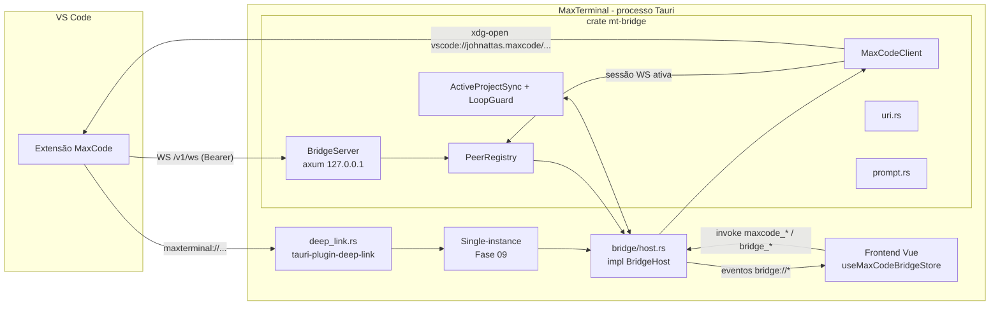
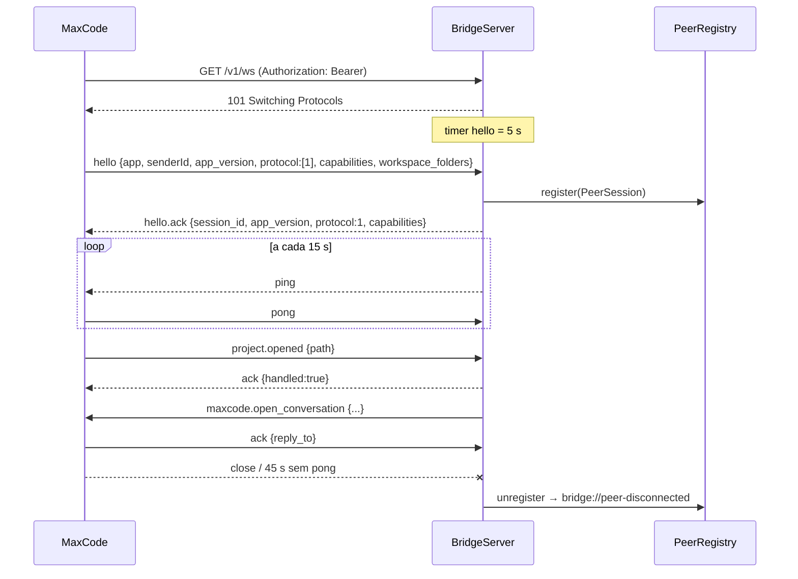
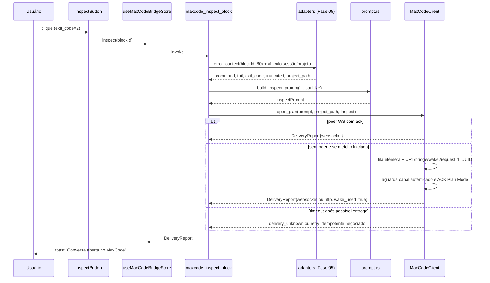

# Fase 11 — Integração Bidirecional com MaxCode (`spec.md`)

> Escopo funcional e critérios de aceite: [`./instructions.md`](./instructions.md). Fonte da verdade: AGENTS.md §6.
> Contratos compartilhados: [`../README.md`](../README.md) §2.

**Contrato proposto, não API comprovada do MaxCode.** O AGENTS.md define a intenção e os schemes, mas não
as rotas, portas, descoberta, mensagens, capabilities ou confirmação de Plan Mode. Toda definição externa
desta spec é proposta v1 atrás de `MaxCodeAdapter`. Implementar o lado local com fixtures e peer fake;
validar a extensão real por versão antes de habilitar o adaptador. Recurso não validado retorna
`bridge.unsupported_capability`, sem assumir que uma URI desconhecida funciona. Dependências diretas do
roadmap: **05, 07, 09**; contratos transitivos: 01, 03, 04, 06. Não importar módulos de fases posteriores.

---

## 1. Visão Geral da Arquitetura



Princípios:
- `mt-bridge` é **puro** (tokio + axum), sem dependência de Tauri; o crate binário injeta comportamento via trait
  `BridgeHost` (inversão de dependência) — permite testes de integração reais do servidor sem janela.
- **Canal preferencial**: sessão WebSocket iniciada pelo MaxCode (que descobre o MaxTerminal via `bridge.json`).
  **Wake-up**: URI `vscode://johnattas.maxcode/...` sem conteúdo sensível; a entrega ocorre posteriormente por
  WS/HTTP autenticado. Abrir o handler do SO não comprova abertura de conversa.
- Todo texto de origem do terminal que sai do processo passa por `mt_db::sanitizer::sanitize()`.

---

## 2. Organização de Módulos

### 2.1. `src-tauri/crates/mt-bridge/Cargo.toml` (dependências)

```toml
[dependencies]
mt-core = { path = "../mt-core" }
axum = { workspace = true, features = ["ws", "json", "tokio", "http1"] }
tokio = { workspace = true, features = ["rt-multi-thread", "net", "sync", "time", "process", "fs", "macros"] }
tower-http = { workspace = true, features = ["limit", "timeout", "trace"] }
serde = { workspace = true, features = ["derive"] }
serde_json = { workspace = true }
specta = { workspace = true }
tracing = { workspace = true }
uuid = { workspace = true, features = ["v7", "serde"] }
rand = "0.9"
base64 = "0.22"
subtle = "2"
url = "2"
percent-encoding = "2"
strip-ansi-escapes = "0.2"
toml = "0.8"
thiserror = { workspace = true }
futures-util = "0.3"
async-trait = "0.1"
reqwest = { version = "0.12", default-features = false, features = ["json"] }
time = { workspace = true, features = ["serde", "formatting"] }

[dev-dependencies]
tokio-tungstenite = "0.26"
tempfile = "3"
```

> `mt-db` **não** é dependência de `mt-bridge`: o sanitizador é injetado (`BridgeHost::sanitize`) para manter o
> crate isolado; o crate binário liga `mt_db::sanitizer::sanitize`.

### 2.2. Árvore

```
mt-bridge/src/
├── lib.rs          # pub use; BridgeHandle; start_bridge()
├── error.rs        # BridgeError + códigos bridge.*
├── config.rs       # BridgeConfig (TOML)
├── discovery.rs    # DiscoveryFile (escrita 0600 atômica), MaxCodeDiscovery (leitura)
├── auth.rs         # Token, OriginPolicy, HostPolicy, verify_bearer
├── protocol.rs     # Envelope, MessageType, payloads, PROTOCOL_VERSION
├── server.rs       # BridgeServer (Router, bind, shutdown)
├── session.rs      # PeerRegistry, PeerSession, heartbeat, pending acks
├── client.rs       # MaxCodeClient, UriOpener, DeliveryReport
├── dedup.rs        # reserva atômica por operação, ACK e TTL limitados
├── uri.rs          # MaxTerminalUri (parse), MaxCodeUri (build), limites
├── paths.rs        # canonicalização e worktrees
├── sync.rs         # ActiveProjectSync, LoopGuard
├── prompt.rs       # build_inspect_prompt, truncate_utf8, strip_ansi
└── handler.rs      # trait BridgeHost
src-tauri/src/bridge/
├── mod.rs          # init(app) no setup; shutdown via hook Fase 09 antes do exit final
├── host.rs         # TauriBridgeHost: impl BridgeHost
├── adapters.rs     # pontes para contratos das Fases 05/06/07/09
└── deep_link.rs    # registro do plugin + roteamento maxterminal://
```

### 2.3. Contratos consumidos de fases anteriores (via `adapters.rs`)

| Fase | Símbolo esperado | Uso |
|------|------------------|-----|
| 01 | `mt_core::{MtError, ErrorCode, MtResult, ProjectId, TabId, TemplateId, CommandBlockId, paths::AppPaths}` | erros, ids, XDG |
| 03 | `mt_db::sanitizer::sanitize(&str) -> Cow<str>` | prompt do "Inspecionar", logs |
| 04 | Slot `#actions` do bloco; `registerBlockAction` é apenas adaptador local se não existir na fase dona | montar `InspectButton` |
| 05 | `ShellService::error_context(id, 80) -> ErrorContext`, `command_block_get(id, include_output)` / `CommandBlockDto` | contexto exato do bloco, tail sanitizada; não inventar `shell_block_output` |
| 06 | Serviço/repositório de projetos por caminho e `useProjectsStore.selectedProjectId` | adaptador de seleção com metadados; evento `project://selected` só se realmente existir |
| 07 | `WorkspaceManager::open_tab(TabOpenRequest { project_id, template_id, overrides: Option<TabOpenOverrides>, focus }) -> TabView`, `TemplateRepo::list(project_id)` | criar no Rust; resolver nome para id dentro do projeto e sobrescrever somente `cwd` permitido |
| 09 | `cli::handle_second_instance`, único plugin single-instance, `QuakeController::show_and_focus`, `ShutdownHooks` | composição no binário; não existe contrato confirmado `mt_os::single_instance::on_args` |

`ErrorContext` é o contrato oficial da Fase 05 para inspeção; seus campos TS são `blockId`, `exitCode`,
`cwd`, `command`, `tail`, `truncated`. `CommandBlockDto` também serializa camelCase. O envelope externo
mantém os nomes explicitados abaixo; DTOs dessa ponte usam snake_case, salvo `correlationId` explicitamente
renomeado. Gerar todos por specta; não renomear contratos das fases donas para acomodar esta fase.

---

## 3. Tipos Rust Centrais

### 3.1. Erros (`error.rs`)

```rust
/// Erros da ponte MaxCode. Convertidos para `MtError` com código `bridge.*` e mensagem pt-BR.
#[derive(Debug, thiserror::Error)]
pub enum BridgeError {
    #[error("Não foi possível abrir a porta da ponte em 127.0.0.1")]          BindFailed(#[source] std::io::Error),
    #[error("Token de autenticação ausente ou inválido")]                     Unauthorized,
    #[error("Origem da requisição não permitida")]                             OriginForbidden,
    #[error("Host da requisição não permitido")]                               HostForbidden,
    #[error("Versão de protocolo não suportada: {0}")]                         UnsupportedVersion(u16),
    #[error("Tipo de mensagem desconhecido: {0}")]                             UnknownType(String),
    #[error("Mensagem inválida: {0}")]                                         InvalidMessage(String),
    #[error("URI inválida: {0}")]                                              InvalidUri(String),
    #[error("Caminho inválido ou inexistente: {0}")]                           InvalidPath(String),
    #[error("Pasta fora do projeto")]                                          CwdOutsideProject,
    #[error("Nenhum projeto corresponde ao caminho informado")]                ProjectNotFound,
    #[error("MaxCode não confirmou o recebimento a tempo")]                    AckTimeout,
    #[error("Não foi possível abrir o MaxCode: {0}")]                          LaunchFailed(String),
    #[error("Ponte desabilitada nas configurações")]                           Disabled,
    #[error("A extensão não oferece este recurso compatível")]                 UnsupportedCapability,
    #[error("Não foi possível confirmar a entrega ao MaxCode")]                 DeliveryUnknown,
    #[error("O MaxCode não se conectou dentro do prazo")]                       WakeTimeout,
    #[error("Limite de solicitações da ponte atingido")]                        Busy,
    #[error("Identificador reutilizado para outra operação")]                  IdempotencyConflict,
    #[error("Falha de E/S na ponte: {0}")]                                     Io(#[from] std::io::Error),
}

impl BridgeError {
    pub fn code(&self) -> &'static str; // "bridge.bind_failed", "bridge.unauthorized", ...
}
impl From<BridgeError> for mt_core::MtError { /* code(), to_string(), details */ }
```

### 3.2. Configuração (`config.rs`)

Arquivo `$XDG_CONFIG_HOME/maxterminal/bridge.toml` (criado com padrões na primeira execução, 0600).

```rust
#[derive(Debug, Clone, Serialize, Deserialize, specta::Type, PartialEq)]
#[serde(default, rename_all = "snake_case")]
pub struct BridgeConfig {
    pub enabled: bool,                    // padrão true
    pub preferred_port: u16,              // padrão 47615 (1024..=65535)
    pub fallback_range: u8,               // padrão 9 → tenta 47616..=47624
    pub allow_ephemeral_fallback: bool,   // padrão true
    pub sync_active_project: bool,        // padrão true
    pub extra_allowed_origins: Vec<String>, // padrão []
    pub ack_timeout_ms: u32,              // padrão 3000
}
impl BridgeConfig {
    pub fn load(paths: &AppPaths) -> Result<Self, BridgeError>;        // tolera arquivo ausente
    pub fn save(&self, paths: &AppPaths) -> Result<(), BridgeError>;   // atômico
    pub fn validate(&self) -> Result<(), BridgeError>;
}
```

Validação: porta 1024..=65535, `fallback_range` 0..=9 sem overflow, timeout 500..=10000 ms;
origens extras no máximo 8 entradas exatas, ≤ 256 bytes cada, sem curingas, `null` ou schemes HTTP(S).
Desabilitar cancela fila de wake-up e pendências com erro, fecha servidor e remove descoberta própria;
URI explícita de foco continua disponível pela integração SO, mas não reativa a ponte.

### 3.3. Descoberta (`discovery.rs`)

```rust
pub const DISCOVERY_VERSION: u16 = 1;

#[derive(Clone, Serialize, Deserialize)] // Debug customizado omite token
pub struct DiscoveryFile {
    pub version: u16,          // 1
    pub app: String,           // "maxterminal"
    pub host: String,          // sempre "127.0.0.1"
    pub port: u16,
    pub token: String,         // base64url sem padding, 43 chars
    pub pid: u32,
    pub protocol: u16,         // PROTOCOL_VERSION
    pub started_at: String,    // RFC 3339
    pub app_version: String,
    pub instance_id: Uuid,     // muda a cada start; distingue reutilização de PID
    pub process_start_ticks: u64, // /proc/<pid>/stat, com boot_id para identidade do processo
    pub boot_id: String,
}

/// `$XDG_RUNTIME_DIR/maxterminal/bridge.json`; fallback `$XDG_STATE_HOME/maxterminal/run/bridge.json`.
pub fn discovery_path(paths: &AppPaths) -> PathBuf;
/// Valida dono/tipo sem seguir symlink; temporário exclusivo aleatório 0600, fsync, rename e fsync do diretório.
pub fn write_discovery(path: &Path, file: &DiscoveryFile) -> Result<(), BridgeError>;
/// Remove somente se instance_id e identidade do processo ainda forem desta instância.
pub fn remove_discovery(path: &Path) -> Result<(), BridgeError>;
/// Valida UID, boot_id e process_start_ticks; nome/PID isolados não provam identidade.
pub fn foreign_live_instance(path: &Path) -> Option<u32>;

/// Proposta externa opcional, DESABILITADA até validada: `$XDG_RUNTIME_DIR/maxcode/bridge.json`
/// `{ version, app: "maxcode", port, token, pid, protocol, workspace_folders: string[] }`.
#[derive(Clone, Deserialize)] // Debug customizado omite token
pub struct MaxCodeDiscovery { pub version: u16, pub port: u16, pub token: String, pub pid: u32,
                              pub protocol: u16, #[serde(default)] pub workspace_folders: Vec<PathBuf> }
pub fn read_maxcode_discovery(paths: &AppPaths) -> Option<MaxCodeDiscovery>; // valida identidade, UID e 0600
```

Regra: se `foreign_live_instance` retornar `Some`, a instância atual é secundária (a single-instance da Fase 09 já
deveria tê-la encerrado) — o servidor **não** sobe e registra `WARN`.

O adaptador completa a identidade externa conforme o contrato efetivamente negociado; PID isolado não basta.
Descoberta ≤ 8 KiB, diretórios ancestrais privados pertencentes ao UID atual; rejeitar symlink e arquivo não
regular com abertura no-follow e validação por descritor. Falhar fechado se os paths XDG não forem seguros.
Nunca seguir URL/host fornecido no arquivo: construir `http://127.0.0.1:<porta>` localmente. Token só existe
no arquivo privado e nos headers; não serializar em IPC, erro, evento ou log. Isso não isola processos maliciosos
com o mesmo UID, que já podem ler o arquivo; o limite de confiança é a conta local.

### 3.4. Autenticação (`auth.rs`)

```rust
#[derive(Clone)]
pub struct Token(Arc<str>);
impl Token {
    pub fn generate() -> Self;                         // 32 bytes OsRng → base64url
    pub fn verify(&self, presented: &str) -> bool;     // subtle::ConstantTimeEq
    pub fn expose(&self) -> &str;                      // uso exclusivo do discovery
}
impl std::fmt::Debug for Token { /* imprime "Token(***)" */ }

pub struct OriginPolicy { allowed: Vec<String> }
impl OriginPolicy {
    /// Padrão: Origin ausente (clientes Node/extensões) OU `vscode-file://vscode-app` OU `extra_allowed_origins`.
    /// Qualquer `http(s)://` é rejeitado, inclusive `http://localhost`.
    pub fn check(&self, origin: Option<&HeaderValue>) -> Result<(), BridgeError>;
}
pub struct HostPolicy { port: u16 }
impl HostPolicy {
    /// Aceita apenas `127.0.0.1:<port>` e `localhost:<port>` (anti DNS-rebinding).
    pub fn check(&self, host: Option<&HeaderValue>) -> Result<(), BridgeError>;
}
/// Extrai `Authorization: Bearer <t>`; ausente/mal formado → Unauthorized.
pub fn verify_bearer(headers: &HeaderMap, token: &Token) -> Result<(), BridgeError>;
```

Limites de conexão/headers são aplicados antes de alocar corpo; depois `Host` → `Origin` → `Bearer` → payload.
`/v1/health` é a única exceção de Bearer. Origin ausente não dispensa token; rejeitar múltiplos valores e `null`.
O token **nunca** vai em query string
(evita vazamento em logs).

### 3.5. Trait de host (`handler.rs`)

```rust
/// Ponto de inversão: o app Tauri implementa; testes usam `MockHost`.
#[async_trait::async_trait]
pub trait BridgeHost: Send + Sync + 'static {
    /// Resolve caminho canônico → projeto conhecido (Fase 06).
    async fn find_project_by_path(&self, canonical: &Path) -> Option<ProjectRef>;
    /// Seleciona/foca o projeto na UI; `cause` repassado ao LoopGuard.
    async fn focus_project(&self, req: FocusRequest) -> Result<(), BridgeError>;
    /// Abre aba (Fase 07).
    async fn open_tab(&self, req: OpenTabRequest) -> Result<TabId, BridgeError>;
    /// Mostra e foca a janela principal (Fase 09).
    async fn show_main_window(&self);
    /// Sanitização (Fase 03).
    fn sanitize(&self, text: &str) -> String;
    /// Notifica mudanças de estado (vira evento `bridge://*`).
    fn on_event(&self, event: BridgeEvent);
}

#[derive(Debug, Clone, Serialize, specta::Type)]
pub struct ProjectRef { pub id: ProjectId, pub path: PathBuf, pub title: String }

#[derive(Debug, Clone)]
pub struct FocusRequest { pub project: ProjectRef, pub worktree_path: Option<PathBuf>, pub context: SyncContext }

#[derive(Debug, Clone, Serialize, Deserialize, specta::Type)]
pub struct SyncContext {
    pub origin: PeerApp,
    #[serde(rename = "correlationId")]
    pub correlation_id: Uuid,
}

#[derive(Debug, Clone)]
pub struct OpenTabRequest { pub project: ProjectRef, pub template: Option<String>, pub cwd: Option<PathBuf> }
```

### 3.6. Handle público (`lib.rs`)

```rust
pub struct BridgeHandle { /* Arc<Inner>: config RwLock, token, registry, client, sync, shutdown_tx */ }

pub async fn start_bridge(paths: AppPaths, config: BridgeConfig, host: Arc<dyn BridgeHost>)
    -> Result<BridgeHandle, BridgeError>;

impl BridgeHandle {
    pub fn status(&self) -> BridgeStatus;
    pub fn client(&self) -> &MaxCodeClient;
    pub fn sync(&self) -> &ActiveProjectSync;
    pub async fn restart(&self, config: BridgeConfig) -> Result<BridgeStatus, BridgeError>;
    pub async fn regenerate_token(&self) -> Result<BridgeStatus, BridgeError>;
    pub async fn shutdown(&self);   // fecha sessões (1001), remove bridge.json, aguarda até 2 s
}

#[derive(Debug, Clone, Serialize, specta::Type)]
#[serde(rename_all = "snake_case")]
pub enum BridgeState { Disabled, Starting, Listening, Connected, Failed }

#[derive(Debug, Clone, Serialize, specta::Type)]
pub struct BridgeStatus {
    pub instance_id: String,
    pub revision: u64,             // contador monotônico; snapshot/listeners usam a mesma revisão
    pub selection: Option<ProjectFocusRequested>, // última seleção desejada, recuperável no reload
    pub state: BridgeState,
    pub port: Option<u16>,
    pub discovery_path: Option<String>,
    pub peers: Vec<PeerInfo>,
    pub last_error: Option<MtError>,
    pub protocol: u16,
}

#[derive(Debug, Clone, Serialize, specta::Type)]
pub struct PeerInfo {
    pub id: String,                 // Uuid v7 da sessão
    pub app: String,                // "maxcode"
    pub app_version: String,
    pub workspace_folders: Vec<String>,
    pub capabilities: Vec<String>,
    pub connected_at: String,
}
```

`state = Connected` ⇔ `Listening` com ≥ 1 peer que completou `hello`.
Conectado não implica `open_conversation`: cada ação depende da capability específica confirmada.

---

## 4. Servidor (`server.rs`, `session.rs`)

### 4.1. Bind com fallback

```rust
pub async fn bind(cfg: &BridgeConfig) -> Result<(TcpListener, u16), BridgeError> {
    // 1) 127.0.0.1:preferred_port  2) preferred_port+1 ..= preferred_port+fallback_range
    // 3) se allow_ephemeral_fallback: 127.0.0.1:0   — nunca Ipv6/0.0.0.0
}
```
`SocketAddr` é sempre construído com `Ipv4Addr::LOCALHOST`; teste unitário garante que nenhum caminho de código usa
`UNSPECIFIED`. `SO_REUSEADDR` desabilitado (evita sequestro de porta).

### 4.2. Rotas

| Método | Rota | Auth | Corpo | Resposta |
|--------|------|------|-------|----------|
| GET | `/v1/health` | Host + Origin (sem token) | — | `200 {"ok":true,"protocol":1}` |
| POST | `/v1/messages` | Host + Origin + Bearer | `Envelope` (≤ 256 KiB) | `200 Envelope` (`ack`/`error`/resposta) |
| GET | `/v1/ws` | Host + Origin + Bearer no upgrade | — | `101` → WS; frames texto `Envelope` (≤ 256 KiB) |
| * | outras | — | — | `404` sem corpo |

Camadas: `RequestBodyLimitLayer(256 KiB)`, `TimeoutLayer(10 s)` para HTTP, `TraceLayer` com campos sem headers.
Respostas de erro HTTP: `{ "code": "bridge.unauthorized", "message": "<pt-BR>" }`. Nenhum header CORS é emitido;
`OPTIONS` → `405`.

`POST /v1/messages` existe para clientes "one-shot" (ex.: script ou CLI do MaxCode que não mantém WS): processa
uma mensagem e responde de forma síncrona; não registra peer. Usa a mesma validação, autorização por tipo e
dedup do WS; exige `senderId` autenticado associado à instância da extensão. Negotiation HTTP proposta:
`hello` devolve `session_id` efêmero, enviado em `X-Bridge-Session` nas próximas mensagens; expira em 5 min
sem uso, no restart ou rotação do token. Nunca cria peer WS fictício.

Limites adicionais: HTTP 50 req/s por sessão e 200 req/s global (burst 50/200), incluindo health e falhas de
auth; máximo 16 requests em andamento, 8 handshakes/sessões WS no total, 128 ACKs pendentes globais,
headers ≤ 8 KiB, resposta HTTP ≤ 256 KiB. Excesso HTTP → 429 com `Retry-After`, saturação → 503.
WS limita **mensagem agregada** a 256 KiB, inclusive fragmentação; rejeita binário e extensões de compressão
não negociadas. Limitar profundidade JSON (32) e coleções (32 capabilities/workspaces). Filas cheias nunca
descartam silenciosamente ações: devolvem `bridge.busy`. Não manter locks em awaits de rede/UI.

### 4.3. Ciclo de vida da sessão WS



Códigos de fechamento: `4001` hello ausente/ inválido, `4002` versão incompatível, `4003` token revogado,
`4008` excesso de mensagens, `1001` shutdown do app, `1009` frame grande demais.

```rust
pub struct PeerSession {
    pub info: PeerInfo,
    tx: mpsc::Sender<Envelope>,                     // capacidade 64; cheia → descarta ping, fecha 4008 se persistir
    pending: Mutex<HashMap<Uuid, oneshot::Sender<Envelope>>>, // aguardando ack/resposta
    last_pong: AtomicI64,
}
pub struct PeerRegistry { peers: RwLock<HashMap<Uuid, Arc<PeerSession>>> }
impl PeerRegistry {
    pub fn register(&self, s: Arc<PeerSession>);
    pub fn unregister(&self, id: Uuid);
    /// Filtra capability e projeto/worktree exatos; ambiguidade => escolha explícita, nunca peer arbitrário.
    pub fn pick_for(&self, project_path: Option<&Path>) -> Option<Arc<PeerSession>>;
    pub async fn request(&self, peer: &PeerSession, msg: Envelope, timeout: Duration) -> Result<Envelope, BridgeError>;
    pub fn close_all(&self, code: u16);
}
```

Rate limit por sessão: 50 mensagens/s (token bucket); excedido 3 s seguidos → `4008`. Máximo 8 sessões
simultâneas; a 9ª recebe `503`.
Heartbeat usa relógio monotônico; qualquer pong não basta: conferir desafio da sessão. Remover pending ACK
ao completar, cancelar, expirar ou desconectar. ACK só resolve request do mesmo peer autenticado e `reply_to`.

---

## 5. Protocolo de Mensagens v1 (`protocol.rs`)

### 5.1. Envelope

```rust
pub const PROTOCOL_VERSION: u16 = 1;
pub const MAX_FRAME_BYTES: usize = 256 * 1024;

#[derive(Debug, Clone, Serialize, Deserialize, specta::Type)]
pub struct Envelope {
    pub v: u16,                         // sempre 1
    pub id: Uuid,                       // Uuid v7 gerado pelo emissor
    #[serde(rename = "type")]
    pub kind: MessageType,
    pub ts: String,                     // RFC 3339 UTC
    #[serde(default, skip_serializing_if = "Option::is_none")]
    pub reply_to: Option<Uuid>,         // resposta/ack a outra mensagem
    #[serde(rename = "correlationId")]
    pub correlation_id: Uuid,           // causa original; preservada em respostas, eventos e retransmissões
    #[serde(rename = "senderId")]
    pub sender_id: Uuid,                // instância autenticada no hello; não é prova de identidade sozinho
    pub origin: PeerApp,                // quem gerou: "maxterminal" | "maxcode"
    #[serde(default)]
    pub payload: serde_json::Value,     // validado por tipo via `Message::decode`
}

#[derive(Debug, Clone, Copy, Serialize, Deserialize, specta::Type, PartialEq, Eq)]
#[serde(rename_all = "snake_case")]
pub enum PeerApp { Maxterminal, Maxcode }

#[derive(Debug, Clone, Serialize, Deserialize, specta::Type, PartialEq, Eq)]
pub enum MessageType {
    #[serde(rename = "hello")] Hello,
    #[serde(rename = "hello.ack")] HelloAck,
    #[serde(rename = "ping")] Ping,
    #[serde(rename = "pong")] Pong,
    #[serde(rename = "ack")] Ack,
    #[serde(rename = "error")] Error,
    #[serde(rename = "bridge.capabilities")] Capabilities,
    #[serde(rename = "project.focus")] ProjectFocus,
    #[serde(rename = "project.opened")] ProjectOpened,
    #[serde(rename = "project.closed")] ProjectClosed,
    #[serde(rename = "terminal.open_tab")] TerminalOpenTab,
    #[serde(rename = "maxcode.open_conversation")] MaxcodeOpenConversation,
    #[serde(rename = "maxcode.open_project")] MaxcodeOpenProject,
    #[serde(other)] Unknown,
}

/// Mensagem tipada após validação do payload.
pub enum Message {
    Hello(HelloPayload), HelloAck(HelloAckPayload), Ping, Pong, Ack(AckPayload), Error(ErrorPayload),
    Capabilities(CapabilitiesPayload), ProjectFocus(ProjectPathPayload), ProjectOpened(ProjectPathPayload),
    ProjectClosed(ProjectPathPayload), TerminalOpenTab(OpenTabPayload),
    MaxcodeOpenConversation(OpenConversationPayload), MaxcodeOpenProject(ProjectPathPayload),
}
impl Message {
    pub fn decode(env: &Envelope) -> Result<Message, BridgeError>;   // v != 1 → UnsupportedVersion
    pub fn encode(self, sender_id: Uuid, origin: PeerApp, reply_to: Option<Uuid>, correlation_id: Uuid) -> Envelope;
}
```

### 5.2. Tabela de tipos

| `type` | Direção | Payload | Resposta esperada |
|--------|---------|---------|-------------------|
| `hello` | MC → MT | `HelloPayload` | `hello.ack` ou `error` + close 4002 |
| `hello.ack` | MT → MC | `HelloAckPayload` | — |
| `ping` / `pong` | ambos | `{}` | `pong` |
| `ack` | ambos | `AckPayload` | — |
| `error` | ambos | `ErrorPayload` | — |
| `bridge.capabilities` | ambos | `CapabilitiesPayload` | `ack` |
| `project.opened` | MC → MT | `ProjectPathPayload` | `ack { handled, reason? }` |
| `project.closed` | MC → MT | `ProjectPathPayload` | `ack` (informativo; não fecha nada no MT) |
| `project.focus` | MT → MC | `ProjectPathPayload` | `ack` |
| `terminal.open_tab` | MC → MT | `OpenTabPayload` | `ack { handled, tab_id? }` |
| `maxcode.open_conversation` | MT → MC | `OpenConversationPayload` | `ack` |
| `maxcode.open_project` | MT → MC | `ProjectPathPayload` | `ack` |

### 5.3. Payloads

```rust
#[derive(Serialize, Deserialize, specta::Type)]
pub struct HelloPayload {
    pub app: PeerApp,                       // deve ser Maxcode
    #[serde(rename = "senderId")] pub sender_id: Uuid,
    pub app_version: String,                // ≤ 64 chars
    pub protocol: Vec<u16>,                 // versões suportadas; precisa conter 1
    #[serde(default)] pub capabilities: Vec<Capability>,
    #[serde(default)] pub workspace_folders: Vec<PathBuf>,  // ≤ 32 itens, absolutos
}
#[derive(Serialize, Deserialize, specta::Type)]
pub struct HelloAckPayload { pub session_id: Uuid, pub app_version: String, pub protocol: u16,
                             pub capabilities: Vec<Capability> }

#[derive(Serialize, Deserialize, specta::Type, Clone, PartialEq, Eq)]
#[serde(rename_all = "snake_case")]
pub enum Capability { ProjectSync, OpenTab, OpenConversation, OpenProject, IdempotentRequests, PlanMode,
                      #[serde(other)] Unknown }

#[derive(Serialize, Deserialize, specta::Type)]
pub struct AckPayload { pub handled: bool,
                         #[serde(default)] pub reason: Option<String>,      // ex.: "project_not_found"
                        #[serde(default)] pub tab_id: Option<TabId>,
                        #[serde(default)] pub conversation_id: Option<String>,
                        #[serde(default)] pub mode: Option<ConversationMode> }
#[derive(Serialize, Deserialize, specta::Type)]
pub struct ErrorPayload { pub code: String, pub message: String }          // message pt-BR
#[derive(Serialize, Deserialize, specta::Type)]
pub struct CapabilitiesPayload { pub capabilities: Vec<Capability>, #[serde(default)] pub workspace_folders: Vec<PathBuf> }
#[derive(Serialize, Deserialize, specta::Type)]
pub struct ProjectPathPayload { pub path: PathBuf }                         // absoluto, ≤ 4096 bytes
#[derive(Serialize, Deserialize, specta::Type)]
pub struct OpenTabPayload { pub project_path: PathBuf,
                            #[serde(default)] pub template: Option<String>,  // nome do template (≤ 64 chars, F07)
                            #[serde(default)] pub cwd: Option<PathBuf> }     // dentro do projeto
#[derive(Serialize, Deserialize, specta::Type)]
pub struct OpenConversationPayload {
    pub mode: ConversationMode,             // v1: somente Plan
    pub prompt: String,                     // ≤ 64 KiB (UTF-8)
    #[serde(default)] pub project_path: Option<PathBuf>,
    pub source: ConversationSource,         // rastreabilidade
}
#[derive(Serialize, Deserialize, specta::Type)]
#[serde(rename_all = "snake_case")]
pub enum ConversationMode { Plan }
#[derive(Serialize, Deserialize, specta::Type)]
#[serde(rename_all = "snake_case")]
pub enum ConversationSource { Inspect, Generic }
```

`source` é metadado de rastreabilidade, não escolhe comportamento. As Fases 14/16 usam `Generic` e podem
evoluir o adaptador/capabilities depois; não incluir enums de domínio futuro nem prometer execução por
`IssueFix`. `open_conversation` exige `open_conversation` **e** `plan_mode`; ACK terminal só é sucesso com
`handled:true`, `conversation_id` e `mode:plan`. Aceitação em fila não é conclusão. `project.focus`/`project.opened`
transportam apenas seleção; não executar comandos nem fechar abas. Envelopes de controle também carregam
`senderId`/`correlationId`, mas somente operações com efeito entram no cache de idempotência.

### 5.4. Exemplos

```json
{"v":1,"id":"019a3158-0000-7000-8000-000000000001","type":"hello","ts":"2026-10-29T12:00:00Z","origin":"maxcode",
 "senderId":"019a3158-0000-7000-8000-000000000010","correlationId":"019a3158-0000-7000-8000-000000000001",
 "payload":{"app":"maxcode","senderId":"019a3158-0000-7000-8000-000000000010","app_version":"fixture-1","protocol":[1],"capabilities":["project_sync","open_conversation","plan_mode","idempotent_requests"],
             "workspace_folders":["/home/johnattas/GitHub/MaxTerminal"]}}
{"v":1,"id":"019a3158-0000-7000-8000-000000000002","type":"maxcode.open_conversation","ts":"2026-10-29T12:00:01Z","origin":"maxterminal",
 "senderId":"019a3158-0000-7000-8000-000000000020","correlationId":"019a3158-0000-7000-8000-000000000002",
 "payload":{"mode":"plan","project_path":"/home/johnattas/GitHub/MaxTerminal","source":"inspect",
             "prompt":"Ao executar o comando \"npm run build\" tive o seguinte erro: \"error TS2304: ...\""}}
{"v":1,"id":"019a3158-0000-7000-8000-000000000003","type":"ack","ts":"2026-10-29T12:00:02Z","origin":"maxcode",
 "senderId":"019a3158-0000-7000-8000-000000000010","correlationId":"019a3158-0000-7000-8000-000000000002",
 "reply_to":"019a3158-0000-7000-8000-000000000002","payload":{"handled":true,"conversation_id":"fixture-plan-1","mode":"plan"}}
```

### 5.5. Regras de compatibilidade
- Campos desconhecidos são ignorados (`serde` sem `deny_unknown_fields` nos payloads).
- `type` desconhecido → `error { code: "bridge.unknown_type" }` com `reply_to`, sessão mantida.
- Quebra de compatibilidade exige `v: 2` e negociação via `hello.protocol`.
- Validar direção por sessão: MaxCode não pode enviar operações `maxcode.*` ao MaxTerminal. `origin` e
  `senderId` devem corresponder ao peer autenticado; campos declarados pelo cliente não substituem auth.
- Manter matriz de compatibilidade com versão real do MaxCode, capabilities comprovadas e fixtures de
  request/ACK sanitizadas. Um cliente sem Plan Mode não recebe prompt para modo padrão como fallback.

### 5.6. Idempotência e semântica de entrega (`dedup.rs`)

Chave de operação `(senderId, id)` preservada em retries e troca de canal; `correlationId` liga efeitos
derivados à intenção original, sem confundir ACK com nova operação. O receptor reserva a chave **antes**
do efeito numa seção crítica curta: `InFlight` → `Completed { ack }` ou `Rejected { error }`. Duplicata em
voo aguarda o mesmo resultado; concluída reapresenta ACK. Mesma chave com tipo/payload diferentes retorna
`bridge.idempotency_conflict`. Não repetir `open_tab`/`open_conversation` após perda de ACK por simples timeout.

Cache limitado a 1024 operações por instância, TTL 5 min; entradas em voo nunca são expulsas. Saturação
retorna `bridge.busy`; guardar fingerprint do payload e resposta mínima, não o prompt. Retry automático só
com `idempotent_requests` negociado, mesmo receptor/instância e dentro do TTL. Reinício do destino perde
cache: pedido que pode ter sido aplicado retorna `bridge.delivery_unknown`, não é reexecutado. Não há
garantia de exactly-once após crash; não usar SQL só para simular essa garantia.

---

## 6. URI Schemes (`uri.rs`, `deep_link.rs`)

### 6.1. `maxterminal://` (entrada)

```rust
#[derive(Debug, Clone, PartialEq)]
pub enum MaxTerminalUri {
    ProjectOpen { path: PathBuf },
    TabOpen { project: PathBuf, cwd: Option<PathBuf>, request_id: Uuid },
}
impl MaxTerminalUri {
    /// Aceita somente scheme `maxterminal`, host `project`|`tab`, path `/open`.
    /// Parâmetros: percent-decoding UTF-8; cada valor ≤ 4096 bytes; URI total ≤ 16 KiB;
    /// `path`/`project` absolutos; cwd relativo é resolvido contra o projeto antes de canonicalizar;
    /// parâmetros repetidos ou desconhecidos → InvalidUri.
    pub fn parse(raw: &str) -> Result<Self, BridgeError>;
}
```

Rotas:
- `maxterminal://project/open?path=<abs>` → resolve projeto por caminho canônico → `focus_project` + `show_main_window`.
- `maxterminal://tab/open?project=<abs>&cwd=<abs|rel>&requestId=<uuid>` → abre aba Shell neutra, sem comando
  inicial e sem agente, usando overrides internos da Fase 07; rejeita `template`, `command`, `env`, `prompt`,
  `token`. `requestId` deduplica criação (não autentica). Template com comando só pode ser escolhido via
  `terminal.open_tab` autenticado. `cwd` precisa estar no projeto ou em worktree cujo vínculo foi verificado.

URIs são entrada **não autenticada**, inclusive quando recebidas por single-instance. Não executam comandos
por padrão de template: o adaptador resolve um template local `environment.kind == Shell`, sem `env_vars`,
e passa seu `template_id` com `initial_command: Some("")` e `cwd` validado. Não usar automaticamente o template
padrão, que pode iniciar um agente. Não existe override de ambiente na Fase 07; sem template neutro compatível,
retornar `unsupported_capability`, sem criar template/projeto implicitamente.
Não ampliar o payload externo para contornar essa restrição. Para `project/open`, caminho pode conter nomes
com espaços/acentos, mas não credenciais; para integrações automatizadas preferir wake + canal autenticado.
Rejeitar userinfo, porta, fragmento, NUL/controles e percent-encoding inválido; decodificar exatamente uma vez.

Registro (`deep_link.rs`):

```rust
pub fn init(app: &AppHandle, bridge: BridgeHandle) -> MtResult<()> {
    // 1) Em debug: app.deep_link().register_all() (gera handler XDG para o binário de dev).
    // 2) app.deep_link().on_open_url(|event| route(event.urls())) — URLs da instância atual.
    // 3) URLs na linha de comando do primeiro start: app.deep_link().get_current().
    // 4) A composição no binário mantém o único callback single-instance da Fase 09.
    //    Habilitar a feature deep-link do plugin single-instance; não registrar outro plugin/callback.
    //    Se houver encaminhamento manual, ele entra na mesma fila com dedup, nunca numa rota paralela.
}
async fn route(host: &TauriBridgeHost, raw: &str) -> Result<(), BridgeError>;
```

`tauri.conf.json`:

```json
{ "plugins": { "deep-link": { "desktop": { "schemes": ["maxterminal"] } } } }
```

`packaging/linux/maxterminal.desktop`:

```ini
[Desktop Entry]
Type=Application
Name=MaxTerminal
Comment=Terminal acelerado por GPU e orquestrador de agentes de IA
Exec=maxterminal %u
Icon=maxterminal
Terminal=false
Categories=System;TerminalEmulator;Development;
MimeType=x-scheme-handler/maxterminal;
StartupWMClass=maxterminal
```

Wake-up: com o app fechado, o XDG inicia `maxterminal <url>`; a URL é lida em `get_current()` após o setup das
Fases 06/07 (o roteamento aguarda o sinal `projects_ready` via `tokio::sync::watch`, timeout 10 s). Com o app
aberto, a single-instance (Fase 09) encerra o novo processo e encaminha `argv`. Plugin single-instance
registrado primeiro, com feature `deep-link`; depois plugin deep-link. Registrar listener antes de consumir
`get_current()`; ambos alimentam uma fila limitada a 32 itens. Para `TabOpen`, dedup por `requestId` durante
5 min; para foco idempotente, coalescer URI normalizada por 2 s. Não logar argv/URI crua.
Readiness inclui serviços Rust **e** consumidor de seleção da UI; timeout devolve falha visível. `show_and_focus`
usa a Fase 09 (best effort no Wayland), sem criar outra janela. Integração de saída passa por `ShutdownHooks`
antes do exit final; minimizar para tray mantém ponte, fila e PTYs vivos.

As chamadas acima são pontos de integração a validar na versão fixada dos plugins. Documentação consultada
via Context7 teve a consulta de conteúdo bloqueada por cota; a verificação de assinaturas/feature no lockfile
e um teste Linux instalado são obrigatórios antes de implementação. Não presumir que registro debug substitui
o `.desktop` do pacote. Capabilities Tauri só autorizam chamadas JS; handlers Rust não exigem expor registro XDG.

### 6.2. `vscode://johnattas.maxcode/` (saída — contrato com a extensão)

```rust
pub enum MaxCodeUri {
    Wake { request_id: Uuid },
}
impl MaxCodeUri {
    pub const BASE: &'static str = "vscode://johnattas.maxcode";
    /// Proposta `/bridge/wake?requestId=<uuid>`; só usar após validar handler no MaxCode.
    /// Encoding: percent-encoding de tudo fora de RFC 3986 "unreserved" (inclui espaço → %20, nunca '+').
    pub fn build(&self) -> Result<String, BridgeError>;
}
```

### 6.3. Limites

| Item | Limite | Comportamento |
|------|--------|---------------|
| URI `maxterminal://` total | 16 KiB | rejeita (`InvalidUri`) |
| Valor de parâmetro de entrada | 4096 bytes | rejeita |
| URI `vscode://` total | 2 KiB | só scheme, rota e UUID público; rejeita qualquer conteúdo adicional |
| Prompt genérico via WS/HTTP | 64 KiB UTF-8 | rejeita acima do limite; não cortar template já interpolado |
| `${comando}` (Inspecionar) | 2000 caracteres | truncado |
| `${erro}` (Inspecionar) | últimas 80 linhas e 6000 caracteres | mantém o **final** da saída, prefixo `[…] ` |

`truncate_utf8` corta somente em fronteira de `char`; os limites de `${comando}`/`${erro}` incluem marcadores
de truncamento. Caracteres significam escalares Unicode; o limite de transporte é em bytes UTF-8. A URI
nunca recebe esses valores. Sanitizar antes de truncar evita perder delimitadores necessários à redação.

### 6.4. Abertura via `xdg-open`

```rust
#[async_trait::async_trait]
pub trait UriOpener: Send + Sync {
    async fn open(&self, uri: &str) -> Result<(), BridgeError>;
}
pub struct XdgOpener;  // tokio::process::Command::new("xdg-open").arg(uri), stdin/out null, timeout 5 s,
                       // exit != 0 → LaunchFailed; sem shell; timeout cancela/recolhe o helper supervisionado
```

---

## 7. Banco de Dados

**Nenhuma tabela, índice ou migration** nesta fase. Justificativa: o estado da ponte é efêmero (sessões, token) e a
configuração é um arquivo TOML de usuário. Eventos de "Inspecionar" não são persistidos (o bloco já está na sessão
SQLite das Fases 05/07). Logs `tracing` registram apenas `type`, `id`, tamanho e canal — nunca payload.

Leituras via repositórios das fases donas, WAL/foreign_keys/busy_timeout herdados da Fase 03. Consulta
conceitual parametrizada para provar pertencimento (adaptar nomes apenas no `adapters.rs`):

```sql
SELECT b.id, b.command, b.exit_code, b.cwd, b.error_tail,
       s.id AS session_id, t.project_id, p.path AS project_path
FROM command_blocks AS b
JOIN sessions AS s ON s.id = b.session_id
JOIN tabs AS t ON t.id = s.tab_id
JOIN projects AS p ON p.id = t.project_id
WHERE b.id = ?1;
```

`command_blocks.id`, `sessions.id`, `tabs.id`, `projects.id` usam as PKs existentes; nenhuma varredura FTS
ou índice novo é necessária. `idx_blocks_session_seq` (05) serve histórico, não deve ser duplicado pela ponte.
Preferir `ShellService::error_context` e resolução de projeto da Fase 07, sem leitura bruta de scrollback.
Tail de bloco arquivado é válida; sessão/aba podem estar fechadas, sem depender do projeto atualmente
selecionado. Histórico removido retorna `shell.block_not_found`; transação de leitura mantém snapshot
consistente. Fila de entrega, token, dedup e prompts são efêmeros; nunca salvar outbox contendo segredos.

---

## 8. Cliente MaxCode (`client.rs`)

```rust
#[derive(Debug, Clone, Copy, Serialize, specta::Type, PartialEq, Eq)]
#[serde(rename_all = "snake_case")]
pub enum DeliveryChannel { Websocket, Http }

#[derive(Debug, Clone, Serialize, specta::Type)]
pub struct DeliveryReport { pub channel: DeliveryChannel, pub message_id: String, pub truncated: bool,
                            pub wake_used: bool, pub confirmed: bool, // true apenas após ACK terminal
                            pub conversation_id: Option<String>, pub mode: Option<ConversationMode>,
                            pub fallback_reason: Option<String> }

#[async_trait::async_trait]
pub trait MaxCodeAdapter: Send + Sync {
    fn capabilities(&self) -> Vec<Capability>;
    fn build_wake_uri(&self, request_id: Uuid) -> Result<String, BridgeError>;
    async fn discover_http(&self) -> Result<Option<MaxCodeDiscovery>, BridgeError>;
    // Traduz wire format real ↔ Envelope local; sem implementar regras de issues/Artisan.
}

pub struct MaxCodeClient { registry: Arc<PeerRegistry>, opener: Arc<dyn UriOpener>, paths: AppPaths,
                           adapter: Arc<dyn MaxCodeAdapter>, ack_timeout: Duration /* fila efêmera interna */ }
impl MaxCodeClient {
    /// API genérica (Fases 11, 14, 16).
    pub async fn open_plan(&self, prompt: &str, project_path: Option<&Path>, source: ConversationSource)
        -> Result<DeliveryReport, BridgeError>;
    pub async fn open_project(&self, project_path: &Path) -> Result<DeliveryReport, BridgeError>;
    pub async fn notify_focus(&self, project_path: &Path, context: SyncContext) -> Result<(), BridgeError>; // sem wake
}
```

Estratégia de entrega (`open_plan`/`open_project`):
1. Criar operação com `id` estável, sanitizar no Rust, validar projeto e capabilities. Escolher peer do workspace
   correspondente; se mais de um, usar vínculo explícito, nunca espalhar conversa para todas as janelas.
2. WS ativo → request/ACK em até 3 s. Sucesso exige confirmação terminal (§5.3).
3. Sem canal utilizável, descoberta HTTP **validada pelo adaptador** → handshake e POST autenticado, timeout
   2 s, `.no_proxy()`, redirects desativados e resposta limitada. Rejeitar redirecionamento/host não loopback.
4. Sem conexão e sem efeito iniciado: guardar payload sanitizado em fila (máx. 32 operações/2 MiB, TTL 30 s),
   `XdgOpener` abre URI apenas com requestId. A extensão descobre a ponte por arquivo privado e autentica;
   o sender retoma a mesma operação por WS/HTTP. UUID não concede leitura do prompt nem há GET público
   de payload. Confirmar somente após ACK; expirar → `bridge.wake_timeout`, apagar buffer.
5. Se envio pode ter sido aplicado, retry só conforme §5.6; caso contrário `bridge.delivery_unknown` sem
   nova criação automática. Rejeição de capability/validação é terminal, não dispara fallback.

Os dois canais retornam `DeliveryReport.confirmed = true`; `wake_used` informa que foi preciso acordar o
destino, não é um terceiro transporte de conteúdo. Fechamento, rotação e disable cancelam pendências; não
retransmitir silenciosamente ao reiniciar. A fila usa relógio monotônico e limpa payload em conclusão/erro.

`notify_focus` usa apenas conexão já compatível (nunca acorda o VS Code só por troca de foco).

---

## 9. Sincronização de Projeto Ativo (`paths.rs`, `sync.rs`)

### 9.1. Canonicalização

```rust
/// realpath (std::fs::canonicalize) + remoção de barra final; erro → InvalidPath.
pub fn canonicalize_project_path(p: &Path) -> Result<PathBuf, BridgeError>;

#[derive(Debug, Clone, PartialEq)]
pub struct ResolvedPath { pub canonical: PathBuf, pub main_root: PathBuf, pub worktree: Option<PathBuf> }

/// Sobe a árvore a partir de `p` procurando `.git`:
/// - diretório `.git` → main_root = pai; worktree = None
/// - arquivo `.git` com `gitdir: <x>/.git/worktrees/<n>` → lê `<gitdir>/commondir` → main_root = pai do common dir;
///   worktree = raiz que contém o arquivo `.git`
/// - nomes `.worktrees`/`.max-code-worktrees` são pistas; nunca prova de pertencimento
pub fn resolve_worktree_root(p: &Path) -> Result<ResolvedPath, BridgeError>;

/// Match: projeto cadastrado exato da worktree, depois main_root verificado, depois ancestral por componentes.
pub fn match_project<'a>(resolved: &ResolvedPath, projects: &'a [ProjectRef]) -> Option<&'a ProjectRef>;
```

Resolver `gitdir` e `commondir` relativos contra os diretórios que os contêm; validar vínculo reverso
`gitdir/gitdir` e pertencimento ao repositório registrado (ou consultar `git worktree list --porcelain -z`
no adaptador, sem shell). Suportar worktree fora da raiz, com `cwd` confinado à sua raiz verificada.
`Path::starts_with` por componentes evita confundir `/repo` e `/repo-malicioso`; revalidar após symlink/TOCTOU
antes de abrir aba. Se for submódulo/metadata incompatível e não houver projeto cadastrado exato, falhar sem
inferir o repositório pelo nome da pasta. Cache é só otimização, não substitui validação no uso.

### 9.2. LoopGuard e fluxo

```rust
pub struct LoopGuard { recent: Mutex<HashMap<Uuid, SyncContext>>, ttl: Duration /* 5 min */, limit: usize /*1024*/ }
impl LoopGuard {
    pub fn record(&self, context: SyncContext);
    /// Seleção remota sempre é terminal localmente, independentemente de tempo/path.
    pub fn should_suppress(&self, context: &SyncContext, outgoing_to: PeerApp) -> bool;
}

pub struct ActiveProjectSync { guard: LoopGuard, enabled: AtomicBool, debounce: Duration /* 250 ms */,
                               outgoing: mpsc::Sender<(PathBuf, SyncContext)> }
impl ActiveProjectSync {
    pub async fn on_remote_opened(&self, host: &dyn BridgeHost, env: &Envelope, p: &ProjectPathPayload) -> AckPayload;
    pub fn on_local_selected(&self, project_path: &Path, context: SyncContext); // debounced
    pub fn set_enabled(&self, on: bool);
}
```

```mermaid
sequenceDiagram
    participant MC as MaxCode
    participant S as ActiveProjectSync
    participant H as BridgeHost/UI
    MC->>S: project.opened {path: /repo/.max-code-worktrees/wt-x} (id=A, correlationId=A)
    S->>S: resolve → main_root=/repo, worktree=wt-x; match projeto
    S->>S: reserva dedup; guard.record(origin=maxcode, correlationId=A)
    S->>H: focus_project(context={maxcode,A})
    H-->>S: on_local_selected(/repo, context={maxcode,A})
    S->>S: origem remota explícita → não envia project.focus
    S-->>MC: ack {handled:true}
    Note over H: usuário seleciona outro projeto /outro
    H->>S: on_local_selected(/outro, context={maxterminal,B})
    S->>S: debounce 250 ms; guard.record(context)
    S->>MC: project.focus {path:/outro} (correlationId=B)
```

Regras adicionais: origem inválida recebe erro; correlação própria devolvida pelo peer é reconhecida e não
reaplica foco. Propagar `SyncContext` até a mutação da store e ao observador, sem flag global `isSyncing`
apagada antes de um watcher assíncrono. Seleção manual gera nova correlação mesmo para o mesmo path; não
suprimi-la por janela de 1500 ms. Desabilitar sync cancela debounce e invalida geração de tasks pendentes;
rechecar antes de aplicar seleção. `project.closed` é informativo, nunca fecha projeto/PTY local. Acks de
foco confirmam seleção aplicada; evento enviado sem consumidor pronto não é ACK de sucesso. Snapshot
autoritativo de seleção fica em `BridgeStatus.selection`, recuperável após reload da UI. O evento
`project-focus-requested` aplica apenas revisão mais recente da mesma instância; a UI chama
`bridge_notify_active_project(project_id, context)` com o contexto remoto como confirmação da aplicação.
Rust aceita essa confirmação somente para seleção pendente com mesmos projeto/correlação, resolve o ACK
de foco e não reenvia para MaxCode. Timeout de consumidor (3 s) devolve erro, preservando snapshot para
reconciliação; a seleção idempotente pode ser aplicada depois sem criar abas. `origin` do deep link é local
com correlação nova; selecionar por URI pode sincronizar uma vez, respeitando a opção de sync.

---

## 10. Prompt do "Inspecionar" (`prompt.rs`)

```rust
pub const INSPECT_TEMPLATE: &str = "Ao executar o comando \"{comando}\" tive o seguinte erro: \"{erro}\"";
pub struct InspectLimits { pub command_chars: usize /*2000*/, pub error_lines: usize /*80*/, pub error_chars: usize /*6000*/ }

/// 1) strip ANSI/OSC (strip-ansi-escapes) + normaliza CRLF→LF + remove `\r` de barras de progresso (mantém último trecho)
/// 2) sanitize(command), sanitize(output)
/// 3) trim externo; erro = últimas N linhas preservando vazias internas; limita chars (mantém final, prefixo "[…] ")
/// 4) interpola no template exato (aspas internas NÃO são escapadas — fidelidade ao AGENTS.md §6)
/// 5) verificar ausência de segredos; se houver resíduo, redigir os valores e reconstruir o mesmo template
pub fn build_inspect_prompt(command: &str, output: &str, exit_code: i32, limits: &InspectLimits, sanitize: &dyn Fn(&str) -> String)
    -> InspectPrompt;
pub struct InspectPrompt { pub text: String, pub truncated: bool }
```

Saída vazia → `${erro}` = `código de saída <N>` (garante prompt útil). O `${erro}` vem do intervalo de output do
bloco (OSC 133 `C`→`D`, Fase 05), via `ErrorContext.tail` no Rust — o frontend só envia `CommandBlockId`.
PTY combina stdout/stderr; `tail` não deve ser apresentado como stderr exclusivo. Verificar exit_code
conhecido e diferente de zero no Rust, mesmo que o frontend esteja desatualizado. Sem código confiável
(fallback `/proc`) não inventar falha. Preservar `ErrorContext.truncated` no relatório; truncamento local não
apaga sinal de perda anterior. Reaplicar sanitização em valores completos normalizados antes de qualquer
recorte; não cortar raw tail em fronteira que deixe metade de token sem contexto. Aspas e quebras de linha
nos valores ficam intactas; só o transporte JSON as escapa, não o texto semântico do AGENTS.md.

---

## 11. Comandos Tauri IPC (`src-tauri/src/commands/bridge.rs`)

Todos `async`, `#[tauri::command] #[specta::specta]`, retorno `Result<T, MtError>`.

| Comando | Args | Retorno | Erros |
|---------|------|---------|-------|
| `bridge_status` | — | `BridgeStatus` | — |
| `bridge_get_config` | — | `BridgeConfig` | `bridge.io` |
| `bridge_set_config` | `config: BridgeConfig` | `BridgeStatus` | `bridge.invalid_message` (validação), `bridge.bind_failed`, `bridge.io` |
| `bridge_restart` | — | `BridgeStatus` | `bridge.bind_failed`, `bridge.disabled` |
| `bridge_regenerate_token` | — | `BridgeStatus` | `bridge.io`, `bridge.disabled` |
| `maxcode_open_plan` | `prompt: String, project_path: Option<String>, source: Option<ConversationSource>` | `DeliveryReport` | `bridge.invalid_path`, `bridge.launch_failed` |
| `maxcode_open_project` | `project_path: String` | `DeliveryReport` | `bridge.invalid_path`, `bridge.launch_failed` |
| `maxcode_inspect_block` | `block_id: CommandBlockId` | `DeliveryReport` | `shell.block_not_found` (Fase 05), `bridge.invalid_message` (exit 0/None), `bridge.launch_failed` |
| `bridge_notify_active_project` | `project_id: ProjectId, context: SyncContext` | `()` | `project.not_found` (Fase 06) — no-op se sync desativado |

Observações:
- `maxcode_open_plan` aplica `sanitize()` ao prompt genérico (defesa em profundidade para Fases 14/16).
  Inspecionar usa o construtor de valores sanitizados e mantém a frase fixa literal. Ambos limitam bytes.
  Os comandos `maxcode_*` também podem retornar `bridge.unsupported_capability`, `bridge.wake_timeout`,
  `bridge.delivery_unknown`, `bridge.busy` e `bridge.idempotency_conflict` conforme §8.
- `bridge_set_config` com mudança de porta/`enabled` reinicia o servidor; mudança de `sync_active_project` é aplicada
  a quente.
- Escolher **um** produtor de notificações locais: adaptador de seleção da UI → IPC acima. Se o backend da
  Fase 06 já publicar seleção autoritativa, usar esse observador e desligar o watcher redundante. Nunca ambos.

## 12. Eventos Emitidos (`src-tauri/src/events/bridge.rs`)

| Evento | Payload | Quando |
|--------|---------|--------|
| `bridge://status-changed` | `BridgeStatus` | start/stop/restart, mudança de peers, erro de bind |
| `bridge://peer-connected` | `PeerInfo` | após `hello.ack` |
| `bridge://peer-disconnected` | `{ peer_id: string, reason: string }` | close/timeout/revogação |
| `bridge://project-focus-requested` | `{ project_id: ProjectId, worktree_path: string \| null, context: SyncContext, revision: number, instance_id: string }` | seleção autoritativa idempotente; adaptador aguarda aplicação/ack do consumidor, não só emit |
| `bridge://tab-opened` | `{ tab_id: TabId, project_id: ProjectId, context: SyncContext }` | notificação após `WorkspaceManager::open_tab`; UI nunca cria outra aba ao receber |
| `bridge://delivery-failed` | `{ message_id: string, code: string, message: string }` | falha total de entrega assíncrona |

Volume baixo → `emit` é adequado (sem `Channel`), restrito à janela principal autorizada; registrar payloads
como structs Rust com specta. DTOs TS abaixo são imports gerados, não interfaces duplicadas. Sem prompt,
token, comando ou tail em eventos de bridge. A Fase 07 permanece autoridade única da criação de aba.

---

## 13. Frontend

### 13.1. IPC (`src/ipc/bridge.ts`)

```ts
import { commands, type BridgeStatus, type BridgeConfig, type DeliveryReport, type ConversationSource,
    type CommandBlockId, type ProjectId, type PeerInfo, type ProjectFocusRequested, type SyncContext } from '@/types/bindings';
import { listen, type UnlistenFn } from '@tauri-apps/api/event';
import { unwrap } from './core';

export const bridgeIpc = {
    status: (): Promise<BridgeStatus> => unwrap(commands.bridgeStatus()),
    getConfig: (): Promise<BridgeConfig> => unwrap(commands.bridgeGetConfig()),
    setConfig: (config: BridgeConfig): Promise<BridgeStatus> => unwrap(commands.bridgeSetConfig(config)),
    restart: (): Promise<BridgeStatus> => unwrap(commands.bridgeRestart()),
    regenerateToken: (): Promise<BridgeStatus> => unwrap(commands.bridgeRegenerateToken()),
    openPlan: (prompt: string, projectPath: string | null, source: ConversationSource = 'generic'): Promise<DeliveryReport> =>
        unwrap(commands.maxcodeOpenPlan(prompt, projectPath, source)),
    openProject: (projectPath: string): Promise<DeliveryReport> => unwrap(commands.maxcodeOpenProject(projectPath)),
    inspectBlock: (blockId: CommandBlockId): Promise<DeliveryReport> => unwrap(commands.maxcodeInspectBlock(blockId)),
    notifyActiveProject: (projectId: ProjectId, context: SyncContext): Promise<void> =>
        unwrap(commands.bridgeNotifyActiveProject(projectId, context))
};

export const onBridgeStatus = (cb: (s: BridgeStatus) => void): Promise<UnlistenFn> =>
    listen<BridgeStatus>('bridge://status-changed', (e) => cb(e.payload));
export const onPeerConnected = (cb: (p: PeerInfo) => void): Promise<UnlistenFn> =>
    listen<PeerInfo>('bridge://peer-connected', (e) => cb(e.payload));
export const onProjectFocusRequested = (cb: (p: ProjectFocusRequested) => void): Promise<UnlistenFn> =>
    listen<ProjectFocusRequested>('bridge://project-focus-requested', (e) => cb(e.payload));
// onPeerDisconnected, onTabOpened, onDeliveryFailed análogos; todos os DTOs gerados do Rust
```

### 13.2. Store `useMaxCodeBridgeStore` (`src/stores/maxCodeBridge.ts`)

```ts
interface MaxCodeBridgeState {
    status: BridgeStatus | null;
    config: BridgeConfig | null;
    pendingBlockIds: Set<CommandBlockId>;   // envios "Inspecionar" em andamento
    lastDelivery: DeliveryReport | null;
    lastError: MtError | null;
    initialized: boolean;
}
getters:
    state: BridgeState ('disabled' quando status null)
    isConnected: boolean                    // state === 'connected'
    peers: PeerInfo[]
    port: number | null
    syncEnabled: boolean                    // config?.sync_active_project ?? false
    indicator: { color: 'success' | 'info' | 'danger' | 'neutral'; label: string }
        // connected → success "MaxCode conectado"; listening → info "Aguardando MaxCode";
        // failed → danger "Ponte indisponível"; disabled → neutral "Ponte desativada"
    isInspecting: (id: CommandBlockId) => boolean
actions:
    init(): Promise<void>                   // single-flight: listeners antes de snapshot; compara instance_id/revision
    dispose(): void
    updateConfig(patch: Partial<BridgeConfig>): Promise<void>
    restart(): Promise<void>
    regenerateToken(): Promise<void>
    openPlan(prompt: string, projectPath: string | null, source?: ConversationSource): Promise<DeliveryReport>
        // API pública para Fases 14 e 16
    openProject(projectPath: string): Promise<DeliveryReport>
    inspect(blockId: CommandBlockId): Promise<DeliveryReport> // coalesce por id; finally limpa pendingBlockIds
```

Store sem persistência via `max-pinia` (a fonte da verdade é o backend). Toasts via `Toast.show` do
`@maxvue/max-components-ui`: sucesso `"Conversa aberta no MaxCode"` somente para relatório confirmado;
erro `"Não foi possível abrir o MaxCode"` com `code`; entrega ambígua usa `"Não foi possível confirmar a abertura no MaxCode"`.
Listeners são instalados antes de buscar snapshot; descartar revisão obsoleta, detectar nova `instance_id`.
`dispose()` incrementa geração e remove inclusive listeners cuja Promise resolveu após desmontagem; nenhum
toast tardio após disposal. Configuração vem do Rust e rollback em falha mantém estado real. Duplo clique
no mesmo bloco compartilha Promise de envio, sem criar nova operação.

### 13.3. Composables

```ts
// src/composables/useActiveProjectSync.ts — montado uma vez no AppShell
export function useActiveProjectSync(): void;
// - escuta onProjectFocusRequested → adaptador local aplica select(project_id) + contexto imutável
// - confirma aplicação via notifyActiveProject(id, context); contexto remoto nunca é encaminhado pelo Rust
// - seleção manual gera contexto { origin: 'maxterminal', correlationId: UUID } e notifica uma vez
// - observa selectedProjectId da Fase 06; não presumir activeProjectId/cause na API dessa store
// - onScopeDispose remove listeners

// src/composables/useMaxCodeInspect.ts
export function useMaxCodeInspect(block: MaybeRefOrGetter<CommandBlockDto>): {
    visible: ComputedRef<boolean>;   // exitCode !== null && exitCode !== undefined && exitCode !== 0
    loading: ComputedRef<boolean>;
    inspect: () => Promise<DeliveryReport>;
};
```

### 13.4. Componentes

`src/components/bridge/InspectButton.vue` — registrado no slot de ações do bloco (Fase 04):

```ts
// Montar no slot #actions; registry opcional é adaptador local, não API presumida da Fase 04.
interface Props { block: CommandBlockDto }   // tipo gerado da Fase 05
const emit = defineEmits<{ inspected: [report: DeliveryReport] }>();
```
Template: `<MaxButton v-if="visible" :loading="loading" :disabled="loading" severity="danger" size="small" text icon="mdi:magnify-scan" label="Inspecionar" v-tooltip="'Abrir conversa em Plan Mode no MaxCode'" @click="onClick" />`.
O slot é compartilhado com o "Diagnóstico Rápido Inline" da Fase 12 (que renderiza **ao lado**, `order: 20`).

`src/components/bridge/BridgeStatusIndicator.vue` — inserido na `AppTitleBar` (Fase 01):
```ts
interface Props { compact?: boolean }
const emit = defineEmits<{ openSettings: [] }>();
```
Ponto colorido (`--max-success-500` / `--max-info-500` / `--max-danger-500` / cinza neutro) + rótulo; tooltip
"Porta 47615 · 1 conexão"; clique emite `openSettings`.

`src/components/bridge/BridgeSettingsSection.vue` — seção montável em qualquer tela de configurações:
campos "Ativar ponte com MaxCode", "Porta preferida", "Sincronizar projeto ativo", lista de conexões, botões
"Reiniciar ponte" e "Gerar novo token" (com `MaxPopoverConfirm`: "As conexões atuais serão encerradas.").
```ts
interface Props { embedded?: boolean }
const emit = defineEmits<{ saved: [config: BridgeConfig] }>();
```

---

## 14. Fluxos de Dados

### 14.1. "Inspecionar"



### 14.2. Inicialização e encerramento
1. Registrar single-instance da Fase 09 primeiro, depois deep-link; `setup()` → `BridgeConfig::load` →
   `start_bridge` (task tokio; falha de bind não impede o app: `state=failed`).
2. `write_discovery` após bind; `bridge://status-changed`.
3. `deep_link::init` → processa `get_current()` após `projects_ready`.
4. Hook do shutdown coordenado da Fase 09 com "Sair" real → bloquear novos pedidos, cancelar wake/ACKs,
   fechar sessões, aguardar tasks até 2 s e remover somente descoberta desta instância; exit final depois.

---

## 15. Tratamento de Erros

| Situação | Comportamento |
|----------|---------------|
| Bind falhou em todas as portas | `state=failed`; deep links locais continuam, mas wake-up isolado não entrega prompt. Só HTTP externo compatível ainda pode entregar; demais pedidos retornam erro |
| `bridge.json` não gravável | `WARN`, servidor continua (MaxCode só não descobre) e `last_error` preenchido |
| Payload inválido no WS | `error` com `reply_to`; 10 inválidos seguidos → close `4001` |
| `ack` com `handled:false` | erro terminal de domínio/capability; não contornar trocando transporte |
| `xdg-open` ausente | `LaunchFailed("xdg-open não encontrado")` → toast |
| Deep link para projeto inexistente | toast "Projeto não encontrado: <caminho>"; não cria projeto automaticamente |
| Panic em handler de sessão | isolado por `tokio::spawn`; sessão fechada `1011`; servidor segue |

Toda mensagem de erro voltada ao usuário em pt-BR; códigos estáveis `bridge.*` documentados em `error.rs`.

---

## 16. Performance

- Servidor em runtime tokio compartilhado do Tauri; nenhuma operação na thread principal.
- Frames JSON pequenos; serialização única por envio; `mpsc` com capacidade 64 por peer (backpressure).
- `canonicalize` + leitura de `.git` são `spawn_blocking` (I/O de FS) com cache LRU de 128 entradas (TTL 30 s).
- Consumir `ErrorContext.tail` já sanitizada/limitada da Fase 05; sem leitura ilimitada de scrollback nem corte
  de segredo raw antes da sanitização.
- Meta: latência `project.opened` → foco na UI < 100 ms (p95) em máquina local; `inspect` com WS < 150 ms.

## 17. Segurança

- Bind exclusivo `127.0.0.1`; teste que falha se `UNSPECIFIED` aparecer.
- Token 256 bits, rotacionado por execução e sob demanda; comparação em tempo constante; `Debug` mascarado;
  jamais em logs, eventos ou `BridgeStatus` (o frontend nunca recebe o token).
- `Host` + `Origin` validados antes do token; sem CORS; `POST` exige `Content-Type: application/json`
  (bloqueia formulários HTML simples).
- Arquivo de descoberta 0600 em diretório 0700; leitura da descoberta do MaxCode rejeita arquivo com permissão
  mais aberta que 0600 ou dono diferente do UID atual.
- Caminhos recebidos (WS, URI) devem ser absolutos, canonicalizados e corresponder a projeto já cadastrado; `cwd`
  confinado à raiz do projeto — a ponte **nunca** executa comandos arbitrários nem cria projetos.
- `terminal.open_tab` aceita apenas nome de template existente; o comando inicial vem do template (Fase 07),
  nunca do payload. Essa operação exige autenticação; deep links abrem somente template neutro conforme §6.1.
- `xdg-open` chamado sem shell, com URI construída por `url`/`percent-encoding`.
- Sanitização dupla do prompt; limites de tamanho em todas as entradas.

## 18. Estratégia de Testes

### 18.1. Unitários (`mt-bridge`)
- `protocol`: roundtrip de todos os `MessageType`; `v=2` → `UnsupportedVersion`; `type` desconhecido → `Unknown`;
  campos extras ignorados; exemplos da §5.4 como fixtures.
- `auth`: Bearer ausente/mal formado/errado/correto; `Origin` ausente ok, `vscode-file://vscode-app` ok,
  `http://localhost:5177` e `https://evil.example` rejeitados; `Host` válido/inválido; `Debug` do token mascarado.
- `uri`: parse das 2 rotas, percent-decoding UTF-8 (acentos, espaços), parâmetros repetidos/desconhecidos,
  caminho relativo, limites 4096/16 KiB; `vscode://` contém somente requestId. Rejeitar token/prompt/comando,
  userinfo, NUL, fragmento e dupla decodificação; template com comando não inicia por URI.
- `prompt`: caso exato do CA-29; ANSI e `\r` removidos; 200 linhas → 80 últimas; saída vazia → "código de saída N";
  aspas internas preservadas; sanitizador real com segredo dividido na fronteira do recorte; template fixo
  preservado mesmo com Unicode/truncamento e `ErrorContext.truncated` anterior.
- `paths`: repo `.git` dir, worktree interna/externa com `gitdir`/`commondir` relativos e vínculo reverso,
  pasta de nome falso `.max-code-worktrees`, symlink e escape de cwd, subpasta e projeto cadastrado exato.
- `sync`: foco remoto não ecoa após 1500 ms/reconexão; seleção manual do mesmo path não é suprimida;
  debounce colapsando 5 seleções em 1, disable cancela task pendente, correlação própria reconhecida.
- `discovery`: modo 0600/0700 (`std::os::unix::fs::PermissionsExt`), escrita atômica, pid morto sobrescrito,
  `remove` só da própria identidade, PID reutilizado, symlink e concorrência de rename/restart.
- `client`: WS → HTTP validado → wake sem payload; ACK terminal, modo incorreto, peer errado, redirects/proxy
  rejeitados; timeout após envio não recria conversa; fila TTL/capacidade e cancelamento ao desabilitar.
- `dedup`: mesmo id em WS e HTTP simultâneos chama host uma vez, ACK perdido reapresenta resultado,
  id reutilizado com outro payload falha, restart do receptor não permite retry ambíguo, cache saturado.

### 18.2. Integração (`mt-bridge/tests/`)
- `server_it.rs`: sobe `start_bridge` com `MockHost` em porta efêmera; `reqwest` para `/v1/health` e códigos
  401/403/413/404/405; `tokio-tungstenite` para handshake `hello`, timeout de hello (4001), ping/pong com tempo
  pausado, `project.opened` → `MockHost.focus_project` chamado 1×, sem eco `project.focus` (CA-25), regeneração de
  token fecha com 4003, fallback de porta ocupando a preferida com `TcpListener`.
- `uri_it.rs`: tabela de URIs válidas/inválidas.
- `discovery_it.rs`: ciclo start → arquivo presente → shutdown → arquivo ausente.

### 18.3. Frontend (Vitest + `@tauri-apps/api/mocks`)
- `maxCodeBridge.spec.ts`: `init` idempotente, getters `indicator` para os 4 estados, `inspect` alternando
  `pendingBlockIds`, toasts de sucesso/erro, `openPlan` repassando `source`.
- `useActiveProjectSync.spec.ts`: evento `project-focus-requested` seleciona projeto sem chamar
  `notifyActiveProject`; seleção manual chama uma vez; sync desativado não chama.
- `InspectButton.spec.ts`: visível só com `exitCode` ≠ 0 (casos `undefined`, `null`, `0`, `2`, `-1`), loading/disabled, emit
  `inspected`.
- `BridgeStatusIndicator.spec.ts`: cor/rótulo por estado, tooltip com porta e conexões.

### 18.4. Manuais (registrados no PR)
- Roteiro dos CA-06, CA-07, CA-11, CA-17, CA-18, CA-19 com `ss`, `nc`, `websocat`, `xdg-open` e VS Code + MaxCode.
- Extensão real: registrar versão e capabilities, janela aberta/fechada, duas janelas de workspace, abertura
  efetiva em Plan Mode e perda de ACK. Sem contrato implementado, declarar interoperabilidade pendente;
  o peer fake valida apenas a proposta. E2E final de empacotamento continua na Fase 17.
- Startup/get_current/on_open_url/single-instance recebendo a mesma URI, reload de webview e listeners
  tardios: exatamente uma aba e nenhum vazamento de subscriptions. Sem token/prompt nos processos/logs.

---

## 19. Pontos de Extensão para Fases Posteriores

| Fase | Ponto | Uso |
|------|-------|-----|
| 12 | Slot de ações do `CommandBlock` compartilhado (`order` 20+) | Diagnóstico Rápido Inline ao lado de "Inspecionar" |
| 13 | `OpenTabPayload` / `BridgeHost::open_tab` | abrir aba de Agente CLI em worktree a partir do MaxCode (via template de agente) |
| 14 | `maxcode_open_plan(prompt, project_path, 'generic')` / `useMaxCodeBridgeStore().openPlan` | "Criar com MaxCode"; formulário/prompt pertencem à 14 |
| 16 | `maxcode_open_plan(..., 'generic')`, `maxcode_open_project`, `MaxCodeAdapter` | Abrir/Analisar; Corrigir e lote exigem extensão de capability validada na 16, nunca tradução implícita de BUG FIX para Plan |
| 17 | `packaging/linux/maxterminal.desktop`, `BridgeConfig` | empacotamento, registro do MIME, hardening e E2E |

Novos tipos de mensagem devem ser adicionados em `MessageType` + `Message` com `Capability` correspondente,
mantendo `v: 1` enquanto forem aditivos.
