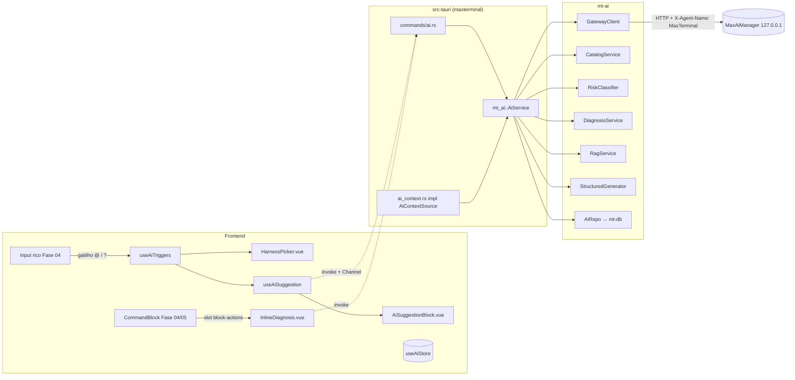
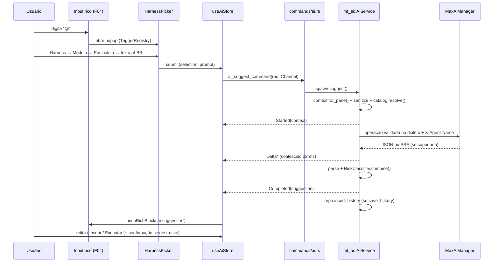

# Fase 12 — Integração MaxAiManager — Especificação Técnica (`spec.md`)

> Escopo funcional, critérios de aceite e riscos: [`./instructions.md`](./instructions.md).
> Contratos compartilhados: [`../README.md`](../README.md) §2. Fonte da verdade: [`../../AGENTS.md`](../../AGENTS.md) §5.1.

---

## 1. Visão Geral e Dependências

### 1.1. Arquitetura em camadas



Princípios:
- `mt-ai` **não depende** de `mt-pty`, `mt-shell`, `mt-projects` nem de Tauri. Recebe contexto por trait e devolve dados.
  Isso garante estruturalmente que a IA nunca escreve no PTY (CA-15).
- `mt-ai` depende de `mt-core` (erros/ids) e `mt-db` (sanitizer + conexão) apenas.
- O crate binário faz a ponte (comandos IPC, `Channel`, implementação do contexto lendo estado das Fases 05–07).

### 1.2. Dependências e adaptadores reconciliados

Dependências diretas: **04, 05, 07, 10**; 01/03/06 são transitivas. A aresta **10→12** é exclusivamente
de migrations: `0007_12_ai.sql` exige a sequência `0001`–`0006`, terminando em `0006_10_themes.sql` (D-01),
sem acoplar `mt-ai` aos serviços/crate de temas. Nenhum import de `mt-bridge` (11), `mt-agents` (13)
ou `mt-commands` (14/15). Os contratos abaixo foram lidos nas respectivas specs; helpers internos da 12 não são
apresentados como APIs preexistentes. Divergências ficam em `ai_context.rs` e `composables/ai/adapters.ts`.

| Fase | Contrato consumido | Uso |
|------|-------------------|-----|
| 01 | `mt_core::{MtError, MtResult, ErrorCode}`, `CommandBlockId`, `ProjectId`, `TabId`, `PaneId`; `AppPaths` | erros, ids |
| 03 | `mt_db::Db`, writer/runner de migrations, `sanitizer::sanitize` e sanitização incremental | persistência; adaptador segue API da fase dona |
| 04 | `triggerRegistry.register(TriggerDefinition): Disposable`; `provide/onSelect/onSubmitWithoutSelection`, `push-stage/handled/replace-input`; `useRichInput().text`; `TerminalInstanceHandle.write`; `HybridTerminal #block-actions` → `CommandBlock #actions` | gatilhos, inserção sem submit, execução explícita e diagnóstico |
| 05 | `shell://command-finished: CommandFinished`, `command_block_error_context: ErrorContext`, `ShellService::error_context`, `CommandBlocksRepo::list_by_session/get` | evento após persistência; cauda sanitizada, código nullable e comandos recentes |
| 06 | Projeto/stack pelo serviço/repositório da fase; converter para string opcional no adaptador | contexto e sugestão de slug (não prova que base existe) |
| 07 | `TabView`/`PaneView`, `WorkspaceLifecycleObserver::on_signal(WorkspaceLifecycleSignal)`, `ExecutionOwner`, `WorkspaceManager` | capturar projeto/aba/painel/sessão/PTY; invalidar contexto obsoleto |
| 10 | `0006_10_themes.sql` após todas as migrations `0001`–`0005` | contiguidade D-01 para criar/aplicar `0007_12_ai.sql`, sem consumo de serviços de temas |

`AiPaneContext` (snapshot interno novo da 12) agrega os IDs de `TabView`/`PaneView`, shell da 05 e cwd observado
do shell (fallback ao cwd da 07). `CommandFinished` não possui `isInteractive`: o adaptador guarda por bloco
o modo de terminal observado pela 04 e ambiente do template da 07; sem metadados confiáveis, oferece diagnóstico
manual em vez de disparo automático. `exitCode == null` nunca é erro confirmado.

`BlockRendererRegistry`, `useBlockSlots`, `insertText` e `pushRichBlock` não são APIs publicadas da 04.
A 12 entrega `AiPaneResults.vue` junto ao terminal, com cards IA keyed por requisição, e compõe `InlineDiagnosis`
no slot existente. Os nomes `pushRichBlock`/`insertIntoInput` usados adiante são helpers privados deste adaptador:
o primeiro atualiza a coleção de cards; o segundo altera o `text` da instância **já montada** de `useRichInput`,
sem criar outro input nem chamar `submit`. Ações registradas pela 11 continuam visíveis ao lado do slot; não é
necessário que a 11 esteja instalada para renderizar diagnóstico.

### 1.3. Dependências Cargo de `mt-ai`

```toml
[dependencies]
mt-core = { path = "../mt-core" }
mt-db = { path = "../mt-db" }
reqwest = { workspace = true, default-features = false, features = ["json", "stream", "rustls-tls"] }
eventsource-stream = "0.2"
async-trait = "0.1"
strip-ansi-escapes = "0.2"
futures-util = "0.3"
tokio = { workspace = true, features = ["rt", "macros", "time", "sync"] }
tokio-util = { version = "0.7", features = ["rt"] }   # CancellationToken
serde = { workspace = true, features = ["derive"] }
serde_json = { workspace = true }
specta = { workspace = true }
jsonschema = { version = "0.26", default-features = false }
regex = "1"
shell-words = "1"
sha2 = "0.10"
url = "2"
dashmap = "6"
parking_lot = "0.12"
tracing = { workspace = true }
uuid = { workspace = true, features = ["v7"] }
time = { workspace = true }

[dev-dependencies]
wiremock = "0.6"
tokio = { workspace = true, features = ["full"] }
tempfile = "3"
```

---

## 2. Módulos Rust (`mt-ai`)

### 2.1. Ids, erros e configuração

```rust
// ids.rs — newtype local (não altera mt-core, conforme Fase 01 R-11)
#[derive(Clone, Copy, Debug, PartialEq, Eq, Hash, Serialize, Deserialize, specta::Type)]
#[serde(transparent)]
pub struct AiRequestId(pub uuid::Uuid);
impl AiRequestId { pub fn new() -> Self { Self(uuid::Uuid::now_v7()) } }

// error.rs — constantes `ErrorCode` no padrão canônico `dominio.motivo` (D-07; regex `^[a-z][a-z0-9_]*(\.[a-z][a-z0-9_]*)+$`).
// Os nomes Rust mantêm o prefixo `AI_`; o valor transportado no IPC é `ai.<motivo>` em minúsculas.
pub mod codes {
    use mt_core::ErrorCode;

    pub const AI_GATEWAY_UNAVAILABLE: ErrorCode = ErrorCode("ai.gateway_unavailable"); // conexão recusada / DNS
    pub const AI_TIMEOUT: ErrorCode = ErrorCode("ai.timeout");
    pub const AI_CANCELLED: ErrorCode = ErrorCode("ai.cancelled");
    pub const AI_HTTP_STATUS: ErrorCode = ErrorCode("ai.http_status");               // details: { status, body_excerpt }
    pub const AI_BAD_RESPONSE: ErrorCode = ErrorCode("ai.bad_response");             // JSON/SSE malformado
    pub const AI_SCHEMA_VALIDATION: ErrorCode = ErrorCode("ai.schema_validation");   // details: { errors: string[] }
    pub const AI_URL_INVALID: ErrorCode = ErrorCode("ai.url_invalid");
    pub const AI_URL_NOT_LOOPBACK: ErrorCode = ErrorCode("ai.url_not_loopback");
    pub const AI_INVALID_SLUG: ErrorCode = ErrorCode("ai.invalid_slug");
    pub const AI_RAG_NOT_FOUND: ErrorCode = ErrorCode("ai.rag_not_found");
    pub const AI_NO_DEFAULT_SELECTION: ErrorCode = ErrorCode("ai.no_default_selection");
    pub const AI_UNKNOWN_SELECTION: ErrorCode = ErrorCode("ai.unknown_selection");   // harness/modelo/nível fora do catálogo
    pub const AI_RATE_LIMITED: ErrorCode = ErrorCode("ai.rate_limited");
    pub const AI_EMPTY_COMMAND: ErrorCode = ErrorCode("ai.empty_command");
    pub const AI_DISABLED: ErrorCode = ErrorCode("ai.disabled");
    pub const AI_NOT_CONFIGURED: ErrorCode = ErrorCode("ai.not_configured");
    pub const AI_CAPABILITY_UNAVAILABLE: ErrorCode = ErrorCode("ai.capability_unavailable");
    pub const AI_AUTH_REQUIRED: ErrorCode = ErrorCode("ai.auth_required");
    pub const AI_REQUEST_CONFLICT: ErrorCode = ErrorCode("ai.request_conflict");
    pub const AI_CONTEXT_STALE: ErrorCode = ErrorCode("ai.context_stale");
    pub const AI_SETTINGS_CONFLICT: ErrorCode = ErrorCode("ai.settings_conflict");
}

// config.rs
#[derive(Clone, Debug, Serialize, Deserialize, specta::Type)]
#[serde(rename_all = "camelCase")]
pub struct AiSettings {
    pub revision: u32,                       // backend incrementa; update exige revisão esperada
    pub enabled: bool,                       // padrão true
    pub base_url: Option<String>,            // None até configurar a URL real; sem porta presumida
    pub allow_remote: bool,                  // padrão false
    pub default_selection: Option<AiSelection>, // usado pelo gatilho `?`
    pub diagnosis: DiagnosisSettings,
    pub rag: RagSettings,
    pub context: ContextSettings,
    pub timeouts: TimeoutSettings,
    pub save_history: bool,                  // padrão true; histórico sanitizado
}

#[derive(Clone, Debug, PartialEq, Eq, Hash, Serialize, Deserialize, specta::Type)]
#[serde(rename_all = "camelCase")]
pub struct AiSelection { pub harness_id: String, pub model_id: String, pub reasoning_id: Option<String> }

#[derive(Clone, Debug, Serialize, Deserialize, specta::Type)]
#[serde(rename_all = "camelCase")]
pub struct DiagnosisSettings {
    pub enabled: bool,                       // padrão true
    pub debounce_ms: u32,                    // padrão 800
    pub selection: Option<AiSelection>,      // None → default_selection com reasoning mais baixo do catálogo
    pub ignored_exit_codes: Vec<i32>,        // padrão [130]
    pub disabled_projects: Vec<ProjectId>,   // opt-out por projeto
    pub max_per_minute: u32,                 // padrão 10
}

#[derive(Clone, Debug, Serialize, Deserialize, specta::Type)]
#[serde(rename_all = "camelCase")]
pub struct RagSettings {
    pub top_k: u8,                                      // padrão 5, máx 20
    pub stack_slugs: std::collections::BTreeMap<String, String>, // "laravel" → "laravel"
    pub last_slug: Option<String>,
}

#[derive(Clone, Debug, Serialize, Deserialize, specta::Type)]
#[serde(rename_all = "camelCase")]
pub struct ContextSettings {
    pub recent_commands: u8,                 // padrão 10, máx 20
    pub include_output_tail: bool,           // padrão false para `@`/`?`; diagnóstico sempre usa tail
    pub output_tail_bytes: u32,              // padrão 4096
}

#[derive(Clone, Debug, Serialize, Deserialize, specta::Type)]
#[serde(rename_all = "camelCase")]
pub struct TimeoutSettings {
    pub connect_ms: u32,    // 2000
    pub suggest_ms: u32,    // 60000 (total, inclui stream)
    pub diagnosis_ms: u32,  // 20000
    pub rag_ms: u32,        // 10000
    pub structured_ms: u32, // 90000
    pub catalog_ms: u32,    // 5000
}

impl AiSettings {
    /// Valida URL: esquema http/https, sem userinfo, host loopback (127.0.0.0/8, ::1, "localhost") salvo allow_remote.
    pub fn validate(&self) -> MtResult<()>;
}
```

### 2.2. Cliente HTTP

```rust
// client/http.rs
pub struct GatewayClient {
    inner: reqwest::Client,          // default_headers: X-Agent-Name, User-Agent, Accept
    config: parking_lot::RwLock<Arc<GatewayConfigSnapshot>>, // URL/dialeto/timeouts/revisão atômicos
    dialect: Box<dyn GatewayDialect>,
}

pub const AGENT_HEADER: (&str, &str) = ("X-Agent-Name", "MaxTerminal");

impl GatewayClient {
    pub fn new(settings: &AiSettings) -> MtResult<Self>;
    pub fn reconfigure(&self, settings: &AiSettings) -> MtResult<()>; // CA-06, troca snapshot/Client se necessário
    pub async fn health(&self) -> MtResult<GatewayHealth>;
    pub async fn get_json<T: DeserializeOwned>(&self, path: &str, op: Op, etag: Option<&str>)
        -> MtResult<Conditional<T>>;
    pub async fn post_json<B: Serialize, T: DeserializeOwned>(&self, path: &str, body: &B, op: Op,
        cancel: &CancellationToken) -> MtResult<T>;
    /// Envia chat; se Content-Type == text/event-stream, consome SSE chamando `on_delta`.
    pub async fn chat(&self, req: &ChatRequest, op: Op, cancel: &CancellationToken,
        on_delta: &mut (dyn FnMut(&str) + Send)) -> MtResult<ChatResponse>;
}

pub enum Op { Health, Catalog, Suggest, Diagnosis, Rag, Structured } // seleciona o timeout
pub enum Conditional<T> { Fresh { value: T, etag: Option<String> }, NotModified }

// client/dialect.rs — único ponto que conhece o formato do gateway (R-01)
pub trait GatewayDialect: Send + Sync {
    fn chat_path(&self) -> &str;                               // caminho validado; exemplo proposto em §4
    fn build_chat_body(&self, req: &ChatRequest) -> serde_json::Value;
    fn parse_chat_response(&self, v: serde_json::Value) -> MtResult<ChatResponse>;
    fn parse_sse_delta(&self, data: &str) -> MtResult<Option<String>>; // None para eventos de controle
    fn is_sse_done(&self, data: &str) -> bool;                  // "[DONE]"
}
pub struct OpenAiCompatDialect; // candidato; `Default` inicia com capacidades pendentes de probe (não validadas); `for_tests()` (somente `#[cfg(test)]`) usa `all_validated()`

#[derive(Clone, Debug)]
pub struct ChatRequest {
    pub selection: AiSelection,
    pub messages: Vec<ChatMessage>,
    pub json_mode: bool,          // pede response_format json_object
    pub stream: bool,
    pub max_tokens: Option<u32>,
}
pub struct ChatMessage { pub role: Role, pub content: String }
pub enum Role { System, User, Assistant }
pub struct ChatResponse { pub content: String, pub model: Option<String>, pub usage: Option<Usage> }
```

Mapeamento de erros: conexão → `ai.gateway_unavailable`; timeout → `ai.timeout`; 401/403 → `ai.auth_required`;
429 → `ai.rate_limited` (`retryAfterMs` quando válido); demais ≥ 400 → `ai.http_status` com `body_excerpt` (≤ 512
bytes, sanitizado). Retry somente em health/catálogo homologados como leituras idempotentes: 1 tentativa inicial +
até 2 repetições em falha transitória de conexão/502/503/504, backoff 200/600 ms com jitter e dentro do deadline.
Sem retry de geração, diagnóstico, RAG ou erro de autenticação/validação. Timeouts configuráveis entre 300 e
120000 ms; `connect_ms <= prazo da operação`; health usa prazo do catálogo. Corpo/contexto são sanitizados antes
do envio e limites são aplicados também à resposta descomprimida, sem confiar apenas em `Content-Length`.

SSE é opcional, habilitado pela capacidade validada do dialeto. Cancelamento e deadline abrangem conexão,
headers, leitura JSON/SSE, espera de semáforo, backoff e reparo; nunca apenas a chegada do próximo token.
Timeout total inclui todos os estágios; inatividade máxima de stream: 15 s, limitada pelo prazo total.
Ao cancelar, descartar a resposta e a task local; isso não garante interromper processamento/cobrança remotos.
Coalescer deltas a cada 32 ms (cinco deltas de origem não implicam cinco eventos IPC); flush antes de `Completed`.
EOF sem terminador válido do dialeto é `ai.bad_response`; não aceitar comando parcial. Limites: 1 MiB por resposta
acumulada, 64 KiB por frame SSE e fila IPC limitada a 256 KiB; consumidor fechado/lento cancela a operação.
JSON único é escolhido antes da chamada quando SSE não é suportado; não repetir geração após timeout ou stream
interrompido. Sanitização incremental precede qualquer delta visível; caudas sensíveis permanecem retidas até
serem classificáveis. Se o sanitizer não garantir fronteiras, mostrar só progresso e liberar texto após sanitizar
a resposta completa. Desabilitar redirects automáticos; credenciais e header de agente não atravessam outra origem.

### 2.3. Catálogo

```rust
#[derive(Clone, Debug, Serialize, Deserialize, specta::Type)]
#[serde(rename_all = "camelCase")]
pub struct HarnessCatalog {
    pub config_revision: u32,
    pub capabilities: GatewayCapabilities,
    pub source: CatalogSource,               // 'gateway' | 'cache' | 'fallback'
    pub fetched_at: Option<String>,          // RFC3339
    pub harnesses: Vec<Harness>,
}
#[derive(Clone, Copy, Debug, Serialize, Deserialize, specta::Type)]
#[serde(rename_all = "camelCase")]
pub enum CatalogSource { Gateway, Cache, Fallback }

pub struct Harness { pub id: String, pub label: String, pub icon: String, pub models: Vec<AiModel> }
pub struct AiModel { pub id: String, pub label: String, pub reasoning_levels: Vec<ReasoningLevel>,
                     pub default_reasoning: Option<String>, pub context_window: Option<u32> }
pub struct ReasoningLevel { pub id: String, pub label: String, pub rank: u8 } // rank 0 = mais baixo

pub struct CatalogService { client: Arc<GatewayClient>, repo: Arc<AiRepo>,
                            mem: parking_lot::RwLock<Option<(HarnessCatalog, std::time::Instant)>> }
impl CatalogService {
    pub const TTL: Duration = Duration::from_secs(6 * 3600);
    pub async fn get(&self) -> HarnessCatalog;            // cache válido → gateway homologado → cache antigo indicado → identidades
    pub async fn refresh(&self) -> MtResult<HarnessCatalog>; // força gateway (If-None-Match)
    pub fn resolve(&self, sel: &AiSelection) -> MtResult<ResolvedSelection>; // valida contra catálogo atual
    pub fn lowest_reasoning(&self, harness: &str, model: &str) -> Option<String>;
}
```

Fallback (`assets/catalog.fallback.json`, embutido com `include_str!`): os 4 harnesses obrigatórios com ids fixos
`claude-code` (ícone `simple-icons:claude`), `codex` (`simple-icons:openai`), `agy` (rótulo "Antigravity (agy)",
`simple-icons:google`), `opencode` (`mdi:code-braces`). Fallback possui `models: []`: identidades visuais, sem
capacidade de geração presumida. Modelos/níveis vêm de catálogo validado (gateway ou configuração homologada).
Quando o modelo não aceitar raciocínio, a terceira etapa mostra "Não configurável" e envia `reasoningId: null`;
`resolve` permite null somente nessa condição. Nunca inventar `default`, `low`, `medium` ou `high`.
Catálogo incompleto mantém os quatro harnesses visíveis e indisponíveis quando não houver modelos; outros podem
aparecer depois. Cache é separado por identidade do gateway/dialeto; `ETag` só é enviado à origem que o emitiu.

### 2.4. Contexto

```rust
#[derive(Clone, Debug, Serialize, Deserialize, specta::Type)]
#[serde(rename_all = "camelCase")]
pub struct AiContext {
    pub shell: String,                 // "zsh" | "bash" | "fish" | ...
    pub os: OsInfo,                    // { family: "linux", distro: "CachyOS", kernel: "7.x" } (/etc/os-release, uname)
    pub cwd: String,                   // home abreviado para "~"
    pub project_stack: Option<String>, // ProjectStack serializado
    pub project_name: Option<String>,
    pub recent_commands: Vec<RecentCommand>, // sanitizados, mais recente por último
    pub output_tail: Option<String>,   // sanitizado, sem ANSI
}
pub struct RecentCommand { pub command: String, pub exit_code: Option<i32>, pub cwd: Option<String> }

#[async_trait::async_trait]
pub trait AiContextSource: Send + Sync {
    async fn for_pane(&self, pane: PaneId, opts: &ContextSettings) -> MtResult<AiContext>;
    async fn for_block(&self, block: CommandBlockId, tail_bytes: u32) -> MtResult<(AiContext, BlockFailure)>;
    fn project_of_pane(&self, pane: PaneId) -> Option<ProjectId>;
}
pub struct BlockFailure { pub command: String, pub exit_code: i32, pub output_tail: String,
                          pub is_interactive: bool, pub project_id: Option<ProjectId> }
```

Regra de sanitização dupla: a implementação (`src-tauri/src/ai_context.rs`) lê dados já sanitizados das Fases 03/05,
e `AiService` reaplica `sanitize()` em todo campo textual antes de montar o prompt (defesa em profundidade, CA-18).
Também remove sequências ANSI (`strip-ansi-escapes`) e trunca: comando ≤ 1 KiB, tail ≤ `output_tail_bytes` (mantendo o
**final** do output).

### 2.5. Sugestão NL → shell

```rust
#[derive(Clone, Debug, Serialize, Deserialize, specta::Type)]
#[serde(rename_all = "camelCase")]
pub struct SuggestRequest {
    pub request_id: AiRequestId,
    pub pane_id: PaneId,
    pub trigger: AiTrigger,                 // 'at' | 'question'
    pub selection: Option<AiSelection>,     // obrigatório para 'at'; None em 'question' → default_selection
    pub prompt: String,                     // pt-BR, ≤ 2000 caracteres
    pub regenerate_from: Option<AiRequestId>,
}
#[derive(Clone, Copy, Debug, Serialize, Deserialize, specta::Type)]
#[serde(rename_all = "camelCase")]
pub enum AiTrigger { At, Question }

#[derive(Clone, Debug, Serialize, Deserialize, specta::Type)]
#[serde(rename_all = "camelCase")]
pub struct CommandSuggestion {
    pub request_id: AiRequestId,
    pub command: String,                    // linha única (pode conter && / |)
    pub explanation: String,                // pt-BR, ≤ 400 caracteres
    pub risk: RiskAssessment,
    pub selection: AiSelection,
    pub context_summary: AiContext,         // exatamente o que foi enviado (AiContextPreview)
    pub latency_ms: u32,
}

#[derive(Clone, Debug, Serialize, Deserialize, specta::Type)]
#[serde(tag = "type", rename_all = "camelCase", rename_all_fields = "camelCase")]
pub enum AiStreamEvent {
    Started { request_id: AiRequestId, selection: AiSelection, context: AiContext },
    Delta { request_id: AiRequestId, text: String },
    Completed { request_id: AiRequestId, suggestion: CommandSuggestion },
    Failed { request_id: AiRequestId, error: MtError },
    Cancelled { request_id: AiRequestId },
}
```

Prompt de sistema (`prompts/suggest.rs`, pt-BR): "Você converte pedidos em português em UM comando de shell `{shell}`
para `{os}`. Responda apenas JSON `{\"command\":string,\"explanation\":string,\"risk\":\"safe\"|\"caution\"|\"destructive\"}`.
Nunca use `sudo` a menos que o pedido exija. Prefira comandos não destrutivos." + bloco de contexto serializado.

Parser (`suggest::parse_suggestion`): JSON direto ou um único bloco cercado `json`, validado contra o schema da
operação. Não extrair primeira linha de prosa, retirar `$ ` ou converter multilinha para `&&` (alteraria semântica).
Comando vazio → `ai.empty_command`; multiline, NUL, CR, ESC e demais controles → `ai.bad_response`. O resultado é
apenas prévia editável; durante streaming todas as ações de inserção/execução permanecem desabilitadas.

### 2.6. Classificação de risco

```rust
#[derive(Clone, Copy, Debug, PartialEq, Eq, PartialOrd, Ord, Serialize, Deserialize, specta::Type)]
#[serde(rename_all = "camelCase")]
pub enum RiskLevel { Safe, Caution, Destructive }

#[derive(Clone, Debug, Serialize, Deserialize, specta::Type)]
#[serde(rename_all = "camelCase")]
pub struct RiskAssessment {
    pub level: RiskLevel,
    pub local_level: RiskLevel,
    pub model_hint: Option<RiskLevel>,
    pub reasons: Vec<RiskReason>,           // { ruleId, message (pt-BR), segment }
    pub requires_confirmation: bool,        // level == Destructive
    pub confirm_token: Option<String>,      // 1º token do segmento mais perigoso (ex.: "rm", "dd", "git")
}

pub struct RiskClassifier { rules: Vec<RiskRule> }
pub struct RiskRule { pub id: &'static str, pub level: RiskLevel, pub matcher: Matcher, pub message: &'static str }
pub enum Matcher { Program { name: &'static str, args_any: &'static [&'static str] }, Regex(regex::Regex) }

impl RiskClassifier {
    pub fn default_rules() -> Self;
    pub fn classify(&self, command: &str) -> RiskAssessment;              // só local
    pub fn combine(local: RiskAssessment, hint: Option<RiskLevel>) -> RiskAssessment; // level = max(local, hint)
}
```

Algoritmo: divide em segmentos por `&&`, `||`, `;`, `|`, `&` e extrai subshells `$(…)`/`` `…` ``; tokeniza cada segmento
com `shell-words` (erro de tokenização → `caution`); remove prefixos `sudo`, `doas`, `env X=Y`, `nice`, `time`, `xargs`
(registrando `sudo` como motivo `caution` mínimo). Regras `destructive` (não exaustivo; lista completa em `risk.rs`):
`rm` com `-r`/`-R`/`--recursive` ou `-f` sobre `/`, `~`, `*`, `..`; `dd … of=`; `mkfs*`; `wipefs`; `shred`; `fdisk`/`parted`/`sgdisk`;
redirecionamento `>` para `/dev/sd*|nvme*`; `git push` com `--force`/`-f`/`--force-with-lease`/`+refspec`; `git reset --hard`;
`git clean -f*`; `git branch -D`; `git checkout -- .`/`git restore .`; `chmod|chown -R` em `/` ou `~`; fork bomb; `curl|wget … | sh|bash`;
`DROP (DATABASE|TABLE)`/`TRUNCATE` em `mysql|psql|sqlite3 -e/-c`; `php artisan migrate:fresh|migrate:reset|db:wipe`;
`docker system prune -a`, `docker volume rm`; `kill -9 -1`; `systemctl stop|disable` com `sudo`; `find … -delete`.
`caution`: `sudo`, `rm` sem recursão, `mv` sobrescrevendo, `npm publish`, `cargo publish`, `git push`, instalações
globais, strings literais que contêm padrões destrutivos (`echo "rm -rf"`). Sem regra → `safe`.

### 2.7. Diagnóstico inline

```rust
#[derive(Clone, Debug, Serialize, Deserialize, specta::Type)]
#[serde(rename_all = "camelCase")]
pub struct InlineDiagnosis {
    pub block_id: CommandBlockId,
    pub error_hash: String,           // hex SHA-256
    pub summary: String,              // pt-BR, ≤ 160 caracteres (truncado com "…")
    pub fix_command: Option<String>,
    pub fix_risk: Option<RiskAssessment>,
    pub from_cache: bool,
    pub created_at: String,
}

#[derive(Clone, Copy, Debug, Serialize, Deserialize, specta::Type)]
#[serde(rename_all = "camelCase")]
pub enum DiagnosisSkip { Disabled, ProjectOptOut, IgnoredExitCode, Interactive, RateLimited, Superseded }

#[derive(Clone, Debug, Serialize, Deserialize, specta::Type)]
#[serde(tag = "status", rename_all = "camelCase")]
pub enum DiagnosisOutcome { Ready { diagnosis: InlineDiagnosis }, Skipped { reason: DiagnosisSkip } }

pub struct DiagnosisService {
    queue: tokio::sync::Semaphore,               // concorrência 1
    pending: DashMap<PaneId, CancellationToken>, // um pendente por painel; splits independentes
    limiter: parking_lot::Mutex<RateWindow>,     // max_per_minute
}
impl DiagnosisService {
    pub fn error_hash(key: &DiagnosisCacheKey) -> String;
    pub fn normalize(tail: &str) -> String;
    pub async fn diagnose(&self, svc: &AiService, req: DiagnoseRequest) -> MtResult<DiagnosisOutcome>;
}
pub struct DiagnoseRequest { pub request_id: AiRequestId, pub block_id: CommandBlockId }
pub struct DiagnosisCacheKey {
    pub gateway_key: String, pub project_id: Option<ProjectId>, pub cwd: String, pub shell: String,
    pub command: String, pub exit_code: i32, pub sanitized_tail: String,
    pub selection: AiSelection, pub prompt_version: u32, pub sanitizer_version: u32,
}
```

`normalize` remove ANSI e normaliza finais de linha; conserva argumentos, caminhos, números e códigos de erro
significativos. Hash = SHA-256 da serialização canônica de `DiagnosisCacheKey` (contexto sanitizado completo usado
no prompt, inclusive últimos comandos quando anexados). Não usar só o nome do programa nem apagar todos os PIDs/
números/caminhos indiscriminadamente: erros distintos não podem receber a mesma correção. TTL máximo: 30 dias;
mudanças de prompt/sanitizer/seleção/gateway invalidam a chave. Reclassificar o comando do cache com regras locais
atuais e associar a resposta ao `blockId` solicitado, nunca ao bloco que originou a entrada.

Debounce de 800 ms **por painel**, deduplicação por `blockId` e cancelamento imediato da geração anterior quando
chega novo erro. Backend aplica `Superseded`, fila explícita com capacidade 3 (semáforo sozinho não limita espera),
concorrência 1 e rate limit 10/min para chamadas externas. Ao descartar uma entrada, concluir como `Skipped`.
Revalidar opt-out, bloco finalizado, `exitCode != null && exitCode != 0`, contexto e sessão antes de chamar HTTP.
Resposta JSON `{summary, fix_command|null}`; seleção = `diagnosis.selection` ou padrão com menor raciocínio
**suportado**. Sem seleção válida, manter diagnóstico indisponível sem afetar "Inspecionar". Ignorar um diagnóstico
cancela sua requisição e marca somente aquele `blockId` como dispensado; resposta tardia não o reexibe.

### 2.8. RAG

```rust
#[derive(Clone, Debug, Serialize, Deserialize, specta::Type)]
#[serde(rename_all = "camelCase")]
pub struct RagSlug { pub slug: String, pub title: Option<String>, pub documents: Option<u32> }

#[derive(Clone, Debug, Serialize, Deserialize, specta::Type)]
#[serde(rename_all = "camelCase")]
pub struct RagSearchRequest { pub request_id: AiRequestId, pub slug: String, pub query: String,
                              pub top_k: Option<u8>, pub pane_id: Option<PaneId> }

#[derive(Clone, Debug, Serialize, Deserialize, specta::Type)]
#[serde(rename_all = "camelCase")]
pub struct RagResult { pub id: Option<String>, pub title: Option<String>, pub content: String,
                       pub score: Option<f32>, pub source: Option<String>, pub url: Option<String> }

#[derive(Clone, Debug, Serialize, Deserialize, specta::Type)]
#[serde(rename_all = "camelCase")]
pub struct RagSearchResponse { pub slug: String, pub query: String, pub results: Vec<RagResult>, pub latency_ms: u32 }

pub struct RagService;
impl RagService {
    pub fn validate_slug(slug: &str) -> MtResult<()>;           // ^[a-z0-9][a-z0-9_-]{0,63}$
    pub async fn list(&self, c: &GatewayClient) -> MtResult<Vec<RagSlug>>; // 404 → Ok(vec![]) (lista só de settings)
    pub async fn search(&self, c: &GatewayClient, r: &RagSearchRequest, cancel: &CancellationToken)
        -> MtResult<RagSearchResponse>;
    pub fn default_slug(settings: &RagSettings, stack: Option<&str>) -> Option<String>; // last_slug > stack_slugs
}
```

Slug é sempre codificado com `url::Url::path_segments_mut().push()` (nunca interpolado). `content` truncado em 2 KiB.
Resultados: se todos os scores forem números finitos comparáveis, ordenar descendentemente com desempate estável;
se faltarem scores, preservar a ordem do gateway. Resultado vazio é sucesso. Links apenas `http:`/`https:` e abertos
por ação explícita; texto sempre interpolado (sem `v-html`). Query não vazia ≤ 2000 caracteres; `top_k` entre 1 e 20.
Sem API de listagem confirmada, `list()` retorna união dos slugs configurados, sem inventar chamada de descoberta.

### 2.9. Geração Assistida (ponto de extensão das Fases 14 e 15)

```rust
#[derive(Clone, Debug, Serialize, Deserialize, specta::Type)]
#[serde(rename_all = "camelCase")]
pub struct StructuredRequest {
    pub request_id: AiRequestId,
    pub schema_id: String,                   // versionado: "artisan.command.v1" (Fase 14), "command-group.suggestion.v1" (Fase 15)
    pub schema: serde_json::Value,           // JSON Schema draft 2020-12 (≤ 32 KiB)
    pub prompt: String,                      // pt-BR, ≤ 8000 caracteres
    pub system: Option<String>,              // instrução adicional do consumidor
    pub selection: Option<AiSelection>,      // None → default_selection
    pub pane_id: Option<PaneId>,             // Some → anexa AiContext
    pub project_id: Option<ProjectId>,
}

#[derive(Clone, Debug, Serialize, Deserialize, specta::Type)]
#[serde(rename_all = "camelCase")]
pub struct StructuredResponse { pub request_id: AiRequestId, pub value: serde_json::Value,
                                pub repaired: bool, pub latency_ms: u32 }

pub struct StructuredGenerator { compiled: DashMap<(String, [u8; 32]), Arc<jsonschema::Validator>> }
impl StructuredGenerator {
    pub async fn generate(&self, svc: &AiService, req: StructuredRequest, cancel: &CancellationToken)
        -> MtResult<StructuredResponse>;
}

/// Ids de schema reconhecidos como builtin (contratos versionados dos consumidores). Não há alias sem sufixo `.vN`.
pub const BUILTIN_SCHEMA_IDS: [&str; 2] = ["artisan.command.v1", "command-group.suggestion.v1"];

// Ponto de entrada PÚBLICO e ÚNICO para consumidores (Fases 14 e 15), definido em `AiService` (02/spec.md §3.7):
//   pub async fn AiService::generate_structured(&self, req: StructuredRequest) -> MtResult<StructuredResponse>
// `StructuredGenerator::generate` é detalhe interno; nenhum consumidor o chama nem cria rota HTTP/cliente próprio.
```

Fluxo: compila schema (erro → `ai.schema_validation` com `details.schemaError`); chama chat com `json_mode = true` e
prompt de sistema "Responda SOMENTE JSON válido conforme o schema: …"; valida; se inválido, uma 2ª chamada com as
mensagens de erro do validador ("Corrija o JSON…"); falha → `ai.schema_validation { errors }`. Nenhum campo do resultado
é executado; o consumidor decide. Campos `command`/`commands[]` retornados podem ser passados por `ai_classify_risk`.

`schema_id` é namespace/versionamento do consumidor e DEVE casar `^[a-z][a-z0-9]*([.-][a-z0-9]+)*\.v[0-9]+$`
(violação → `core.invalid_argument`, campo `schemaId`; sem alias sem versão). Os ids builtin são exatamente
`artisan.command.v1` (Fase 14; JSON Schema exportado do formulário "Criar comando") e `command-group.suggestion.v1`
(Fase 15; rascunho de grupo), ambos em `BUILTIN_SCHEMA_IDS`; o JSON Schema em si vem do consumidor e é validado/cacheado
pela 12 por `(schema_id, sha256(schema))`, que registra o id no histórico. O registro e o cache são genéricos, sem
importar tipos das Fases 14/15; ids fora de `BUILTIN_SCHEMA_IDS` com formato válido continuam aceitos (extensível). Cache keyed por ID + SHA-256 canônico do schema,
limitado a 64 validadores. Aceitar apenas referências locais `$ref` (`#...`), sem resolução HTTP/arquivo; limites de
profundidade e tamanho também para a resposta. Reparo é no máximo uma chamada adicional, com o mesmo cancelamento
e deadline total de 90 s. `response_format` é emitido somente quando confirmado pelo dialeto; JSON também é validado
localmente. Erros do validador enviados ao gateway/UI são sanitizados e limitados.

`useAiGenerate<T>(schemaId: string, schema: Record<string, unknown>, decode: (value: unknown) => T)` só publica `result`
após validação Rust e decoder TS; generic `T` sozinho não valida JSON. `decode` é obrigatório.
`run(prompt, opts?: AiGenerateRunOptions): Promise<T | null>`, com `AiGenerateRunOptions { system?, selection?, paneId?,
projectId?, getFormRevision?: () => number, signal?: AbortSignal }`, retorna `null` (sem lançar) quando cancelado
(`cancel()`/`signal`), a revisão do formulário mudou, o `decode` lançou, o backend falhou (erro em `error`) ou uma
nova chamada substituiu a anterior. `run` captura revisão do formulário; a Fase 14/15 aplica o retorno apenas se
essa revisão ainda coincidir e por ação de preenchimento do usuário. A 12 não cria arquivo PHP, salva grupo ou
executa comandos; esses efeitos pertencem aos consumidores e seus critérios de validação.

### 2.10. Serviço agregador e registro de requisições

```rust
pub struct AiService {
    pub settings: parking_lot::RwLock<AiSettings>,
    pub client: Arc<GatewayClient>,
    pub catalog: CatalogService,
    pub risk: RiskClassifier,
    pub diagnosis: DiagnosisService,
    pub rag: RagService,
    pub structured: StructuredGenerator,
    pub requests: AiRequestRegistry,
    pub repo: Arc<AiRepo>,
    pub context: Arc<dyn AiContextSource>,
    status: tokio::sync::watch::Sender<GatewayStatus>,
}

pub struct AiRequestRegistry { map: DashMap<AiRequestId, RequestEntry> }
pub struct RequestEntry {
    pub pane_id: Option<PaneId>, pub session_id: Option<SessionId>, pub pty_id: Option<PtyId>,
    pub config_revision: u32, pub cancel: CancellationToken,
    // Estado terminal atômico e origem da janela são mantidos internamente.
}
impl AiRequestRegistry {
    pub fn begin(&self, id: AiRequestId, entry: RequestEntry) -> MtResult<RequestGuard>; // recusa duplicados
    pub fn cancel(&self, id: AiRequestId) -> bool;
    pub fn cancel_pane(&self, pane: PaneId) -> usize;   // chamado ao fechar painel/aba (Fase 07 evento)
    pub fn cancel_all(&self) -> usize;                  // ao desabilitar IA / sair do app
}

#[derive(Clone, Debug, Serialize, Deserialize, specta::Type)]
#[serde(rename_all = "camelCase")]
pub struct GatewayHealth { pub status: GatewayStatus, pub version: Option<String>, pub latency_ms: Option<u32>,
                           pub base_url: Option<String>, pub checked_at: String, pub config_revision: u32,
                           pub capabilities: GatewayCapabilities }
#[derive(Clone, Copy, Debug, PartialEq, Eq, Serialize, Deserialize, specta::Type)]
#[serde(rename_all = "camelCase")]
pub enum GatewayStatus { Online, Degraded, Offline, Disabled, Unconfigured }

#[derive(Clone, Debug, Serialize, Deserialize, specta::Type)]
#[serde(tag = "status", rename_all = "camelCase")]
pub enum CapabilityState { Validated, Unavailable { reason: String } }
#[derive(Clone, Debug, Serialize, Deserialize, specta::Type)]
#[serde(rename_all = "camelCase")]
pub struct GatewayCapabilities {
    pub catalog: CapabilityState, pub generation: CapabilityState, pub reasoning: CapabilityState,
    pub json_mode: CapabilityState, pub sse: CapabilityState, pub rag_search: CapabilityState,
    pub rag_list: CapabilityState, pub health: CapabilityState,
}
```

Health check periódico: a cada 60 s enquanto `Online`, backoff exponencial até 5 min enquanto `Offline`; toda requisição
bem-sucedida/falha de conexão atualiza o status imediatamente; transições emitem `ai://status-changed`.

Sem URL/perfil validado: `Unconfigured`, nenhuma sonda em endpoint adivinhado. Health periódico só usa operação
homologada; ausência de rota health não implica offline se outras operações confirmadas funcionarem.

### 2.11. Invariantes de concorrência e ciclo de vida

1. Backend registra `requestId` antes de retornar aceite e antes do spawn. IDs são Uuid v7 novos; duplicata ativa ou
   recentemente concluída retorna `ai.request_conflict`, sem substituir token. `RequestGuard` libera mapas/semáforo
   em sucesso, erro, cancelamento e falha de Channel; nunca manter guard de lock síncrono atravessando `await`.
2. Uma transição atômica `pending/running → completed|failed|cancelled` decide o vencedor. Após cancelamento aceito
   não publicar deltas, cache ou resultado. Se conclusão já venceu, `ai_cancel` retorna false. Um único produtor
   serializa Channel; nenhuma mensagem segue o evento terminal. Respostas IPC não-stream retornam `ai.cancelled`.
3. Frontend cria estado local antes do invoke. Se Esc ocorrer antes do aceite, marca intenção de cancelar, ignora
   todos os callbacks e reenvia `ai_cancel` após o aceite (inclusive erro de início devidamente tratado). Para RAG/
   structured/diagnóstico, cancelamento que chegue antes de `begin` grava tombstone por janela/requestId, TTL igual
   ao maior timeout (máximo 120 s, limite 256); `begin` consome tombstone e retorna `ai.cancelled`. Evita corrida IPC.
4. Cada operação captura `(projectId, tabId, paneId, sessionId, ptyId, configRevision, requestId)`. Sugestão substitui
   só outra sugestão do mesmo painel; RAG e geração estruturada têm lanes independentes. Toda resposta da UI exige
   ID/revisão/contexto atuais, mesmo que cancelar HTTP falhe. Classificação após edição também usa contador de revisão.
5. Nova sessão, PTY substituído, fechamento de painel/aba ou projeto cancela operações daquele contexto. Usar
   `WorkspaceLifecycleObserver` para saída/arquivamento/fechamento e comparar layouts para painel removido; rejeitar resultado
   se o snapshot autoritativo mudou antes da notificação. Trocar apenas foco não move resultado para outro painel.
6. Alterar URL/dialeto/credencial cancela pendências, incrementa `configRevision`, troca snapshot inteiro e invalida
   catálogo/capacidades em memória antes da próxima chamada. Settings salvas e eventos incluem a revisão; resposta
   antiga de health/catalog/settings não sobrescreve nova. Desabilitar IA cancela tudo, sem matar PTYs.
7. Limpar histórico/cache incrementa geração de persistência: requisição anterior à limpeza não repovoa os dados
   removidos. Cancelar falha de rede nunca envia sinal ao processo terminal. Cancelamento remoto só se documentado.

---

## 3. Comandos Tauri IPC (`src-tauri/src/commands/ai.rs`)

Todos retornam `Result<T, MtError>` e são registrados no builder `tauri-specta`.

| Comando | Args | Retorno | Erros principais |
|---------|------|---------|------------------|
| `ai_health` | — | `GatewayHealth` | — (status offline não é erro) |
| `ai_settings_get` | — | `AiSettings` | `db.*` |
| `ai_settings_update` | `settings: AiSettings` (revision esperada) | `AiSettings` (revision incrementada) | `ai.url_invalid`, `ai.url_not_loopback`, `ai.unknown_selection`, `ai.settings_conflict` |
| `ai_catalog_get` | — | `HarnessCatalog` | — (fallback garante sucesso) |
| `ai_catalog_refresh` | — | `HarnessCatalog` | `ai.gateway_unavailable`, `ai.timeout`, `ai.http_status` |
| `ai_context_preview` | `paneId: PaneId` | `AiContext` | `ai.context_stale`, `ai.disabled`, demais `ai.*` |
| `ai_suggest_command` | `request: SuggestRequest, onEvent: Channel<AiStreamEvent>` | `AiRequestId` (retorna imediatamente; trabalho em `tauri::async_runtime::spawn`) | `ai.disabled`, `ai.no_default_selection`, `ai.unknown_selection`; erros de rede chegam via `Failed` |
| `ai_cancel` | `requestId: AiRequestId` | `bool` | — |
| `ai_classify_risk` | `command: string` | `RiskAssessment` | — (síncrono, sem rede) |
| `ai_diagnose_block` | `request: DiagnoseRequest` | `DiagnosisOutcome` | `ai.gateway_unavailable`, `ai.timeout`, `ai.bad_response`, `ai.cancelled` |
| `ai_diagnosis_dismiss` | `blockId: CommandBlockId` | `()` | — (marca dispensado na sessão de UI) |
| `ai_rag_list_slugs` | — | `RagSlug[]` | `ai.gateway_unavailable` |
| `ai_rag_search` | `request: RagSearchRequest` | `RagSearchResponse` | `ai.invalid_slug`, `ai.rag_not_found`, `ai.timeout` |
| `ai_generate_structured` | `request: StructuredRequest` | `StructuredResponse` | `ai.schema_validation`, `ai.cancelled`, rede |
| `ai_history_list` | `filter: AiHistoryFilter` | `AiHistoryPage` | `db.*` |
| `ai_history_clear` | `projectId: ProjectId \| null` | `u32` (linhas removidas) | `db.*` |
| `ai_cache_clear` | `scope: 'diagnosis' \| 'catalog' \| 'all'` | `u32` | `db.*` |

`AiHistoryFilter { kind?: AiHistoryKind, projectId?: ProjectId, limit: u16 (≤ 200), beforeId?: string }`;
`AiHistoryPage { items: AiHistoryItem[], nextBeforeId?: string }`. `AiHistoryKind` espelha o CHECK da tabela;
`AiHistoryItem` projeta seus campos sanitizados (id, kind, trigger, projectId/tabId/paneId/sessionId/blockId,
seleção, ragSlug/schemaId, promptSanitized/responseSanitized, riskLevel/status/errorCode/latencyMs/createdAt).
Esses DTOs e tipos auxiliares (`RiskReason`, `Usage`, nested settings/catalog) devem derivar serde/specta, com
camelCase consistente em campos, inclusive variantes de enums; exemplos Rust são contratos, não arquivos completos.

Concorrência de `ai_suggest_command`: um mesmo `paneId` só pode ter 1 sugestão ativa; nova requisição cancela a anterior
(evento `Cancelled` na Channel antiga). `ai_rag_search` e `ai_generate_structured` aceitam `ai_cancel` pelo `requestId`.

### 3.1. Eventos globais

| Evento | Payload | Quando |
|--------|---------|--------|
| `ai://status-changed` | `GatewayHealth` | transição de `GatewayStatus` |
| `ai://catalog-updated` | `HarnessCatalog` | catálogo atualizado do gateway (diferente do anterior) |
| `ai://settings-changed` | `AiSettings` | após `ai_settings_update` (sincroniza múltiplas janelas/stores) |

Streams de tokens usam **exclusivamente** `Channel<AiStreamEvent>` (README §2.2). Eventos consumidos: `shell://command-finished`
(Fase 05, no frontend) e fechamento de painel/aba (Fase 07, no backend → `cancel_pane`).

---

## 4. Contratos HTTP com o Gateway MaxAiManager

### 4.0. Fatos confirmados, propostas e gate de validação

**Confirmado pelo AGENTS.md:** gateway local MaxAiManager, header `X-Agent-Name: MaxTerminal` e caminho RAG
`/v1/rags/{slug}/search`. Não há evidência aqui de porta, método RAG, corpos, autenticação, catálogo ou protocolo de
geração. Os exemplos §4.2–§4.4 são **fixtures propostas**, não documentação da API real; inclusive os nomes de
modelos são ilustrativos. Mocks provam o adaptador proposto, não a compatibilidade com o MaxAiManager.

Antes de habilitar cada capacidade: consultar documentação/configuração/código do gateway na versão usada,
registrar versão e origem da evidência, validar método/rota/auth/schema com requisição mínima e header obrigatório,
salvar fixture sanitizada e teste de contrato correspondente. Sem gateway disponível, registrar validação pendente
e capacidade indisponível; não declarar integração real concluída. Este planejamento não presume acesso ao serviço.

| Id | Proposta a validar (não habilitada automaticamente) | Onde ajustar |
|----|-----------|--------------|
| S-01 | URL lida de Preferências, depois `MAXTERMINAL_AI_URL`; sem valor → `Unconfigured`. Porta/caminho-base vêm da configuração real. | `config.rs` |
| S-02 | `GET /health` → `200 {status:"ok", version?}` é só candidato. Não sondar `/v1/models` como fallback sem contrato validado. | `client/http.rs` |
| S-03 | Chat compatível OpenAI em `POST /v1/chat/completions`, com `stream: true` → SSE `data: {choices:[{delta:{content}}]}` e `data: [DONE]`. | `client/dialect.rs` |
| S-04 | Seleção enviada como `model: "{harnessId}/{modelId}"` + `reasoning_effort: "{reasoningId}"` + header `X-Harness: {harnessId}`. | `client/dialect.rs` |
| S-05 | `GET /v1/harnesses` e formato 4.2 são candidatos; sem descoberta validada, fallback de identidades e catálogo homologado configurado. | `catalog/` |
| S-06 | `GET /v1/rags` é candidato opcional; na busca, apenas o caminho é confirmado. POST, `{query, top_k}` e resposta de 4.4 exigem validação. | `rag.rs` |
| S-07 | Mecanismo de autenticação desconhecido. `X-Agent-Name` identifica cliente, **não autentica**. Se exigida credencial, adapter de credenciais no backend, nunca em settings SQLite/eventos; 401/403 são erros acionáveis, sem retry. | `client/http.rs` |

`GatewayCapabilities` (DTO gerado) registra por revisão: `catalog`, `generation`, `reasoning`, `jsonMode`, `sse`,
`ragSearch`, `ragList`, `health` como `validated`/`unavailable`, com motivo pt-BR; devolvido em `HarnessCatalog` e
`GatewayHealth`. `GatewayDialect` precisa traduzir **todas** essas operações, não apenas chat: método/rota/corpo,
parsing, seleção de harness, auth e normalização de erros. Não embutir `X-Harness`, `harness/model` ou
`reasoning_effort` fora dele. Disponibilidade de RAG independe do catálogo de geração e do padrão de `?`.

### 4.1. Headers comuns (todas as requisições)
```
X-Agent-Name: MaxTerminal
User-Agent: MaxTerminal/{versão} (+linux)
Accept: application/json, text/event-stream
X-Request-Id: {AiRequestId}        # proposta opcional, somente se aceita pelo gateway
```

### 4.2. Catálogo — `GET /v1/harnesses` (S-05)
```json
{
  "harnesses": [
    { "id": "claude-code", "label": "Claude Code", "icon": "simple-icons:claude",
      "models": [ { "id": "opus", "label": "Opus", "contextWindow": 200000, "defaultReasoning": "medium",
                    "reasoningLevels": [ { "id": "low", "label": "Baixo" }, { "id": "medium", "label": "Médio" },
                                         { "id": "high", "label": "Alto" } ] } ] }
  ]
}
```
`ETag` opcional; `rank` só é derivado da ordem se o contrato confirmar ordenação. Campos obrigatórios ausentes
falham validação; campos extras podem ser ignorados. `#[serde(default)]` se aplica apenas a campos opcionais.

### 4.3. Chat — `POST /v1/chat/completions` (S-03/S-04)
```json
{ "model": "claude-code/opus", "reasoning_effort": "low", "stream": true,
  "response_format": { "type": "json_object" }, "max_tokens": 600,
  "messages": [ { "role": "system", "content": "…" }, { "role": "user", "content": "…" } ] }
```
Resposta não-stream: `{ "choices": [ { "message": { "content": "…" } } ], "model": "…", "usage": {…} }`.
Não inferir capacidade por texto livre de erro nem repetir geração ao receber `400`. Configurar `json_mode`/stream
pelas capacidades homologadas; fallback JSON sem streaming ocorre na escolha inicial do transporte.

### 4.4. RAG — `POST /v1/rags/{slug}/search` (S-06)
Requisição `{ "query": "como criar job", "top_k": 5 }` → `200 { "results": [ { "id", "title", "content", "score", "source", "url" } ] }`.
Mapeamento de base inexistente deve seguir o erro documentado: `404` de rota ausente não prova slug inexistente.
Aceitar somente variantes de resposta validadas no dialeto; não tentar array/chave `data` por adivinhação.

---

## 5. Banco de Dados (`mt-db/migrations/0007_12_ai.sql`)

```sql
-- Fase 12: configurações, caches e histórico de IA (todo texto já sanitizado)
CREATE TABLE IF NOT EXISTS ai_settings (
    id          INTEGER PRIMARY KEY CHECK (id = 1),         -- singleton
    payload     TEXT    NOT NULL CHECK (json_valid(payload)),-- AiSettings serializado
    updated_at  TEXT    NOT NULL DEFAULT (strftime('%Y-%m-%dT%H:%M:%fZ', 'now'))
);

CREATE TABLE IF NOT EXISTS ai_catalog_cache (
    gateway_key TEXT    PRIMARY KEY,                        -- hash URL canônica + dialeto/versão + identidade de auth (sem segredo)
    payload     TEXT    NOT NULL CHECK (json_valid(payload)),
    etag        TEXT,
    fetched_at  TEXT    NOT NULL
);

CREATE TABLE IF NOT EXISTS ai_diagnosis_cache (
    error_hash   TEXT    PRIMARY KEY CHECK (length(error_hash) = 64),
    gateway_key  TEXT    NOT NULL,
    project_id   TEXT    REFERENCES projects (id) ON DELETE CASCADE,
    summary      TEXT    NOT NULL,
    fix_command  TEXT,
    fix_risk     TEXT    CHECK (fix_risk IN ('safe', 'caution', 'destructive')),
    harness_id   TEXT    NOT NULL,
    model_id     TEXT    NOT NULL,
    reasoning_id TEXT,
    prompt_version INTEGER NOT NULL,
    sanitizer_version INTEGER NOT NULL,
    hits         INTEGER NOT NULL DEFAULT 0,
    created_at   TEXT    NOT NULL DEFAULT (strftime('%Y-%m-%dT%H:%M:%fZ', 'now')),
    last_hit_at  TEXT,
    expires_at   TEXT    NOT NULL
);
CREATE INDEX IF NOT EXISTS idx_ai_diagnosis_cache_last_hit ON ai_diagnosis_cache (last_hit_at);
CREATE INDEX IF NOT EXISTS idx_ai_diagnosis_cache_expiry ON ai_diagnosis_cache (expires_at);
CREATE INDEX IF NOT EXISTS idx_ai_diagnosis_cache_project ON ai_diagnosis_cache (project_id, gateway_key);

CREATE TABLE IF NOT EXISTS ai_prompt_history (
    id                 TEXT    PRIMARY KEY,                 -- AiRequestId (Uuid v7, ordenável)
    kind               TEXT    NOT NULL CHECK (kind IN ('suggest', 'diagnosis', 'rag', 'structured')),
    trigger            TEXT    CHECK (trigger IN ('at', 'question')),
    project_id         TEXT    REFERENCES projects (id) ON DELETE SET NULL,  -- tabela da Fase 06
    tab_id             TEXT,                                -- sem FK: abas podem ser removidas
    pane_id            TEXT,
    session_id         TEXT,
    block_id           TEXT,
    harness_id         TEXT,
    model_id           TEXT,
    reasoning_id       TEXT,
    rag_slug           TEXT,
    schema_id          TEXT,
    prompt_sanitized   TEXT    NOT NULL,
    response_sanitized TEXT,
    risk_level         TEXT    CHECK (risk_level IN ('safe', 'caution', 'destructive')),
    status             TEXT    NOT NULL CHECK (status IN ('completed', 'failed', 'cancelled')),
    error_code         TEXT,
    latency_ms         INTEGER,
    created_at         TEXT    NOT NULL DEFAULT (strftime('%Y-%m-%dT%H:%M:%fZ', 'now'))
);
CREATE INDEX IF NOT EXISTS idx_ai_history_project   ON ai_prompt_history (project_id, id DESC);
CREATE INDEX IF NOT EXISTS idx_ai_history_kind      ON ai_prompt_history (kind, id DESC);
CREATE INDEX IF NOT EXISTS idx_ai_history_project_kind ON ai_prompt_history (project_id, kind, id DESC);
```

Regras:
- `AiRepo` aplica `sanitize()` em `prompt_sanitized`, `response_sanitized`, `summary`, `fix_command` imediatamente antes
  do `INSERT` (CA-31), independente de já virem sanitizados.
- Retenção: `ai_prompt_history` mantém no máximo 5 000 linhas (poda das mais antigas após cada insert em lote de 100);
  `ai_diagnosis_cache` ignora entradas com `expires_at <= agora` em toda leitura e poda no startup/manutenção. Hits não
  prorrogam TTL de 30 dias. Catálogo expira em 6h; só reutilizar expirado com indicação visual e validação da seleção.
- Se a tabela `projects` da Fase 06 tiver outro nome, a FK é ajustada na migration; a Fase 17 pode criar FTS5 sobre
  `ai_prompt_history` (ponto de extensão, não criado aqui).
- Todas as escritas pelo writer único da Fase 03; leituras pelo executor/pool dela, fora da thread da UI.
- Paginação: `WHERE id < :beforeId ORDER BY id DESC LIMIT :limit`; índice PK cobre consulta global; índices acima
  cobrem filtros de projeto/kind (sem cursor por id combinado com ordenação por data). SQL parametrizado.
- `ai_settings` e catálogo: sanitizar campos textuais **antes** de serializar e validar JSON; não aplicar regex no JSON
  serializado que possa corrompê-lo. Tokens/auth nunca pertencem a esses payloads. Histórico usa apenas texto sanitizado.
- Banco já aberto com WAL, foreign_keys e busy_timeout da 03; migration é registrada uma vez no runner. Testar
  aplicação após 03/05/06/07, rollback de falha e reabertura; `IF NOT EXISTS` não substitui versionamento de schema.

---

## 6. Arquitetura Frontend

### 6.1. IPC (`src/ipc/ai.ts`)
Wrapper fino sobre `commands.*` gerados em `bindings.ts`, convertendo `Result` em exceção `IpcError` (padrão da Fase 01) e
criando `Channel<AiStreamEvent>`:

```ts
export function suggestCommand(request: SuggestRequest, onEvent: (e: AiStreamEvent) => void): Promise<AiRequestId>;
export function cancelRequest(id: AiRequestId): Promise<boolean>;
export function onAiStatusChanged(cb: (h: GatewayHealth) => void): Promise<UnlistenFn>;
// demais: getHealth, getSettings, updateSettings, getCatalog, refreshCatalog, previewContext, classifyRisk,
// diagnoseBlock, dismissDiagnosis, listRagSlugs, ragSearch, generateStructured, listHistory, clearHistory, clearCache
```

### 6.2. Store `useAiStore` (`src/stores/ai.ts`)

```ts
interface SuggestionState {
    requestId: AiRequestId;
    paneId: PaneId;
    trigger: AiTrigger;
    prompt: string;
    status: 'pending' | 'streaming' | 'ready' | 'failed' | 'cancelled';
    sessionId: SessionId;
    ptyId: PtyId;
    configRevision: number;
    editRevision: number;
    streamText: string;
    suggestion: CommandSuggestion | null;
    editedCommand: string;               // editável pelo usuário
    editedRisk: RiskAssessment | null;   // reclassificado a cada edição (debounce 150 ms)
    error: MtError | null;
}

interface AiState {
    health: GatewayHealth | null;
    settings: AiSettings | null;
    catalog: HarnessCatalog | null;
    catalogLoading: boolean;
    suggestions: Record<AiRequestId, SuggestionState>;
    activeByPane: Record<PaneId, AiRequestId>;
    diagnoses: Record<CommandBlockId, { status: 'pending' | 'ready' | 'skipped' | 'failed' | 'dismissed';
                                        diagnosis?: InlineDiagnosis; error?: MtError }>;
    ragSlugs: RagSlug[];
    ragResults: Record<AiRequestId, RagSearchResponse>;
}

// getters
isAvailable: (s) => s.settings?.enabled === true && s.health?.capabilities.generation.status === 'validated';
hasDefaultSelection: (s) => !!s.settings?.defaultSelection;
harnesses: (s) => s.catalog?.harnesses ?? [];
modelsOf: (s) => (harnessId: string) => AiModel[];
reasoningOf: (s) => (harnessId: string, modelId: string) => ReasoningLevel[];
selectionLabel: (s) => (sel: AiSelection) => string;   // "Claude Code · Opus · Médio"
activeSuggestion: (s) => (paneId: PaneId) => SuggestionState | null;
diagnosisEnabledFor: (s) => (projectId: ProjectId | null) => boolean;

// actions
init(): Promise<void>;                                   // settings + catalog + health + listeners
updateSettings(patch: Partial<AiSettings>): Promise<void>;
refreshCatalog(): Promise<void>;
startSuggestion(args: { paneId; trigger; prompt; selection?: AiSelection }): Promise<AiRequestId>;
editCommand(requestId: AiRequestId, command: string): void;
cancel(requestId: AiRequestId): Promise<void>;
discard(requestId: AiRequestId): void;
requestDiagnosis(blockId: CommandBlockId): Promise<void>;
dismissDiagnosis(blockId: CommandBlockId): Promise<void>;
loadRagSlugs(): Promise<void>;
ragSearch(args: { paneId; slug; query; topK?: number }): Promise<RagSearchResponse>;
```

Persistência das settings é feita no Rust (`ai_settings`); a store usa `@maxvue/max-pinia` apenas para cache de leitura
(sem `options.save`), evitando duas fontes de verdade.

Todos os tipos Rust (`AiSelection`, requests/results, `MtError`, capabilities/eventos) são importados de bindings
gerados, nunca interfaces manuais paralelas. `SuggestionState`/estado de formulário são tipos exclusivamente UI.
`init()` registra listeners antes do snapshot, aplica revisão monotônica e é idempotente. `dispose()` cancela
pendências, timers e assinaturas (inclusive `UnlistenFn` que resolva após descarte). Tokens/Channels/controllers
ficam fora do estado serializável; coleções de cards limitadas a 100 por painel e removidas ao encerrar a sessão.
RAG/structured têm estado `pending|ready|empty|failed|cancelled`, `requestId` e revisão próprios; resultados antigos
não sobrescrevem a pesquisa/formulário atual. Erro da IA não muda `TabStatus` nem marca o comando como corrigido.

### 6.3. Composables (`src/composables/ai/`)

| Composable | Responsabilidade |
|------------|------------------|
| `adapters.ts` | Ponte nova da 12 para APIs publicadas em §1.2; `registerTrigger`, `insertIntoInput`, `writeToPty`, `pushRichBlock`, `onBlockFinished` são helpers locais. Composição de slot usa Vue diretamente. |
| `useAiTriggers()` | Uma vez após `useAiStore().init()`; registra `@` e `?` no `triggerRegistry`; devolve `Disposable`. Os cards são montados em `AiPaneResults`, diagnóstico no slot existente. |
| `useAiSuggestion(paneId)` | `start/cancel/regenerate/insert/execute`; `insert` altera texto sem Enter. `execute` revalida revisão do texto, contexto/sessão/PTY originais e prompt ocioso; se mudaram, pede regenerar. Escrita explícita pelo `TerminalInstanceHandle.write`, nunca para o painel que apenas ganhou foco. |
| `useInlineDiagnosis()` | Escuta `shell://command-finished`; exige código conhecido não zero, filtra ignorados/interativo/opt-out; debounce por `paneId`; `requestDiagnosis` aloca ID cancelável. Sem metadados confiáveis, diagnóstico somente manual. |
| `useRagSearch(paneId)` | Slug padrão (`last_slug` → stack), busca, `pushRichBlock(paneId, { kind: 'ai-rag', props })`. |
| `useAiGenerate<T>(schemaId, schema, decode)` | API pública p/ Fases 14/15: `{ loading, error, result: Ref<T \| null>, repaired, run(prompt, opts?: AiGenerateRunOptions): Promise<T \| null>, cancel() }` (`AiGenerateRunOptions` inclui `signal?: AbortSignal`); decoder e revisão do consumidor impedem cast cego/resposta obsoleta. |

Contrato `TriggerDefinition` publicado na Fase 04 (§6/§8); definições e handlers abaixo pertencem à 12
em `src/terminal/triggers/providers/ai.ts` (`aiAtTrigger`, `aiQuestionTrigger`, D-09). `useAiTriggers`
importa o módulo diretamente para registrar e descartar ambos; o barrel `providers/index.ts` nasce na 14.

```ts
import type { TriggerDefinition } from '@/types/triggers';

export const aiAtTrigger: TriggerDefinition = {
    id: 'ai.at', prefix: '@', label: 'Assistente de comandos',
    isAvailable: (ctx) => isRichShellPane(ctx.paneId),
    provide: (query, ctx, signal) => provideAiStage(query, ctx, signal),
    onSelect: (item, query, ctx) => selectAiStage(item, query, ctx),
    onSubmitWithoutSelection: (query, ctx) => submitAiPrompt(query, ctx)
};
// '?' usa provider próprio: geração com defaults ou ação "Consultar documentação".
// Todo envio para IA retorna { kind: 'handled' }; jamais { kind: 'submit', text: prompt }.
```

`@`: estágio 0 lista quatro harnesses; seleção retorna `push-stage` guardando `harnessId`; estágio 1 lista modelos
validados e guarda `modelId`; estágio 2 lista níveis suportados (ou "Não configurável"); estágio 3 recebe pedido.
Voltar de etapa limpa descendentes; alterar harness invalida modelo/raciocínio. `CompletionPopup` da 04 apresenta
as listas; `HarnessPicker` reutiliza o mesmo controlador em Preferências. `provide` responde rapidamente com
"Carregando…" e `refreshAfter` para catálogo, respeitando `AbortSignal`; nunca inicia geração automaticamente.
`?` com default inválido mostra ação "Configurar padrão"; Enter é tratado, não vaza `?pedido` ao shell. RAG continua
disponível sem default. A mudança de modo usa item/botão explícito "Consultar documentação", preservando Tab como
tecla de navegação/seleção da 04. Falha/offline mostra erro no popup/card, sem fallback para execução literal.

### 6.4. Componentes (`src/components/ai/`)

| Componente | Props | Emits | Notas |
|------------|-------|-------|-------|
| `HarnessPicker.vue` | `paneId: PaneId`, `query: string` | `submit: [{ selection: AiSelection; prompt: string }]`, `close: []` | Etapas `harness → model → reasoning → prompt`; lista filtrada por `query`; ↑/↓/Enter/←/Esc; chip da seleção; pré-seleciona o último usado; `role="listbox"`/`aria-activedescendant`. |
| `AiPromptInput.vue` | `paneId: PaneId`, `mode: 'command' \| 'rag'`, `selection: AiSelection \| null`, `initialSlug?: string` | `submit: [{ mode; prompt; slug?: string }]`, `close: []`, `update:mode: [mode]` | Usado no `?` e etapa final do `@`; botão/item explícito alterna "Gerar comando" / "Consultar documentação (RAG)"; slug selecionável ou digitável. |
| `AiSuggestionBlock.vue` | `requestId: AiRequestId` | `inserted: []`, `executed: []`, `discarded: []` | Bloco rico: cabeçalho (seleção, latência), stream, comando em `MaxInput` monoespaçado editável, explicação, `RiskBadge`, `AiContextPreview` (colapsado), ações. Botão "Executar" com `MaxPopoverConfirm` p/ `caution` e `DestructiveConfirm` p/ `destructive`. |
| `RiskBadge.vue` | `risk: RiskAssessment` | — | `safe` → `--max-success-500` "Sem alerta detectado"; `caution` → `--max-warning-500` "Atenção"; `destructive` → `--max-danger-500` "Destrutivo"; classificação é heurística, não garantia de segurança. |
| `DestructiveConfirm.vue` | `command: string`, `risk: RiskAssessment` | `confirm: []`, `cancel: []` | Modal: lista motivos; campo "Digite `{confirmToken}` para confirmar"; botão desabilitado até coincidir. |
| `InlineDiagnosis.vue` | `blockId: CommandBlockId`, `tabId: TabId`, `paneId: PaneId` | — | Slot `block-actions`; estados: carregando (spinner discreto "Analisando erro…"), pronto (resumo + comando + `RiskBadge` + "Inserir no input" + "Ignorar"), falha (ícone com tooltip, sem ruído). Nunca possui "Executar" direto. |
| `RagResults.vue` | `requestId: AiRequestId` | `copy: [text: string]` | Bloco rico: cabeçalho `slug · query`, itens com título, trecho (expandir), score, fonte; links abertos via `@tauri-apps/plugin-opener`. |
| `AiContextPreview.vue` | `context: AiContext` | — | Lista shell/SO/cwd/stack/comandos com exit codes; texto "Dados enviados ao MaxAiManager". |
| `AiStatusIndicator.vue` | — | `open-preferences: []` | Ponto de status na barra; tooltip com URL/versão/latência. |
| `AiPaneResults.vue` | `paneId: PaneId`, `sessionId: SessionId` | — | Coleção de cards de sugestão/RAG, progresso e erro por requestId; complemento visual do terminal, sem injetar saída sintética no PTY. |
| `src/components/preferences/AiPreferences.vue` | — | — | Seção "IA": habilitar; URL base + "Testar conexão"; padrão do `?` (3 selects encadeados); diagnóstico (ligar, debounce, exit codes ignorados, opt-out por projeto, seleção própria); RAG (top_k, mapa stack→slug); contexto (nº de comandos, incluir output); histórico (salvar, limpar); limpar caches. Montada no contêiner de Preferências existente; se ainda não houver contêiner, exposta como rota `/preferences/ai`. |

Todos seguem README §2.6 (ordem de blocos, tags em linha única, tokens `--max-*`, textos pt-BR).

---

## 7. Fluxos de Dados

### 7.1. Gatilho `@` → sugestão


### 7.2. Diagnóstico inline
```
shell://command-finished(exit conhecido≠0) ─► useInlineDiagnosis: filtros (enabled, opt-out, exit ignorado, interativo)
   └─ debounce por paneId (800 ms) ─► ai_diagnose_block({requestId, blockId})
        └─ AiService: context.for_block → normalize → error_hash
             ├─ cache hit  → hits++ → Ready{fromCache:true}
             └─ cache miss → rate limit → fila limitada(3) → semáforo(1) → revalidar contexto/cancelamento
                  → chat JSON (reasoning baixo, timeout 20 s) → risco do fix → INSERT cache → Ready
   └─ store.diagnoses[blockId] ─► InlineDiagnosis no slot block-actions
```

### 7.3. RAG
`?` → "Consultar documentação" → slug (padrão `last_slug`/stack) → Enter → `ai_rag_search` → `RagSearchResponse` →
`pushRichBlock(paneId, { kind: 'ai-rag' })` → `RagResults`; `last_slug` persistido em settings.

### 7.4. Geração assistida (Fases 14/15)
`useAiGenerate('artisan.command.v1', schema, decode).run(prompt)` → `ai_generate_structured` → validação/reparo →
decoder/revisão atual → `result.value` → consumidor permite aplicar ao formulário. Nenhuma execução implícita.

---

## 8. Tratamento de Erros (UX)

| Código | Mensagem pt-BR (exemplo) | Ação na UI |
|--------|--------------------------|------------|
| `ai.gateway_unavailable` | "MaxAiManager não está acessível em {url}. Verifique se ele está em execução." | Bloco com "Tentar novamente" e "Abrir Preferências > IA"; status `offline`. |
| `ai.timeout` | "O MaxAiManager não respondeu em {s} s." | "Tentar novamente"; sugere nível de raciocínio menor. |
| `ai.no_default_selection` | "Nenhum padrão configurado para `?`. Configure em Preferências > IA." | Link direto. |
| `ai.unknown_selection` | "A seleção {label} não existe mais no catálogo." | Reabre `HarnessPicker`. |
| `ai.bad_response` / `ai.empty_command` | "A IA não retornou um comando válido." | "Regenerar"; mostra resposta bruta (sanitizada) colapsada. |
| `ai.schema_validation` | "A resposta da IA não segue o formato esperado." | Consumidor recebe `details.errors`. |
| `ai.rate_limited` | "Limite de diagnósticos atingido; tente em instantes." | Diagnóstico silencioso (ícone). |
| `ai.cancelled` | — | Bloco removido ou marcado "Cancelado". |
| `ai.not_configured` / `ai.capability_unavailable` | "Configure o gateway e valide esta operação em Preferências > IA." | Manter terminal disponível; sem chamar rota proposta. |
| `ai.auth_required` | "O MaxAiManager exige uma credencial válida." | Abrir configuração backend de credenciais; nunca exibir token. |
| `ai.context_stale` | "O painel ou a sessão mudou. Gere uma nova sugestão." | Desabilitar execução da prévia antiga. |
| `ai.settings_conflict` | "As preferências foram alteradas em outra janela." | Recarregar revisão atual antes de salvar. |
| `ai.request_conflict` | "Esta solicitação já foi registrada." | Não substituir operação existente. |

Diagnóstico nunca exibe toasts (não interrompe o fluxo); sugestões e RAG exibem erro no próprio bloco.

---

## 9. Performance

- Requisições HTTP em `tokio` fora da thread principal; comandos IPC retornam imediatamente (`ai_suggest_command`).
- Deltas coalescidos (32 ms) ⇒ ≤ ~30 mensagens/s por stream; `AiSuggestionBlock` atualiza via `shallowRef`.
- `RiskClassifier` com regex compiladas uma vez (`once_cell::Lazy`); classificação < 1 ms para comandos ≤ 1 KiB
  (teste de benchmark simples em `risk_rules.rs`).
- Catálogo servido da memória (0 I/O) após o primeiro carregamento; validadores JSON Schema compilados em cache.
- Diagnóstico: debounce + cache + semáforo garantem ≤ 1 requisição simultânea e ≤ `max_per_minute`.
- Contexto: no máximo 20 comandos e 4 KiB de output (≈ 1,5 k tokens), mantendo latência previsível.

---

## 10. Segurança e Privacidade

1. **Sem auto-execução:** `mt-ai` não depende de `mt-pty`/`mt-shell` (verificado por teste que lê `cargo metadata`);
   apenas a ação explícita "Executar" no frontend escreve no PTY; `destructive` exige `DestructiveConfirm`.
2. **Risco não rebaixável:** `level = max(local, hint)`; edição do comando reclassifica localmente antes de habilitar "Executar".
3. **Loopback por padrão:** host remoto exige `allow_remote = true` e aviso pt-BR na UI ("dados do terminal sairão desta máquina").
4. **Sanitização:** `sanitize()` antes do HTTP e antes de qualquer `INSERT`; ANSI removido; truncamentos de tamanho.
5. **Logs:** `tracing` registra `request_id`, `op`, `status`, `latency_ms`, tamanhos — nunca conteúdo (CA-32).
6. **Injeção de prompt via output:** output do terminal é delimitado em bloco `<<<OUTPUT … OUTPUT>>>` com instrução de
   tratá-lo como dado; a resposta nunca é executada sem revisão humana, o que limita o impacto.
7. **URL/slug:** validação estrita; slug como segmento codificado; respostas limitadas a 1 MiB (`content-length`/contagem).
8. **CSP:** o frontend nunca chama o gateway diretamente; toda rede passa pelo Rust (sem afrouxar a CSP da Fase 01).

---

## 11. Estratégia de Testes

### 11.1. Rust (`cargo test -p mt-ai`)
| Arquivo | Cobertura |
|---------|-----------|
| `tests/gateway_mock.rs` | Header em todas as operações; JSON e SSE condicional/coalescido; EOF prematuro; cancelamento em conexão/backoff/stream/reparo; deadline total; 401/403/429/5xx; sem retry de geração; troca atômica de gateway; limites de bytes/frames; segredo cruzando chunks. |
| `tests/catalog.rs` | gateway OK → `Gateway`; 404 → `Fallback` com 4 harnesses; TTL sem HTTP; `ETag`/304; mescla de harnesses ausentes; `resolve()` inválido → `ai.unknown_selection`. |
| `tests/risk_rules.rs` | ≥ 40 casos tabelados (CA-19), `combine` não rebaixa, `confirm_token` correto, comando não tokenizável → `caution`. |
| `tests/diagnose_cache.rs` | normalização estável (fixtures com timestamps/PIDs), hit incrementa `hits`, `Superseded`, rate limit, exit 130 ignorado. |
| `tests/structured.rs` | JSON válido; reparo em 1 tentativa; falha → `details.errors`; schema inválido. |
| `tests/suggest_parse.rs` | JSON válido e cercado `json`; rejeitar prosa, comando vazio, multilinha, NUL/ESC; nunca converter linhas em operadores shell. |
| `tests/repo.rs` | migration em banco temporário (`tempfile`), `foreign_key_check`, sanitização em todas as colunas textuais, `save_history = false`, poda de retenção. |
| `tests/no_pty_dependency.rs` | `cargo metadata` confirma que `mt-ai` não depende de `mt-pty`/`mt-shell`. |

### 11.2. Frontend (Vitest + `mockIPC`)
- `stores/ai.spec.ts`: `init`, getters de catálogo, `startSuggestion` processando `Started/Delta/Completed/Failed/Cancelled`, nova sugestão no mesmo painel cancela a anterior, `editCommand` reclassifica.
- `composables/ai/useInlineDiagnosis.spec.ts`: debounce (fake timers) — 3 erros → 1 chamada; filtros de exit/opt-out/interativo.
- `composables/ai/useAiSuggestion.spec.ts`: `insert()` não envia `\r`; `execute()` bloqueado sem confirmação em `destructive`; nenhuma escrita no PTY antes da ação (CA-15).
- `composables/ai/useAiGenerate.spec.ts`: consumidor fictício (Fase 14) com `loading/error/result/cancel`.
- `components/ai/HarnessPicker.spec.ts`: navegação por teclado entre as 3 etapas, Backspace volta, Esc fecha, chip de seleção.
- `components/ai/AiSuggestionBlock.spec.ts`, `DestructiveConfirm.spec.ts`, `InlineDiagnosis.spec.ts`, `RagResults.spec.ts`, `RiskBadge.spec.ts`: renderização por estado e tokens de cor.

### 11.3. Manual (com MaxAiManager real)
Antes dos cenários, preencher evidências do gate §4.0 e usar somente modelos/níveis/slugs realmente disponíveis.
1. `@` → Claude Code → modelo → Baixo → "mostrar portas abertas" → sugestão `ss -tulpn` (`safe`) → Executar.
2. `?` → "apagar a pasta node_modules" → `rm -rf node_modules` → `destructive` → digitar `rm` → executa.
3. `npm run inexistente` → progresso após debounce e diagnóstico dentro do prazo de 20 s (latência depende do gateway), ao lado de "Inspecionar" quando presente; repetir mesmo contexto → cache.
4. `?` → "Consultar documentação" → slug validado → "como agendar comando" → `RagResults` no terminal.
5. Parar o MaxAiManager → indicador `offline`; `?` mostra erro acionável sem travar o input.

### 11.4. Regressões obrigatórias de concorrência e desacoplamento
- Cancelamento antes/depois do aceite, durante conexão, leitura e reparo: exatamente um terminal; eventos atrasados
  não reativam estado. Requisição duplicada não cancela a original. Channel fechado libera recursos.
- Dois painéis na mesma aba, nova sessão com mesmos PaneIds, PTY reiniciado e mudança de URL: nenhum resultado
  reaproveitado no contexto novo; nenhuma execução em painel por mero foco. Edição enquanto classificação está
  pendente não habilita executar texto ainda não classificado.
- UI sem módulo da Fase 11: diagnóstico aparece no slot; com ação "Inspecionar" registrada, ambas convivem.
- Consumidores fictícios Artisan e grupos usam schemas/decoders diferentes; resposta antiga não preenche formulário
  editado; nenhum arquivo/grupo/PTY é alterado pelo gerador da 12.
- Cache não cruza projeto/seleção/cwd/gateway; TTL e `ETag` por origem; limpar cache/histórico durante requisição não
  repovoa dados. Logs/Channel/cache/histórico sem segredos, incluindo fronteiras de chunks.
- Banco temporário com migrations anteriores: keyset sem duplicatas, foreign_key_check vazio, índice usado nas
  consultas filtradas (`EXPLAIN QUERY PLAN`), schema inválido/`$ref` externo recusado sem acesso à rede.

---

## 12. Pontos de Extensão para Fases Posteriores

| Ponto | Consumidor | Contrato |
|-------|-----------|----------|
| `ai_generate_structured` / `useAiGenerate<T>()` | Fase 14 (`artisan.command.v1`), Fase 15 (`command-group.suggestion.v1`); entrada única `AiService::generate_structured` | §2.9, §6.3 |
| `ai_classify_risk` | Fases 14/15 (validar comandos gerados ou de grupos) | §2.6 |
| `ai_catalog_get` / `ai://catalog-updated` | Fase 13 (templates de Agentes CLI podem listar modelos) | §2.3 |
| `ai_prompt_history` | Fase 17 (FTS5 / busca global) | §5 |
| `HybridTerminal #block-actions` → `CommandBlock #actions` | Diagnóstico da 12 compõe ao lado das ações registradas pela 11; não exige import/execução da 11 | §1.2, §6.3 |
| `GatewayDialect` | Ajuste ao contrato real do MaxAiManager sem tocar no restante | §2.2, §4.0 |
