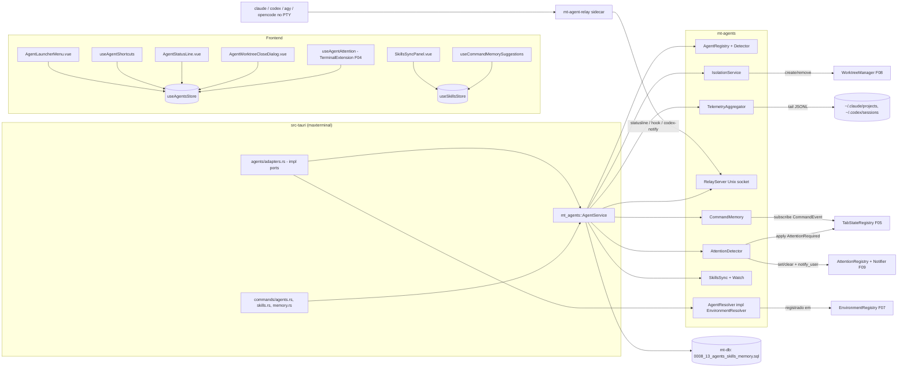

# Fase 13 — Agentes CLI, Telemetria e MaxSkills — Especificação Técnica (`spec.md`)

> Escopo funcional, critérios de aceite e riscos: [`./instructions.md`](./instructions.md).
> Contratos compartilhados: [`../README.md`](../README.md) §2. Fonte da verdade: [`../../AGENTS.md`](../../AGENTS.md) §5.2
> (e §4.1 item 4 — "Agente aguarda intervenção").

---

## 1. Visão Geral e Dependências

### 1.1. Arquitetura em camadas



Princípios:
- `mt-agents` depende de `mt-core`, `mt-db`, `mt-git` (tipos `WorktreeCreateRequest`/`WorktreeLocation`) e **não**
  depende de Tauri, `mt-pty`, `mt-shell` nem `mt-os`: toda interação com outras fases passa pelas *portas* do módulo
  `mt_agents::ports` (§1.2), implementadas no binário em `src-tauri/src/agents/adapters.rs` (R-12).
- O agente **sempre** roda dentro do shell do usuário com Shell Integration (Fase 05): o PTY é o shell de login e o
  comando do agente é o *input inicial*. Assim o `PATH` do login shell vale (R-10), o agente vira um bloco
  `running` em `command_blocks`, o status da aba segue a máquina da Fase 05 e, ao sair do agente, o usuário volta ao
  prompt (nenhum processo órfão: o kill da aba é o da Fase 02/07).
- Toda telemetria/atenção é **best-effort**: falhas de parser degradam para `null` ("—"), nunca para erro fatal (R-01).

### 1.2. Contratos consumidos e adaptadores

> Nomes **exatos** das specs anteriores. Quando o `instructions.md` usa um nome que não existe na fase de origem, a
> tabela indica o contrato real adotado. Divergências se resolvem apenas em `src-tauri/src/agents/adapters.rs` (Rust)
> e `src/composables/agents/adapters.ts` (TS).

| Fase | Contrato real consumido | Uso nesta fase |
|------|-------------------------|----------------|
| 01 | `mt_core::{MtError, MtResult, ErrorCode}`, ids `ProjectId, TabId, PaneId, PtyId, SessionId, TemplateId, CommandBlockId`; `AppPaths { config_dir, state_dir, runtime_dir, … }` | erros, ids, caminhos (`agents.toml`, socket, backups) |
| 02 | `PtyManager::{foreground_process, add_output_tap, subscribe}`; `OutputTap::{on_output, on_exit}`; `PtyEvent::ForegroundChanged`; `ProcessInfo { comm, exe, cmdline }` | detecção do agente em foreground, tail do output |
| 03 | `Db::{write, read}`, `sanitizer::{sanitize, SanitizedText}` (máscara `[REDACTED:<kind>]`), `SettingsRegistry::register(SettingDescriptor)`, `SettingsRepo::{get_typed, set}`, migrations `00NN_FF_*.sql` (numeração contígua D-01) | persistência, settings `agents.*` / `skills.*` |
| 04 | TS: `registerTerminalExtension(ext)` (`TerminalInstanceHandle.xterm`), `registerInputModeHint(p)`, `useRichInput(paneId)`, `attachCustomKeyEventHandler` via extensão | reconhecimento de visualização, modo `passthrough`, atalhos com foco no xterm, inserção explícita de sugestão |
| 05 | `TabStateRegistry::apply(pane_id, StateInput) -> Option<TabStateSnapshot>`; `AttentionRequired`/`AttentionCleared` com `RuntimeBinding { tab_id, pane_id, pty_id, session_id }` (quatro campos; geração de bloco em `ExecutionRef`); `ShellService::subscribe() -> broadcast::Receiver<CommandEvent>` (`CommandEvent::Finished(CommandFinished)`); tabela `command_blocks`; `useTabStatusStore` | estado `error` "aguarda intervenção", memória contextual |
| 06 | `projects(id, path, …)`, `Project.stack` (`StackKind`), `ProjectRemovalHook`, `useProjectsStore.{select, countersFor}` | raiz do repo, relevância de skills, badge vermelho (automático via F05) |
| 07 | `EnvironmentKind::Agent` e `snapshot.environment.agent_id` (`claude-code`, `codex`, `agy`, `opencode`); `EnvironmentResolver::resolve(&SpawnContext)` síncrono / `EnvironmentRegistry::register_agent_resolver`; `ResolvedSpawn { spawn_spec, shell_integration_enabled, initial_command }`; `ShellResolver`; `TemplateRepo::{list, create}`; `WorkspaceManager::open_tab(TabOpenRequest { overrides: Option<TabOpenOverrides>, .. })`; `WorkspaceLifecycleObserver::on_signal(WorkspaceLifecycleSignal)` | spawn de agente, templates dedicados, abertura em worktree, fechamento |
| 08 | `WorktreeManager::{list, create, remove}`, `WorktreeCreateRequest { repo_path, name, location, new_branch, base, ensure_gitignore }`, `WorktreeLocation::{MaxCode, Project}`, `GitService::status_once`, `GitRunner::run`, `mt_git::discover` | isolamento em worktree, inspeção antes de remover |
| 09 | `AttentionRegistry::{set, clear}` + `AttentionReason::{AwaitingInput, AwaitingApproval}`; `Notifier::notify_user(NotificationKind::AgentAwaitingInput, title, body, Some(tab))`; `OsIntegration::on_tab_state_changed()`; evento `os://focus-tab`; `OsSettings` (atalho Quake) | destaque no tray, notificação nativa com ação "Abrir aba" |
| 11 | `OpenTabPayload` / `BridgeHost::open_tab` | (opcional) MaxCode abre aba de agente — §12 |
| 12 | `ai_catalog_get` → `HarnessCatalog { harnesses[{ id, models[] }] }` com ids `claude-code`, `codex`, `agy`, `opencode` | sugestões de modelo; IDs de gateway não viram flags locais sem mapeamento validado (§7.4) |

**Mapeamento de nomes do `instructions.md`:**

| Nome no `instructions.md` | Contrato real adotado |
|---------------------------|-----------------------|
| `ExternalTabSignal::AgentAwaiting` / `TabStateMachine::apply_external` | `TabStateRegistry::apply(pane_id, StateInput::AttentionRequired { binding, attention_id, execution, at_ms })` (Fase 05) |
| `tab_templates.agent_kind` | `tab_templates.agent_id` (`AgentRef`, Fase 07 §5.1) |
| `TabCloseInterceptor` | inexistente na Fase 07 → decisão **pós-fechamento** via `WorkspaceLifecycleSignal::TabClosed` (§8.4) — garante CA-16 por construção |
| `InputObserver` (Fase 02) | inexistente → `xterm.onData` via `registerTerminalExtension` (Fase 04) + `agent_attention_ack` |
| `OutputObserver` | `OutputTap` (Fase 02 §3) |
| `ProcessInspector::foreground` | `PtyManager::foreground_process(pty_id)` (Fase 02 §4) |
| `WorktreeService::{create, remove, inspect}` | `WorktreeManager::{create, remove}` + `GitService::status_once` + `GitRunner::run` |
| "provedor de sugestões do input rico" | Fase 04 não possui registro sem prefixo → `CommandMemoryList.vue` + inserção explícita no draft; não alterar `.history` (§6.3) |

**Contratos consumidos e adaptadores desta fase:**

1. Resolução de atenção por `RuntimeBinding` completo e `attention_id = "agent:<run_id>:<episode>"`
   usando `StateInput::{AttentionRequired, AttentionCleared}` da Fase 05. `TabStatePort` mantém a sobreposição separada do estado de execução; remover uma sobreposição
   só afeta seu episódio e recompõe o estado corrente. Nunca restaurar um `Running` capturado antes de `CommandFinished`
   ou `PtyExit`; não limpar erros de outros painéis. `seen` segue a política de foco da Fase 05.
   A Fase 13 adapta seus eventos ao contrato proprietário, sem criar outro `TabStateInput` ou método de aplicação.
2. Tipos de `EnvironmentResolver`, `SpawnContext` e `ShellResolver` pertencem ao binário na Fase 07. Portanto a impl
   concreta `AgentResolver` fica em `src-tauri/src/agents/resolver.rs`, consumindo `mt_agents::LaunchPlanner`;
   os trechos §2.6 são desse adaptador, sem criar dependência circular de crate para o binário.
3. Fases 07/08 devem fornecer inspeção de uso e fechamento concluído antes de remover worktree. Não inferir ausência
   de processo apenas de `tab://closed` recebido no frontend. As especificações dessas fases não são editadas aqui.

### 1.3. Dependências Cargo de `mt-agents`

Manifesto com `edition.workspace = true` (2024, D-09). Em `[workspace.dependencies]`, centralizar
`notify = "8"` e `notify-debouncer-full = "0.5"`; o crate herda essas versões (E-10).

```toml
[dependencies]
mt-core = { path = "../mt-core" }
mt-db = { path = "../mt-db" }
mt-git = { path = "../mt-git" }
tokio = { workspace = true, features = ["rt", "macros", "time", "sync", "net", "process", "fs", "io-util"] }
tokio-util = { version = "0.7", features = ["rt"] }
async-trait = "0.1"
serde = { workspace = true, features = ["derive"] }
serde_json = { workspace = true }
toml = "0.8"
specta = { workspace = true }
regex = "1"
strip-ansi-escapes = "0.2"
sha2 = "0.10"
subtle = "2"                       # comparação de token em tempo constante
rand = "0.8"
base64 = "0.22"
walkdir = "2"
notify = { workspace = true }
notify-debouncer-full = { workspace = true }
which = "6"
shell-words = "1"
dashmap = "6"
parking_lot = "0.12"
nix = { version = "0.29", features = ["user", "socket"] } # getuid, SO_PEERCRED
time = { workspace = true }
uuid = { workspace = true, features = ["v7"] }
tracing = { workspace = true }
thiserror = "1"

[dev-dependencies]
tempfile = "3"
tokio = { workspace = true, features = ["full", "test-util"] }
proptest = "1"
```

`src/bin/mt-agent-relay.rs` usa **somente** `std` + `serde_json` + `base64` (binário < 1 MiB, inicialização < 5 ms,
sem runtime async) — `[[bin]] name = "mt-agent-relay"`, copiado para `src-tauri/binaries/mt-agent-relay-<triple>`.

---

## 2. Crate `mt-agents`

### 2.1. Módulos

```
crates/mt-agents/src/
├── lib.rs              # AgentService (fachada), re-exports
├── error.rs            # códigos agents.* / skills.* / memory.*
├── ports.rs            # traits implementadas no binário (TabStatePort, NotifyPort, PtyPort, WorkspacePort, GitPort)
├── settings.rs         # AgentsSettings, overrides agents.toml
├── registry.rs         # AgentKind, AgentDescriptor, AgentRegistry
├── descriptors/{claude,codex,agy,opencode}.toml
├── detect.rs           # AgentInstallation, login PATH, --version
├── launch.rs           # LaunchPlanner, LaunchPlan; AgentResolver reside no binário
├── isolation.rs        # WorktreeIsolation, propose, open/close/resolve
├── relay/{mod.rs, server.rs, protocol.rs}
├── telemetry/{mod.rs, aggregator.rs, claude_statusline.rs, claude_transcript.rs, codex_session.rs, output_heuristic.rs, tail.rs}
├── attention/{mod.rs, detector.rs, patterns.rs}  + patterns/default.toml
├── skills/{mod.rs, catalog.rs, targets.rs, sync.rs, conflict.rs, watch.rs}
├── memory.rs
└── bin/mt-agent-relay.rs
```

### 2.2. Erros

```rust
// error.rs — códigos `MtError.code` (mensagens pt-BR em `message`)
pub mod codes {
    pub const NOT_INSTALLED: &str = "agents.not_installed";          // "Agente não encontrado no PATH"
    pub const UNKNOWN_AGENT: &str = "agents.unknown_agent";
    pub const SETTINGS_INVALID: &str = "agents.settings_invalid";    // details: { line?, column?, message }
    pub const SHORTCUT_CONFLICT: &str = "agents.shortcut_conflict";  // details: { shortcut, conflictsWith }
    pub const SHORTCUT_INVALID: &str = "agents.shortcut_invalid";
    pub const NOT_A_REPO: &str = "agents.not_a_repo";                // isolamento pedido fora de repositório Git
    pub const WORKTREE_FOREIGN: &str = "agents.worktree_foreign";    // Existing não pertence ao repo do projeto
    pub const WORKTREE_DIRTY: &str = "agents.worktree_dirty";        // remoção sem confirmação; details: { files, ahead }
    pub const LINK_NOT_FOUND: &str = "agents.link_not_found";
    pub const LINK_RESOLVED: &str = "agents.link_already_resolved";
    pub const RELAY_UNAVAILABLE: &str = "agents.relay_unavailable";  // socket não pôde ser criado (degrada)
    pub const TAB_NOT_AGENT: &str = "agents.tab_not_agent";
    pub const SKILLS_SOURCE_MISSING: &str = "skills.source_missing";
    pub const SKILLS_INDEX_INVALID: &str = "skills.index_invalid";
    pub const SKILLS_PLAN_STALE: &str = "skills.plan_stale";         // disco mudou entre plan e apply
    pub const SKILLS_TARGET_INVALID: &str = "skills.target_invalid";
    pub const SKILLS_IO: &str = "skills.io";
    pub const MEMORY_NOT_FOUND: &str = "memory.not_found";
}
```

### 2.3. Registro (`registry.rs`)

```rust
/// Serializa com o mesmo id do `AgentRef` da Fase 07 e do harness da Fase 12.
#[derive(Debug, Clone, Copy, PartialEq, Eq, Hash, Serialize, Deserialize, specta::Type)]
pub enum AgentKind {
    #[serde(rename = "claude-code")] Claude,
    #[serde(rename = "codex")] Codex,
    #[serde(rename = "agy")] Agy,
    #[serde(rename = "opencode")] OpenCode,
}
impl AgentKind {
    pub const ALL: [AgentKind; 4] = [Self::Claude, Self::Codex, Self::Agy, Self::OpenCode];
    pub fn as_ref_id(&self) -> &'static str;                    // "claude-code" | "codex" | "agy" | "opencode"
    pub fn from_ref(r: &AgentRef) -> MtResult<Self>;            // agents.unknown_agent
    pub fn short(&self) -> &'static str;                        // "claude" | "codex" | "agy" | "opencode" (slug/branch)
}

#[derive(Debug, Clone, Serialize, Deserialize, specta::Type)]
#[serde(rename_all = "camelCase")]
pub struct AgentDescriptor {
    pub kind: AgentKind,
    pub display_name: String,              // "Claude Code"
    pub icon: String,                      // Iconify: "simple-icons:claude"
    pub color_token: String,               // "--max-warning-500" (token semântico, nunca hex)
    pub binary: String,                    // "claude"
    pub process_names: Vec<String>,        // basenames aceitos no foreground: ["claude", "node"] + cmdline contém binary
    pub version_args: Vec<String>,         // ["--version"]
    pub version_regex: String,             // r"(\d+\.\d+\.\d+)"
    pub default_args: Vec<String>,
    pub extra_args: Vec<String>,           // override do usuário
    pub model_flag: Option<String>,        // "--model" | "-m"
    pub env: BTreeMap<String, String>,
    pub shortcut: String,                  // "Ctrl+Alt+C"
    pub capabilities: AgentCapabilities,
}

#[derive(Debug, Clone, Copy, Default, Serialize, Deserialize, specta::Type)]
#[serde(rename_all = "camelCase")]
pub struct AgentCapabilities {
    pub statusline_hook: bool,
    pub native_attention_hooks: bool,      // confirma espera, não apenas conclusão de turno
    pub session_files: bool,               // somente parser validado + sessão correlacionada
    pub osc_notifications: bool,           // sinal não autoritativo
}

pub struct AgentRegistry { descriptors: parking_lot::RwLock<Arc<[AgentDescriptor; 4]>> }
impl AgentRegistry {
    pub fn load(paths: &AppPaths) -> (Self, Option<MtError>); // embutidos + agents.toml; erro de TOML não derruba
    pub fn reload(&self, paths: &AppPaths) -> MtResult<()>;   // agents.settings_invalid mantém o anterior
    pub fn descriptors(&self) -> Arc<[AgentDescriptor; 4]>;   // público (ponto de extensão, §12)
    pub fn get(&self, kind: AgentKind) -> AgentDescriptor;
}
```

Descritor embutido (`descriptors/claude.toml`, via `include_str!`):

```toml
kind = "claude-code"
display_name = "Claude Code"
icon = "simple-icons:claude"
color_token = "--max-warning-500"
binary = "claude"
process_names = ["claude", "node"]
version_args = ["--version"]
version_regex = '(\d+\.\d+\.\d+)'
default_args = []
model_flag = "--model"
shortcut = "Ctrl+Alt+C"
[capabilities]
statusline_hook = true
native_attention_hooks = true
session_files = true
osc_notifications = false
```

Demais: `codex` (`simple-icons:openai`, `--max-success-500`, `--model`, `Ctrl+Alt+X`),
`agy` (`simple-icons:google`, `--max-info-500`, `model_flag = None`, `Ctrl+Alt+A`), `opencode`
(`mdi:code-braces`, `--max-primary-500`, `model_flag = None` até validar ajuda da versão instalada, `Ctrl+Alt+O`).
Os booleans do descritor são possibilidades do adaptador; o suporte efetivo por campo/fonte vem de `CapabilityReport` (§7.4).
Codex `notify` não habilita `native_attention_hooks`; arquivos internos só habilitam `session_files` após validação.
Override do usuário em
`$XDG_CONFIG_HOME/maxterminal/agents.toml` com tabelas `[claude]`, `[codex]`, `[agy]`, `[opencode]` aceitando
`binary`, `extra_args`, `env`, `shortcut`, `model_flag`, `enabled` (`#[serde(deny_unknown_fields)]`; CA-07).

### 2.4. Detecção (`detect.rs`)

```rust
#[derive(Debug, Clone, Serialize, specta::Type)]
#[serde(rename_all = "camelCase")]
pub struct AgentInstallation {
    pub kind: AgentKind,
    pub installed: bool,
    pub path: Option<String>,
    pub version: Option<String>,
    pub reason: Option<String>,            // pt-BR: "Binário não encontrado no PATH", "Tempo esgotado ao executar --version"
    pub checked_at_ms: i64,
}

#[derive(Debug, Clone, Serialize, specta::Type)]
#[serde(rename_all = "camelCase")]
pub struct AgentInfo {
    pub descriptor: AgentDescriptor, pub installation: AgentInstallation, pub enabled: bool,
    pub capabilities: CapabilityReport,
}

pub struct Detector { login_path: tokio::sync::OnceCell<Vec<PathBuf>>, cache: DashMap<AgentKind, AgentInstallation> }
impl Detector {
    pub const VERSION_TIMEOUT: Duration = Duration::from_secs(3);
    pub const EXTRA_DIRS: [&'static str; 4] = ["~/.local/bin", "~/.bun/bin", "~/.npm-global/bin", "~/.opencode/bin"];
    /// `$SHELL -lic 'printf %s "$PATH"'` (timeout 2 s, stdin nulo, env `MAXTERMINAL_PATH_PROBE=1`) ∪ PATH do processo ∪ EXTRA_DIRS.
    pub async fn login_path(&self) -> &[PathBuf];
    /// Resolve os 4 em paralelo (`join_all`), cada `--version` com `tokio::process` + `kill_on_drop(true)` + timeout.
    pub async fn detect_all(&self, reg: &AgentRegistry) -> Vec<AgentInstallation>;
    pub fn cached(&self, kind: AgentKind) -> Option<AgentInstallation>;
}
```

`binary` absoluto é usado como está (verifica `is_file` + bit executável); nome simples é resolvido com
`which::which_in(binary, Some(joined_path), cwd)`. Mudança no resultado emite `agent://installations-changed`.
Detecção ocorre no startup (fora do caminho crítico de abertura da janela) e em `agent_detect_refresh`.

### 2.5. Configurações (`settings.rs`)

```rust
#[derive(Debug, Clone, Serialize, Deserialize, specta::Type)]
#[serde(rename_all = "camelCase", default)]
pub struct AgentsSettings {
    pub shortcuts_enabled: bool,                         // true
    pub shortcuts: BTreeMap<AgentKind, String>,          // vazio = do descritor
    pub isolation: IsolationSettings,
    pub attention: AttentionSettings,
    pub telemetry: TelemetrySettings,
    pub inject: BTreeMap<AgentKind, bool>,               // habilita só adaptadores validados; preserva configuração efetiva — R-04
}
#[derive(Debug, Clone, Serialize, Deserialize, specta::Type)]
#[serde(rename_all = "camelCase", default)]
pub struct IsolationSettings {
    pub default_location: WorktreeLocationDto,           // 'project' (.worktrees) | 'maxCode' (.max-code-worktrees)
    pub branch_prefix: String,                           // "agent"
    pub open_isolated_by_default: bool,                  // false
}
#[derive(Debug, Clone, Serialize, Deserialize, specta::Type)]
#[serde(rename_all = "camelCase", default)]
pub struct AttentionSettings {
    pub enabled: bool,                                   // true
    pub on_turn_complete: AttentionLevel,                // padrão Ignore; término de turno nunca confirma espera
    pub silence_ms: u32,                                 // 300
    pub notify: bool,                                    // true
}
#[derive(Debug, Clone, Copy, Serialize, Deserialize, specta::Type)]
#[serde(rename_all = "camelCase")]
pub enum AttentionLevel { Notify, Ignore }
#[derive(Debug, Clone, Serialize, Deserialize, specta::Type)]
#[serde(rename_all = "camelCase", default)]
pub struct TelemetrySettings { pub enabled: bool, pub stale_after_s: u32 /* 60 */, pub read_session_files: bool /* true */ }
```

Persistido como uma `SettingDescriptor` `agents.settings` (Fase 03) com `validate` que checa atalhos
(`^(Ctrl\+)?(Alt\+)?(Shift\+)?(Super\+)?[A-Z0-9]$`, ao menos um modificador) e conflitos (§6.4). Skills usam `skills.settings`
(`source_dir`, padrão `~/GitHub/MaxSkills`; `default_mode`, padrão `symlink`).

`WorktreeLocationDto` mantém `"maxCode"` em IPC/settings JSON; colunas SQL `location` usam
`as_db_str()`/`from_db_str()` para `"project"` e `"max_code"` (01/spec.md §3.7). Testar round-trip
de ambas as variantes e rejeitar valores desconhecidos, sem usar Serde para a coluna com `CHECK`.

### 2.6. Lançamento (`launch.rs`) — implementação do `EnvironmentResolver` da Fase 07

```rust
pub struct AgentResolver {
    shell: Arc<ShellResolver>,              // Fase 07: monta SpawnSpec do shell + ids + prepare_spawn (OSC 133)
    registry: Arc<AgentRegistry>,
    detector: Arc<Detector>,
    relay: Arc<RelayServer>,
    pending: Arc<DashMap<Uuid, PendingLaunch>>, // compartilhado com AppAgentState; chave em overrides.extra_env
    options: Arc<AgentTemplateOptionsRepo>,
    paths: AppPaths,
}
pub struct PendingLaunch {
    pub launch_id: Uuid, pub agent: AgentKind, pub model: Option<String>,
    pub extra_args: Vec<String>, pub link: Option<AgentTabLinkDraft>,
}

impl EnvironmentResolver for AgentResolver {
    fn resolve(&self, ctx: &SpawnContext) -> MtResult<ResolvedSpawn>;
}

#[derive(Debug, Clone)]
pub struct LaunchPlan {
    pub kind: AgentKind,
    pub pending_binding: PendingRunBinding,
    pub program: PathBuf,                   // caminho absoluto resolvido pelo Detector
    pub args: Vec<String>,
    pub env: BTreeMap<String, String>,      // aplicado ao SpawnSpec do shell (herdado pelo agente)
    pub token: RelayToken,                  // 256 bits por execução; nunca em args nem em logs
    pub runtime_dir: PathBuf,               // $XDG_RUNTIME_DIR/maxterminal/agents/<tab_id>/ (0700)
    pub configured_model: Option<String>,
}
// `LaunchPlanner::build_plan` recebe PendingRunBinding + token reservado; assinatura completa em 02/spec.md §3.3.
pub fn command_line(plan: &LaunchPlan, initial_command: Option<&str>, shell: ShellKind) -> MtResult<String>;
// Serialização de argv validada em bash/zsh/fish; não aplicar quoting POSIX genericamente a todos.
```

Algoritmo de `resolve`:
1. `base = self.shell.resolve(ctx)?` — shell de login com OSC 133 e `MAXTERMINAL_{PROJECT,TAB,PANE,SESSION}_ID`.
2. Retirar a chave transitória do ambiente final; `!ctx.is_primary || !ctx.emit_initial_command` → retorna `base`
   (painéis de split são shells comuns e restauração sem comando inicial não relança o agente).
3. Ler agente de `ctx.snapshot.environment.agent_id`; instalação via `detector.cached` (detecção e opções carregadas
   previamente pelo serviço assíncrono, sem `await`/`block_on` no resolvedor);
   ausente → `agents.not_installed` (a Fase 07 converte em falha de abertura; o frontend já bloqueia antes — CA-10).
4. Usar o UUID retirado de `base.spawn_spec.env` → consumir `self.pending.remove(uuid)`; variáveis do template vêm
   de `ctx.snapshot.env_vars`, já resolvidas pelo shell. UUID não é um token de autenticação.
5. `planner.build_plan(...)`: gerar `run_id`, reservar `PendingRunBinding` a partir de `ctx.owner` e `ctx.cwd`;
   `PaneSpawned` fornece o PTY real e ativa o token com `RunBinding` completo (02/spec.md §3.3).
6. `base.spawn_spec.env` ⊕ `plan.env` ⊕ `{ MAXTERMINAL_AGENT, MAXTERMINAL_AGENT_TOKEN, MAXTERMINAL_RELAY_SOCK, MAXTERMINAL_RELAY_BIN }`;
   preservar `base.shell_integration_enabled`.
7. `base.initial_command` já contém o `CommandOverride` resolvido pelo shell; compor com o argv do agente
   apenas se o preparo terminou com sucesso. Preservar sintaxe do shell escolhido (bash/zsh/fish), agrupar comando
   inicial multilinha para respeitar seu status final e testar quoting com espaços, aspas e metacaracteres.
   A Fase 07 escreve uma única vez após `PromptStart`; falha da integração não autoriza execução duplicada.

Injeções por agente (desligáveis por `settings.inject[kind] = false`):

| Agente | Argumentos adicionados | Efeito |
|--------|------------------------|--------|
| Claude Code | `--settings <runtime_dir>/claude-settings.json` | arquivo 0600 com `statusLine` = `"<relay> statusline --chain <b64>"` e hooks observacionais. Encadear somente quando a configuração efetiva da versão instalada for resolvida, incluindo políticas e overrides CLI; localizar o primeiro arquivo não basta. Se houver ambiguidade, manter configuração original e desabilitar apenas a injeção conflitante — CA-21. |
| Codex | `-c notify=["<relay>","codex-notify","--chain","<b64>"]` quando a configuração efetiva puder ser preservada | TOML gerado por serializador; `notify` original efetivo é encadeado como argv. Apenas `agent-turn-complete`, não pedido de permissão. Não sobrescrever preferências `tui.notifications`; OSC/BEL existentes são indícios. |
| agy | — | sem canal estruturado conhecido (S-08) |
| OpenCode | — | API V2 existe, mas adaptador estruturado não validado nesta fase (S-10); sem usar endpoints V1 |
| todos | `model_flag <model>` somente quando flag e ID local validados; `descriptor.default_args` + `extra_args` | `default` do gateway omite a flag; erro explícito para seleção incompatível |

Exemplo do arquivo gerado para o Claude Code:

```json
{
  "statusLine": { "type": "command", "command": "/usr/lib/maxterminal/mt-agent-relay statusline --chain bm9kZSB+Ly5jbGF1ZGUvc2wuanM=", "padding": 0 },
  "hooks": {
    "Notification":     [{ "hooks": [{ "type": "command", "command": "/usr/lib/maxterminal/mt-agent-relay hook Notification" }] }],
    "Stop":             [{ "hooks": [{ "type": "command", "command": "/usr/lib/maxterminal/mt-agent-relay hook Stop" }] }],
    "UserPromptSubmit": [{ "hooks": [{ "type": "command", "command": "/usr/lib/maxterminal/mt-agent-relay hook UserPromptSubmit" }] }],
    "PreToolUse":       [{ "matcher": "*", "hooks": [{ "type": "command", "command": "/usr/lib/maxterminal/mt-agent-relay hook PreToolUse" }] }]
  }
}
```

### 2.7. Isolamento (`isolation.rs`)

```rust
#[derive(Debug, Clone, Serialize, Deserialize, specta::Type)]
#[serde(tag = "mode", rename_all = "camelCase")]
pub enum WorktreeIsolation {
    None,
    Create { location: WorktreeLocationDto, slug: String, branch: String, base: Option<String>, ensure_gitignore: bool },
    Existing { path: String },              // Fase 16: worktree/branch da issue (nunca criada nem apagada aqui)
}

#[derive(Debug, Clone, Serialize, specta::Type)]
#[serde(rename_all = "camelCase")]
pub struct WorktreeProposal {
    pub repo_root: String,                  // main work tree (mt_git::discover(project.path).common_dir pai)
    pub slug: String,                       // "claude-20261029-1731" ou slug do hint
    pub name: String,                       // "wt-<slug>" (nome passado ao WorktreeCreateRequest)
    pub branch: String,                     // "agent/claude/<slug>"
    pub path: String,                       // "<repo>/.worktrees/wt-<slug>"
    pub location: WorktreeLocationDto,
    pub root_ignored: bool,                 // `git check-ignore -q -- <raiz de worktrees>` (CA-13)
    pub warnings: Vec<String>,              // pt-BR
    pub base_ref: String,                   // OID completo imutável resolvido antes da criação
}

#[derive(Debug, Clone, Deserialize, specta::Type)]
#[serde(rename_all = "camelCase")]
pub struct AgentTabOpenRequest {
    pub project_id: ProjectId,
    pub agent: AgentKind,
    pub template_id: Option<TemplateId>,    // None → template dedicado do agente (criado se preciso)
    pub isolation: WorktreeIsolation,
    pub model: Option<String>,
    pub title: Option<String>,
    pub focus: bool,
}

#[derive(Debug, Clone, Serialize, specta::Type)]
#[serde(rename_all = "camelCase")]
pub struct AgentTabLink {
    pub id: i64, pub tab_id: TabId, pub project_id: ProjectId, pub agent: AgentKind,
    pub worktree_path: Option<String>, pub branch: Option<String>, pub base_ref: Option<String>,
    pub created_by_app: bool, pub opened_at_ms: i64, pub tab_closed_at_ms: Option<i64>,
    pub resolution: Option<WorktreeResolution>, pub resolved_at_ms: Option<i64>,
}

#[derive(Debug, Clone, Copy, Serialize, Deserialize, specta::Type)]
#[serde(rename_all = "camelCase")]
pub enum WorktreeResolution { Keep, Remove, RemoveAndDeleteBranch }

#[derive(Debug, Clone, Serialize, specta::Type)]
#[serde(rename_all = "camelCase")]
pub struct AgentCloseInspection {
    pub link: AgentTabLink,
    pub exists: bool,
    pub dirty: bool,                        // GitChanges::is_dirty
    pub changed_files: Vec<String>,         // ≤ 50 (`git status --porcelain=v1 -z`), caminhos relativos
    pub changed_files_truncated: bool,
    pub ahead_of_base: u32,                 // commits desde a base; não comprova merge atual
    pub has_ignored_files: bool,
    pub inspection_complete: bool,
    pub in_use: bool,                       // qualquer painel/processo/sessão vinculada
    pub branch_merged: bool,                // teste de ancestralidade contra destino de integração explícito
    pub inspection_token: String,           // fingerprint de caminhos, HEAD, estado e vínculos; uso único
    pub allowed: Vec<WorktreeResolution>,   // Existing/!created_by_app → somente [Keep]
    pub requires_confirmation: bool,        // toda remoção exige ação explícita, mas não autoriza perda
}

pub struct IsolationService { git: Arc<dyn GitPort>, repo: Arc<AgentLinkRepo>, settings: Arc<RwLock<AgentsSettings>> }
impl IsolationService {
    pub async fn propose(&self, project: &ProjectRecord, agent: AgentKind, hint: Option<&str>) -> MtResult<WorktreeProposal>;
    pub async fn prepare(&self, project: &ProjectRecord, agent: AgentKind, iso: &WorktreeIsolation) -> MtResult<Option<PreparedWorktree>>;
    pub async fn rollback(&self, prepared: &PreparedWorktree) -> MtResult<()>;   // falha do open_tab após criar
    pub async fn inspect(&self, link: &AgentTabLink) -> MtResult<AgentCloseInspection>;
    pub async fn resolve(&self, link_id: i64, action: WorktreeResolution, inspection_token: &str) -> MtResult<AgentTabLink>;
}
```

Regras:
- Slug: `slugify(hint)` (ASCII minúsculo, `[a-z0-9-]`, ≤ 40) ou `<agent.short()>-<YYYYMMDD-HHmm>`; colisão de caminho ou
  branch existente → sufixo `-2`, `-3`…; nome final validado pela regex da Fase 08 (`^[A-Za-z0-9._-]{1,100}$`).
- `Create` → `WorktreeManager::create(WorktreeCreateRequest { repo_path: repo_root, name: "wt-<slug>", location,
  new_branch: Some(branch), base, ensure_gitignore })`; `created_by_app = true`.
- `Existing` → `mt_git::discover(path)` deve retornar `worktree: Some(_)` (ou a principal) com `common_dir` igual ao do
  projeto, senão `agents.worktree_foreign`; `created_by_app = false` (CA-15).
- `resolve`: exige fechamento backend concluído, nenhum consumidor vivo e inspeção completa revalidada sob lock por
  repositório. `Existing`/checkout principal permitem somente `Keep`. Dirty inclui ignorados, untracked e submódulos;
  qualquer alteração ou estado desconhecido bloqueia remoção. `Remove` sempre usa `force = false`.
  `RemoveAndDeleteBranch` exige propriedade comprovada da branch, destino de integração explícito, ancestralidade
  comprovada e `git branch -d`; nunca `-D`. Commits desde a base não são prova de integração. `Keep` só grava resolução.
  Falha após remover a pasta e antes de apagar branch é recuperável; não declarar ambas as etapas concluídas.
- `rollback` só retira worktree própria recém-criada, sem processos, alterações ou arquivos ignorados, com HEAD igual
  à base inicial. Hooks Git podem escrever arquivos; nesse caso manter e retornar pendência recuperável ao usuário.

### 2.8. Relay (`relay/`)

```rust
// protocol.rs — uma mensagem por conexão, JSON + '\n', ≤ 64 KiB
#[derive(Debug, Serialize, Deserialize)]
pub struct RelayEnvelope { pub v: u8 /* 1 */, pub token: String, #[serde(flatten)] pub msg: RelayMessage }

#[derive(Debug, Serialize, Deserialize)]
#[serde(tag = "kind", rename_all = "snake_case")]
pub enum RelayMessage {
    Statusline { payload: serde_json::Value },                 // stdin bruto do Claude Code
    Hook { event: String, payload: serde_json::Value },        // Notification | Stop | UserPromptSubmit | PreToolUse
    CodexNotify { payload: serde_json::Value },                // argv[último] do notify do Codex
}
#[derive(Debug, Serialize, Deserialize)]
pub struct RelayAck { pub ok: bool, pub error: Option<String> }

// server.rs
pub struct RelayServer {
    socket_path: PathBuf,                                     // runtime_dir/agent-relay.sock (fallback state_dir/run/)
    tokens: DashMap<[u8; 32], RunBinding>,                   // SHA-256(token) → tab/pane/session/run/agente
    pending_tokens: DashMap<[u8; 32], PendingRunBinding>,    // reservas antes de PaneSpawned
    tx: tokio::sync::mpsc::Sender<(TabId, AgentKind, RelayMessage)>,
}
impl RelayServer {
    pub async fn bind(paths: &AppPaths, tx: mpsc::Sender<(TabId, AgentKind, RelayMessage)>) -> MtResult<Arc<Self>>;
    pub fn issue(&self, binding: PendingRunBinding) -> RelayToken; // reserva antes do spawn: 32 bytes OsRng, base64url
    pub fn activate(&self, binding: RunBinding) -> MtResult<()>; // PTY real + owner/geração confirmados em PaneSpawned
    pub fn revoke_tab(&self, tab: TabId) -> usize;                  // sinal TabClosed
    pub fn socket_path(&self) -> &Path;
}
```

Servidor: `tokio::net::UnixListener`; diretório 0700, socket `chmod 0600` após `bind` (só retirar socket próprio
comprovadamente sem listener; nunca apagar socket de outra instância);
por conexão: `peer_cred().uid() == getuid()` senão descarta; leitura com `take(64 KiB)` e timeout 1 s; token comparado
pelo hash (`subtle::ConstantTimeEq`); token desconhecido/revogado → `RelayAck { ok: false }` sem detalhes. Canal `mpsc`
com capacidade 256 e `try_send`; telemetria pode ser coalescida, mas perda de sinal de atenção gera estado de fonte
desconhecida e reconciliação, nunca uma resolução presumida. A fila leva `RunBinding` validado, não IDs enviados pelo CLI.
Revogar token no exit/restart/new-session e não somente no fechamento da aba; fonte atrasada não recria execução encerrada.

Binário `mt-agent-relay` (contrato com os CLIs):
- `statusline [--chain <b64>]`: lê stdin (≤ 64 KiB), envia `Statusline` (connect/write/read com timeout total 150 ms);
  depois executa o comando encadeado via `sh -c` com o mesmo stdin (timeout 1 s) e repassa seu stdout; sem comando
  encadeado imprime a linha padrão `"<model.display_name> · ctx <pct>%"`. Falha no socket nunca altera a saída.
- `hook <Evento>`: envia `Hook` e **sempre** termina com exit 0 e stdout vazio (exit 2 bloquearia a ação no Claude Code
  e stdout de `UserPromptSubmit` seria adicionado ao contexto).
- `codex-notify [--chain <b64>] <json>`: envia `CodexNotify`, executa o `notify` original com o mesmo argumento, exit 0.
- Sem `MAXTERMINAL_AGENT_TOKEN`/`MAXTERMINAL_RELAY_SOCK` no ambiente → apenas encadeia (agente iniciado fora do app).

### 2.9. Telemetria (`telemetry/`)

```rust
#[derive(Debug, Clone, Copy, PartialEq, Eq, Serialize, Deserialize, specta::Type)]
#[serde(rename_all = "camelCase")]
pub enum TelemetrySourceKind { ClaudeStatusLine, ClaudeTranscript, CodexSession, OutputHeuristic, Configured }

#[derive(Debug, Clone, Serialize, specta::Type)]
#[serde(rename_all = "camelCase")]
pub struct Field<T> {
    pub value: T, pub source: TelemetrySourceKind, pub observed_at_ms: i64,
    pub received_at_ms: i64, pub quality: MeasurementQuality, pub expires_at_ms: Option<i64>,
}
#[derive(Debug, Clone, Copy, PartialEq, Serialize, specta::Type)]
#[serde(rename_all = "camelCase")]
pub enum MeasurementQuality { Reported, Derived, Estimated, Configured }

#[derive(Debug, Clone, PartialEq, Serialize, specta::Type)]
#[serde(rename_all = "camelCase")]
pub struct ModelInfo { pub id: Option<String>, pub display_name: String }

#[derive(Debug, Clone, PartialEq, Serialize, specta::Type)]
#[serde(rename_all = "camelCase")]
pub struct ContextUsage { pub used_tokens: Option<u64>, pub window_tokens: Option<u64>, pub percent: f32 } // 0..=100

#[derive(Debug, Clone, PartialEq, Serialize, specta::Type)]
#[serde(rename_all = "camelCase")]
pub struct QuotaWindow { pub used_percent: f32, pub resets_at_ms: Option<i64>, pub window_minutes: u32 }

#[derive(Debug, Clone, Serialize, specta::Type)]
#[serde(rename_all = "camelCase")]
pub struct AgentTelemetry {
    pub tab_id: TabId,
    pub pane_id: PaneId,
    pub session_id: SessionId,
    pub run_id: String,                             // UUID por execução/restart; nunca reutilizar
    pub revision: u64,                              // monotônica dentro de run_id
    pub agent: AgentKind,
    pub session_ref: Option<String>,                 // session_id do Claude / id do rollout do Codex
    pub model: Option<Field<ModelInfo>>,
    pub context: Option<Field<ContextUsage>>,
    pub quota_5h: Option<Field<QuotaWindow>>,        // TS: quota5h
    pub quota_weekly: Option<Field<QuotaWindow>>,
    pub cost_usd: Option<Field<f64>>,
    pub availability: BTreeMap<MetricKey, MetricState>,
    pub agent_active: bool,                          // agente em foreground no PTY
    pub updated_at_ms: i64,
}

/// Fonte plugável (R-02): adicionar fonte não altera o agregador.
#[async_trait::async_trait]
pub trait TelemetrySource: Send + Sync {
    fn kind(&self) -> TelemetrySourceKind;
    fn supports(&self, agent: AgentKind) -> bool;
    /// Inicia observação para a aba; envia atualizações parciais no `sink`; termina quando `cancel` dispara.
    async fn run(&self, ctx: TelemetryContext, sink: mpsc::Sender<TelemetryUpdate>, cancel: CancellationToken);
}
pub struct TelemetryContext { pub tab_id: TabId, pub agent: AgentKind, pub cwd: PathBuf, pub started_at_ms: i64,
                              pub session_hint: watch::Receiver<Option<SessionHint>> } // transcript_path vindo do relay
#[derive(Debug, Clone)]
pub enum FieldUpdate<T> { Unchanged, Clear, Set(T) }
#[derive(Debug, Clone)]
pub struct TelemetryUpdate { pub tab_id: TabId, pub run_id: String, pub source: TelemetrySourceKind,
    pub model: FieldUpdate<ModelInfo>, pub context: FieldUpdate<ContextUsage>,
    pub quota_5h: FieldUpdate<QuotaWindow>, pub quota_weekly: FieldUpdate<QuotaWindow>,
    pub cost_usd: FieldUpdate<f64>, pub session_ref: Option<String>, pub observed_at_ms: i64 }

pub struct TelemetryAggregator { state: DashMap<TabId, AgentTelemetry>, throttle: DashMap<TabId, ThrottleState>,
                                 out: Arc<dyn TelemetrySink> /* emit agent://telemetry */, repo: Arc<TelemetryRepo> }
impl TelemetryAggregator {
    pub fn apply(&self, u: TelemetryUpdate, now_ms: i64);       // merge por campo (§7.1) + throttle 1 Hz
    pub fn snapshot(&self, tab: TabId) -> Option<AgentTelemetry>;
    pub fn set_active(&self, tab: TabId, active: bool, now_ms: i64);
    pub fn remove(&self, tab: TabId);                           // persiste snapshot final
}

// tail.rs — leitura incremental de JSONL
pub struct JsonlTail { path: PathBuf, offset: u64, partial: Vec<u8> }
impl JsonlTail {
    pub const INITIAL_WINDOW: u64 = 256 * 1024;                 // R-09
    pub async fn open_from_end(path: PathBuf) -> std::io::Result<Self>; // descarta 1ª linha parcial
    pub async fn read_new(&mut self) -> std::io::Result<Vec<serde_json::Value>>; // linhas inválidas ignoradas (CA-18)
}
```

Detalhes das fontes e do merge: §7.

### 2.10. Atenção (`attention/`)

```rust
#[derive(Debug, Clone, Copy, PartialEq, Eq, Serialize, specta::Type)]
#[serde(rename_all = "camelCase")]
pub enum AttentionKind { AwaitingApproval, AwaitingInput }

#[derive(Debug, Clone, Serialize, specta::Type)]
#[serde(tag = "state", rename_all = "camelCase")]
pub enum AttentionState {
    Inactive,                                               // agente fora do foreground
    Working,
    Suspected { kind: AttentionKind, since_ms: i64, source: AttentionSource, pattern_id: Option<String> },
    Awaiting { kind: AttentionKind, episode: u64, since_ms: i64, source: AttentionSource, message: Option<String> },
}
#[derive(Debug, Clone, Copy, PartialEq, Eq, Serialize, specta::Type)]
#[serde(rename_all = "camelCase")]
pub enum AttentionSource { NativeHook, CodexNotify, OscNotification, Pattern }

#[derive(Debug, Clone, Serialize, specta::Type)]
#[serde(rename_all = "camelCase")]
pub struct AttentionSnapshot {
    pub tab_id: TabId, pub pane_id: PaneId, pub project_id: ProjectId, pub session_id: SessionId,
    pub run_id: String, pub agent: AgentKind, pub revision: u64, pub state: AttentionState,
}

#[derive(Debug, Clone)]
pub enum AttentionSignal {
    HookNotification { message: Option<String>, notification_type: Option<String> }, // permission_prompt | idle_prompt
    HookStop, HookUserPromptSubmit, HookPreToolUse,
    CodexTurnComplete { last_message: Option<String> },
    OscNotify { text: String },                             // OSC 9 / OSC 777;notify
    Bell,
    PatternMatch { pattern_id: String, kind: AttentionKind },
    OutputActivity { bytes: usize },                        // output substancial após o alerta
    UserInput,                                              // apenas reconhece visualização
    Resolved { run_id: String, episode: u64 },                // fonte nativa validada, não tecla arbitrária
    Foreground { is_agent: bool },
}

pub struct AttentionDetector {
    tabs: DashMap<TabId, TabAttention>,
    patterns: Arc<PatternSet>,
    ports: AttentionPorts,                                  // TabStatePort, AttentionRegistryPort, NotifyPort, events
    settings: Arc<RwLock<AttentionSettings>>,
}
struct TabAttention { pane: PaneId, pty: PtyId, agent: AgentKind, state: AttentionState, run: RunBinding,
                      native_active: bool, tail: TailBuffer /* 8 KiB sem ANSI */, last_output_ms: i64, episode: u64 }
impl AttentionDetector {
    pub fn on_signal(&self, tab: TabId, sig: AttentionSignal, now_ms: i64);
    pub fn on_silence_tick(&self, now_ms: i64);             // tarefa de 100 ms: avalia padrões após silence_ms
    pub fn state(&self, tab: TabId) -> Option<AttentionState>;
}
impl OutputTap for AttentionTap { /* só PTYs de abas de agente; append ao TailBuffer + varredura OSC 9/777/BEL */ }
```

Padrões (`patterns/default.toml`, sobrescrevível em `$XDG_CONFIG_HOME/maxterminal/agent-patterns.toml`):

```toml
[[pattern]]
id = "claude.permission"
agent = "claude-code"
kind = "awaiting_approval"
regex = '(?m)^\s*[│ ]*Do you want to (proceed|make this edit to|create|run)\b.*\?\s*$'
confirm = '(?m)^\s*[│ ]*[❯>]?\s*1\.\s+Yes\b'          # segunda âncora obrigatória no mesmo tail

[[pattern]]
id = "codex.approval"
agent = "codex"
kind = "awaiting_approval"
regex = '(?m)(Allow command\?|Would you like to run the following command\?|Would you like to make the following edits\?)'
confirm = '(?m)Yes, proceed|Yes, and don.t ask again'

[[pattern]]
id = "opencode.permission"
agent = "opencode"
kind = "awaiting_approval"
regex = '(?mi)^\s*[┃│ ]*Permission required'
confirm = '(?mi)Allow (once|always)'

[[pattern]]
id = "agy.approval"
agent = "agy"
kind = "awaiting_approval"
regex = '(?mi)^\s*[│ ]*(Allow|Approve) (this )?(command|execution|tool|edit)\b.*\?'
confirm = '(?mi)\b(Yes|Allow once|Approve)\b'
```

Todos os padrões acima são candidatos, não contratos dos CLIs. Só são habilitados após fixtures capturados da versão
instalada passarem nos conjuntos positivo e negativo. Mesmo assim produzem `Suspected`, exibido como
"Possivelmente aguardando intervenção"; nunca `Awaiting` confirmado apenas por regex/OSC/BEL/silêncio.

### 2.11. Skills (`skills/`)

```rust
#[derive(Debug, Clone, Serialize, specta::Type)]
#[serde(rename_all = "camelCase")]
pub struct SkillEntry {
    pub name: String,                       // ^[a-z0-9][a-z0-9._-]{0,63}$ (diretório de destino)
    pub description: String,                // pt-BR quando disponível
    pub source_dir: String,                 // absoluto, contém SKILL.md
    pub tags: Vec<String>,
    pub stacks: Vec<String>,                // StackKind da Fase 06 ("laravel", "vue", …)
    pub hash: String,                       // SHA-256 da árvore (§7.5)
    pub relevance: SkillRelevance,
}
#[derive(Debug, Clone, Copy, Serialize, specta::Type)]
#[serde(rename_all = "camelCase")]
pub enum SkillRelevance { Recommended, Neutral }

#[derive(Debug, Clone, Serialize, specta::Type)]
#[serde(rename_all = "camelCase")]
pub struct SkillCatalog { pub source_dir: String, pub from_index: bool, pub skills: Vec<SkillEntry>, pub scanned_at_ms: i64 }

#[derive(Debug, Clone, Copy, PartialEq, Eq, Serialize, Deserialize, specta::Type)]
#[serde(rename_all = "camelCase")]
pub enum SyncScope { Project, Global }
#[derive(Debug, Clone, Copy, PartialEq, Eq, Serialize, Deserialize, specta::Type)]
#[serde(rename_all = "camelCase")]
pub enum SyncMode { Symlink, Copy }

#[derive(Debug, Clone, Serialize, Deserialize, specta::Type)]
#[serde(rename_all = "camelCase")]
pub struct SkillSyncTarget {
    pub id: Option<i64>, pub agent: AgentKind, pub scope: SyncScope, pub project_id: Option<ProjectId>,
    pub mode: SyncMode, pub auto_sync: bool, pub enabled: bool,
    pub selection: SkillSelection,
    pub project_root: Option<String>,       // raiz efetiva, inclusive worktree; validada contra project_id
    pub dest_override: Option<String>,      // necessário para agente sem destino documentado
    pub dest_dir: Option<String>,           // calculado (read-only no retorno)
}
#[derive(Debug, Clone, Serialize, Deserialize, specta::Type)]
#[serde(tag = "kind", rename_all = "camelCase")]
pub enum SkillSelection { Recommended, All, Explicit { names: Vec<String> } }

#[derive(Debug, Clone, Serialize, specta::Type)]
#[serde(tag = "kind", rename_all = "camelCase")]
pub enum ConflictKind { ForeignSymlink { target: String }, Unmanaged, LocallyModified { expected: String, actual: String } }

#[derive(Debug, Clone, Serialize, specta::Type)]
#[serde(tag = "action", rename_all = "camelCase")]
pub enum SyncAction {
    Create { skill: String, dest: String }, Update { skill: String, dest: String },
    Unchanged { skill: String, dest: String }, Conflict { skill: String, dest: String, conflict: ConflictKind },
    Prune { skill: String, dest: String },
}
#[derive(Debug, Clone, Serialize, specta::Type)]
#[serde(rename_all = "camelCase")]
pub struct SyncPlan { pub plan_id: String, pub target_id: i64, pub dest_dir: String, pub actions: Vec<SyncAction>,
                      pub warnings: Vec<String>, pub fingerprint: String /* hash do estado de disco observado */ }
#[derive(Debug, Clone, Copy, Deserialize, specta::Type)]
#[serde(rename_all = "camelCase")]
pub enum ConflictResolution { Keep, Overwrite, Adopt }
#[derive(Debug, Clone, Serialize, specta::Type)]
#[serde(rename_all = "camelCase")]
pub struct SyncResult { pub target_id: i64, pub applied: u32, pub skipped: u32, pub backups: Vec<String>, pub errors: Vec<String> }

pub fn agent_skill_dir(agent: AgentKind, scope: SyncScope, project_root: Option<&Path>, home: &Path) -> MtResult<PathBuf>;
pub struct SkillsService { /* catalog cache, repo, watcher */ }
impl SkillsService {
    pub async fn scan(&self, project: Option<&ProjectRecord>) -> MtResult<SkillCatalog>;
    pub async fn plan(&self, target_id: i64) -> MtResult<SyncPlan>;                         // dry-run: só leitura
    pub async fn apply(&self, plan_id: &str, resolutions: BTreeMap<String, ConflictResolution>) -> MtResult<SyncResult>;
}
```

Diretórios por agente (`targets.rs`):

| Agente | Escopo projeto | Escopo global | Confiança |
|--------|----------------|---------------|-----------|
| Claude Code | `<projeto>/.claude/skills/<skill>/` | `~/.claude/skills/<skill>/` | documentado (Agent Skills) |
| Codex | `<projeto>/.agents/skills/<skill>/` | `~/.agents/skills/<skill>/` | documentação atual; S-12 valida a versão instalada |
| agy | destino explícito validado pelo usuário/adaptador | destino explícito validado pelo usuário/adaptador | `.agent/skills` local não comprova suporte do CLI; S-13 |
| OpenCode V2 | `<projeto>/.opencode/skills/<skill>/` | `$XDG_CONFIG_HOME/opencode/skills/<skill>/` (fallback `~/.config`) | documentação V2; plural `skills`, S-14 |

### 2.12. Memória contextual (`memory.rs`)

```rust
#[derive(Debug, Clone, Serialize, specta::Type)]
#[serde(rename_all = "camelCase")]
pub struct MemoryEntry {
    pub project_id: ProjectId, pub command: String, pub use_count: u32, pub success_count: u32,
    pub failure_count: u32, pub last_used_at_ms: i64, pub last_cwd: Option<String>, pub last_exit_code: Option<i32>,
    pub pinned: bool, pub hidden: bool, pub score: f32,
}
#[derive(Debug, Clone, Deserialize, specta::Type)]
#[serde(rename_all = "camelCase")]
pub struct MemoryQuery {                    // reutilizável pela Fase 15
    pub project_id: ProjectId, pub prefix: Option<String>, pub limit: u16 /* ≤ 50 */,
    pub include_hidden: bool, pub cwd: Option<String>,   // bônus para mesmo cwd
}
pub struct CommandMemory { db: mt_db::Db, workspace: Arc<dyn WorkspacePort> }
impl CommandMemory {
    pub fn normalize(cmd: &str) -> Option<String>;      // §7.6; None = não memorizável
    pub async fn on_command_finished(&self, block_id: CommandBlockId, now_ms: i64) -> MtResult<bool>;
    pub async fn suggestions(&self, query: &MemoryQuery, now_ms: i64) -> MtResult<Vec<MemoryEntry>>;
    pub async fn rebuild(&self, project_id: Option<ProjectId>, now_ms: i64) -> MtResult<u32>; // mesma agregação incremental (CA-32)
    pub fn score(entry: &MemoryEntry, query_cwd: Option<&str>, now_ms: i64) -> f32;
}
```

As assinaturas completas pertencem a `04/spec.md` §3.2. `now_ms` é epoch ms fornecido pelo relógio
injetável do adaptador, inclusive no `TauriRecurringCommandsAdapter` da Fase 15. `MemoryQuery.limit`
tem teto de 50; consumidores com limites maiores devem restringir a consulta a esse teto.

### 2.13. Fachada e portas

```rust
pub struct AgentService {
    pub registry: Arc<AgentRegistry>, pub detector: Arc<Detector>, pub planner: Arc<LaunchPlanner>,
    pub isolation: Arc<IsolationService>, pub relay: Arc<RelayServer>, pub telemetry: Arc<TelemetryAggregator>,
    pub attention: Arc<AttentionDetector>, pub skills: Arc<SkillsService>, pub memory: Arc<CommandMemory>,
    pub settings: Arc<RwLock<AgentsSettings>>, runtime: AgentRuntimeIndex,   // TabId ↔ (PaneId, PtyId, AgentKind)
}

// ports.rs — implementados em src-tauri/src/agents/adapters.rs
pub trait TabStatePort: Send + Sync {
    fn attention_required(&self, run: &RunBinding, episode: u64) -> bool;
    fn attention_resolved(&self, run: &RunBinding, episode: u64);
}
#[async_trait::async_trait]
pub trait NotifyPort: Send + Sync {
    fn set_attention(&self, tab: TabId, kind: AttentionKind);   // AttentionRegistry::set + on_tab_state_changed
    fn clear_attention(&self, tab: TabId);
    async fn notify(&self, tab: TabId, title: &str, body: &str); // Notifier::notify_user(AgentAwaitingInput, …)
}
pub trait PtyPort: Send + Sync { fn foreground(&self, pty: PtyId) -> Option<ForegroundProc>; }
#[async_trait::async_trait]
pub trait WorkspacePort: Send + Sync {
    async fn project(&self, id: ProjectId) -> MtResult<ProjectRecord>;
    fn project_of_tab(&self, tab: TabId) -> Option<ProjectId>;
    async fn open_tab(&self, req: TabOpenRequest) -> MtResult<TabView>;
    async fn ensure_agent_templates(&self, project: ProjectId) -> MtResult<u32>;
}
#[async_trait::async_trait]
pub trait GitPort: Send + Sync {
    async fn create_worktree(&self, req: WorktreeCreateRequest) -> MtResult<WorktreeEntry>;
    async fn remove_worktree(&self, path: &Path, force: bool) -> MtResult<()>;
    async fn status(&self, cwd: &Path) -> MtResult<Option<GitContext>>;
    async fn run(&self, cwd: &Path, args: &[&str]) -> MtResult<String>;  // GitRunner::run, timeout 10 s, LC_ALL=C
}
```

Registro em `src-tauri/src/lib.rs`: `env_registry.register_agent_resolver(kind.as_ref_id(), agent_resolver.clone())`
para cada agente e `app.manage(AppAgentState { ... })` (estado próprio, sem agregar ao `AppState` da Fase 01);
`workspace.register_observer(Arc::new(AgentWorkspaceObserver))`, implementando `WorkspaceLifecycleObserver::on_signal`:
`PaneSpawned` → índice + ativação do relay + tap/telemetria; `PaneExited`/`SessionArchived` → revogação correlacionada;
`TabClosed` → `relay.revoke_tab`, `telemetry.remove`, inspeção de worktree;
`pty_manager.add_output_tap(attention_tap)`; tarefa que assina `PtyManager::subscribe()` (`ForegroundChanged`) e
`ShellService::subscribe()` (`CommandEvent::Finished` → memória).

---

## 3. Comandos Tauri IPC (`src-tauri/src/commands/{agents,skills,memory}.rs`)

Todos `#[tauri::command] #[specta::specta] async fn … -> Result<T, MtError>`, restritos à janela `main`.

| Comando | Args | Retorno | Erros (`code`) |
|---------|------|---------|----------------|
| `agent_list` | — | `AgentInfo[]` (sempre 4, ordem de `AgentKind::ALL`) | — |
| `agent_detect_refresh` | — | `AgentInfo[]` | — (falhas viram `installed=false` + `reason`) |
| `agent_settings_get` | — | `AgentsSettings` | `db.*` |
| `agent_settings_update` | `settings: AgentsSettings` | `AgentsSettings` | `agents.shortcut_invalid`, `agents.shortcut_conflict`, `agents.settings_invalid` |
| `agent_descriptors_reload` | — | `AgentInfo[]` | `agents.settings_invalid` (descritores anteriores mantidos) |
| `agent_templates_ensure` | `projectId: ProjectId` | `u32` (templates criados) | `project.not_found` |
| `agent_template_options_get` | `templateId: TemplateId` | `AgentTemplateOptions` | `template.not_found`, `agents.tab_not_agent` |
| `agent_template_options_set` | `templateId, options: AgentTemplateOptions` | `AgentTemplateOptions` | `template.not_found`, `agents.settings_invalid` |
| `agent_worktree_propose` | `projectId, agent: AgentKind, hint: string \| null` | `WorktreeProposal` | `agents.not_a_repo`, `git.*` |
| `agent_tab_open` | `request: AgentTabOpenRequest` | `AgentTabOpened { tab: TabView, link: AgentTabLink \| null }` | `agents.not_installed`, `agents.not_a_repo`, `agents.worktree_foreign`, `git.worktree_exists`, `git.invalid_name`, erros de `tab_open` (Fase 07) |
| `agent_tab_link_get` | `tabId: TabId` | `AgentTabLink \| null` | — |
| `agent_tab_close_check` | `tabId: TabId` | `AgentCloseInspection \| null` (null se aba sem worktree) | `agents.link_not_found`, `git.*` |
| `agent_worktree_resolve` | `linkId: number, action: WorktreeResolution, inspectionToken: string` | `AgentTabLink` | `agents.link_not_found`, `agents.link_already_resolved`, `agents.worktree_dirty`, `agents.inspection_stale`, `git.worktree_in_use`, `git.command_failed` |
| `agent_worktree_pending_list` | `projectId: ProjectId \| null` | `AgentCloseInspection[]` | — |
| `agent_telemetry_get` | `tabId` | `AgentTelemetry \| null` | — |
| `agent_telemetry_list` | — | `AgentTelemetry[]` | — |
| `agent_attention_get` | `tabId` | `AttentionSnapshot \| null` | — |
| `agent_attention_ack` | `tabId, runId, episode: number, reason: 'userInput' \| 'dismissed'` | `AttentionSnapshot \| null` | — (execução divergente → nenhuma alteração; reconhecimento não resolve espera) |
| `skills_scan` | `projectId: ProjectId \| null` | `SkillCatalog` | `skills.source_missing`, `skills.index_invalid` |
| `skills_targets_list` | `projectId: ProjectId \| null` | `SkillSyncTarget[]` | — |
| `skills_target_upsert` | `target: SkillSyncTarget` | `SkillSyncTarget` | `skills.target_invalid` |
| `skills_target_remove` | `targetId: number, removeManaged: boolean` | `u32` (entradas removidas) | `skills.target_invalid`, `skills.io` |
| `skills_plan` | `targetId: number` | `SyncPlan` | `skills.source_missing`, `skills.io` |
| `skills_apply` | `planId: string, resolutions: Record<string, ConflictResolution>` | `SyncResult` | `skills.plan_stale`, `skills.io` |
| `memory_suggestions` | `query: MemoryQuery` | `MemoryEntry[]` | `db.*` |
| `memory_list` | `projectId, includeHidden: boolean, limit: number (≤ 500)` | `MemoryEntry[]` | `db.*` |
| `memory_pin` | `projectId, command: string, pinned: boolean` | `MemoryEntry` | `memory.not_found` |
| `memory_hide` | `projectId, command: string, hidden: boolean` | `MemoryEntry` | `memory.not_found` |
| `memory_forget` | `projectId, command: string` | `boolean` | — |
| `memory_rebuild` | `projectId: ProjectId \| null` | `u32` (entradas) | `db.*` |

`AgentTemplateOptions { model: Option<String>, extraArgs: string[], isolationDefault: boolean, location: WorktreeLocationDto }`.
`agent_tab_open` apenas delega a `AppAgentState::open_agent_tab(&self, req: AgentTabOpenRequest) -> MtResult<AgentTabOpened>`
(método assíncrono, D-08; contrato e fluxo completo em `02/spec.md` §3.3). O serviço registra `PendingLaunch` (uuid)
e chama `WorkspaceManager::open_tab` com `overrides: Some(TabOpenOverrides { cwd: worktree, title,
initial_command: CommandOverride::Inherit, extra_env, continuous: None, cwd_fallback_to_project: false })`;
`extra_env` usa `EnvValue::Literal` para o UUID. Em erro encerra eventual PTY antes do rollback conservador.
O adaptador de `AgentPort` da Fase 16 usa o mesmo serviço com `WorktreeIsolation::Existing`, preservando cwd e ownership.

### 3.1. Eventos emitidos (baixo volume, `AppHandle::emit`)

| Evento | Payload | Quando |
|--------|---------|--------|
| `agent://installations-changed` | `AgentInfo[]` | resultado de detecção diferente do anterior |
| `agent://settings-changed` | `AgentsSettings` | após `agent_settings_update` |
| `agent://telemetry` | `AgentTelemetry` | merge alterou algum campo; ≤ 1/s por aba (CA-20) |
| `agent://attention` | `AttentionSnapshot` | toda transição de `AttentionState` |
| `agent://link-changed` | `AgentTabLink` | criação, fechamento da aba, resolução |
| `agent://worktree-close-pending` | `AgentCloseInspection` | após `tab://closed` de aba com worktree não resolvida |
| `skills://changed` | `{ sourceDir, changedSkills: string[] }` | watch da fonte (debounce 500 ms, ≤ 2 s — CA-30) |
| `skills://sync-completed` | `SyncResult` | após `skills_apply` ou auto-sync |
| `memory://updated` | `{ projectId }` | coalescido 1 s por projeto |

Eventos consumidos: `tab://closed`, `tab://state-changed` (frontend), `os://focus-tab` (Fase 09, já trata o clique na
notificação — CA-25), `ai://catalog-updated` (modelos), `PtyEvent::ForegroundChanged` e `CommandEvent::Finished` (backend).

---

## 4. Integração por Agente (resumo normativo)

| Agente | Modelo | % contexto | Cota 5h | Cota semanal | Permissão/Input |
|--------|--------|-----------|---------|--------------|-----------------|
| Claude Code | statusLine `model.display_name`; transcript só validado | `context_window.used_percentage`; `null` inicial/após compactação | `rate_limits.five_hour` se presente | `rate_limits.seven_day` se presente | `Notification` tipada confirma espera; `Stop` só fim de turno |
| Codex | configuração rotulada; rollout versionado opcional | rollout validado + denominador explícito, senão `null` | somente janela validada de 300 min | somente janela validada de 10080 min | `notify` só fim de turno; OSC/BEL/padrões são indícios |
| agy | configuração local validada, rotulada; senão `null` | `null` por padrão; estimativa opt-in validada | `null` | `null` | indícios opt-in, sem hook inventado |
| OpenCode V2 | configuração validada, rotulada; adaptador API futuro | `null` por padrão; estimativa opt-in validada | `null` | `null` | indícios opt-in; nenhum evento V1 presumido válido em V2 |

"—" = indisponível (renderizado com tooltip "Indisponível para este agente", CA-19).

---

## 5. Banco de Dados (`mt-db/migrations/0008_13_agents_skills_memory.sql`)

Número fixo `0008` (decisão D-01: sequência contígua `0001_03_base` … `0007_12_ai` · `0008_13_agents_skills_memory` · `0009_15_command_groups`; sem lacunas, regra da Fase 03). Tabelas `STRICT`, timestamps em epoch ms.

```sql
-- Fase 13: agentes CLI, isolamento, telemetria, MaxSkills e memória contextual

-- Templates dedicados já semeados por projeto (idempotência de agent_templates_ensure, respeitando exclusões do usuário)
CREATE TABLE agent_template_seeds (
    project_id  TEXT    NOT NULL REFERENCES projects(id) ON DELETE CASCADE,
    agent_id    TEXT    NOT NULL CHECK (agent_id IN ('claude-code', 'codex', 'agy', 'opencode')),
    template_id TEXT    NULL REFERENCES tab_templates(id) ON DELETE SET NULL,
    seeded_at   INTEGER NOT NULL,
    PRIMARY KEY (project_id, agent_id)
) STRICT;

-- Opções específicas de agente por template (environment_kind = 'agent')
CREATE TABLE agent_template_options (
    template_id       TEXT    PRIMARY KEY REFERENCES tab_templates(id) ON DELETE CASCADE,
    model             TEXT    NULL CHECK (model IS NULL OR length(model) BETWEEN 1 AND 128),
    extra_args_json   TEXT    NOT NULL DEFAULT '[]' CHECK (json_valid(extra_args_json) AND json_type(extra_args_json) = 'array'),
    isolation_default INTEGER NOT NULL DEFAULT 0 CHECK (isolation_default IN (0, 1)),
    location          TEXT    NOT NULL DEFAULT 'project' CHECK (location IN ('project', 'max_code')),
    updated_at        INTEGER NOT NULL
) STRICT;

-- Vínculo aba ↔ worktree (CA-12, CA-14, CA-15)
CREATE TABLE agent_tab_links (
    id             INTEGER PRIMARY KEY,
    tab_id         TEXT    NOT NULL,             -- identidade histórica; sobrevive à exclusão da aba
    project_id     TEXT    NOT NULL,             -- pendência de worktree sobrevive à remoção do cadastro
    agent_id       TEXT    NOT NULL CHECK (agent_id IN ('claude-code', 'codex', 'agy', 'opencode')),
    worktree_path  TEXT    NULL,
    branch         TEXT    NULL,
    base_ref       TEXT    NULL,
    created_by_app INTEGER NOT NULL DEFAULT 0 CHECK (created_by_app IN (0, 1)),
    opened_at      INTEGER NOT NULL,
    tab_closed_at  INTEGER NULL,                 -- "closed_at" do vínculo: a aba foi fechada
    resolution     TEXT    NULL CHECK (resolution IN ('keep', 'remove', 'remove_and_delete_branch')),
    resolved_at    INTEGER NULL,
    CHECK ((resolution IS NULL) = (resolved_at IS NULL)),
    CHECK (resolution IS NULL OR tab_closed_at IS NOT NULL),
    CHECK (resolution <> 'remove_and_delete_branch' OR created_by_app = 1),
    CHECK (worktree_path IS NOT NULL OR (branch IS NULL AND created_by_app = 0))
) STRICT;
CREATE UNIQUE INDEX ux_agent_links_open_tab ON agent_tab_links(tab_id) WHERE tab_closed_at IS NULL;
CREATE INDEX ix_agent_links_pending ON agent_tab_links(project_id)
    WHERE tab_closed_at IS NOT NULL AND resolution IS NULL AND worktree_path IS NOT NULL;

-- Operações duráveis para reconciliar Git/SQLite/PTY após crash; não guardar tokens ou argv secretos.
CREATE TABLE agent_launch_operations (
    launch_id TEXT PRIMARY KEY,
    project_id TEXT NOT NULL,
    tab_id TEXT NULL,
    agent_id TEXT NOT NULL CHECK (agent_id IN ('claude-code', 'codex', 'agy', 'opencode')),
    repo_path TEXT NOT NULL,
    worktree_path TEXT NULL,
    branch TEXT NULL,
    base_oid TEXT NULL,
    stage TEXT NOT NULL CHECK (stage IN ('reserved', 'worktree_ready', 'opening', 'opened', 'recovery_required', 'resolved')),
    created_at INTEGER NOT NULL,
    updated_at INTEGER NOT NULL
) STRICT;
CREATE INDEX ix_agent_launch_pending ON agent_launch_operations(updated_at)
    WHERE stage IN ('reserved', 'worktree_ready', 'opening', 'recovery_required');

-- Último snapshot de telemetria por aba (restauração da barra após reinício; sem conteúdo de conversa)
CREATE TABLE agent_telemetry_snapshots (
    tab_id       TEXT    PRIMARY KEY REFERENCES tabs(id) ON DELETE CASCADE,
    agent_id     TEXT    NOT NULL,
    payload      TEXT    NOT NULL CHECK (json_valid(payload)),   -- AgentTelemetry serializado
    updated_at   INTEGER NOT NULL
) STRICT;

-- Alvos de sincronização de MaxSkills
CREATE TABLE skill_sync_targets (
    id             INTEGER PRIMARY KEY,
    agent_id       TEXT    NOT NULL CHECK (agent_id IN ('claude-code', 'codex', 'agy', 'opencode')),
    scope          TEXT    NOT NULL CHECK (scope IN ('project', 'global')),
    project_id     TEXT    NULL REFERENCES projects(id) ON DELETE CASCADE,
    mode           TEXT    NOT NULL CHECK (mode IN ('symlink', 'copy')),
    auto_sync      INTEGER NOT NULL DEFAULT 0 CHECK (auto_sync IN (0, 1)),
    enabled        INTEGER NOT NULL DEFAULT 1 CHECK (enabled IN (0, 1)),
    selection_json TEXT    NOT NULL DEFAULT '{"kind":"recommended"}' CHECK (json_valid(selection_json)),
    dest_canonical TEXT    NOT NULL,                              -- deduplicação (R-08)
    project_root   TEXT    NULL,                                  -- worktree/raiz efetiva do escopo local
    dest_override  TEXT    NULL,                                  -- destino explícito validado
    last_synced_at INTEGER NULL,
    created_at     INTEGER NOT NULL,
    CHECK ((scope = 'project') = (project_id IS NOT NULL))
) STRICT;
CREATE UNIQUE INDEX ux_skill_targets_dest ON skill_sync_targets(dest_canonical);

-- Entradas gerenciadas por alvo (fonte da verdade do que o app criou)
CREATE TABLE skill_sync_entries (
    target_id   INTEGER NOT NULL REFERENCES skill_sync_targets(id) ON DELETE CASCADE,
    skill_name  TEXT    NOT NULL,
    dest_path   TEXT    NOT NULL,
    mode        TEXT    NOT NULL CHECK (mode IN ('symlink', 'copy')),
    source_hash TEXT    NOT NULL CHECK (length(source_hash) = 64),
    source_path TEXT    NOT NULL,
    synced_hash TEXT    NOT NULL CHECK (length(synced_hash) = 64),
    synced_at   INTEGER NOT NULL,
    PRIMARY KEY (target_id, skill_name)
) STRICT;

-- Memória contextual de comandos recorrentes (texto já sanitizado — Fase 05 — e re-sanitizado no INSERT)
CREATE TABLE command_memory (
    project_id     TEXT    NOT NULL REFERENCES projects(id) ON DELETE CASCADE,
    command_norm   TEXT    NOT NULL CHECK (length(command_norm) BETWEEN 1 AND 1024),
    command        TEXT    NOT NULL,                              -- forma exibida (última ocorrência)
    use_count      INTEGER NOT NULL DEFAULT 0,
    success_count  INTEGER NOT NULL DEFAULT 0,
    failure_count  INTEGER NOT NULL DEFAULT 0,
    first_used_at  INTEGER NOT NULL,
    last_used_at   INTEGER NOT NULL,
    last_cwd       TEXT    NULL,
    last_exit_code INTEGER NULL,
    pinned         INTEGER NOT NULL DEFAULT 0 CHECK (pinned IN (0, 1)),
    hidden         INTEGER NOT NULL DEFAULT 0 CHECK (hidden IN (0, 1)),
    PRIMARY KEY (project_id, command_norm),
    CHECK (instr(command, '[REDACTED:') = 0)                      -- CA-31: nunca memoriza comando com segredo
) STRICT, WITHOUT ROWID;
CREATE INDEX ix_command_memory_recent ON command_memory(project_id, last_used_at DESC) WHERE hidden = 0;

-- Replay at-least-once: atualizar memória somente quando o bloco for inserido aqui na mesma transação.
CREATE TABLE command_memory_processed (
    block_id TEXT PRIMARY KEY,
    project_id TEXT NOT NULL REFERENCES projects(id) ON DELETE CASCADE,
    processed_at INTEGER NOT NULL
) STRICT;
CREATE INDEX ix_memory_processed_project ON command_memory_processed(project_id);

-- Preferências sobrevivem ao rebuild; tombstone impede que "Esquecer" ressuscite histórico antigo.
CREATE TABLE command_memory_preferences (
    project_id TEXT NOT NULL REFERENCES projects(id) ON DELETE CASCADE,
    command_hash TEXT NOT NULL CHECK (length(command_hash) = 64),
    pinned INTEGER NOT NULL DEFAULT 0 CHECK (pinned IN (0, 1)),
    hidden INTEGER NOT NULL DEFAULT 0 CHECK (hidden IN (0, 1)),
    forgotten INTEGER NOT NULL DEFAULT 0 CHECK (forgotten IN (0, 1)),
    updated_at INTEGER NOT NULL,
    PRIMARY KEY (project_id, command_hash)
) STRICT, WITHOUT ROWID;
```

Regras:
- Escritas sempre via writer da Fase 03 (`Db::write`), fora do runtime async (`spawn_blocking` interno do `mt-db`).
- `command_memory`: `command`/`last_cwd` inseridos como `SanitizedText` (defesa em profundidade); poda para no máximo
  2 000 entradas por projeto (menor `score`, nunca `pinned`) a cada 200 inserções.
- `agent_telemetry_snapshots` guarda apenas números/nomes de modelo; nunca mensagens, prompts ou caminhos de transcript.
- Remoção de projeto apaga alvos/memória por cascade, mas preserva vínculos pendentes de worktree e não toca arquivos
  de skills nem worktrees. A consulta global de pendências não depende de joins com abas/projetos ainda existentes.

---

## 6. Frontend: contratos TypeScript, Pinia e componentes

### 6.1. Serialização e carregamento

Os DTOs novos usam `camelCase` e são gerados a partir de Rust em `src/types/bindings.ts`. Tipos importados da Fase 07
mantêm a serialização dela; o adaptador converte nomes na fronteira, sem declarar outra cópia de `TabView`.
IDs inteiros de SQLite expostos como `number` ficam limitados a `Number.MAX_SAFE_INTEGER` na validação do backend.
Epochs usam milissegundos; percentuais são números finitos. `Option<T>` é `T | null`, não omissão do campo.

```ts
// Projeções ilustrativas dos bindings gerados, não um segundo arquivo de contratos.
type AgentKind = 'claude-code' | 'codex' | 'agy' | 'opencode';
type MeasurementQuality = 'reported' | 'derived' | 'estimated' | 'configured';
type CapabilitySupport = 'available' | 'unsupported' | 'unverified' | 'disabled';
type MetricAvailability = 'available' | 'unsupported' | 'unverified' | 'disabled' | 'awaitingData' | 'invalid' | 'stale';

interface Field<T> {
    value: T;
    source: TelemetrySourceKind;
    observedAtMs: number;
    receivedAtMs: number;
    quality: MeasurementQuality;
    expiresAtMs: number | null;
}

interface MetricState {
    availability: MetricAvailability;
    reason: string | null;
    checkedAtMs: number;
}

interface AgentTelemetry {
    tabId: TabId;
    paneId: PaneId;
    sessionId: SessionId;
    runId: string;
    revision: number;
    agent: AgentKind;
    sessionRef: string | null;
    model: Field<ModelInfo> | null;
    context: Field<ContextUsage> | null;
    quota5h: Field<QuotaWindow> | null;
    quotaWeekly: Field<QuotaWindow> | null;
    costUsd: Field<number> | null;
    availability: Record<MetricKey, MetricState>;
    agentActive: boolean;
    updatedAtMs: number;
}
```

`MetricKey = 'model' | 'context' | 'quota5h' | 'quotaWeekly' | 'costUsd'`.
`MetricState`/`MetricAvailability` também são definidos em Rust e exportados, não somente no frontend.
As mensagens de evento `agent://attention` carregam ainda `paneId, sessionId, runId, revision`; `revision` é independente
da telemetria. `agent_attention_get` retorna o mesmo envelope de atenção, permitindo hidratação sem perda de identidade.

### 6.2. Stores

| Store | Estado | Ações e regras |
|-------|--------|----------------|
| `useAgentsStore` (`stores/agents.ts`) | `agents`, `settings`, `capabilitiesByAgent`, `telemetryByTab`, `attentionByTab`, `linksByTab`, `pendingWorktrees`, `loading`, `error` | `init`, `refreshInstallations`, `openAgent`, `ackAttention`, `inspectClose`, `resolveWorktree`, `dispose` |
| `useSkillsStore` (`stores/skills.ts`) | `catalogByProject`, `targets`, `plansByTarget`, `syncResults`, `memoryByProject`, `suggestionsByPane`, `loadingByKey`, `errorsByKey` | `scan`, `planSync`, `applySync`, `loadMemory`, `suggest`, `pin`, `hide`, `forget`, `rebuild`, `dispose` |

`init` registra listeners **antes** de buscar snapshots, bufferiza eventos durante a leitura e aplica somente a maior
revisão da execução atual. O snapshot backend informa as execuções ativas; eventos de `runId` desconhecido disparam
reconsulta, não substituem automaticamente a execução conhecida. `tab://closed` instala tombstone local e limpa timers.
`PaneExited`/nova sessão atualizam o índice backend antes de publicar; callbacks antigos não ressuscitam dados.
Após reconectar, refazer snapshots; observação não é assumida contínua. Listeners singleton são removidos em `dispose`.
Toda leitura de domínio passa pelas stores; componentes não invocam IPC nem mantêm cópia divergente de `TabStatus`.

### 6.3. Composables e widgets

- `useAgentTelemetry(tabId)`: projeções reativas, relógio compartilhado de 1 s para idade dos campos, status de fonte,
  formatação pt-BR. Atualizar um campo não renova a idade de outros. Campo indisponível = "—"; desatualizado mantém
  último valor com rótulo e horário até expirar. `Configured` exibe "Modelo configurado", não "Modelo ativo";
  `Estimated` usa "Estimado"; percentuais têm unidade explícita. Sem animações contínuas de barras.
- `AgentStatusLine.vue`: props `tabId`, `compact`; tooltips com fonte, qualidade, observado/recebido e motivo da ausência.
  Cota 5h/semanal representa conta/provedor, não consumo exclusivo da aba. Não somar cotas entre abas.
- `useAgentAttention(tabId)` + `AgentAttentionIndicator.vue`: diferenciam `Suspected` de `Awaiting`, exibem tipo e
  origem; ação "Visualizar" ativa a aba. "Dispensar aviso" reconhece episódio, não envia `y`, Enter ou aprovação ao CLI.
- `AgentLauncherMenu.vue`: quatro agentes com ícone, instalado/indisponível; ação chama `agent_tab_open`.
  `AgentTabOpenDialog.vue`: template, modelo local validado, isolamento, proposta de caminho/branch e destino de skills.
- `AgentWorktreeCloseDialog.vue`: props `inspection`; emite ação permitida + token. Lista blockers pt-BR, oferece
  "Manter" por padrão, atualiza inspeção antes de remover. Uma aba já fechada não é reaberta ao cancelar esse diálogo.
- `SkillsSyncPanel.vue` + `SkillConflictList.vue`: fonte, destinos efetivos/canônicos, revisão do plano, conflitos,
  backups e resultado por item. Ausência da fonte não esvazia destinos. Auto-sync não resolve conflitos sozinho.
- `useCommandMemorySuggestions(paneId)`: debounce de 150 ms, sequência local de consulta para descartar resposta antiga,
  limite 20, projeto/cwd correntes; cancelamento lógico ao trocar aba. `CommandMemoryList.vue` insere comando no draft
  apenas por ação do usuário. Não semear `history`, disparar PTY, colar numa TUI ativa ou executar por selecionar item.
- `AgentSettingsPanel.vue`: permite desativar cada fonte, ler capacidades por versão e editar atalhos e mapeamento de
  modelos. Falha na telemetria não bloqueia abertura básica do CLI.

SFCs seguem ordem e estilo do AGENTS.md; botões com rótulo acessível, foco visível e estados além de cor.
`aria-live="polite"` só anuncia mudança de atenção, não cada amostra da telemetria.

### 6.4. Atalhos

`useAgentShortcuts` registra `Ctrl+Alt+C/X/A/O` no app e na extensão de teclado do terminal, nunca como atalhos globais
do SO. `Shift` abre diálogo com isolamento selecionado. Normalizar combinações e comparar com atalhos das Fases 04/07/09;
ignorar composição IME, `event.repeat`, editor de atalhos e modal que capturou teclado. Uma única ação por keydown;
o handler xterm bloqueia a propagação ao PTY somente quando o atalho foi efetivamente tratado. `unmount` desfaz registro.

---

## 7. Fontes, capacidades e algoritmos

### 7.1. Agregação sem inventar medições

1. Validar vínculo `(tab, pane, session, run)` e sequência da fonte. Rejeitar execução encerrada, amostra de outra
   sessão e timestamp regressivo. `observedAtMs` vem da origem quando disponível; senão da recepção local.
2. Atualizações distinguem `Unchanged`, `Clear`, `Set`. Em snapshot completo, campo ausente/nulo significa `Clear`
   para essa fonte. Em evento parcial, campo não mencionado é `Unchanged`. Limpar uma fonte não apaga outras candidatas.
3. Manter candidatos por campo e fonte. Ordem: fonte estruturada documentada → arquivo versionado validado → estimativa
   opt-in → configuração. Escolher somente candidatas válidas e da mesma execução; falta de fonte válida resulta `null`.
   Qualidade `Configured` nunca é promovida a observação; a UI a rotula explicitamente.
4. Contexto: usar percentual reportado. Se ausente, derivar somente com numerador semanticamente definido e denominador
   explícito > 0. Não somar tokens de toda a conversa, subagentes ou turnos como se fossem ocupação atual da janela.
   Para Claude, fórmula documentada usa input + cache creation + cache read, sem output; `current_usage=null` invalida
   o valor derivado até a próxima chamada. Compactação/mudança de sessão invalida candidatos anteriores.
5. Cotas: aceitar apenas janela explicitamente de 300/10080 minutos ou semântica documentada `five_hour`/`seven_day`.
   `primary`/`secondary` não identificam duração por si. Ausência não significa ilimitado/0%; custo não é cota.
   `resets_at` Claude é epoch **segundos**, converter com overflow check para ms. Ao vencer reset, limpar a janela e
   aguardar nova medição; não fabricar reset para 0%. Percentual inválido/NaN/negativo resulta `null` com motivo.
6. Marcar `stale` após 60 s sem observação daquele campo; não renovar timestamp por render/throttle. TTL padrão de
   medição 300 s, limitado ao reset informado. Snapshot restaurado é histórico (`agentActive=false`) até reconciliação.
7. Coalescer por execução: emissão trailing de até 1 Hz, estado interno atualizado imediatamente. Persiste projeção
   sanitizada a cada 30 s e no fim; nenhuma leitura do frontend deve exigir escrever SQLite a cada segundo.

### 7.2. Atenção: evidência, episódio e estado subjacente

| Entrada | Transição | Efeito externo |
|---------|-----------|----------------|
| Claude `Notification.permission_prompt` validada | `Working/Suspected → AwaitingApproval` | `AttentionRequired` → `error`, `seen=false`; registry F09 e notificação |
| Claude `Notification.idle_prompt` ou outro tipo de input explicitamente validado | `Working/Suspected → AwaitingInput` | mesmo fluxo, mensagem "aguarda resposta" |
| Claude `auth_success`, tipo desconhecido | nenhuma espera confirmada | ignorar para atenção |
| Claude `Stop` / Codex `agent-turn-complete` | término de turno separado | só notificação informativa opt-in; nunca permissão, nem `error` por padrão |
| Regex/OSC 9/777/BEL e silêncio com foreground compatível | `Working → Suspected` | indicador "Possivelmente aguardando intervenção"; não alimenta contador vermelho confirmado |
| Tecla, foco, `agent_attention_ack` | mantém espera; episódio visto | evita repetição visual/notificação; não prova resposta/aceite |
| Evento nativo de retomada/resolução com identidade correspondente | `Awaiting → Working` | retirar apenas overlay do episódio; recomputar estado subjacente |
| `CommandFinished`, saída do PTY, nova sessão | encerrar observação da execução | estado real F05 prevalece; revogar token e tarefas |

`UserPromptSubmit` só resolve espera de input correspondente; `PreToolUse` pode preceder pedido de permissão e não
resolve aprovação por si. Um adaptador pode usar evento pós-ferramenta documentado e ID de ferramenta correspondente;
sem essa correlação, permanece aguardando confirmação ou término real. `Stop` de subagente não encerra atenção da
conversa principal. Não assumir que todos os hooks herdados pertencem à sessão raiz.

Um episódio é identificado por execução + tipo + identificador da solicitação quando disponível; sinais repetidos
não reiniciam `seen` nem notificam outra vez. Notificar uma vez por episódio, após atualizar estado e registry;
suprimir se janela focada **e** aba ativa. Falha ou ausência de suporte a ações da Fase 09 mantém indicador interno.
Clique delega para `os://focus-tab`, valida que aba/projeto existem; não recria aba fechada. Nenhum corpo de prompt,
comando sensível ou texto arbitrário do agente entra na notificação: usar mensagem curta local gerada pelo tipo.

### 7.3. Correlação de sessão e arquivos internos

`PendingRunBinding` reserva a identidade antes do spawn. `PaneSpawned { owner, pty_id, .. }` completa
`RunBinding { tab_id, pane_id, pty_id, session_id, generation, project_id, run_id, agent, cwd, started_at_ms }`
antes de publicar observações. O adaptador de `TabStatePort` valida a geração do owner contra o índice da 13
e repassa o `RuntimeBinding` de quatro campos da Fase 05 (`tab_id`, `pane_id`, `pty_id`, `session_id`),
usando `attention_id = "agent:<run_id>:<episode>"` tanto em `AttentionRequired` quanto em `AttentionCleared`.
Claude: `session_id` e `transcript_path` provenientes do relay autenticado são pistas; validar caminho permitido,
arquivo regular, proprietário, limite de tamanho de linha (64 KiB) e sessão no conteúdo antes de seguir o arquivo.
Codex: um `thread-id` associado ao token pelo notify pode estabelecer identidade; procurar o arquivo da sessão exata
somente se o adaptador versionado conhecer esse formato. Nunca escolher "arquivo mais recente no mesmo cwd".
Ausência de vínculo inequívoco deixa `model/context/quotas` dessa fonte `null`.

Tailing por offset, buffer parcial ≤ 64 KiB, leitura inicial ≤ 256 KiB, ignorando início de linha incompleto. Mudança
de inode/truncamento reinicia parser e invalida estado, sem duplicar eventos. JSON inválido e versão desconhecida
produzem diagnóstico de fonte, não crash ou vazamento de conteúdo. Não indexar transcripts completos nem credenciais.
Watchers são cancelados em exit/new-session; um erro de watcher pode reconsultar somente o arquivo já associado.

### 7.4. Matriz verificável de capacidades e referências

```rust
#[derive(Debug, Clone, Serialize, specta::Type)]
#[serde(rename_all = "camelCase")]
pub struct CapabilityReport {
    pub agent: AgentKind,
    pub binary_version: Option<String>,
    pub adapter_revision: String,
    pub checked_at_ms: i64,
    pub features: BTreeMap<String, CapabilityEvidence>,
}
#[derive(Debug, Clone, Serialize, specta::Type)]
#[serde(rename_all = "camelCase")]
pub struct CapabilityEvidence {
    pub support: CapabilitySupport,      // Available, Unsupported, Unverified, Disabled
    pub source: Option<String>,          // URL oficial / fixture versionado / configuração
    pub reason: Option<String>,         // pt-BR, sem payload bruto
}
```

Incluir `CapabilityReport` em `AgentInfo`. Chaves mínimas: `launch`, `modelSelection`, `modelTelemetry`, `contextTelemetry`,
`quota5h`, `quotaWeekly`, `attention`, `skillsProject`, `skillsGlobal`. Fonte documentada não implica capacidade ativa:
conta, versão, configuração e validação local podem impedir o campo. `agy` permanece `unverified` para capacidades
sem contrato comprovado; o executável configurado ainda pode ser aberto com argumentos fornecidos pelo usuário.

Referências consultadas em **2026-10-29**. Context7 foi tentado e respondeu limite mensal excedido; usadas páginas
oficiais abaixo. Nenhum teste com binários reais foi executado nesta revisão documental.

| ID | Referência / evidência | Decisão normativa |
|----|------------------------|-------------------|
| S-01 | [Claude statusline](https://code.claude.com/docs/en/statusline) | `model`, `context_window`, `rate_limits.five_hour/seven_day` documentados; campos podem faltar/nular; quotas dependem da conta |
| S-02 | [Claude hooks](https://code.claude.com/docs/en/hooks) | `Notification` distingue `permission_prompt`, `idle_prompt`, `auth_success`; `Stop` significa terminou resposta |
| S-03 | mesma referência, precedência/políticas e merge | hooks somam; políticas podem bloquear injeção. Preservar comando statusLine efetivo e stdout; encadeamento não pode mudar permissão |
| S-04 | transcripts Claude | caminho disponível no payload, **formato interno não contratado aqui**; fixture sanitizado por versão obrigatório |
| S-05 | [Codex configuração avançada](https://developers.openai.com/codex/config-advanced) | `notify` recebe JSON em argv e atualmente documenta `agent-turn-complete`; não é hook de aprovação |
| S-06 | mesma referência, notificações TUI | OSC 9/BEL e preferências documentados; sinal genérico não comprova permissão; não forçar configuração do usuário |
| S-07 | rollouts Codex | formato interno e semântica de `token_count/rate_limits` dependem da versão; **não confirmados por essa documentação**, adaptador experimental desabilitado até fixtures |
| S-08/S-09 | agy | sem contrato de hooks, modelo, cotas ou padrões validado nesta revisão; nenhuma flag `--model` ou caminho global inventado |
| S-10/S-11 | [OpenCode V2 CLI](https://opencode.ai/v2/docs/cli) | CLI possui serviço compartilhado e modo standalone; API própria existe, mas fonte estruturada desta fase ainda não implementada/validada; regex só indício |
| S-12 | [Codex skills](https://developers.openai.com/codex/skills) | `.agents/skills` no projeto e home, symlinks suportados; não presumir `.codex/skills` |
| S-13 | `.agent/skills` presente no workspace | observação local não comprova descoberta pelo `agy`; requer destino explícito e teste do CLI |
| S-14 | [OpenCode V2 skills](https://opencode.ai/v2/docs/skills) | `.opencode/skills` e `~/.config/opencode/skills`, plural; respeitar XDG, compatibilidade não justifica duplicar instalação |

O seletor da Fase 12 fornece sugestões, não contrato de linha de comando: validar mapping
`(harness_id, gateway_model_id) → cli_model_id` por agente/versão, sem cortar prefixos automaticamente.
`default` significa ausência de flag. `reasoning_id` não vira argumento CLI nesta fase sem capacidade documentada.
Incompatibilidade explícita retorna `agents.model_unsupported`; manter execução normal sem injeção é possível
quando o usuário não pediu a opção incompatível. Não ler tokens de login para consultar APIs privadas de cotas.

### 7.5. Catálogo e sincronização MaxSkills

O repositório padrão é `~/GitHub/MaxSkills`, com expansão de home no Rust. Sync significa **espelhar conteúdo local**,
não `git pull`, reset, commit, executar scripts de skills ou enviar conteúdo ao MaxAiManager.
Não presumir schema do `index.json`: adaptador de índice deve registrar a versão e fixture local; schema desconhecido
gera diagnóstico e fallback para `SKILL.md`, sem inventar campos. `skills.source_missing` não autoriza prune.

1. Scan descarta `.git`, `node_modules`, worktrees e caminhos fora da fonte. Nomes duplicados viram conflito, não
   sobrescrita. Validar frontmatter nome/descrição quando presente; preservar idioma da fonte, rótulos UI em pt-BR.
2. Hash determinístico SHA-256 sobre caminhos relativos ordenados, tipo, bit executável e bytes; excluir somente
   manifesto gerado e metadados explicitamente definidos. Symlinks na árvore da fonte não podem escapar dela;
   links externos/cíclicos e arquivos especiais geram erro por skill, nunca são seguidos silenciosamente.
3. Resolver `project_root` do alvo para projeto/worktree do mesmo repositório. Escopo global ignora raiz de projeto.
   Destino `agy` exige `dest_override`; padrões dos demais vêm da matriz. Não sincronizar a raiz principal por engano
   ao abrir worktree. Detectar ancestrais symlink com `symlink_metadata`, deduplicar destino canônico e recusar escape
   para fora do escopo salvo destino externo explicitamente cadastrado; aviso sozinho não autoriza escrita.
4. Plano fica em memória por 5 minutos, com hash da fonte, destino, seleção, versão do adaptador e manifesto.
   `skills_plan` só lê disco, inclusive não cria backups/diretórios. `skills_apply` recebe `planId` + resoluções,
   revalida fingerprint sob lock do destino. Mudança resulta `skills.plan_stale`, sem usar paths fornecidos pelo frontend.
5. `copy`: escrever staging irmão no destino, validar hash, preservar executável e renomear atomicamente por skill.
   `symlink`: criar link temporário e rename; nunca escrever manifesto dentro do symlink (modificaria a fonte).
   Registrar propriedade em `skill_sync_entries`; manifesto `.maxterminal-skill.json` só em cópias.
6. `Keep` pula conflito; `Overwrite` faz backup completo antes de alterar; `Adopt` só quando conteúdo/link corresponde
   exatamente à fonte, registrando propriedade sem substituir. Falha de backup aborta aquele item.
   `prune` retira apenas entradas comprovadamente gerenciadas e não modificadas, com backup para cópia; mudança local
   vira conflito. `skills_target_remove(removeManaged=true)` aplica as mesmas regras, não `rm -rf` no destino inteiro.
7. Filesystem e SQLite não são uma transação única: manifesto/staging guarda ID da operação; persistir resultado
   por item após rename e reconciliar operações interrompidas no próximo scan. Não reportar sucesso global se parcial.
8. Watch fonte (debounce 500 ms) invalida catálogo/plano. Auto-sync cria novo plano e só aplica ações sem conflito;
   não infere remoção em falha de leitura, fonte desmontada ou index inválido. Mudança de destino também invalida plano.

### 7.6. Memória contextual sanitizada e reprodutível

- Fonte canônica é bloco concluído e persistido pela Fase 05, obtido por `CommandBlockId`. Não usar o texto bruto
  do evento nem falas do agente. Se evento chegar antes do commit, reconsultar com retry limitado; reconciliar blocos
  concluídos não processados no startup para cobrir perda de broadcast.
- `normalize`: sanitizar novamente; rejeitar marcador de redação, vazio, controle/ANSI, multiline e > 1024 caracteres.
  Remover apenas espaços externos; manter aspas, case e espaços internos (`echo 'a  b'` difere de `echo 'a b'`).
  Nunca executar shell/parser expansivo para normalizar. Excluir launcher/relay gerado pelo app usando sua origem,
  não heurística por prefixo; entrada iniciada com espaço para privacidade não é memorizada.
- Na mesma transação writer: inserir `command_memory_processed(block_id)` com conflito ignorado; se já existe,
  não incrementar. Caso novo, consultar tombstone e aplicar UPSERT de contadores. `exit_code=0` é sucesso,
  não zero é falha; `null` não deve ser transformado em sucesso. Definir desempate por `(ended_at, block_id)`.
- `score = (pinned ? 1000 : 0) + ln(1 + use_count) * exp(-age_days / 14) + (same_cwd ? 0.25 : 0)`.
  Prefixo literal, não regex nem wildcard SQL: escapar `%`, `_` e barra quando usar `LIKE ... ESCAPE`.
  Ordenar por score desc, último uso desc e comando asc, limit ≤ 50. Índice por projeto/PK restringe até 2 000 entradas;
  no máximo 100 fixadas, senão `memory.pin_limit`, garantindo limite de retenção.
- `pin/hide` atualizam projeção e preferências na mesma transação. `forget` remove projeção e grava SHA-256 do comando
  normalizado em preferências com `forgotten=1`; novas ocorrências também são excluídas até uma futura ação explícita
  de reabilitar. Não promete apagar histórico original, backups ou retenção SQLite da Fase 03.
- `rebuild`: snapshot consistente dos blocos retidos, mesmo pipeline, mesma hora de referência para ranking e poda,
  substituição transacional por projeto, reaplicando preferências/tombstones. Reconciliar incrementalmente exclusões
  por retenção da Fase 03: memória representa **histórico retido**, não total vitalício. Teste de equivalência fixa relógio,
  inclui duplicados, evento atrasado e preferências. Sem evento de retenção, disparar rebuild ao detectar divergência.

---

## 8. Fluxos de abertura, isolamento e encerramento

### 8.1. Templates e abertura comum

`agent_templates_ensure` roda em transação, uma semente por `(project_id, agent_id)`. Os quatro templates são
dedicados, mas não substituem template padrão já escolhido, não sobrescrevem edição manual e não ressuscitam template
excluído (`seed.template_id=null` registra exclusão). Ao lançar sem template existente, oferecer restauração explícita
do dedicado ou selecionar um template compatível, sem criar duplicado oculto. Validar project/agent do template enviado.

Atalho/menu → store → `agent_tab_open` → detectar binário/capacidades → selecionar template e cwd → reservar run/launch
→ `WorkspaceManager::open_tab` com overrides → `AgentResolver` compõe shell + comando → prompt pronto → enviar uma vez
→ observer registra PTY → ativar taps e fontes. Falha antes de spawn remove reserva; falha depois encerra recursos
por API da Fase 07, revoga token e retorna `MtError` sanitizado. Não repetir spawn automaticamente em timeout incerto.

### 8.2. Isolamento e vínculo

`agent_worktree_propose` é somente leitura. Criação exige repo Git, base resolvida em OID completo, branch validada,
destino sob raiz de worktrees e exclusividade de criação. Política padrão exige raiz ignorada; `ensure_gitignore=false`
evita alteração implícita na raiz. Se não ignorada, diálogo informa correção necessária ou autorização explícita
para operação apropriada da Fase 08; nunca modificar arquivo versionado principal silenciosamente.

Preparar worktree → registrar vínculo provisório durável antes de iniciar agente → abrir aba com
`cwd_fallback_to_project=false` → concluir vínculo após sucesso. Não há transação distribuída Git/SQLite/PTY:
usar registro de operação recuperável no settings/repo da Fase 13 com ID de lançamento, caminho, branch e etapa;
reconciliar no startup. Erro não implica apagar trabalho possivelmente criado por hook/processo.
`Existing` exige mesmo `common_dir` canônico, pode estar dirty e nunca é propriedade desta fase.
Não copiar `.env`, arquivos não versionados ou mudanças da origem automaticamente.

### 8.3. Nova sessão e execução encerrada

`PaneExited` e `SessionArchived` cancelam fontes, revogam token e invalidam run. O shell pode continuar após
o CLI sair: isso não é encerramento da aba, nem licença para apagar worktree. Próximo agente no mesmo shell só é
associado se iniciado pelo launcher com novo run; detectar um nome de processo não basta para atribuir sessão.
OpenCode V2 pode usar serviço compartilhado: não matar daemon usado por outras abas. Para execução supervisionada
inteiramente pela aba, oferecer `--standalone` documentado; em serviço compartilhado, sessão remota ainda ativa
impede remoção da worktree até confirmar encerramento daquela sessão por integração validada ou pelo usuário.

### 8.4. Fechamento e recuperação

Fechar aba pela Fase 07 → aguardar supervisão Fase 02 encerrar processos pertencentes à aba → observer cancela fontes
e grava `tab_closed_at` → revalidar vínculo → emitir `agent://worktree-close-pending`. No fechamento de janela para
tray não acontece esse fluxo; PTYs e fontes continuam vivos. Ao sair do app, manter worktrees sem prompt tardio.

`Keep` conclui vínculo sem mudar disco. Remoção só da própria worktree, limpa inclusive ignorados, sem consumidores,
sem lock, estado Git conhecido e fingerprint atual. Usar `remove(force=false)` mesmo após confirmação.
Branch própria somente pode ser apagada se já integrada e não usada por outra worktree. Diretório alterado depois
da inspeção retorna `agents.inspection_stale`; processo ainda vivo retorna `git.worktree_in_use`.
Reinício lista pendências; exclusão de aba/projeto não as apaga. Manter path/branch não significa propriedade de
worktree descoberta fora de uma operação registrada pelo app.

---

## 9. Limites de recursos e privacidade

- Tap não bloqueia writer do PTY: tail ANSI limitado a 8 KiB, parser OSC incremental, filas limitadas; jamais copiar
  scrollback inteiro a cada byte. Regex compiladas com limites de tamanho, executadas só em runs de agentes.
- Canal relay local com UID e token é isolamento entre execuções, não fronteira contra todos os processos do mesmo
  usuário. Tokens em env nunca persistem em `env_json`, memória de comandos ou logs. Payload bruto transitório não
  vai ao frontend; sanitizar nome de modelo/mensagens e permitir apenas campos conhecidos.
- Processos de detecção, relay e comandos encadeados são supervisionados e reaproveitados corretamente (`wait/reap`);
  timeout deve encerrar árvore própria. Encadeamento não consulta LLM e não concede permissões.
- Cotas disponíveis dependem de versão/conta; não consultar endpoints privados com tokens extraídos de arquivos do CLI.
- Todo IO pesado de filesystem/Git/SQLite fica fora da thread UI; scans limitam profundidade, arquivos e bytes
  (defaults: 12 níveis, 10 000 arquivos por skill, 64 MiB por skill), retornando erro descritivo ao ultrapassar.

---

## 10. Ordem de implementação e erros complementares

1. Tipos `RunBinding`, capabilities e portas; contrato de resolução de atenção com Fase 05.
2. Registry/detector e templates; lançar CLI sem telemetria e validar bash/zsh/fish.
3. Vínculos duráveis e isolamento conservador via Fases 07/08.
4. Relay observacional, fonte Claude documentada e agregador com invalidação; demais adaptadores por fixture.
5. Atenção correlacionada, notificações Fase 09 e StatusLine frontend.
6. MaxSkills dry-run/conflitos, sync e watchers; memória com dedupe/tombstone/rebuild.
7. Testes de integração e bindings; relatório de capacidades efetivamente exercitadas por versão.

Adicionar ao catálogo `MtError`: `agents.model_unsupported`, `agents.inspection_stale`, `agents.execution_in_use`,
`agents.template_deleted`, `skills.capability_unverified`, `skills.limit_exceeded`, `memory.pin_limit`.
`details` contém identificadores/códigos, não tokens ou conteúdo integral do agente.

---

## 11. Verificação e testes de aceite

Fixtures sintéticos são permitidos para limites/erros; suporte real a formato externo exige fixture sanitizado com
versão, origem, data e procedimento de captura. Não chamar um payload inventado de compatibilidade comprovada.

| Suíte | Casos indispensáveis |
|-------|----------------------|
| `registry/detect/launch` | quatro IDs, versões desconhecidas, PATH divergente, timeout/reap, flags ausentes, catálogo gateway incompatível, quoting bash/zsh/fish, start único |
| `isolation` | dirty/untracked/ignored/submódulo, worktree Existing/principal, branch não mesclada, outro pane, Git lock, corrida inspeção/remoção, falha Git→DB→PTY e recuperação |
| `relay` | token inválido/revogado, outra execução, replay tardio, excesso de payload, socket indisponível, fila cheia e preservação do stdout/hook original |
| `telemetry` | campo ausente/nulo/zero, delta clear vs unchanged, compactação, modelo novo, reset vencido, timestamps, prioridade, throttle e snapshot histórico |
| `tail` | duas abas no mesmo cwd, sem session_ref, linha parcial, truncamento/inode novo, JSON inválido e linha gigante |
| `attention` | permissão/input confirmados, `auth_success`, Stop, notify fim de turno, subagente, regex citada, BEL, tecla sem resolução, exit durante espera, múltiplos panes/episódios |
| `skills_sync` | index opcional/desconhecido, nomes duplicados, hash determinístico, link externo/cíclico, destino worktree, dry-run sem escrita, overwrite com backup, adopt diferente rejeitado, prune modificado preservado, crash após rename |
| `memory` | sanitize/marker, espaços entre aspas, evento duplicado/atrasado, persistência anterior ao processamento, forget após rebuild, retenção, score estável, prefixo `%/_`, limite de pinned |
| Frontend | hydrate/event race, listener único, run antigo após restart, null/estimado/configurado/stale acessíveis, atalhos sem duplicar PTY, seleção de sugestão não executa, close dialog com blockers |

Testes Rust/SQLite em diretórios temporários dentro da worktree de implementação; notificação/Git/CLIs mockados por
portas. Testes manuais opcionais com CLIs instalados registram capacidade indisponível como tal, não falha total do
launcher e não aprovação fictícia de telemetria. Conferir comandos de qualidade do instructions §5.1 na implementação.
Esta entrega é especificação: não declara que essas suítes já existem ou passaram.

---

## 12. Contratos publicados e dependências de integração

| Consumidor | Contrato entregue pela Fase 13 | Garantia |
|------------|-------------------------------|----------|
| Fase 16 | `AppAgentState::open_agent_tab` com `WorktreeIsolation::Existing` → `AgentTabOpened` | mesmo repositório, cwd exato, nenhuma exclusão da worktree/branch da issue; handler IPC apenas delega |
| Fase 15 | `memory_suggestions(MemoryQuery)` | somente sugestões sanitizadas e retidas; nenhuma execução implícita |
| Fases 06/09 | estado Fase 05 + `AttentionRegistry` | erro não visto por episódio confirmado; notificação/foco via infraestrutura única |
| Fase 17 | snapshots/events + relatórios de capabilities | E2E distinguem fonte documentada, experimental e indisponível; sidecar empacotado com checksum/target correto |
| Fase 11 (opcional) | bridge chama `AppAgentState::open_agent_tab` por adaptador | não adicionar dependência obrigatória nova ao DAG 07/08/09/12 |

Bloqueadores explícitos: resolução de overlay de atenção na Fase 05; validação de fechamento/consumidores antes de
remoção na Fase 08; uso do `EnvironmentResolver` no binário da Fase 07. Sem registro genérico de sugestões na Fase 04,
usar painel próprio com inserção no draft. IDs do catálogo da Fase 12 exigem mapeamento local, nunca inferência.
As alterações desta revisão ficam exclusivamente nos dois arquivos da Fase 13.
