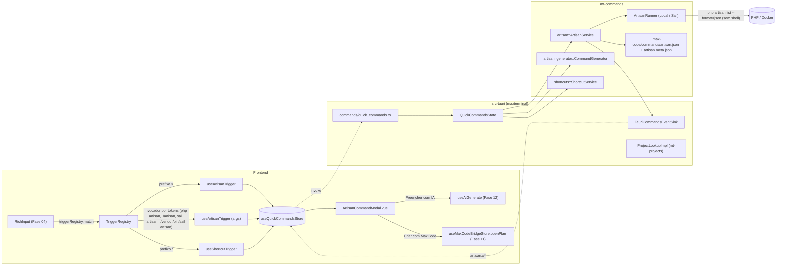
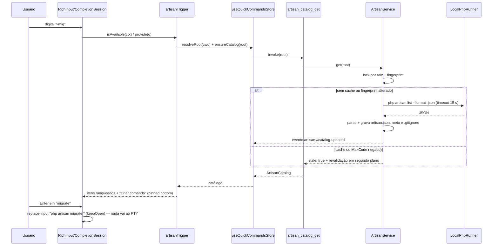
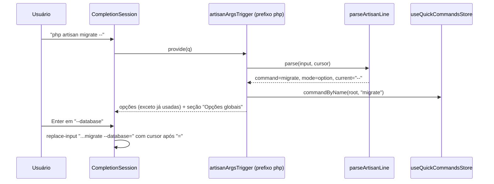
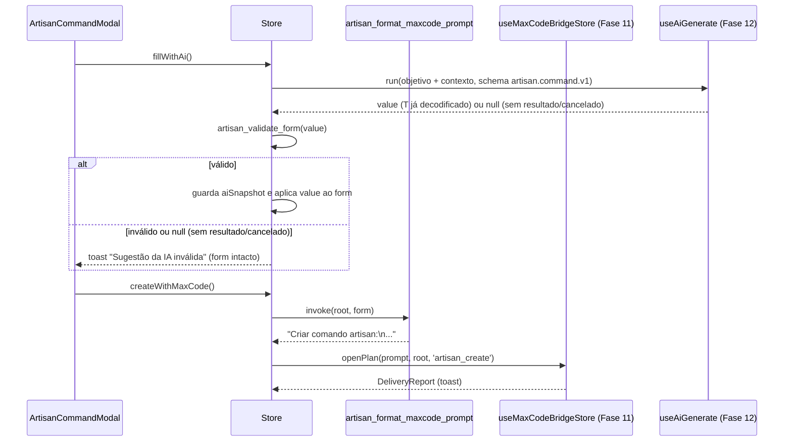
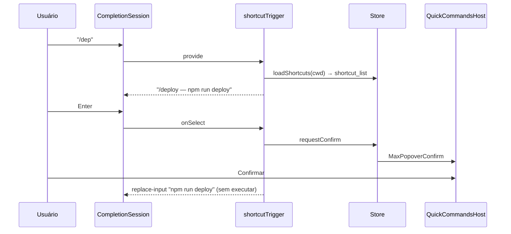

# Fase 14 — Comandos Rápidos: Artisan (`>`) e Atalhos Universais (`/`) — Especificação Técnica (`spec.md`)

> Escopo funcional, critérios de aceite (CA-01…CA-40) e riscos: [`./instructions.md`](./instructions.md).
> Contratos compartilhados: [`../README.md`](../README.md) §2. Fonte da verdade: [`../../AGENTS.md`](../../AGENTS.md) §8.1 e §8.3.
> Referência de compatibilidade: `~/GitHub/MaxCode/src/core/artisanDiscovery.ts`, `terminalChatExecutor.ts`,
> `configDeTrabalhoStore.ts`. Código local consultado na revisão `1054eb8a886de412de8912ad56f64b1367da8b09`:
> cache array confirmado em `artisanDiscovery.ts:9–20,73–120`; configurações em `configDeTrabalhoStore.ts:21–29,66–68`.
> A tabela histórica de atalhos é adaptada às capacidades efetivamente suportadas (§8), sem prometer paridade de flags.

---

## 1. Visão Geral e Dependências

### 1.1. Arquitetura em camadas



Princípios:
- `mt-commands` **não depende** de Tauri, `mt-pty` nem `mt-projects`: recebe tudo por traits em `ports.rs`. Isso
  garante estruturalmente que nenhum comando Artisan/atalho é escrito no PTY por esta fase (CA-13, CA-31).
- Seleções produzem `replace-input`, `handled` (modal) ou `close`; a execução continua sendo
  responsabilidade do Enter explícito do usuário (Fase 04 §11.2).
- A filtragem fuzzy roda no **frontend** sobre o catálogo já carregado (uma chamada IPC por raiz, nunca por tecla).
- O validador, o renderizador PHP e o formatador do prompt do MaxCode existem **apenas em Rust**; o frontend chama
  `artisan_validate_form`/`artisan_preview_command` — preview e arquivo gravado são idênticos byte a byte (CA-19).

### 1.2. Organização do crate (módulos compartilhados com a Fase 15)

```
src-tauri/crates/mt-commands/
├── Cargo.toml
├── src/
│   ├── lib.rs              # pub mod artisan; pub mod shortcuts; pub mod ports; pub mod error; (Fase 15: pub mod groups)
│   ├── error.rs            # códigos `artisan.*`, `shortcut.*` (Fase 15 adiciona `groups.*`)
│   ├── ports.rs            # ArtisanRunner, CommandsEventSink, ProjectLookup, MaxCodeConfigLocator, Clock
│   ├── fs_util.rs          # atomic_write, create_new_file, read_capped, file_stamp, is_inside
│   ├── artisan/
│   │   ├── mod.rs  model.rs  root.rs  runner.rs  parser.rs  cache.rs  fingerprint.rs  service.rs
│   │   └── generator/
│   │       ├── mod.rs  form.rs  validate.rs  signature.rs  psr4.rs  template.rs
│   │       ├── schedule.rs  console_routes.rs  maxcode_prompt.rs
│   │       └── snapshots/*.snap
│   └── shortcuts/
│       └── mod.rs  model.rs  detect.rs  manifests.rs  maxcode_config.rs  resolve.rs  service.rs
└── tests/
    ├── fixtures/ (artisan_list_laravel11.json, artisan_list_laravel10.json, maxcode_cache_legacy.json,
    │              shortcuts/{laravel-vue, tauri-pnpm, npm-default-test, multi-lock, maxcode-config}/)
    ├── artisan_cache.rs  artisan_runner.rs  generator.rs  shortcuts.rs
    └── laravel_integration.rs   # #[ignore], usa MT_LARAVEL_FIXTURE
```

### 1.3. `Cargo.toml`

```toml
[package]
name = "mt-commands"
edition.workspace = true   # 2024 (D-09)

[dependencies]
mt-core = { path = "../mt-core" }
mt-db = { workspace = true }   # sanitizador (mt_db::sanitizer) e fachada mt_db::Db (D-09)
serde = { workspace = true, features = ["derive"] }
serde_json = { workspace = true }
schemars = "1"                     # JSON Schema draft 2020-12 do formulário (Geração Assistida)
specta = { workspace = true }
tokio = { workspace = true, features = ["process", "time", "sync", "fs", "io-util", "macros", "rt"] }
async-trait = "0.1"
thiserror = { workspace = true }
tracing = { workspace = true }
sha2 = "0.10"
walkdir = "2"
dashmap = "6"
indexmap = { version = "2", features = ["serde"] }   # preserva a ordem de argumentos do Symfony
libc = "0.2"                                          # kill(-pgid) do grupo de processos no timeout

[dev-dependencies]
tempfile = "3"
insta = { version = "1", features = ["json"] }
pretty_assertions = "1"
tokio = { workspace = true, features = ["test-util", "rt-multi-thread"] }
```

> `indexmap` e `libc` são adições a I-01/§4.1 das instructions (necessárias para ordem de argumentos e kill de grupo).
>
> D-09: `mt-commands/Cargo.toml` **nasce nesta fase** com `edition.workspace = true` (edição 2024 herdada do workspace) e
> `mt-db = { workspace = true }`. A Fase 15 apenas **acrescenta** dependências (ex.: `rusqlite = { workspace = true }`) e o módulo
> `groups`, sem redefinir `edition`, `name` ou o crate. Esta fase não tem migration SQLite.

---

## 2. Contratos Consumidos

| Fase | Contrato (nome exato da fase dona) | Uso nesta fase | Ponto de ajuste |
|------|-----------------------------------|----------------|-----------------|
| 01 | `mt_core::{MtError, MtResult, ErrorCode}`, `ProjectId`, `PaneId`; padrão `unwrap`/`MtIpcError` de `src/ipc/core.ts`; `tauri-specta` | erros, ids, IPC | — |
| 03 | `mt_db::sanitizer::sanitize(&str) -> Cow<str>` | `stderr` da descoberta, prompt ao MaxCode | `ports.rs` |
| 04 | `triggerRegistry.register(def: TriggerDefinition): Disposable`, `TriggerQuery`, `TriggerSelectOutcome`, `CompletionItem` (`kind`, `pinned: 'bottom'`, `disabled`, `payload`), `CompletionResult`, `TerminalContext { paneId, projectId, cwd }` | provedores `>`, args e `/` | `src/composables/quick-commands/adapters.ts` |
| 06 | `Project.stack: StackKind` (`'laravel'`), `useProjectsStore().projectById(id)` | habilitar `>` | `adapters.ts` |
| 07 | `TerminalContext.cwd` (preenchido via `registerContextProvider` das Fases 05/07); `PaneView.cwd` | raiz Laravel por aba/worktree | `adapters.ts` |
| 11 | `maxcode_open_plan(prompt, project_path, source)` com `ConversationSource::ArtisanCreate` (`'artisan_create'`); `useMaxCodeBridgeStore().openPlan(prompt, projectPath, source)` | "Criar com MaxCode" | `adapters.ts` |
| 12 | `useAiGenerate<T>(schemaId, schema, decode: (value: unknown) => T)` → `{ loading, error, result, run(prompt, opts?: AiGenerateRunOptions): Promise<T \| null>, cancel() }` (`AiGenerateRunOptions.signal?: AbortSignal`; `null` = sem resultado utilizável/cancelado); `ai_generate_structured(StructuredRequest)` com `schemaId = 'artisan.command.v1'` (D-05) | "Preencher com IA" | `adapters.ts` |

### 2.1. Campos `passthrough` / `refreshAfter` do `CompletionResult` (contrato da Fase 04)

O contrato reconciliado da Fase 04 (`04/spec.md` §6 e §8.2) já permite que um provedor diga "este texto não é para
mim" depois que o prefixo casou (ex.: `/usr/bin/env`, `> saida.txt`, `phpunit`) e que o popup seja reconsultado
quando um carregamento assíncrono terminar, além da supressão pós-Escape por painel. Esta fase apenas **consome**:

```ts
export interface CompletionResult {
    // ...demais campos da Fase 04...
    /** true ⇒ sessão volta a `idle` sem renderizar popup; Enter segue o fluxo literal (§11.2 passo 2). */
    passthrough?: boolean;
    /** ao resolver, a sessão chama `provide` de novo com a mesma query (ex.: catálogo terminou de carregar). */
    refreshAfter?: Promise<unknown>;
}
```

Regra de supressão (R-05, implementada pela Fase 04): após `Escape` com popup aberto, o gatilho fica suprimido
**naquele painel** até a linha ficar vazia ou o prefixo ser apagado.

### 2.2. Reconciliação de contexto e contrato com as fases-base

| Instructions | Contrato real | Decisão |
|--------------|---------------|---------|
| `ProjectDto.stacks: ProjectStack[]` (nome antigo) | `Project.stack: StackKind` (primária) + `ProjectIdentity.detected` | A stack é dica; `artisan_resolve_root` não nulo é obrigatório, inclusive em Laravel+Vue com stack primária diferente. |
| `useProjectsStore().activeProject` | `selectedProject` / `projectById(id)` | Usa `TerminalContext.projectId` → `projectById`. |
| `useTabsStore().activeTab.cwd` | `activeTab(projectId)` (getter função) e `PaneView.cwd` | Usa `TerminalContext.cwd` do painel em foco (mais preciso em split panes). |

Dependências diretas permanecem **04, 07, 11, 12**; 01/03/06 são contratos transitivos. Nenhum símbolo da Fase 15
é importado. `ProjectLookup` deve vincular `(projectId, paneId, cwd, root)` ao contexto conhecido pelo backend;
o `project_id` recebido não é ignorado nem usado para autorizar uma raiz arbitrária. Raízes de worktrees externas
só são aceitas se já vinculadas ao projeto pelo serviço dono; pertencer por prefixo textual não basta.

---

## 3. Fundamentos do crate

### 3.1. Erros (`error.rs`)

```rust
use mt_core::ErrorCode;

pub mod codes {
    use super::ErrorCode;
    pub const NOT_LARAVEL: ErrorCode = ErrorCode("artisan.not_laravel");
    pub const ROOT_FORBIDDEN: ErrorCode = ErrorCode("artisan.root_forbidden");     // fora de projeto cadastrado
    pub const PHP_NOT_FOUND: ErrorCode = ErrorCode("artisan.php_not_found");
    pub const TIMEOUT: ErrorCode = ErrorCode("artisan.timeout");
    pub const EXIT_NONZERO: ErrorCode = ErrorCode("artisan.exit_nonzero");
    pub const INVALID_JSON: ErrorCode = ErrorCode("artisan.invalid_json");
    pub const OUTPUT_TOO_LARGE: ErrorCode = ErrorCode("artisan.output_too_large");
    pub const INVALID_FORM: ErrorCode = ErrorCode("artisan.invalid_form");
    pub const FILE_EXISTS: ErrorCode = ErrorCode("artisan.file_exists");
    pub const UNSAFE_PATH: ErrorCode = ErrorCode("artisan.unsafe_path");          // symlink para fora da raiz
    pub const WRITE_FAILED: ErrorCode = ErrorCode("artisan.write_failed");
    pub const CONSOLE_ROUTES_FAILED: ErrorCode = ErrorCode("artisan.console_routes_failed");
    pub const PREVIEW_STALE: ErrorCode = ErrorCode("artisan.preview_stale");
    pub const PARTIAL_WRITE: ErrorCode = ErrorCode("artisan.partial_write");
    pub const RUNNER_UNSUPPORTED: ErrorCode = ErrorCode("artisan.runner_unsupported");
    pub const SHORTCUT_INVALID_CWD: ErrorCode = ErrorCode("shortcut.invalid_cwd");
    pub const SHORTCUT_UNRESOLVED: ErrorCode = ErrorCode("shortcut.unresolved");
    pub const MANAGER_CONFLICT: ErrorCode = ErrorCode("shortcut.manager_conflict");
    pub const UNSUPPORTED_CAPABILITY: ErrorCode = ErrorCode("shortcut.unsupported_capability");
}
```

Mensagens em pt-BR (exemplos): `artisan.php_not_found` → "PHP não encontrado no PATH. Instale o PHP ou inicie o
Sail (`./vendor/bin/sail up -d`)."; `artisan.timeout` → "A descoberta de comandos Artisan excedeu 15 s e foi
interrompida."; `artisan.file_exists` → "O arquivo app/Console/Commands/X.php já existe; nada foi alterado.".

### 3.2. Portas (`ports.rs`)

```rust
#[async_trait::async_trait]
pub trait ArtisanRunner: Send + Sync + 'static {
    fn kind(&self) -> RunnerKind;
    /// Prefixo inserido no input (relativo ao cwd da aba): "php artisan", "php ../artisan", "./vendor/bin/sail artisan".
    fn invoker(&self, root: &Path, cwd: &Path) -> String;
    async fn list_json(&self, root: &Path, limits: RunLimits) -> MtResult<Vec<u8>>;
}

pub trait CommandsEventSink: Send + Sync + 'static {
    fn catalog_updated(&self, p: CatalogUpdatedPayload);
    fn discovery_failed(&self, p: DiscoveryFailedPayload);
    fn command_created(&self, p: CommandCreatedPayload);
}

/// Implementado no binário sobre `mt_projects::ProjectService` (Fase 06).
pub trait ProjectLookup: Send + Sync + 'static {
    /// Caminho canônico está dentro de algum `Project.path` cadastrado (inclui worktrees internas).
    fn owning_project(&self, path: &Path) -> Option<(ProjectId, PathBuf)>;
}

pub trait MaxCodeConfigLocator: Send + Sync + 'static {
    fn config_file(&self) -> Option<PathBuf>;
}

pub trait Clock: Send + Sync + 'static { fn now_ms(&self) -> i64; }

#[derive(Clone, Copy, Debug)]
pub struct RunLimits { pub timeout: Duration, pub max_stdout: usize, pub max_stderr: usize }
impl Default for RunLimits {
    fn default() -> Self {
        Self { timeout: Duration::from_secs(15), max_stdout: 8 * 1024 * 1024, max_stderr: 64 * 1024 }
    }
}
```

### 3.3. Utilitários (`fs_util.rs`)

- `atomic_write(path, bytes)`: grava `path.tmp-<pid>-<rand>` no mesmo diretório, `sync_all`, `rename`; preserva
  permissões do arquivo anterior quando existir.
- `create_new_file(path, bytes)`: `OpenOptions::new().write(true).create_new(true)` (O_EXCL) + `sync_all`;
  `ErrorKind::AlreadyExists` → `artisan.file_exists`.
- `read_capped(path, max) -> io::Result<Option<String>>`: `None` se ausente; erro se `> max` (2 MiB para manifestos,
  256 KiB para `bootstrap/app.php`/`routes/console.php`, 1 MiB para a config do MaxCode).
- `is_inside(root, candidate)`: `canonicalize` de ambos e `starts_with`; usado antes de toda escrita.

Esses helpers não tornam uma sequência multi-arquivo transacional. Antes de criar diretórios, abrir cada ancestral
a partir do descritor da raiz autorizada, rejeitando symlinks e escapes (`openat`/`O_NOFOLLOW`, ou equivalente Linux).
Para um destino inexistente, validar o pai existente mais próximo; não chamar `canonicalize(target)` esperando que
um arquivo ainda inexistente exista. A publicação deve preservar essa ancoragem, incluindo `.max-code/commands/`,
temporários, sidecar e `routes/console.php`. `atomic_write` genérico é exclusivo de cache regenerável; arquivos PHP
do usuário exigem a política de revisão e recuperação de §7.8. Não exportar este helper como CAS multi-processo.

---

## 4. Módulo `artisan` — Descoberta e Cache

### 4.1. Modelo (`model.rs`)

O tipo `ArtisanCommand` **é** o elemento do array de `artisan.json` (schema do MaxCode + campos estendidos opcionais).

```rust
#[derive(Debug, Clone, PartialEq, Serialize, Deserialize, specta::Type)]
#[serde(rename_all = "camelCase")]
pub struct ArtisanCommand {
    pub name: String,
    #[serde(default, skip_serializing_if = "Option::is_none")] pub description: Option<String>,
    #[serde(default, skip_serializing_if = "Vec::is_empty")] pub options: Vec<ArtisanOption>,
    #[serde(default, skip_serializing_if = "Vec::is_empty")] pub arguments: Vec<ArtisanArgument>,
    // ---- estendidos (ignorados pelo MaxCode) ----
    #[serde(default, skip_serializing_if = "Vec::is_empty")] pub aliases: Vec<String>,
}

#[derive(Debug, Clone, PartialEq, Serialize, Deserialize, specta::Type)]
#[serde(rename_all = "camelCase")]
pub struct ArtisanOption {
    pub name: String,                                   // sempre com prefixo: "--database"
    #[serde(default, skip_serializing_if = "Option::is_none")] pub description: Option<String>,
    #[serde(default, skip_serializing_if = "Option::is_none")] pub shortcut: Option<String>, // "-d"; vazio é omitido
    #[serde(default, skip_serializing_if = "Option::is_none")] pub accept_value: Option<bool>,
    #[serde(default, skip_serializing_if = "Option::is_none")] pub is_value_required: Option<bool>,
    #[serde(default, skip_serializing_if = "Option::is_none")] pub is_multiple: Option<bool>,
    #[serde(default, skip_serializing_if = "Option::is_none")] pub default: Option<serde_json::Value>,
    #[serde(default, skip_serializing_if = "Option::is_none")] pub is_global: Option<bool>,
}

#[derive(Debug, Clone, PartialEq, Serialize, Deserialize, specta::Type)]
#[serde(rename_all = "camelCase")]
pub struct ArtisanArgument {
    pub name: String,
    #[serde(default, skip_serializing_if = "Option::is_none")] pub description: Option<String>,
    #[serde(default, skip_serializing_if = "Option::is_none")] pub required: Option<bool>,
    #[serde(default, skip_serializing_if = "Option::is_none")] pub is_array: Option<bool>,
    #[serde(default, skip_serializing_if = "Option::is_none")] pub default: Option<serde_json::Value>,
}

#[derive(Debug, Clone, Copy, PartialEq, Eq, Serialize, Deserialize, specta::Type)]
#[serde(rename_all = "snake_case")]
pub enum RunnerKind { Local, Sail }

#[derive(Debug, Clone, Copy, PartialEq, Eq, Serialize, Deserialize, specta::Type)]
#[serde(rename_all = "snake_case")]
pub enum LaravelLayout { Modern /* ≥ 11: Application::configure */, Legacy /* ≤ 10: Console\Kernel */, Unknown }

#[derive(Debug, Clone, Copy, PartialEq, Eq, Serialize, Deserialize, specta::Type)]
#[serde(rename_all = "snake_case")]
pub enum CatalogSource { Fresh, Cache, ForeignCache /* gravado pelo MaxCode */ }

#[derive(Debug, Clone, Serialize, Deserialize, specta::Type)]
#[serde(rename_all = "camelCase")]
pub struct ArtisanRoot {
    pub root: String,                 // canônico
    pub project_id: Option<ProjectId>,
    pub is_worktree: bool,
    pub invoker: String,              // relativo ao cwd informado
    pub invoker_tokens: Vec<String>,  // representação estruturada para parser/quoting
    pub runner: RunnerKind,
    pub layout: LaravelLayout,
    pub laravel_version: Option<String>, // de composer.lock ("11.31.0")
}

#[derive(Debug, Clone, Serialize, Deserialize, specta::Type)]
#[serde(rename_all = "camelCase")]
pub struct ArtisanCatalog {
    pub root: String,
    pub commands: Vec<ArtisanCommand>,       // ordenado por name; hidden excluídos
    pub source: CatalogSource,
    pub stale: bool,                          // true ⇒ revalidação em segundo plano em curso
    pub generated_at_ms: Option<i64>,
    pub last_error: Option<CatalogErrorInfo>, // última falha de descoberta (cache antigo servido)
}

#[derive(Debug, Clone, Serialize, Deserialize, specta::Type)]
pub struct CatalogErrorInfo { pub code: String, pub message: String }
```

### 4.2. Resolução da raiz (`root.rs`)

```rust
pub struct RootResolver { lookup: Arc<dyn ProjectLookup>, memo: DashMap<PathBuf, (i64, Option<ArtisanRoot>)> } // TTL 30 s

impl RootResolver {
    pub fn resolve(&self, cwd: &Path, runner: &dyn ArtisanRunner) -> MtResult<Option<ArtisanRoot>> {
        let cwd = std::fs::canonicalize(cwd)?;
        let Some((project_id, project_path)) = self.lookup.owning_project(&cwd) else { return Ok(None) };
        // Sobe de cwd até a fronteira autorizada de projeto/worktree: primeiro artisan + composer.json vence.
        // Assim, cwd em `.max-code-worktrees/x/app` resolve para a worktree, não para o projeto principal (CA-11).
        let mut dir = cwd.as_path();
        loop {
            if dir.join("artisan").is_file() && is_laravel_composer(&dir.join("composer.json"))? {
                return Ok(Some(ArtisanRoot {
                    root: dir.display().to_string(),
                    project_id: Some(project_id),
                    is_worktree: is_worktree(dir),
                    invoker: runner.invoker(dir, &cwd),
                    invoker_tokens: invoker_tokens(runner.kind(), dir, &cwd),
                    runner: runner.kind(),
                    layout: detect_layout(dir),
                    laravel_version: laravel_version(dir),
                }));
            }
            if dir == project_path || has_git_boundary(dir) { return Ok(None); }
            match dir.parent() { Some(p) => dir = p, None => return Ok(None) }
        }
    }
}

/// `require` ou `require-dev` contém `laravel/framework` (ou `laravel/lumen-framework` → None: sem suporte).
fn is_laravel_composer(path: &Path) -> MtResult<bool>;
/// Componente `.max-code-worktrees` ou `.worktrees` no caminho, ou `.git` regular contendo `gitdir:`.
fn is_worktree(dir: &Path) -> bool;
/// `Modern` se `bootstrap/app.php` contém `Application::configure(`; `Legacy` se existe `app/Console/Kernel.php`.
fn detect_layout(dir: &Path) -> LaravelLayout;
/// `composer.lock` → `packages[].name == "laravel/framework"` → `version` sem o prefixo `v`.
fn laravel_version(dir: &Path) -> Option<String>;
```

`invoker` local: `php artisan` quando `cwd == root`, senão `php <caminho relativo>/artisan` (`php ../artisan`).
Cada caminho é serializado como um token conforme o shell do painel; não interpolar texto sem quoting. A resolução
retorna também `invokerTokens: string[]` no binding gerado, usados pelo parser em vez de reaprender caminhos por regex.
Sail segue o mesmo princípio. Antes de sair de qualquer pasta com `.git` (arquivo ou diretório), interromper a busca:
worktree sem Artisan nunca usa acidentalmente o catálogo ou a pasta de geração da árvore principal.

### 4.3. Runners (`runner.rs`)

```rust
pub struct LocalPhpRunner { php_bin: PathBuf } // padrão: `which("php")`; testes injetam script fake (ARTISAN_PHP_BIN)
pub struct SailRunner;                           // `vendor/bin/sail artisan list --format=json`

const ENV_ALLOWLIST: &[&str] = &["PATH", "HOME", "LANG", "LC_ALL", "COMPOSER_HOME", "XDG_CONFIG_HOME",
                                  "DOCKER_HOST", "DOCKER_CONTEXT", "WWWUSER", "WWWGROUP"];

#[async_trait::async_trait]
impl ArtisanRunner for LocalPhpRunner {
    fn kind(&self) -> RunnerKind { RunnerKind::Local }
    fn invoker(&self, root: &Path, cwd: &Path) -> String { format!("php {}", rel_artisan(root, cwd)) }
    async fn list_json(&self, root: &Path, limits: RunLimits) -> MtResult<Vec<u8>> {
        let mut cmd = tokio::process::Command::new(&self.php_bin);
        cmd.args(["artisan", "list", "--format=json", "--no-interaction", "--no-ansi"])
            .current_dir(root)
            .env_clear()
            .envs(ENV_ALLOWLIST.iter().filter_map(|k| std::env::var_os(k).map(|v| (*k, v))))
            .env("NO_COLOR", "1")
            .stdin(Stdio::null()).stdout(Stdio::piped()).stderr(Stdio::piped())
            .kill_on_drop(true)
            .process_group(0); // novo grupo: o timeout mata php e eventuais filhos
        run_bounded(cmd, limits).await
    }
}

async fn run_bounded(cmd: tokio::process::Command, limits: RunLimits) -> MtResult<Vec<u8>>;
```

Contrato de `run_bounded`: supervisor possui o filho e seu grupo até o reap; duas tarefas drenam stdout/stderr
concorrentemente. Stdout retém até 8 MiB e sinaliza overflow imediatamente ao byte seguinte; stderr continua drenando
até EOF com buffer circular limitado a 64 KiB (não usar `take(limit).read_to_end`, que deixa o pipe bloquear o filho).
Deadline, cancelamento de serviço, overflow ou falha de leitura encerram o grupo, fazem `child.wait().await` e juntam
as tarefas de leitura. Sucesso exige status zero e EOF; filhos persistentes são encerrados ainda sob supervisão.
`kill_on_drop` é defesa adicional, não substituto do reap nem da limpeza do grupo. Cancelar um consumidor de catálogo
compartilhado cancela apenas sua espera; a tarefa single-flight continua até concluir/deadline/shutdown.
Sanitizar a saída retida antes de truncar o diagnóstico a 4 KiB; descartar linhas incompletas nas bordas do ring buffer
para não expor fragmentos de segredo. Nenhum stdout bruto é logado; dados do catálogo são sanitizados antes do cache.

Seleção (`RunnerSelector::pick(root)`): preferência `QuickCommandsConfig.runner = auto | local | sail`.
Em `auto`: `php` encontrado no `PATH` → `Local`; senão, `vendor/bin/sail` existe **e**
`docker compose ps --status running --services` (timeout 3 s, mesmo `run_bounded`) lista `laravel.test` → `Sail`;
senão `Local` (que falhará com `artisan.php_not_found`, cuja mensagem sugere o Sail).

Matar o wrapper Sail no host não garante matar PHP no contêiner. O runner opcional precisa de identificador próprio
da tarefa no contêiner e rotina de encerramento/reap verificável; sem esse contrato, responder
`artisan.runner_unsupported` em vez de iniciar uma descoberta sem supervisão. Não iniciar ou parar serviços Docker
para obter completions. Overrides de ambiente do projeto são explícitos, em memória, sanitizados em diagnóstico.

### 4.4. Parser do JSON do Symfony Console (`parser.rs`)

Formato real de `php artisan list --format=json` (Symfony `JsonDescriptor`; recortado):

```json
{
  "application": { "name": "Laravel Framework", "version": "11.31.0" },
  "commands": [
    {
      "name": "migrate",
      "usage": ["migrate [--database [DATABASE]] [--force] [--path [PATH]] [--seed]"],
      "description": "Run the database migrations",
      "help": "Run the database migrations",
      "hidden": false,
      "definition": {
        "arguments": [],
        "options": {
          "database": { "name": "--database", "shortcut": "", "accept_value": true, "is_value_required": true,
                        "is_multiple": false, "description": "The database connection to use", "default": null },
          "path": { "name": "--path", "shortcut": "", "accept_value": true, "is_value_required": true,
                    "is_multiple": true, "description": "The path(s) to the migrations files to be executed", "default": [] },
          "verbose": { "name": "--verbose", "shortcut": "-v|-vv|-vvv", "accept_value": false,
                       "is_value_required": false, "is_multiple": false, "description": "Increase the verbosity…", "default": false }
        }
      }
    },
    {
      "name": "make:model",
      "definition": {
        "arguments": { "name": { "name": "name", "is_required": true, "is_array": false,
                                 "description": "The name of the model", "default": null } },
        "options": { }
      }
    }
  ],
  "namespaces": [ { "id": "_global", "commands": ["about", "migrate"] } ]
}
```

Peculiaridades tratadas: (1) mapas vazios chegam como **array** `[]` (array PHP vazio); (2) a ordem das chaves de
`arguments` é a ordem posicional — exige `IndexMap`; (3) `shortcut` já vem com `-` e pode ter múltiplos (`-v|-vv`);
(4) opções negáveis geram entrada própria (`no-ansi`); (5) saída pode ter lixo antes do `{` (warnings de PHP
`display_errors`) — o parser procura o primeiro `{` na linha que inicia o objeto e reporta `artisan.invalid_json`
se a desserialização falhar.

```rust
#[derive(Deserialize)]
struct RawList { commands: Vec<RawCommand> }

#[derive(Deserialize)]
struct RawCommand {
    name: String,
    #[serde(default)] description: String,
    #[serde(default)] hidden: bool,
    #[serde(default)] aliases: Vec<String>,
    #[serde(default)] definition: Option<RawDefinition>,
}

#[derive(Deserialize)]
struct RawDefinition {
    #[serde(default, deserialize_with = "map_or_empty_array")] arguments: IndexMap<String, RawArgument>,
    #[serde(default, deserialize_with = "map_or_empty_array")] options: IndexMap<String, RawOption>,
}

pub fn parse_artisan_list(bytes: &[u8]) -> MtResult<Vec<ArtisanCommand>> {
    let start = bytes.iter().position(|b| *b == b'{').ok_or_else(invalid_json)?;
    let raw: RawList = serde_json::from_slice(&bytes[start..]).map_err(|e| invalid_json().with_source(e))?;
    let visible: Vec<_> = raw.commands.into_iter().filter(|c| !c.hidden && !c.name.trim().is_empty()).collect();
    // Opção é global se aparece em TODOS os comandos visíveis (help, quiet, verbose, version, ansi, no-ansi,
    // no-interaction, env) — robusto a pacotes que adicionam opções globais.
    let globals = intersect_option_keys(&visible);
    let mut out: Vec<ArtisanCommand> = visible.into_iter().map(|c| to_command(c, &globals)).collect();
    out.sort_by(|a, b| a.name.cmp(&b.name));
    Ok(out)
}
```

`to_command`: `description` vazia → `None`; `shortcut` vazio → `None`; `default` `null`, `false` (flag) ou `[]` →
`None`; `name` da opção sem `--` recebe o prefixo (paridade com `normalizarArtisanJson` do MaxCode).

### 4.5. Cache compatível (`cache.rs`)

Arquivos (na raiz resolvida, inclusive worktrees):

| Arquivo | Conteúdo | Escrita |
|---------|----------|---------|
| `.max-code/commands/artisan.json` | **array** de `ArtisanCommand`, `serde_json::to_vec_pretty` (2 espaços) | `atomic_write` |
| `.max-code/commands/artisan.meta.json` | `CacheMeta` (abaixo) | `atomic_write`, **após** o `artisan.json` |
| `.max-code/.gitignore` | `*\n` | `create_new` (nunca sobrescreve; erro ignorado) |

```rust
#[derive(Serialize, Deserialize)]
#[serde(rename_all = "camelCase")]
pub struct CacheMeta {
    pub schema: u32,                 // 1
    pub generator: String,           // "maxterminal"
    pub generator_version: String,   // CARGO_PKG_VERSION
    pub generated_at_ms: i64,
    pub artisan_json_sha256: String, // hash dos bytes exatos de artisan.json
    pub fingerprint: Fingerprint,
    pub runner: RunnerKind,
    pub laravel_version: Option<String>,
    pub command_count: u32,
}
```

Exemplo de `artisan.json` gerado (legível pelo `lerCacheArtisan()` do MaxCode, que só exige array):

```json
[
  {
    "name": "migrate",
    "description": "Run the database migrations",
    "options": [
      { "name": "--database", "description": "The database connection to use", "acceptValue": true, "isValueRequired": true, "isMultiple": false },
      { "name": "--force", "description": "Force the operation to run when in production", "acceptValue": false, "isValueRequired": false, "isMultiple": false },
      { "name": "--verbose", "shortcut": "-v|-vv|-vvv", "description": "Increase the verbosity of messages", "acceptValue": false, "isValueRequired": false, "isMultiple": false, "isGlobal": true }
    ]
  }
]
```

Falhas de gravação (disco somente leitura, permissão) são registradas em `tracing::warn` e **não** quebram o popup:
o catálogo em memória é servido normalmente (paridade com `salvarCacheArtisan`).

O leitor MaxCode retorna o array sem validar elementos: isso confirma compatibilidade, não confiabilidade dos dados.
O leitor Rust limita o cache a 8 MiB, valida cada item e tipo, rejeita nomes com controles/metacaracteres shell,
normaliza opções e preserva metadados ausentes como `None` (não adivinhar se uma opção aceita valor).
`normalizarArtisanJson` recebe o objeto de discovery; **não** recebe o array de cache. A fixture de compatibilidade
usa o leitor no array produzido e o normalizador somente no JSON Symfony, registrando a revisão do código de origem.
O formato pode manter descrições de terceiros no idioma original; UI e mensagens produzidas pelo MaxTerminal são pt-BR.
`artisan.json` e sidecar não são uma transação: hash divergente ou geração interrompida serve como cache estrangeiro,
sem apagar o arquivo de outro produtor. Cache é regenerável; lock entre produtores só vale se ambos o respeitarem.

### 4.6. Fingerprint e invalidação (`fingerprint.rs`)

```rust
#[derive(Clone, Debug, PartialEq, Eq, Serialize, Deserialize)]
#[serde(rename_all = "camelCase")]
pub struct Fingerprint {
    pub artisan: Option<FileStamp>,
    pub composer_json: Option<FileStamp>,
    pub composer_lock: Option<FileStamp>,
    pub bootstrap_app: Option<FileStamp>,
    pub console_routes: Option<FileStamp>,          // routes/console.php
    pub commands_dir: DirStamp,                     // app/Console/Commands/**/*.php
}
#[derive(Clone, Debug, PartialEq, Eq, Serialize, Deserialize)]
#[serde(rename_all = "camelCase")]
pub struct FileStamp { pub mtime_ns: i64, pub size: u64, pub content_sha256: String }
#[derive(Clone, Debug, PartialEq, Eq, Serialize, Deserialize)]
#[serde(rename_all = "camelCase")]
pub struct DirStamp { pub file_count: u32, pub entries_sha256: String } // hash ordenado de caminho + stamp de CADA arquivo

pub fn compute(root: &Path) -> MtResult<Fingerprint>; // máx. 5 000 arquivos, profundidade 6, sem seguir symlinks
```

Ao atingir limites, retornar diagnóstico de fingerprint incompleto, nunca reutilizar como se fosse íntegro.
Hash de conteúdo detecta edição com tamanho/mtime preservados; executar leitura/hashing em tarefa bloqueante limitada,
uma vez por abertura/refresh (não por tecla). A memória só é fresh após comparar fingerprint **e** bytes/hash atual
do `artisan.json` e sidecar. `max_mtime` agregado sozinho perde alterações em arquivos mais antigos.
TTL de 24 h complementa os sinais locais para comandos registrados em providers/pacotes; refresh explícito sempre disponível.

Matriz de decisão de `ArtisanService::get(root)`:

| Situação | Resposta | Ação extra |
|----------|----------|------------|
| Memória com fingerprint, hash de cache/sidecar iguais e TTL (24 h) válido | catálogo da memória, `source: cache` | — |
| Sem `artisan.json` | descobre **e aguarda** | grava cache + sidecar; emite `catalog-updated` |
| `artisan.json` sem sidecar ou hash divergente (CA-07) | `source: foreign_cache`, `stale: true` | revalidação em segundo plano; ausência de campos estendidos sozinha não comprova produtor estrangeiro |
| Sidecar válido, fingerprint diferente (CA-08) | descobre **e aguarda**; em falha serve o cache antigo com `stale: true` e `lastError` | emite `discovery-failed` em falha |
| Sidecar válido, fingerprint igual, TTL expirado | `source: cache`, `stale: true` | revalidação em segundo plano |
| JSON do cache corrompido | trata como "sem cache" | — |

### 4.7. Serviço (`service.rs`) — single-flight por raiz

```rust
pub struct ArtisanService {
    runners: RunnerSelector,
    sink: Arc<dyn CommandsEventSink>,
    clock: Arc<dyn Clock>,
    locks: DashMap<PathBuf, Arc<tokio::sync::Mutex<()>>>,
    memory: DashMap<PathBuf, Arc<MemEntry>>,          // { catalog, fingerprint, sha256, generated_at_ms }
    revalidating: dashmap::DashSet<PathBuf>,
    limits: RunLimits,
    ttl: Duration,                                     // 24 h
}

impl ArtisanService {
    pub async fn get(self: &Arc<Self>, root: &Path) -> MtResult<ArtisanCatalog> {
        if let Some(hit) = self.fresh_from_memory(root) { return Ok(hit); }
        let lock = self.locks.entry(root.to_path_buf()).or_default().clone();
        let _guard = lock.lock().await;                // 10 chamadas concorrentes ⇒ 1 execução (CA-05)
        if let Some(hit) = self.fresh_from_memory(root) { return Ok(hit); } // double-check pós-lock
        match self.load_disk(root)? {
            Disk::Fresh(c) => Ok(self.remember(root, c)),
            Disk::Stale(c) => { self.spawn_revalidate(root.to_path_buf()); Ok(c) }
            Disk::Outdated(old) => match self.discover_locked(root).await {
                Ok(fresh) => Ok(fresh),
                Err(e) => {
                    self.sink.discovery_failed(DiscoveryFailedPayload::new(root, &e));
                    Ok(old.stale_with_error(&e))       // serve o cache antigo com `stale: true` + `lastError`
                }
            },
            Disk::Missing => self.discover_locked(root).await,
        }
    }
    pub async fn refresh(self: &Arc<Self>, root: &Path) -> MtResult<ArtisanCatalog>; // força descoberta (botão ↻)
    /// Descarta memória e marca o sidecar como inválido (usado após "Criar" e, na Fase 17, por um watcher).
    pub fn invalidate(&self, root: &Path);
    fn spawn_revalidate(self: &Arc<Self>, root: PathBuf) {
        if !self.revalidating.insert(root.clone()) { return; }
        let this = Arc::clone(self);
        tokio::spawn(async move {
            let lock = this.locks.entry(root.clone()).or_default().clone();
            let _g = lock.lock().await;
            if let Err(e) = this.discover_locked(&root).await {
                this.sink.discovery_failed(DiscoveryFailedPayload::new(&root, &e));
            }
            this.revalidating.remove(&root);
        });
    }
}
```

`discover_locked`: `runner.list_json` → `parse_artisan_list` → grava cache → `remember` → `sink.catalog_updated`.

O código acima descreve o fluxo, não o gerenciamento completo de tarefas: implementação mantém handles de revalidação,
remove `revalidating` via guard também em erro/cancelamento, limita raízes em memória (LRU) e cancela/aguarda no shutdown.
Depois de obter o lock, revalidação verifica geração novamente; pedidos concorrentes de refresh compartilham a mesma
descoberta em voo. Falha sem cache também publica diagnóstico e guarda estado com backoff (ex.: 5 s); a abertura seguinte
não repete subprocessos a cada tecla. Refresh explícito ignora backoff, mantendo single-flight.

---

## 5. Comandos Tauri IPC (`src-tauri/src/commands/quick_commands.rs`)

Todos `#[tauri::command] #[specta::specta]`, `async`, retornam `Result<T, MtError>`. Todo argumento `root`/`cwd`
passa por `RootResolver`/`ProjectLookup` (deve estar dentro de projeto cadastrado e conter `artisan` quando aplicável).

| Comando | Args | Retorno | Erros |
|---------|------|---------|-------|
| `artisan_resolve_root` | `cwd: String, project_id: Option<ProjectId>` | `Option<ArtisanRoot>` | `core.not_found` (cwd inexistente) |
| `artisan_catalog_get` | `root: String` | `ArtisanCatalog` | `artisan.not_laravel`, `artisan.root_forbidden`, `artisan.php_not_found`, `artisan.timeout`, `artisan.exit_nonzero`, `artisan.invalid_json`, `artisan.output_too_large` (só quando não há cache para servir) |
| `artisan_catalog_refresh` | `root: String` | `ArtisanCatalog` | mesmos de `artisan_catalog_get` (sempre propagados) |
| `artisan_form_schema` | — | `serde_json::Value` (JSON Schema 2020-12 de `ArtisanCommandForm`, ≤ 32 KiB) | — |
| `artisan_validate_form` | `root: String, form: ArtisanCommandForm` | `ValidationReport` | `artisan.root_forbidden` |
| `artisan_preview_command` | `root: String, form: ArtisanCommandForm` | `ArtisanPreview` | `artisan.root_forbidden` (formulário inválido **não** é erro: `preview.php = None` + `report`) |
| `artisan_create_command` | `root: String, form: ArtisanCommandForm, expected_revision: String` | `ArtisanCreateResult` | `artisan.invalid_form` (`details.issues`), `artisan.file_exists`, `artisan.unsafe_path`, `artisan.preview_stale`, `artisan.write_failed`, `artisan.console_routes_failed`, `artisan.partial_write` |
| `artisan_format_maxcode_prompt` | `root: String, form: ArtisanCommandForm` | `String` | `artisan.invalid_form` (apenas erros estruturais: classe/signature vazias) |
| `shortcut_list` | `cwd: String` | `ShortcutList` | `shortcut.invalid_cwd` |
| `shortcut_resolve` | `cwd: String, id: ShortcutId` | `ResolvedShortcut` | `shortcut.invalid_cwd`, `shortcut.unresolved` |

```rust
#[derive(Serialize, specta::Type)] #[serde(rename_all = "camelCase")]
pub struct ArtisanPreview {
    pub revision: String,                      // hash de form + catálogo + layout + arquivos-base
    pub report: ValidationReport,
    pub path: String,                          // "app/Console/Commands/SendWeeklyReport.php"
    pub signature: String,                     // signature completa montada
    pub php: Option<String>,                   // None se houver erros
    pub console_patch: Option<ConsoleRoutesPatch>,
    pub manual_steps: Vec<String>,             // arquivo existente, layout legacy/customizado
}
#[derive(Serialize, specta::Type)] #[serde(rename_all = "camelCase")]
pub struct ConsoleRoutesPatch {
    pub path: String,
    pub will_create: bool,
    pub added_lines: Vec<String>,
    pub manual_only: bool,
    pub base_sha256: Option<String>,
    pub unified_diff: String,
}
#[derive(Serialize, specta::Type)] #[serde(rename_all = "camelCase")]
pub struct ArtisanCreateResult {
    pub path: String,
    pub console_routes_patched: bool,
    pub manual_steps: Vec<String>,
    pub catalog_refresh_pending: bool,         // criação já concluída, discovery independente
}
```

Estado no binário: `QuickCommandsState` com
`{ artisan: Arc<ArtisanService>, roots: RootResolver, generator: CommandGenerator, shortcuts: ShortcutService }`,
criado no `setup` após `ProjectService` (Fase 06) e registrado com `app.manage(QuickCommandsState { … })` (D-09). O `AppState`
da Fase 01 não agrega serviços de domínio: **não** há campo `quick_commands`/`commands` nele; os comandos IPC recebem
`tauri::State<'_, QuickCommandsState>`. A Fase 15 registra seu próprio `AppCommandGroupState` separadamente (sem referência cruzada).
Registro dos comandos no builder de `specta.rs` e no `invoke_handler`.

---

## 6. Eventos (`AppHandle::emit`, baixo volume)

| Evento | Payload (`camelCase`) | Quando |
|--------|------------------------|--------|
| `artisan://catalog-updated` | `{ root: string, commandCount: number, source: CatalogSource, generatedAtMs: number }` | após toda descoberta bem-sucedida (síncrona ou em segundo plano) |
| `artisan://discovery-failed` | `{ root: string, error: { code, message, details? } }` | falha de revalidação em segundo plano ou com cache antigo servido |
| `artisan://command-created` | `{ root: string, path: string, className: string, signatureName: string }` | após `artisan_create_command` bem-sucedido |

O payload de `catalog-updated` **não** carrega a lista (pode ter centenas de KB): a store chama `artisan_catalog_get`
(que agora acerta a memória em < 1 ms). Implementação: `TauriCommandsEventSink(AppHandle)` em `src-tauri/src/events/`.

Adicionar a todos os payloads `projectId`, `revision: u64` monotônica por raiz durante o processo e `requestId: string`
de correlação (UUID v7 local, sem novo id global em `mt-core`). Declarar structs `CatalogUpdatedPayload`,
`DiscoveryFailedPayload`, `CommandCreatedPayload` em `artisan/model.rs`, com Serde/Specta; exportá-las para bindings.
Erros carregam apenas `MtError` sanitizado. Evento atualiza/invalida estado da raiz correspondente, nunca o modal de
outra raiz. Store ignora revisões antigas e também considera a resposta IPC autoritativa (evento pode precedê-la ou
se perder); listeners não desencadeiam `refresh` recursivo. Reconexão invalida a numeração e relê snapshot via IPC.

---

## 7. Gerador "Criar comando" (`artisan/generator/`)

### 7.1. Formulário (`form.rs`)

```rust
/// Formulário do modal "Criar comando" — também é o schema da Geração Assistida (`artisan.command.v1`).
#[derive(Debug, Clone, Default, Serialize, Deserialize, specta::Type, schemars::JsonSchema)]
#[serde(rename_all = "camelCase", deny_unknown_fields)]
pub struct ArtisanCommandForm {
    /// Nome da classe PHP em PascalCase, ex.: SendWeeklyReport.
    pub class_name: String,
    /// Nome do comando na signature, ex.: reports:send-weekly.
    pub signature_name: String,
    /// Descrição curta exibida em `php artisan list`.
    pub description: String,
    #[serde(default)] pub params: Vec<ArtisanParam>,
    #[serde(default)] pub isolatable: bool,
    #[serde(default)] pub prompts_for_missing_input: bool,
    #[serde(default)] pub schedule: Option<ScheduleSpec>,
    /// Objetivo e regras de negócio do comando (vai para o PHPDoc e para o MaxCode).
    #[serde(default)] pub objective: String,
}

#[derive(Debug, Clone, Copy, PartialEq, Eq, Serialize, Deserialize, specta::Type, schemars::JsonSchema)]
#[serde(rename_all = "snake_case")]
pub enum ParamKind { Argument, Option }

#[derive(Debug, Clone, Serialize, Deserialize, specta::Type, schemars::JsonSchema)]
#[serde(rename_all = "camelCase", deny_unknown_fields)]
pub struct ArtisanParam {
    pub kind: ParamKind,
    pub name: String,                          // sem `--`
    #[serde(default)] pub description: String,
    #[serde(default)] pub optional: bool,      // somente argumento
    #[serde(default)] pub is_array: bool,
    #[serde(default)] pub default: Option<String>,
    #[serde(default)] pub shortcut: Option<String>, // somente opção: 1 letra
    #[serde(default)] pub accepts_value: bool,      // somente opção (`--queue=`)
}

#[derive(Debug, Clone, Serialize, Deserialize, specta::Type, schemars::JsonSchema)]
#[serde(rename_all = "camelCase", deny_unknown_fields)]
pub struct ScheduleSpec {
    pub frequency: ScheduleFrequency,
    #[serde(default)] pub arguments: Vec<String>, // valores posicionais, na ordem da signature
    #[serde(default)] pub options: Vec<ScheduleOption>,
    #[serde(default)] pub without_overlapping: bool,
    #[serde(default)] pub on_one_server: bool,
    #[serde(default)] pub run_in_background: bool,
}

#[derive(Debug, Clone, Serialize, Deserialize, specta::Type, schemars::JsonSchema)]
#[serde(rename_all = "camelCase", deny_unknown_fields)]
pub struct ScheduleOption { pub name: String, pub values: Vec<String>, pub enabled: bool }

#[derive(Debug, Clone, Serialize, Deserialize, specta::Type, schemars::JsonSchema)]
#[serde(tag = "kind", rename_all = "camelCase")]
pub enum ScheduleFrequency {
    EveryMinute, EveryFiveMinutes, EveryFifteenMinutes, EveryThirtyMinutes,
    Hourly, HourlyAt { minute: u8 },
    Daily, DailyAt { time: String },                // "HH:MM"
    TwiceDaily { first: u8, second: u8 },
    Weekly, WeeklyOn { day: u8, time: String },     // 0 = domingo … 6 = sábado
    Monthly, MonthlyOn { day: u8, time: String },   // 1..=31
    Cron { expression: String },                    // 5 campos
}
```

`ValidationReport { valid: bool, issues: Vec<FieldIssue> }`;
`FieldIssue { path: String /* "className", "params[2].shortcut", "schedule.frequency.time" */, severity: 'error' | 'warning', code: String, message: String /* pt-BR */ }`.

### 7.2. Validação (`validate.rs`) — fonte única para UI, IA e criação

| Campo | Regra | Mensagem (pt-BR) |
|-------|-------|------------------|
| `className` | `^[A-Z][A-Za-z0-9]{0,63}$`; não é palavra reservada PHP (`Class`, `List`, `Array`, `Static`, `Function`, `Match`, `Enum`… comparação case-insensitive, lista completa do manual PHP 8.3) | "Use PascalCase (ex.: SendWeeklyReport)." / "\"List\" é palavra reservada do PHP." |
| `signatureName` | `^[a-z][a-z0-9-]*(:[a-z0-9][a-z0-9-]*)*$`, ≤ 100; não colide com `name`/`aliases` do catálogo atual | "Signature inválida: use minúsculas, `-` e `:`." / "Já existe o comando \"x\"." |
| `description` e `params[].description` | 1..=255 (comando) / ≤ 255 (params); sem `{`, `}` nem quebra de linha | "Descrições não podem conter { ou }." |
| `params[].name` | `^[a-z][a-z0-9_-]*$`; único entre argumentos **e** opções | "Nome duplicado: \"user\"." |
| argumentos | obrigatório após opcional proibido; `isArray` só no último argumento; obrigatório não tem `default` | "Argumento obrigatório não pode vir após um opcional." |
| `params[].shortcut` | `^[A-Za-z]$`, único, ∉ {`h`, `q`, `V`, `n`, `v`}; só em opções | "Atalho reservado pelo Symfony Console." |
| nome de opção | ∉ {`help`, `quiet`, `verbose`, `version`, `ansi`, `no-ansi`, `no-interaction`, `env`} e ∉ {`isolated`} quando `isolatable` | "\"--env\" é uma opção global reservada." |
| `default` | `^[^{}\s][^{}]*$`, sem ` : `; proibido em flag sem valor e em arrays | "Valor padrão inválido." |
| `schedule` | `HH:MM` 00:00–23:59; `day` no intervalo; `TwiceDaily` horas distintas 0–23; `Cron`: 5 campos, cada um `*`, `n`, `a-b`, listas e `/passo` dentro dos limites (0–59, 0–23, 1–31, 1–12, 0–7) | "Expressão cron inválida no campo \"hora\"." |
| `objective` | ≤ 8 000 caracteres (limite de prompt da Fase 12) | "Objetivo muito longo (máx. 8 000)." |
| aviso | `promptsForMissingInput` sem argumento obrigatório (`severity: warning`, não bloqueia) | "Sem argumentos obrigatórios: PromptsForMissingInput não terá efeito." |

Regras adicionais: schedule exige valor para cada argumento obrigatório; não depende de prompts numa execução não
interativa. Suas opções precisam existir na signature, obedecer flag/valor/array e não conter CR/LF/NUL. Validar
interfaces contra `composer.lock`/capacidade instalada, não apenas número de layout; recurso desconhecido bloqueia
a geração dessa interface com explicação, mantendo a possibilidade de encaminhar o objetivo ao MaxCode.
Não gerar variável `$this`, nomes que iniciem com número ou colidam após camelCase (`user-id` e `user_id`): o template
usa mapa `$arguments`/`$options` indexado pelo nome original nesses casos. Verificar colisões de classe com imports
(`Command`, `Isolatable`, `PromptsForMissingInput`) e usar FQCN/aliases estáveis quando necessário.
Campos incompatíveis são erro (ex.: atalho em argumento, array de flag sem valores), não coerções silenciosas.
Limitar formulário completo a 64 KiB/100 parâmetros; objetivo de 8 000 caracteres não implica que o prompt IA
possa ultrapassar o limite total da Fase 12: reservar espaço ao contexto ou pedir redução explicitamente.

### 7.3. Formato do prompt "Criar com MaxCode" (`maxcode_prompt.rs`)

Texto **exato** enviado a `maxcode_open_plan(prompt, root, 'artisan_create')` (snapshot `maxcode_prompt__full_form.snap`):

```text
Criar comando artisan:
Nome da Classe: SendWeeklyReport
Signature: reports:send-weekly {user : ID do usuário} {--Q|queue=default : Fila de processamento} {--force : Ignora a confirmação}
Descrição: Envia o relatório semanal por e-mail
Arquivo: app/Console/Commands/SendWeeklyReport.php
Laravel: 11.31.0 (schedule em routes/console.php)
Argumentos:
- user (obrigatório) — ID do usuário
Opções:
- --queue=, atalho -Q, aceita valor, padrão "default" — Fila de processamento
- --force (flag) — Ignora a confirmação
Isolatable: sim
PromptsForMissingInput: sim
Agendamento: semanal, segunda-feira às 08:00 — ->weeklyOn(1, '08:00')->withoutOverlapping()
Parâmetros do agendamento: user=42
Objetivo / Regras:
Enviar para cada usuário ativo um resumo das vendas da semana anterior.
Nunca enviar duas vezes no mesmo dia.
```

Regras: linhas ausentes viram `Nenhum` (`Argumentos:\n- Nenhum`); `Objetivo / Regras:` vazio → `Não informado`;
`Laravel: desconhecido` quando sem `composer.lock`; em Legacy, `(schedule manual em app/Console/Kernel.php)`; o
resultado passa por `sanitize()` (idempotente para textos sem segredo). Nenhum arquivo é gravado (CA-24).

### 7.4. Signature (`signature.rs`)

```rust
pub fn param_token(p: &ArtisanParam) -> String {
    let desc = match p.description.trim() { "" => String::new(), d => format!(" : {d}") };
    let default = p.default.as_deref().filter(|d| !d.is_empty());
    let body = match p.kind {
        ParamKind::Argument => {
            let mut s = p.name.clone();
            match (default, p.is_array) {
                (Some(d), false) => { s.push('='); s.push_str(d); }   // {user=1} já é opcional
                _ if p.optional => s.push('?'),                      // {user?} / {user?*}
                _ => {}
            }
            if p.is_array { s.push('*'); }
            s
        }
        ParamKind::Option => {
            let mut s = String::from("--");
            if let Some(sc) = p.shortcut.as_deref() { s.push_str(sc); s.push('|'); }
            s.push_str(&p.name);
            if p.accepts_value || p.is_array {
                s.push('=');
                if p.is_array { s.push('*'); } else if let Some(d) = default { s.push_str(d); }
            }
            s
        }
    };
    format!("{{{body}{desc}}}")
}

/// Uma linha quando há ≤ 1 parâmetro; senão, nome + um parâmetro por linha indentado com 28 espaços
/// (formato do `make:command` do Laravel). Argumentos antes das opções, na ordem do formulário.
pub fn build_signature(form: &ArtisanCommandForm, multiline: bool) -> String;
```

### 7.5. Namespace PSR-4 (`psr4.rs`)

Lê `composer.json` → `autoload.psr-4` (valor `string` ou `string[]`); escolhe o prefixo cujo diretório (normalizado
sem `./` e com `/` final) é o **mais longo** prefixo de `app/Console/Commands/`; namespace = prefixo + segmentos
restantes unidos por `\`. Ex.: `"App\\": "app/"` → `App\Console\Commands`. Sem correspondência ou mapeamentos
ambíguos → issue bloqueante `psr4_unresolved`; exibir ajuste necessário em `manual_steps`, sem inventar namespace.
Validar que a pasta é descoberta pelo Laravel instalado; layout customizado pode precisar de registro manual.

### 7.6. Template PHP (`template.rs`)

Renderização por `String` + `write!` (sem engine de templates), determinística e coberta por snapshot `insta`.
Escapes: strings PHP entre aspas simples (`\` → `\\`, `'` → `\'`); textos no PHPDoc têm `*/` → `*\/`. Variáveis de
`handle()` em camelCase do nome do parâmetro (`user-id` → `$userId`). Saída para o formulário do §7.3:

```php
<?php

namespace App\Console\Commands;

use Illuminate\Console\Command;
use Illuminate\Contracts\Console\Isolatable;
use Illuminate\Contracts\Console\PromptsForMissingInput;

/**
 * Envia o relatório semanal por e-mail
 *
 * Objetivo / Regras:
 * Enviar para cada usuário ativo um resumo das vendas da semana anterior.
 * Nunca enviar duas vezes no mesmo dia.
 *
 * Gerado pelo MaxTerminal.
 */
class SendWeeklyReport extends Command implements Isolatable, PromptsForMissingInput
{
    /**
     * Nome e assinatura do comando no console.
     *
     * @var string
     */
    protected $signature = 'reports:send-weekly
                            {user : ID do usuário}
                            {--Q|queue=default : Fila de processamento}
                            {--force : Ignora a confirmação}';

    /**
     * Descrição do comando no console.
     *
     * @var string
     */
    protected $description = 'Envia o relatório semanal por e-mail';

    /**
     * Executa o comando.
     */
    public function handle(): int
    {
        $user = $this->argument('user');
        $queue = $this->option('queue');
        $force = (bool) $this->option('force');

        // TODO: implementar conforme "Objetivo / Regras" descrito acima.

        $this->warn('Implemente o objetivo do comando antes de executá-lo.');
        return self::FAILURE;
    }

    /**
     * Perguntas exibidas quando argumentos obrigatórios não forem informados.
     *
     * @return array<string, string>
     */
    protected function promptForMissingArgumentsUsing(): array
    {
        return [
            'user' => 'Informe: ID do usuário',
        ];
    }
}
```

Variações: sem `Isolatable`/`PromptsForMissingInput` → `use`/`implements` correspondentes omitidos e método
`promptForMissingArgumentsUsing` ausente; argumento sem descrição → pergunta `Informe o valor de "user"`; arrays →
`$ids = $this->argument('ids'); // array<int, string>`.

"Criar" gera estrutura compilável e objetivo documentado, não implementação de negócio inventada. Por isso o esqueleto
incompleto não retorna sucesso nem é executado automaticamente. A assistência IA preenche dados do formulário;
implementação do objetivo pode ser encaminhada ao Plan Mode pelo botão próprio.

### 7.7. Agendamento (`schedule.rs`) e `routes/console.php` (`console_routes.rs`)

`render_chain(spec) -> String`:

| Frequência | Saída |
|------------|-------|
| `EveryMinute` … `EveryThirtyMinutes`, `Hourly`, `Daily`, `Weekly`, `Monthly` | `->everyMinute()` … `->monthly()` |
| `HourlyAt { 15 }` | `->hourlyAt(15)` |
| `DailyAt { "03:30" }` | `->dailyAt('03:30')` |
| `TwiceDaily { 1, 13 }` | `->twiceDaily(1, 13)` |
| `WeeklyOn { 1, "08:00" }` | `->weeklyOn(1, '08:00')` |
| `MonthlyOn { 5, "09:00" }` | `->monthlyOn(5, '09:00')` |
| `Cron { "0 8 * * 1" }` | `->cron('0 8 * * 1')` |
| modificadores | `->withoutOverlapping()`, `->onOneServer()`, `->runInBackground()` (nessa ordem) |

Plano de patch aditivo e idempotente para layout moderno validado (CA-20):

```rust
pub fn plan_patch(source: Option<&str>, fqcn: &str, spec: &ScheduleSpec) -> MtResult<PatchPlan>;
```

O planner reconhece tokens PHP de topo (imports, aliases, `declare`, namespace, comentários/strings e fechamento
`?>`), nunca `text.contains` para detectar registro. Renderizar chamada com FQCN quando houver conflito de aliases,
e valores como literais PHP escapados: `Schedule::command(SendWeeklyReport::class, ['42'])->weeklyOn(1, '08:00');`.
Deduplicação considera classe/signature e parâmetros/frequência em nós reconhecidos, não menção em comentário.
Confirmar `withRouting(commands: ...)` no bootstrap: `Application::configure` sozinho não comprova que
`routes/console.php` será carregado. Layout legacy, registro alternativo, arquivo ambíguo ou PHP não reconhecido
recebe snippet manual, sem alteração automática.

**Inserção confirmada e idempotente (T-18):** `routes/console.php` existente e reconhecido também recebe
agendamento automático. Inserir antes de `?>` (ou no fim do segmento PHP) um bloco delimitado por
`// <maxterminal:schedule:Classe>` e `// </maxterminal:schedule:Classe>`, com FQCNs para evitar colisão de imports.
Preservar todos os bytes fora desse bloco, inclusive comentários, newline e comandos existentes. Se registro
equivalente já existir, produzir patch vazio; bloco divergente/duplicado, estrutura PHP ambígua ou agendamento
customizado conflitante exige revisão manual, nunca duplicar registro. Arquivo ausente usa `create_new` e os mesmos delimitadores.

O preview mostra o diff completo, marca `manual_only = false` nos casos suportados e inclui identidade/hash da
base em `revision`. O clique explícito em **Criar**, após pré-visualização do agendamento, confirma exatamente
essa revisão; IA nunca confirma. Revalidar base sob lock por raiz imediatamente antes da publicação: mudança
detectada retorna `artisan.preview_stale`. Preparar temporário exclusivo no mesmo diretório, preservar permissões
e backup dos bytes originais, sincronizar e publicar a atualização atomicamente. Hash+rename não é CAS contra
editor externo e lock advisory só coordena escritores cooperativos: documentar a janela residual, não prometer
atomicidade entre arquivos; em conflito observado, preservar arquivos e devolver diff/passos manuais. Não instalar cron do sistema.

`LaravelLayout::Legacy`/`Unknown` → nada é escrito; `manual_steps` (CA-22):

```text
Adicione em app/Console/Kernel.php, no método schedule():
$schedule->command(\App\Console\Commands\SendWeeklyReport::class)->weeklyOn(1, '08:00');
```

### 7.8. Criação exclusiva e recuperação (`CommandGenerator::create`)

1. Adquirir lock de geração por raiz; validar contexto, formulário e colisões de classe/signature no catálogo atual.
   A classe é exclusiva por arquivo; assinatura também é revalidada sob o lock (duas classes não podem criá-la juntas).
2. Recalcular revisão do preview sobre formulário normalizado, layout, catálogo e bases lidas. Diferença de
   `expected_revision` → `artisan.preview_stale` sem escrita; UI exibe novo preview preservando o formulário.
3. Resolver destino ancorado na raiz antes de criar diretórios (§3.3). Arquivo existente ou symlink → erro sem alterações.
   Renderizar PHP e patch com a mesma função do preview. Preparar bytes completos em arquivo temporário exclusivo,
   sincronizar e publicar com operação no-replace (`renameat2(RENAME_NOREPLACE)` ou link exclusivo Linux).
4. Schedule existente suportado recebe o bloco delimitado aprovado no preview, após revalidação de identidade/hash
   (§7.7); preservar backup original e bytes externos ao bloco. Se ausente, publicar exclusivamente. Cada publicação
   registra inode/hash produzido para recuperação; arquivos ambíguos/legacy retornam `manual_steps`.
5. Em falha, remover apenas temporários próprios e artefatos cuja identidade/bytes continuam os gravados nesta operação.
   Se algum artefato mudou externamente ou a limpeza falhou, retornar `artisan.partial_write` com `createdPaths`,
   `preservedPaths`, `manualSteps` sanitizados; não anunciar "nada alterado" nem apagar edição externa.
6. Sucesso publica `artisan://command-created`, invalida cache e solicita revalidação deduplicada. O resultado de criação
   é definitivo mesmo se discovery posterior falhar: retornar `catalogRefreshPending`, permitir refresh e passos manuais,
   sem tentar criar de novo. Duplo clique é bloqueado e O_EXCL protege chamadas IPC concorrentes.

Não há atomicidade entre dois caminhos nem rollback garantido após queda de energia. Publicação de cada arquivo é
atômica (exclusiva para arquivos novos); reinício que encontra classe criada a mostra como existente, em vez de substituir o arquivo.

### 7.9. Schema da Geração Assistida

`artisan_form_schema` = `SchemaSettings::draft2020_12().into_generator().into_root_schema_for::<ArtisanCommandForm>()`
serializado (≈ 4 KiB). A resposta de `ai_generate_structured` é desserializada estritamente
(`deny_unknown_fields`; no frontend, a função `decode` passada a `useAiGenerate` valida o objeto antes de a store usá-lo) e passa por `artisan_validate_form`; qualquer issue `error` rejeita a sugestão (CA-25).

---

## 8. Módulo `shortcuts` — Atalhos Universais

### 8.1. Modelo (`model.rs`)

```rust
#[derive(Debug, Clone, Copy, PartialEq, Eq, Hash, Serialize, Deserialize, specta::Type)]
#[serde(rename_all = "kebab-case")]
pub enum ShortcutId { Install, InstallForce, Update, UpdateForce, Build, Deploy, Test }

#[derive(Debug, Clone, Copy, PartialEq, Eq, Serialize, Deserialize, specta::Type)]
#[serde(rename_all = "snake_case")]
pub enum PackageManager { Composer, Npm, Pnpm, Yarn, Bun, Cargo }

#[derive(Debug, Clone, Serialize, specta::Type)] #[serde(rename_all = "camelCase")]
pub struct DetectedManager {
    pub manager: PackageManager,
    pub manifest: String,
    pub lockfile: Option<String>,
    pub version: Option<String>,
    pub evidence: Vec<ManagerEvidence>,
    pub reason: String,
}

#[derive(Debug, Clone, Serialize, specta::Type)] #[serde(rename_all = "camelCase")]
pub struct ManagerEvidence { pub path: String, pub field: Option<String>, pub value: String }

#[derive(Debug, Clone, Serialize, specta::Type)] #[serde(rename_all = "camelCase")]
pub struct ShortcutPart {
    pub manager: Option<PackageManager>,
    pub cwd: String,
    pub program: Option<String>,              // None somente para shell configurado explicitamente
    pub args: Vec<String>,
    pub configured_shell: Option<String>,
    pub line: String,                        // renderizada a partir dos campos acima
    pub source: PartSource,
}

#[derive(Debug, Clone, Copy, Serialize, specta::Type)] #[serde(rename_all = "snake_case")]
pub enum PartSource { Table, PackageScript, ComposerScript, Artisan, VendorBin, MaxCodeConfig }

#[derive(Debug, Clone, Serialize, specta::Type)] #[serde(rename_all = "camelCase")]
pub struct ResolvedShortcut {
    pub id: ShortcutId,
    pub label: String,                    // "/install"
    pub description: String,              // pt-BR
    pub line: Option<String>,             // partes unidas por " && "
    pub parts: Vec<ShortcutPart>,
    pub disabled_reason: Option<String>,  // ex.: "Nenhum comando de teste encontrado"
    pub requires_confirmation: bool,      // install-force, update-force, deploy (paridade MaxCode)
    pub evidence_revision: String,        // revalidada na seleção, antes de substituir o input
}

#[derive(Debug, Clone, Serialize, specta::Type)] #[serde(rename_all = "camelCase")]
pub struct ShortcutList { pub root: String, pub managers: Vec<DetectedManager>, pub warnings: Vec<String>, pub items: Vec<ResolvedShortcut> }
```

### 8.2. Detecção (`detect.rs`, `manifests.rs`)

Raiz: ancestral mais próximo de `cwd` até a fronteira autorizada de projeto/worktree, contendo `composer.json`,
`package.json` ou `Cargo.toml` (também reconhecer raiz somente com `src-tauri/Cargo.toml`). Nunca atravessar `.git`
para incorporar manifestos do projeto pai. Ordem de composição: **Composer → gerenciador JS → Cargo**; múltiplos
ecossistemas complementares não são conflito. Dentro de monorepo, preservar o pacote/workspace selecionado pelo cwd;
metadados do workspace ancestral autorizado ajudam a escolher a CLI, mas não ampliam execução a todos os pacotes.

| Gerenciador | Detectado quando |
|-------------|------------------|
| Composer | `composer.json` |
| JS (um só) | `packageManager` válido em `package.json` → único gerenciador evidenciado por lockfile → npm somente sem declaração nem lockfile. Conflitos não possuem ordem arbitrária de preferência (CA-29). |
| Cargo | `Cargo.toml` na raiz **ou** `src-tauri/Cargo.toml` (linhas recebem `--manifest-path src-tauri/Cargo.toml`) |

`npm-shrinkwrap.json` e `package-lock.json` indicam npm (shrinkwrap prevalece para npm); `bun.lock`/`bun.lockb` indicam
Bun, não dois gerenciadores. `packageManager` contém nome permitido e versão; valor inválido/desconhecido não vira npm.
Declaração válida conflitante com lockfile mantém a declaração e exibe evidências; dois lockfiles de gerenciadores
diferentes sem declaração → `shortcut.manager_conflict`, itens dependentes de JS sem `line` e motivo com os caminhos.
CLI ausente (`PATH`) não causa troca de gerenciador; mostrar "pnpm não encontrado". Não instalar Corepack/CLI sozinho.
Yarn Classic/Modern é identificado pela versão declarada, metadados do lockfile e `.yarnrc.yml`/`yarnPath` consistentes;
se ambíguo, desabilitar operações que dependem da variante. Não executar binário `yarnPath` arbitrário para detectar.
`manifests.rs` lê com `read_capped(2 MiB)`: `package.json { packageManager?, scripts? }`,
`composer.json { scripts? (string | string[]), require?, autoload? }`. JSON inválido preserva a evidência de presença,
mas bloqueia operações dependentes desse manifesto, em vez de montar um comando sobre dados não compreendidos.
Script `test` igual ao padrão do `npm init` (`/^echo "Error: no test specified" && exit 1$/`) é ignorado (CA-28).

### 8.3. Tabela de resolução (`resolve.rs`)

Linhas-base por gerenciador; Yarn nesta tabela é **Classic 1.x**. Variantes/capacidades abaixo prevalecem sobre a
tabela histórica do MaxCode. `force` significa a opção suportada de reinstalação/revalidação, nunca apagar lockfiles,
diretórios ou elevar privilégios; não significa atualizar para versões major fora do range.

| Atalho | composer | npm | pnpm | yarn | bun | cargo (`$M` = `--manifest-path …` se em `src-tauri/`) |
|--------|----------|-----|------|------|-----|-------|
| `/install` | `composer install` | `npm install` | `pnpm install` | `yarn install` | `bun install` | `cargo build $M` |
| `/install-force` | `composer install --no-cache` | `npm install --force` | `pnpm install --force` | `yarn install --force` | `bun install --force` se suportado | `cargo build $M` (sem force nativo) |
| `/update` | `composer update` | `npm update` | `pnpm update` | `yarn upgrade` | `bun update` | `cargo update $M` |
| `/update-force` | `composer update --no-cache` | `npm update --force` | indisponível sem capacidade validada | indisponível sem capacidade validada | indisponível sem capacidade validada | `cargo update $M` (sem force nativo) |

Yarn Modern: `/install` → `yarn install`; `/update` → `yarn up -R '*'` para re-resolver o lockfile nos ranges existentes;
`/install-force` e `/update-force` indisponíveis até haver semântica compatível validada para a versão (não substituir
por `--check-cache`, cujo objetivo é outro, nem por `yarn up '*'`, que pode alterar ranges). Uma matriz
`ManagerCapabilities` interna, com fixtures por major suportada, registra `installForce`, `updateForce` e variante;
capacidade desconhecida retorna `shortcut.unsupported_capability`, nunca copia flags por analogia.
Cargo não tem equivalência genérica de force: mostrar explicitamente que o plano coincide com o normal. Não adicionar
`cargo clean`, `--locked`, `--frozen`, `--ignore-platform-reqs`, `--latest` ou remoções implicitamente.

Composição: todos os gerenciadores resolvidos, unidos por ` && `; parte obrigatória conflitante torna o atalho todo
indisponível, sem executar apenas Composer quando JS falhou. Cada parte guarda cwd/argv e origem. Cwd do painel igual
à raiz → linha simples; cwd diferente → renderizar `sh -c <literal POSIX de 'cd -- <raiz> && <cadeia>'>` com quoting
em duas camadas, sem alterar o cwd do shell interativo. A string externa é escapada para bash/zsh/fish; caminho com
espaço/apóstrofo e `'*'` não sofre expansão prematura. Discovery continua sem shell; aqui apenas se prepara texto.

Atalhos baseados em scripts (`<pm> run <script>` para npm/pnpm/yarn/bun; `composer run-script <script>`):

| Atalho | Ordem de resolução (primeira que existir; `/test` compõe) |
|--------|------------------------------------------------------------|
| `/build` | `comandoBuild` do MaxCode (exclusivo) → script `build` do `package.json` → script `build` do `composer.json` → `cargo build --release $M` (apenas se não houver build JS) → desabilitado "Nenhum comando de build encontrado" |
| `/deploy` | `comandoDeploy` do MaxCode (exclusivo) → script `deploy` do `package.json` → do `composer.json` → desabilitado "Nenhum comando de deploy encontrado" |
| `/test` | parte PHP: invocador Artisan + `test` se comando realmente descoberto → `composer run-script test` → `vendor/bin/pest` → `vendor/bin/phpunit`; **e** parte JS: `<pm> run test` se script não padrão; **e** parte Cargo: `cargo test $M`; nenhuma → desabilitado "Nenhum comando de teste encontrado" |

Exemplos verificados pelos testes: Laravel+Vue(npm) → `/install` = `composer install && npm install`,
`/update-force` = `composer update --no-cache && npm update --force`, `/build` = `npm run build`,
`/test` = `php artisan test` (CA-26). Tauri+pnpm → `/install` = `pnpm install && cargo build --manifest-path src-tauri/Cargo.toml`,
`/test` = `pnpm run test && cargo test --manifest-path src-tauri/Cargo.toml` (CA-27).

Scripts são executados pelo gerenciador (`run`/`run-script`), sem expandir o corpo de `package.json` ou arrays Composer
no resolvedor. Script vazio não configura ação. Para build/deploy, precedência é explicitada na UI com alternativas
encontradas; `/deploy` é indisponível sem `comandoDeploy` ou script `deploy`, mesmo que existam artefatos, Dockerfile,
configuração Tauri ou diretório público. Não inferir destino, `cargo publish`, registry, SSH, upload ou migrações.
Resolver catálogo de teste Artisan usa o cache/single-flight existente; não dispara discovery por cada atalho/tecla.

### 8.4. Divergências intencionais em relação ao MaxCode

| MaxCode (`terminalChatExecutor.ts`) | MaxTerminal | Motivo |
|-------------------------------------|-------------|--------|
| `/test` e `/teste` → `echo "RESPOSTA DE TESTE"` | `/test` resolve testes reais; `/teste` não existe | AGENTS §8.3 lista 7 atalhos; o `echo` é artefato de depuração do chat |
| Um único gerenciador (`composer.json && !package.json` → composer; senão JS…) | Composição multi-gerenciador com `&&` | Laravel+Vue e Tauri precisam de ambos |
| `/build`/`/deploy` só via `comandoBuild`/`comandoDeploy` | config do MaxCode primeiro, depois scripts dos manifestos | funciona sem MaxCode instalado |
| Executa via `spawn(shell -c)` | Apenas insere a linha no input | Diretriz: nada executa sem Enter |
| Cargo só com `Cargo.toml` na raiz | Também `src-tauri/Cargo.toml` | Projetos Tauri |
| Prioridade fixa entre lockfiles e flags iguais entre versões | Evidências, conflito explícito e matriz de capacidades | Yarn Modern e flags não suportadas não recebem comandos inválidos |

### 8.5. Configuração do MaxCode (`maxcode_config.rs`)

`MaxCodeConfigLocator` usa primeiro localização conhecida pela integração da Fase 11, quando disponível, ou procura
`${XDG_CONFIG_HOME:-~/.config}/{Code,Code - OSS,VSCodium}/User/globalStorage/johnattas.maxcode/config-trabalho.json`.
Esses caminhos são candidatos, não contrato do VS Code: perfis/instalações portáveis podem mudar o globalStorage.
Múltiplos arquivos válidos divergentes sem origem selecionada tornam o override ambíguo, sem escolher arbitrariamente.
Formato: `{ "versao": 1, "geral": {…}, "projetos": { "<raiz absoluta>": {…} } }`; valor efetivo = `projetos[raiz]`
campo a campo sobre `geral`. Ausência herda; string vazia explícita apaga override herdado, permitindo fallback ao
script do manifesto. Lidos apenas `comandoBuild`/`comandoDeploy` (`trim`, versão deve ser 1). Arquivo ausente,
inválido ou > 1 MiB → ignorado sem erro (CA-30). Leitura memorizada por `(path, mtime)`.

---

## 9. SQLite

Nenhuma tabela, índice, trigger, migration SQL ou FTS novo (CA-34). Catálogos vivem em `.max-code/commands/` e memória;
fingerprints e planos de atalhos são cache regenerável. Não duplicar histórico em `artisan_commands`/`shortcut_runs`.
Quando o usuário executar a linha pelo input da Fase 04, OSC 133/Fase 05 e sessão da Fase 07 usam o caminho de
persistência da Fase 03 (comandos/blocos/saída sanitizados, WAL e índices existentes). Esta fase não escreve SQL
diretamente nem inventa um esquema para tabelas pertencentes às fases anteriores. Formulário, respostas IA e objetivos
ficam somente em memória enquanto o modal está aberto; cache em disco também é sanitizado antes de serializar.

---

## 10. Arquitetura Frontend

### 10.1. IPC (`src/ipc/quickCommands.ts`)

```ts
import { commands, type ArtisanCommandForm, type ShortcutId } from '@/types/bindings';
import { listen, type UnlistenFn } from '@tauri-apps/api/event';
import { unwrap } from './core';

export const quickCommandsIpc = {
    resolveRoot: (cwd: string, projectId: ProjectId | null) => unwrap(commands.artisanResolveRoot(cwd, projectId), 'artisan_resolve_root'),
    catalogGet: (root: string) => unwrap(commands.artisanCatalogGet(root), 'artisan_catalog_get'),
    catalogRefresh: (root: string) => unwrap(commands.artisanCatalogRefresh(root), 'artisan_catalog_refresh'),
    formSchema: () => unwrap(commands.artisanFormSchema(), 'artisan_form_schema'),
    validateForm: (root: string, form: ArtisanCommandForm) => unwrap(commands.artisanValidateForm(root, form), 'artisan_validate_form'),
    preview: (root: string, form: ArtisanCommandForm) => unwrap(commands.artisanPreviewCommand(root, form), 'artisan_preview_command'),
    create: (root: string, form: ArtisanCommandForm, expectedRevision: string) => unwrap(commands.artisanCreateCommand(root, form, expectedRevision), 'artisan_create_command'),
    maxcodePrompt: (root: string, form: ArtisanCommandForm) => unwrap(commands.artisanFormatMaxcodePrompt(root, form), 'artisan_format_maxcode_prompt'),
    shortcutList: (cwd: string) => unwrap(commands.shortcutList(cwd), 'shortcut_list'),
    shortcutResolve: (cwd: string, id: ShortcutId) => unwrap(commands.shortcutResolve(cwd, id), 'shortcut_resolve')
};

export const onCatalogUpdated = (cb: (p: CatalogUpdatedPayload) => void): Promise<UnlistenFn> => listen('artisan://catalog-updated', (e) => cb(e.payload as CatalogUpdatedPayload));
export const onDiscoveryFailed = (cb: (p: DiscoveryFailedPayload) => void): Promise<UnlistenFn> => listen('artisan://discovery-failed', (e) => cb(e.payload as DiscoveryFailedPayload));
export const onCommandCreated = (cb: (p: CommandCreatedPayload) => void): Promise<UnlistenFn> => listen('artisan://command-created', (e) => cb(e.payload as CommandCreatedPayload));
```

### 10.2. Store `useQuickCommandsStore` (`src/stores/quickCommands.ts`)

```ts
state: {
    rootsByCwd: Record<string, { root: ArtisanRoot | null; at: number }>;   // TTL 30 s
    catalogs: Record<string, { catalog: ArtisanCatalog | null; loading: boolean; error: string | null }>;
    shortcutsByCwd: Record<string, { list: ShortcutList; at: number }>;     // TTL 10 s
    modal: { open: boolean; root: string | null; form: ArtisanCommandForm; preview: ArtisanPreview | null;
              report: ValidationReport | null; creating: boolean; aiSnapshot: ArtisanCommandForm | null;
              paneId: PaneId | null; contextRevision: number; formRevision: number; previewRevision: number };
    confirm: { open: boolean; title: string; line: string } | null;
}
getters: {
    catalogFor: (root) => ArtisanCatalog | null;
    commandByName: (root, name) => ArtisanCommand | undefined;    // considera aliases
    canCreate: boolean; // report.valid && previewRevision === formRevision && !creating && preview.php !== null
}
actions: {
    init(): Promise<void>;                          // registra os 3 listeners; idempotente
    dispose(): void;                                // unlisten, cancela esperas/IA e resolve confirmação pendente
    resolveRoot(cwd, projectId): Promise<ArtisanRoot | null>;
    ensureCatalog(root, opts?: { force?: boolean }): Promise<ArtisanCatalog>; // promessa em voo deduplicada (Map fora do state)
    loadShortcuts(cwd): Promise<ShortcutList>;
    openCreateModal(root, seed?: { signatureName?: string }): void;
    updateForm(patch: Partial<ArtisanCommandForm>): void;          // dispara previewDebounced (250 ms, useDebounceFn de @maxvue/max-use)
    create(): Promise<ArtisanCreateResult | null>;                  // sucesso com passos manuais mantém resultado aberto
    createWithMaxCode(): Promise<void>;                             // maxcodePrompt → adapters.openMaxCodePlan
    fillWithAi(): Promise<void>; undoAiSuggestion(): void;
    requestConfirm(title, line): Promise<boolean>;                  // resolvido por QuickCommandsHost
}
```

Em `artisan://catalog-updated`/`command-created`: `ensureCatalog(root, { force: false })` (acerta memória no Rust).
Sem `options.save` do max-pinia (nada persistido).

Bindings TS de domínio são gerados; os esboços desta seção não criam interfaces duplicadas. Importar também
`ProjectId`, payloads de eventos e DTOs usados em cada arquivo. Expor wrappers `listen<Payload>` tipados em lugar de
casts dispersos. DTO/erro IPC é desembrulhado conforme `src/ipc/core.ts` da Fase 01.
Cache `rootsByCwd` usa chave composta `(projectId, cwd canônico)` e é invalidado por contexto/layout; `ensureCatalog`
consulta fingerprint no início de cada sessão de completion, reaproveitando a promessa e o catálogo durante as teclas.
`loadShortcuts` usa TTL só para exibição: `shortcut_resolve` relê evidências na seleção e exige nova seleção se o plano mudou.

Cada ação assíncrona captura `(paneId, root, contextRevision, formRevision)`; resultado só pode alterar input/modal se
continuar atual. Preview antigo não reabilita "Criar"; IA não apaga edições feitas enquanto estava pendente (oferece
reaplicar a sugestão sem substituir automaticamente). Fechar modal cancela `useAiGenerate.cancel()` e debounce;
listeners ainda em registro depois de `dispose` são imediatamente desregistrados. O pedido de confirmação captura o
painel original; mudar/fechar painel resolve como cancelado. Single-flight de backend continua independente da UI.
Após sucesso com `manualSteps`, manter resultado visível no modal; só fechar automaticamente quando não houver
pendências. Cancelar o modal conserva o rascunho em memória daquela raiz e restaura foco ao input de origem.

### 10.3. Adaptadores (`composables/quick-commands/adapters.ts`)

Única ponte com Fases 04/06/11/12: `registerTrigger(def)`, `projectStack(projectId)`, `openMaxCodePlan(prompt, root)`
(→ `useMaxCodeBridgeStore().openPlan(prompt, root, 'artisan_create')`), `aiGenerate<T>(schemaId, schema)`
(→ `useAiGenerate<T>(schemaId, schema, decode)`; o adaptador fornece o `decode`, repassa `{ signal }` e converte retorno `null` em "sem sugestão"), `TRIGGER_PASSTHROUGH = { items: [], passthrough: true }`.

### 10.4. Filtro fuzzy (`fuzzy.ts`)

```ts
const BOUNDARY = new Set([':', '-', '_', '.', ' ']);

export function fuzzyScore(query: string, target: string): number | null {
    const q = query.toLowerCase();
    const t = target.toLowerCase();
    if (q === '') {
        return 0;
    }
    if (t === q) {
        return 10_000;
    }
    if (t.startsWith(q)) {
        return 5_000 - (t.length - q.length);      // `mig` → migrate antes de migrate:fresh (CA-12)
    }
    let score = 0;
    let ti = 0;
    let last = -2;
    for (const ch of q) {
        const i = t.indexOf(ch, ti);
        if (i < 0) {
            return null;
        }
        score += 10;
        if (i === 0 || BOUNDARY.has(t[i - 1])) {
            score += 15;                             // início de namespace/palavra (`mfr` → migrate:fresh)
        }
        if (i === last + 1) {
            score += 8;                              // consecutivo
        }
        score -= Math.min(i - ti, 5);               // penalidade de lacuna
        last = i;
        ti = i + 1;
    }
    return score;
}

export function rankCommands(query: string, commands: readonly ArtisanCommand[]): ArtisanCommand[] {
    return commands
        .map((c) => ({ c, s: Math.max(fuzzyScore(query, c.name) ?? -1, ...(c.aliases ?? []).map((a) => (fuzzyScore(query, a) ?? -1) - 100)) }))
        .filter((r) => r.s >= 0)
        .sort((a, b) => b.s - a.s || a.c.name.length - b.c.name.length || a.c.name.localeCompare(b.c.name))
        .map((r) => r.c);
}
```

### 10.5. Parser de linha (`artisanLineParser.ts`)

```ts
export interface LineToken { text: string; start: number; end: number }
export interface ArtisanLine {
    invoker: string;
    command: string | null;          // null enquanto o 1º token não terminou com espaço
    current: LineToken;              // token sob o cursor ('' quando após espaço)
    usedOptions: Set<string>;        // '--force', '--database' (normalizado sem '=valor')
    positionalsBefore: number;       // argumentos posicionais completos antes do cursor
    mode: 'option' | 'argument-hint' | 'none';
}
export function parseArtisanLine(input: string, cursor: number, root: ArtisanRoot, command?: ArtisanCommand): ArtisanLine | null;
```

Tokenização até o cursor com aspas simples/duplas e `\`; `mode = 'option'` se `current` começa com `-`;
`'argument-hint'` se `current === ''` e há argumento posicional pendente; senão `'none'`.

Comparar tokens do invocador com `root.invokerTokens`, incluindo caminhos quotados e relativos; regex rígida não cobre
`php '../Meu Projeto/artisan'`. Não fazer expansão de variáveis, substituição de comando ou execução para completar.
Operadores shell fora de aspas (`|`, `;`, `&&`, redirecionamentos), nova linha e sintaxe não suportada → passthrough.
`--` isolado seguido de espaço encerra opções; `--database=foo`, `--database foo` e `-d foo` consomem valores conforme
o catálogo, sem contá-los como posicionais. `--` ainda sob o cursor pode abrir a lista de flags. Só substituir o intervalo
`start..end` do token, preservando sufixo/aspas e cursor no meio da linha. Metadado legado desconhecido insere apenas
o nome da opção e solicita revalidação; não inventar `=`. Opção de valor em edição não reaparece como flag já usada.

### 10.6. Provedores Artisan (`useArtisanTrigger.ts`)

```ts
export function artisanTrigger(store = useQuickCommandsStore()): TriggerDefinition {
    return {
        id: 'artisan',
        prefix: '>',
        label: 'Comandos Artisan',
        isAvailable: async (ctx) => isLaravelContext(ctx, store),   // exige raiz validada (§2.2)
        async provide(q, ctx, signal) {
            if (q.query.startsWith('>') || /^\s/.test(q.query)) {
                return TRIGGER_PASSTHROUGH;                          // `>>` (Fase 15) e redirecionamento `> arquivo`
            }
            const root = (await store.resolveRoot(ctx.cwd!, ctx.projectId))!;
            const createItem: CompletionItem = { id: 'artisan:create', label: 'Criar comando', icon: 'mdi:plus-circle-outline', kind: 'action', pinned: 'bottom', payload: { root: root.root, seed: q.query } };
            const catalog = store.catalogFor(root.root);
            if (!catalog) {
                // Não aguardar discovery por tecla; a store guarda falhas e aplica backoff.
                const pending = store.ensureCatalog(root.root).catch(() => undefined);
                return { items: [createItem], stageLabel: 'Carregando comandos Artisan…', refreshAfter: pending };
            }
            const items = rankCommands(q.query, catalog.commands).slice(0, 200).map((c) => toItem(c, root));
            return { items: [...items, createItem], emptyMessage: 'Nenhum comando corresponde', stageLabel: catalog.stale ? 'Atualizando…' : undefined };
        },
        onSelect(item, q, ctx) {
            if (item.kind === 'action') {
                const { root, seed } = item.payload as { root: string; seed: string };
                store.openCreateModal(root, { signatureName: SIGNATURE_RE.test(seed) ? seed : undefined }); // CA-16
                return { kind: 'handled' };                          // preserva rascunho para cancelar o modal
            }
            const { invoker, name } = item.payload as { invoker: string; name: string };
            const text = `${invoker} ${name} `;
            return { kind: 'replace-input', text, cursor: text.length, keepOpen: true };              // CA-13
        }
    };
}
```

`toItem`: `label = name`, `description = description`, `detail = aliases.join(', ')`, `icon = 'logos:laravel'`;
consulta vazia agrupa em `sections` por namespace (`_global` primeiro, depois alfabético).

Antes do caminho de loading do esboço, consultar estado de erro/backoff: retornar `[createItem]` com `stageLabel`
de erro e sem `refreshAfter` já resolvido, evitando ciclo infinito. Refresh explícito limpa esse estado. Com cache
stale, filtrar imediatamente enquanto revalida. O contexto pode desaparecer após um await: checar root/signal e
revisão antes de usar resultado; o `!` no esboço não autoriza assumir contexto válido na implementação.
"Criar comando" não participa do fuzzy e nunca some em erro, loading ou lista vazia; navegação o alcança por teclado.
Hints desabilitados não capturam Enter como execução; Escape usa supressão da Fase 04. Todos os atalhos operam só
no input rico, sem interceptar teclas do xterm/TUI ou eventos IME enquanto `isComposing`.

Provedor de argumentos/flags (`artisanArgsTrigger`). A ativação é **por tokens do invocador**, não por 4 prefixos fixos de
poucos caracteres: o provedor é registrado uma vez por **primeiro token** de invocador reconhecido
(`ARTISAN_INVOKER_HEADS = ['php', './artisan', 'sail', './vendor/bin/sail', 'vendor/bin/sail']`, com `id: 'artisan.args:<token>'`;
a Fase 04 §8.1 aceita prefixos de até 32 caracteres) e, ao ser consultado, delega a `parseArtisanLine`, que compara os tokens
completos digitados com `root.invokerTokens` e com os equivalentes canônicos `php artisan`, `./artisan`, `sail artisan` e
`./vendor/bin/sail artisan` (inclusive caminhos relativos/quotados como `php '../Meu Projeto/artisan'`). Quando os tokens não
formam `<invocador> artisan …` para a raiz ativa (ex.: `php -v`, `sail up`), o resultado é `TRIGGER_PASSTHROUGH`:

| Situação (`parseArtisanLine`) | Resultado |
|-------------------------------|-----------|
| não é invocação Artisan, `command === null` ou comando desconhecido | `TRIGGER_PASSTHROUGH` |
| `mode = 'option'` | opções do comando filtradas por `fuzzyScore` sobre `name`/`shortcut`, excluindo `usedOptions` quando `isMultiple !== true`; seções "Opções" e "Opções globais" (`isGlobal`); `description` = descrição; `detail` = `aceita valor · padrão: x · -d` (CA-14) |
| `mode = 'argument-hint'` | 1 item `disabled: true`, `label: '<name>'`, `description: 'Obrigatório · The name of the model'` (CA-15) |
| `mode = 'none'` | `TRIGGER_PASSTHROUGH` |

Seleção de opção: `acceptValue` → substitui o token por `--database=` com cursor após `=` (`keepOpen: false`);
flag → `--force ` (`keepOpen: true`, para encadear a próxima opção).

### 10.7. Provedor de atalhos (`useShortcutTrigger.ts`)

- `id: 'shortcuts'`, `prefix: '/'`, `label: 'Atalhos do projeto'`, `isAvailable: (ctx) => ctx.cwd !== null`.
- `provide`: se `q.query` contém espaço ou `/`, ou nenhum dos 7 ids começa com `q.query` → `TRIGGER_PASSTHROUGH`
  (`/usr/bin/env` executa normalmente — CA-32). Senão, `store.loadShortcuts(cwd)` e itens:
  `label: '/install'`, `description: line ?? disabledReason`, `detail: managers` (ex.: `composer + npm`),
  `disabled: line === null`, `icon` por atalho (`mdi:package-down`, `mdi:update`, `mdi:hammer`, `mdi:rocket-launch`,
  `mdi:test-tube`); avisos de lockfile como item desabilitado em seção "Avisos" (`order: 99`).
- `onSelect`: primeiro `shortcutResolve(ctx.cwd, id)` e comparação de `evidenceRevision`; plano alterado → renovar
  popup sem inserir. `requiresConfirmation` → `await store.requestConfirm('Confirmar /deploy?', line)`; `false` →
  `{ kind: 'close' }`; senão `{ kind: 'replace-input', text: line, cursor: line.length }` (CA-31).
- `onSubmitWithoutSelection`: texto exatamente igual a um id → mesmo fluxo do `onSelect` (nunca envia `/install` cru
  ao shell); senão `{ kind: 'submit', text: q.input }`.

O **registro** acontece em `src/terminal/triggers/providers/index.ts` (D-09), arquivo **criado por esta fase**:
`registerTriggerProviders()` chama `useQuickCommandsStore().init()` uma única vez e registra, via `triggerRegistry.register`,
`artisan` (`>`), os `artisan.args:*` e `shortcuts` (`/`), retornando um `Disposable` agregado. A Fase 15 apenas **estende** esse
arquivo com `registerCommandGroupsTrigger` (`>>`). Os módulos em `src/composables/quick-commands/` (`useArtisanTrigger.ts`,
`useShortcutTrigger.ts`) continuam sendo a lógica dos provedores, mas **não** se registram sozinhos e `src/app/main.ts`
não é alterado por esta fase (a chamada de `registerTriggerProviders()` pertence ao ponto único de inicialização dos gatilhos do terminal,
compartilhado com a Fase 12).

### 10.8. Componentes (`src/components/quick-commands/`)

| Componente | Props | Emits | Notas |
|-----------|-------|-------|-------|
| `QuickCommandsHost.vue` (**novo nesta fase**) | — | — | Montado uma vez em `App.vue`; renderiza `ArtisanCommandModal` e o `MaxPopoverConfirm` de `store.confirm` ancorado ao `RichInput` ativo |
| `ArtisanCommandModal.vue` | `root: string`, `open: boolean` | `close: []` | `MaxModal` 2 colunas: formulário à esquerda, `ArtisanPhpPreview` à direita; rodapé: "Preencher com IA", "Desfazer sugestão", "Criar com MaxCode", "Criar" (desabilitado se `!canCreate`) |
| `ArtisanParamsBuilder.vue` | `modelValue: ArtisanParam[]`, `issues: FieldIssue[]` | `update:modelValue` | Botões "Adicionar argumento" / "Adicionar opção", reordenar (↑/↓), remover |
| `ArtisanParamRow.vue` | `modelValue: ArtisanParam`, `index: number`, `issues: FieldIssue[]` | `update:modelValue`, `remove`, `move: [-1 \| 1]` | Campos condicionais por `kind`: argumento (nome, descrição, opcional, array, padrão); opção (nome, atalho, aceita valor, array, padrão, descrição) |
| `ArtisanSchedulePicker.vue` | `modelValue: ScheduleSpec \| null`, `params: ArtisanParam[]` | `update:modelValue` | Checkbox "Agendamento (Schedule)", frequência, hora/dia/cron, argumentos/opções de execução e modificadores; mostra chamada completa e passos manuais |
| `ArtisanPhpPreview.vue` | `preview: ArtisanPreview \| null`, `loading: boolean` | — | `<pre>` somente leitura (texto interpolado, nunca `v-html`), abas "Comando" / "routes/console.php" / "Passos manuais" |
| `QuickCommandItem.vue` | `item: CompletionItem`, `active: boolean` | — | Usado no slot `item` do `CompletionPopup` (Fase 04): realça posições do fuzzy, badge "aceita valor"/"global" |

Campos do formulário (ordem): Nome da Classe, Signature, Descrição, Argumentos e Flags, Isolatable,
PromptsForMissingInput, Agendamento, Objetivo / Regras do Comando (`MaxTextarea`, 6 linhas). Erros por campo vindos de
`report.issues[path]` exibidos abaixo de cada input; a classe é sugerida a partir da signature
(`reports:send-weekly` → `SendWeekly`) enquanto o usuário não editar o campo manualmente.

---

## 11. Fluxos de Dados

### 11.1. Popup `>` com descoberta e cache



### 11.2. Autocompletar de flags



### 11.3. Criar comando

```mermaid
sequenceDiagram
    participant M as ArtisanCommandModal
    participant S as Store
    participant G as CommandGenerator
    participant FS as Disco
    participant A as ArtisanService
    M->>S: updateForm(patch)
    S->>G: artisan_preview_command (debounce 250 ms)
    G-->>M: ArtisanPreview (php + patch + issues)
    M->>S: create()
    S->>G: artisan_create_command(root, form)
    G->>G: validate + checa destino inexistente
    G->>FS: create_new app/Console/Commands/X.php
    G->>FS: publicar routes ausente com no-replace; existente recebe patch manual
    alt falha no console.php
        G->>FS: remover somente artefato próprio inalterado; preservar edição externa
        G-->>S: artisan.console_routes_failed
    else sucesso
        G->>A: invalidate + revalidação
        G-->>S: ArtisanCreateResult + artisan://command-created
        A-->>S: artisan://catalog-updated
    end
```

### 11.4. Criar com MaxCode e Preencher com IA



### 11.5. Atalho `/` com confirmação



---

## 12. Tratamento de Erros (UX)

| Código | Onde aparece | Comportamento |
|--------|--------------|---------------|
| `artisan.php_not_found` | popup `>` | estado de erro "PHP não encontrado no PATH…" + item "Criar comando" mantido; sem toast |
| `artisan.timeout`, `artisan.exit_nonzero`, `artisan.invalid_json`, `artisan.output_too_large` | popup `>` (sem cache) ou `stageLabel` "Catálogo desatualizado" (com cache) | `details.stderrTail` (sanitizado, ≤ 4 KiB) em tooltip; botão ↻ chama `artisan_catalog_refresh` |
| `artisan://discovery-failed` | store | registra `catalogs[root].error`; toast `warn` apenas se o usuário tiver forçado o refresh |
| `artisan.invalid_form` | modal | issues mapeadas por `path`; foco no primeiro campo inválido |
| `artisan.file_exists`, `artisan.unsafe_path`, `artisan.write_failed`, `artisan.console_routes_failed` | modal | `Toast.show({ title, severity: 'error' })`; modal permanece aberto com o formulário |
| `bridge.*` (Fase 11) | modal | toast com a mensagem do `MtError`; nada é gravado |
| `AI_SCHEMA_VALIDATION`, `AI_*` (Fase 12) | modal | toast "Não foi possível gerar a sugestão"; formulário intacto |
| `shortcut.invalid_cwd` | popup `/` | `TRIGGER_PASSTHROUGH` (log `warn`) |
| `trigger.timeout` (Fase 04) | — | catálogo carregado fora da espera do provedor; resposta imediata com "Carregando…" + `refreshAfter` |
| `artisan.preview_stale` | modal | recalcula preview, mantém formulário e pede novo clique em "Criar" |
| `artisan.partial_write` | modal | informa arquivos criados/preservados e recuperação; não fecha nem repete gravação |
| `shortcut.manager_conflict`, `shortcut.unsupported_capability` | popup `/` | item desabilitado com evidências/motivo; não degrada para outro gerenciador |

---

## 13. Performance

| Item | Orçamento | Técnica |
|------|-----------|---------|
| Abertura do popup `>` com cache válido | meta p95 ≤ 30 ms (fixture ~50 arquivos) | catálogo no store imediato; fingerprint/hashes em tarefa bloqueante limitada na abertura, nunca por tecla |
| Fuzzy sobre 400 comandos | ≤ 2 ms por tecla | algoritmo O(n·m) sem regex; debounce 80 ms da Fase 04 |
| Descoberta fria | limitada pelo boot do Laravel (1–5 s); teto 15 s | fora do PTY, single-flight, *stale-while-revalidate* |
| Parse do JSON (~600 KB) | ≤ 15 ms | `serde_json::from_slice` direto em structs |
| Fingerprint | ≤ 5 ms | `walkdir` sem seguir symlinks, teto 5 000 arquivos |
| Preview PHP | ≤ 300 ms após a última edição | debounce 250 ms + renderização Rust < 1 ms (CA-19) |
| `shortcut_list` | ≤ 5 ms | leitura de até 3 manifestos com `read_capped`; cache 10 s no store |
| Popup | até 200 resultados fuzzy mais ação fixa (Fase 04 virtualiza quando necessário) | ação nunca entra no corte |

Nenhuma reatividade profunda sobre o catálogo: `catalogs[root].catalog` é atribuído com `markRaw`.

---

## 14. Segurança

- **Sem shell na descoberta:** `tokio::process::Command` com argumentos fixos, `env_clear()` + allowlist, `stdin`
  nulo, grupo de processos próprio e `SIGKILL` no grupo ao estourar timeout/limite (CA-09, sem processos órfãos).
- **Escopo de escrita:** raiz autorizada e resolução ancorada em descritores, sem symlinks; publicação exclusiva
  de PHP novo; schedule existente suportado recebe inserção delimitada confirmada (§7.7–§7.8), preservando bytes externos, sem prometer CAS baseado apenas em hash.
- **PHP gerado:** campos validados por regex restritivas antes de interpolar; strings em aspas simples escapadas;
  `{`/`}` proibidos em descrições/defaults (impede quebra da signature); `*/` escapado no PHPDoc.
- **IA não confiável:** desserialização estrita (`deny_unknown_fields`), mesmo validador, nada é gravado sem clique em
  "Criar"; "Desfazer sugestão" restaura o snapshot.
- **Segredos:** sanitizar antes de truncar diagnóstico e antes de persistir cache; prompt MaxCode sanitizado aqui e na
  Fase 11. `.max-code/.gitignore` é criado sem sobrescrever; se já existe, não presumir que ignore o cache.
- **Execução:** nenhum atalho/comando escreve no PTY; `*-force` e `/deploy` exigem confirmação; `comandoBuild`/
  `comandoDeploy` da config do MaxCode são inseridos visíveis no input para revisão.
- **Leituras limitadas:** manifestos ≤ 2 MiB, `bootstrap/app.php`/`routes/console.php` ≤ 256 KiB, config do MaxCode
  ≤ 1 MiB, stdout da descoberta ≤ 8 MiB.

---

## 15. Estratégia de Testes

### 15.1. Rust (`cargo test -p mt-commands`)

| Arquivo | Casos |
|---------|-------|
| `artisan/parser.rs` (unit) | fixtures Laravel 11/10; `arguments: []`; ordem de argumentos; `hidden` excluído; `shortcut` vazio omitido; `--` preservado; globais por interseção; lixo antes do `{`; JSON inválido → `artisan.invalid_json` |
| `tests/artisan_cache.rs` | `FakeRunner` com contador: 10 `get` concorrentes ⇒ 1 execução (CA-05); arquivos criados e `.gitignore` não sobrescrito; `touch` em `app/Console/Commands/X.php`, `composer.lock`, `routes/console.php` ⇒ redescoberta; sem mudança ⇒ 0 execuções (CA-08); `maxcode_cache_legacy.json` ⇒ `foreign_cache` + `stale` + evento após revalidação (CA-07); compatibilidade: arquivo gerado é array indentado com 2 espaços (CA-06) |
| `tests/artisan_runner.rs` | script fake `sleep 30` ⇒ `artisan.timeout` e nenhum PID do grupo vivo (`kill(pid, 0)` → `ESRCH`); binário inexistente ⇒ `php_not_found`; exit 1 com `APP_KEY=base64:…` no stderr ⇒ `exit_nonzero` com segredo mascarado; saída > 8 MiB ⇒ `output_too_large` |
| `artisan/root.rs` (unit, `tempfile`) | worktree `.max-code-worktrees/x` com `artisan` ⇒ raiz = worktree (CA-11); fora de projeto ⇒ `None`; `composer.json` sem `laravel/framework` ⇒ `None`; `invoker` relativo (`php ../artisan`) |
| `generator/validate.rs` | uma asserção por linha da tabela §7.2 (CA-18) |
| `tests/generator.rs` + snapshots `insta` | `template__full_form`, `template__minimal`, `template__arrays`, `maxcode_prompt__full_form` (CA-24), `console_routes__fresh_laravel11`, `console_routes__idempotent` (2ª execução sem mudança), Legacy ⇒ `manual_steps` sem escrita (CA-22), `file_exists` sem alteração de `routes/console.php`, rollback simulando falha de escrita (CA-21), preview == bytes gravados (CA-19) |
| `tests/shortcuts.rs` | fixtures `laravel-vue` (CA-26), `tauri-pnpm` (CA-27), `npm-default-test` (CA-28), `multi-lock` + `packageManager` (CA-29), `maxcode-config` com `projetos[raiz].comandoBuild` e ausência do arquivo (CA-30) |
| `tests/laravel_integration.rs` (`#[ignore]`) | com `MT_LARAVEL_FIXTURE`: descoberta real, `php -l` no arquivo gerado, `php artisan list` lista o novo comando (CA-20) |

Casos adicionais obrigatórios (CA-35…CA-40):
- `shortcuts`: Yarn Classic/Modern, variante desconhecida, `packageManager` inválido, conflito sem declaração,
  npm shrinkwrap, Bun lock textual/binário, binário ausente e manifesto inválido; deploy ausente em todos os gerenciadores;
  `force` não suportado; cwd de subpacote e fronteira de worktree; nenhum atalho parcialmente executável oculta conflito.
- `cache/runner`: editar PHP antigo que não tinha maior mtime, tamanho/mtime preservados, cache externo com memória
  quente, limites de leitura, stderr volumoso, filho que mantém pipe aberto, shutdown e reap. Assertar segredo ausente
  em cache/diagnóstico, não apenas formato do array; ausência de sidecar não remove cache estrangeiro.
- `generator`: preview obsoleto, mesmo nome/signature concorrente, PHPDoc hostil, PSR-4 ausente, colisão `$this`/imports,
  parâmetro obrigatório de schedule ausente, routes existente intocado, routes ausente criado com exclusividade,
  rollback com arquivo externamente modificado e erro parcial. Não simular CAS inexistente só com hashes.

### 15.2. Frontend (Vitest + `mockIPC`)

- `fuzzy.spec.ts`: `mig` → `migrate` primeiro; `mfr` → `migrate:fresh` no topo; aliases com penalidade (CA-12).
- `artisanLineParser.spec.ts`: invocadores (`php artisan`, `php ../artisan`, `./vendor/bin/sail artisan`, `sail artisan`),
  aspas, `--opt=valor`, modos `option`/`argument-hint`/`none`.
- `useArtisanTrigger.spec.ts` (com `createTriggerRegistry()` da Fase 04): `>>` e `> arquivo` ⇒ passthrough (CA-17);
  projeto não Laravel ⇒ `isAvailable` falso (CA-10); seleção ⇒ `replace-input` sem chamar `pty_write` (espião, CA-13);
  "Criar comando" sempre último e único em `>zzzzz` (CA-16); opções já usadas não reaparecem, `--database=` com cursor
  após `=` (CA-14); dica de argumento desabilitada (CA-15); catálogo lento ⇒ "Carregando…" + `refreshAfter`.
- `useShortcutTrigger.spec.ts`: `/usr/bin/env` ⇒ passthrough (CA-32); confirmação para `install-force`/`update-force`/
  `deploy` e recusa ⇒ `close` (CA-31); item desabilitado com motivo.
- `quickCommands.spec.ts` (store): deduplicação de `ensureCatalog`; reação a `artisan://catalog-updated`; `fillWithAi`
  inválido mantém formulário, válido preenche e `undoAiSuggestion` restaura (CA-25); `createWithMaxCode` chama
  `openPlan(prompt, root, 'artisan_create')` com o texto do IPC.
- `maxcodeCacheCompat.spec.ts`: port verbatim de `normalizarArtisanJson`/`lerCacheArtisan` do MaxCode lendo o
  `artisan.json` gerado pelo teste Rust (fixture copiada em `tests/fixtures/`) (CA-06).
- Componentes: `ArtisanCommandModal.spec.ts` (botão "Criar" desabilitado com issues, mensagens por campo, preview com
  debounce via `vi.useFakeTimers`), `ArtisanParamsBuilder.spec.ts` (adicionar/reordenar/remover),
  `ArtisanSchedulePicker.spec.ts` (campos dinâmicos por frequência).
- Respostas IPC/IA fora de ordem, troca de painel/cwd, fechar modal durante solicitação, init/dispose com listeners
  pendentes, erro de discovery sem loop de `refreshAfter`, criação concluída seguida de falha no refresh.
- Parser preserva sufixo e quoting com cursor no meio, `--` terminador, valor que começa com `-`, opção curta com valor
  e metadados legados; navegação acessível, IME, Escape e Enter de seleção sem chamada de PTY.

### 15.3. Manual (registrado no PR)

Projeto Laravel 12 real: `>` frio e quente, `>migrate --` com flags, "Criar" com schedule semanal e verificação em
`php artisan schedule:list`, "Criar com MaxCode" abrindo Plan Mode, `/install` em Laravel+Vue e Tauri+pnpm.

---

## 16. Pontos de Extensão para Fases Posteriores

| Ponto | Consumidor | Contrato |
|-------|-----------|----------|
| Crate `mt-commands` + `QuickCommandsState` | Fase 15 | Adicionar `pub mod groups` (modelos, repositório, execução Sequencial/Paralelo/Multi-Abas) e campo `groups` no estado; códigos `groups.*` em `error.rs` |
| Prefixo `>>` | Fase 15 | Registro independente no `TriggerRegistry` (maior prefixo vence); o provedor `>` já devolve passthrough para consultas iniciadas por `>` |
| `fuzzy.ts` (`fuzzyScore`, ranking) e `QuickCommandItem.vue` | Fase 15 | Filtro do popup `>>` e renderização homogênea dos itens (locais primeiro, globais depois) |
| `CompletionResult.passthrough` / `refreshAfter` | Fases 15 e 17 | Popups que dependem de carregamento assíncrono |
| `ShortcutService::list(cwd)` / `ArtisanService::get(root)` | Fase 15 | Sugestão de grupos por IA com base em atalhos e comandos Artisan do projeto |
| `fs_util` | Fases 15 e 16 | Escrita de cache e publicação exclusiva; não promete transação/CAS sobre arquivos existentes (§3.3/§7.8) |
| `ArtisanService::invalidate(root)` | Fase 17 | Watcher `fs::watch` opcional de `app/Console/Commands` |
| Eventos `artisan://*` | Fase 17 | E2E com app empacotado e métricas de descoberta |

## 17. Fontes verificadas e limites de compatibilidade

- Cache MaxCode e configuração: código local na revisão indicada no cabeçalho; `lerCacheArtisan` retorna array,
  `salvarCacheArtisan` usa JSON indentado e `.max-code/.gitignore` exclusivo. A localização global da extensão é
  injetada no construtor de `ConfigDeTrabalhoStore`; a busca em caminhos convencionais é fallback, não garantia.
- [Laravel 12 — Scheduling](https://laravel.com/docs/12.x/scheduling): `routes/console.php`, alternativa `withSchedule`,
  `Schedule::command(Classe::class, argumentos)` e `schedule:list`. Usar documentação correspondente à versão instalada
  na implementação; layouts customizados não se deduzem apenas da versão major.
- [Yarn — up](https://yarnpkg.com/cli/up): variante moderna, `-R` re-resolve sem reescrever ranges; não usar o `upgrade`
  Classic nem converter silenciosamente em upgrade de majors.
- [pnpm — update](https://pnpm.io/cli/update): a documentação consultada não estabelece `--force` como contrato genérico
  de update. A disponibilidade exige evidência da versão suportada na matriz de capacidades.
- Context7 foi consultado nesta revisão, mas retornou cota mensal excedida; páginas oficiais acima foram usadas como
  fallback. Fontes de API não substituem testes das fixtures/versionamento da CLI escolhida.
