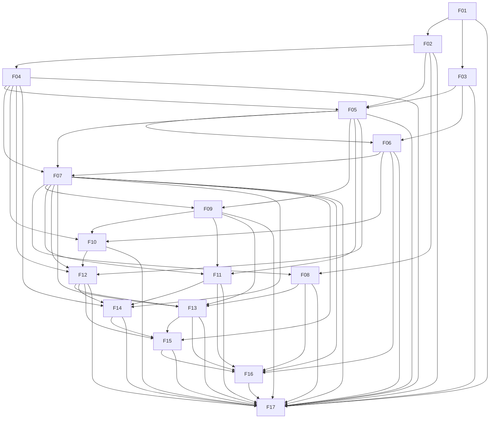

# MaxTerminal — Roadmap de Implementação por Fases

Fonte da verdade: [`../AGENTS.md`](../AGENTS.md). Este documento define a ordem cronológica das fases,
o grafo de dependências (acíclico) e os **contratos compartilhados** que todas as fases devem respeitar.

Cada fase possui:
- `instructions.md` — objetivo, escopo, pré-requisitos, entregáveis e critérios de aceite.
- `spec.md` — especificação técnica profunda (Rust, IPC, SQLite, Frontend, fluxos de dados).

---

## 1. Lista Ordenada de Fases

| Nº | Fase | Depende de | Itens do AGENTS.md cobertos |
|----|------|-----------|-----------------------------|
| 01 | Setup e Fundação do Projeto | — | §2 Stack, §1–§3 das Diretrizes (idioma, SFC, lint), `sync:local-libs`, estrutura de crates/pastas |
| 02 | Core PTY e Supervisão de Processos | 01 | §2 `portable-pty`, `/proc`, Diretriz §4 (sem órfãos, Channels sem bloqueio) |
| 03 | Persistência SQLite e Sanitização de Segredos | 01 | §2 SQLite WAL + FTS5, §3 Sanitização de Segredos, migrations, repositórios |
| 04 | Motor de Terminal Híbrido | 02 | §2 `@xterm/xterm` + WebGL/fit/search/web-links, camada de blocos `vue-web-terminal`, input rico (infra de gatilhos) |
| 05 | Shell Integration OSC 133 e Máquina de Estados das Abas | 02, 03, 04 | §6 OSC 133 (hooks zsh/bash/fish), exit codes, estados Executando/Contínua/Finalizado/Erro/Parado, blocos de comando |
| 06 | Projetos e Layout de 2 Colunas | 03, 05 | §4.1 completo (cadastro, Pasta de Projetos, `fs::watch`, auto-detecção ícone/cor, badges 1–5), `splitpanes` colunas |
| 07 | Abas, Templates, Split Panes e Sessões | 04, 05, 06 | §4.2 (nova aba, Iniciar Aba Template, Templates e parâmetros, Workspace, Split Panes, Sessões e "Iniciar nova Sessão", histórico) |
| 08 | Indicadores Contextuais: Git/Worktree e Portas Ativas | 02, 07 | §4.2 Git & Worktree (branch, dirty, worktree), Detector de Portas (badge abrir/encerrar) |
| 09 | Integração com o Sistema Operacional (CachyOS) | 05, 07 | §3 System Tray, Atalho Global (Quake), Links Clicáveis p/ Editor, notificações nativas (infra) |
| 10 | Temas e Importador Tabby | 04, 06, 09 | §2 Temas (YAML/JSON Tabby → tokens MaxComponentsUi, Max Navy/Teal); migrations anteriores até 0005 |
| 11 | Integração Bidirecional com MaxCode | 05, 07, 09 | §6 completo (Loopback HTTP/WS, URI schemes, sync projeto ativo, botão "Inspecionar" → Plan Mode); transporte de issues/ciclo de bugs (§7) em 11/06 para consumo pela 16 |
| 12 | Integração MaxAiManager (`@` / `?`) | 04, 05, 07, 10 | §5.1 (NL→shell, popup Harness→Modelo→Raciocínio, padrão via `?`, Diagnóstico Inline, RAG, API de Geração Assistida); migrations anteriores até 0006 |
| 13 | Agentes CLI, Telemetria e MaxSkills | 07, 08, 09, 12 | §5.2 completo (4 agentes, templates/atalhos, worktree isolada, StatusLine, alerta permissão, MaxSkills + memória contextual) |
| 14 | Comandos Rápidos: Artisan (`>`) e Atalhos Universais (`/`) | 04, 07, 11, 12 | §8.1 completo (descoberta, cache `.max-code/commands/artisan.json`, flags, modal "Criar comando", Criar / Criar com MaxCode) e §8.3 |
| 15 | Grupos de Comandos (`>>`) | 07, 12, 13, 14 | §8.2 completo (local/global, ordenação, Sequencial/Paralelo/Multi-Abas, criação; sugestão IA de grupos); migrations anteriores até 0008 |
| 16 | Aba Fixa de GitHub Issues | 06, 07, 08, 11, 13, 15 | §4.1 badge 🟣 Issues, §7 completo (24 labels, ações, gestão local, "Corrigir todos os Bugs"); migrations anteriores até 0009 |
| 17 | Busca Global, Qualidade, Performance e Empacotamento | 01–16 | §2 busca FTS5 instantânea (UI global), testes E2E, benchmarks de rajada de output, empacotamento CachyOS (PKGBUILD/AppImage), hardening |

### Grafo de dependências (DAG — sem ciclos)



Regra: uma fase **só pode consumir** contratos (comandos IPC, eventos, tabelas, stores) de fases com número menor.
Funcionalidades que "atravessam" fases são resolvidas por **pontos de extensão** definidos na fase anterior
(ex.: o registro de gatilhos do input rico nasce na Fase 04; `@`/`?` registra-se na 12, `>`/`/` na 14, `>>` na 15).

A tabela declara dependências diretas de entrega; dependências transitivas também estão disponíveis.
As arestas 09 → 10, 10 → 12, 13 → 15 e 15 → 16 garantem também a contiguidade das migrations D-01; não introduzem acoplamento entre os serviços desses domínios. Por transitividade, a 10 recebe as migrations 0004 (07) e 0005 (09).
O grafo representa as mesmas arestas da tabela. Todas vão de um número menor para um maior,
portanto a própria sequência `01` a `17` é uma ordenação topológica. A numeração define a ordem
de implementação; a redação dos documentos pode ocorrer em paralelo, com um responsável por fase.

---

## 2. Contratos Compartilhados (válidos para todas as fases)

### 2.1. Estrutura de diretórios do repositório
```
MaxTerminal/
├── src-tauri/                  # Workspace Cargo
│   ├── Cargo.toml              # [workspace]
│   ├── src/                    # crate binário `maxterminal` (main.rs, lib.rs, commands/, events/)
│   └── crates/
│       ├── mt-core/            # tipos de domínio, erros (`MtError`), ids (Uuid v7)
│       ├── mt-pty/             # Fase 02
│       ├── mt-db/              # Fase 03 (migrations/, repos/, sanitizer/)
│       ├── mt-shell/           # Fase 05 (parser OSC 133, scripts de hook)
│       ├── mt-projects/        # Fase 06
│       ├── mt-git/             # Fase 08
│       ├── mt-ports/           # Fase 08
│       ├── mt-os/              # Fase 09
│       ├── mt-themes/          # Fase 10
│       ├── mt-bridge/          # Fase 11 (MaxCode loopback/URI)
│       ├── mt-ai/              # Fase 12
│       ├── mt-agents/          # Fase 13
│       ├── mt-commands/        # Fases 14 e 15
│       └── mt-github/          # Fase 16
├── src/                        # Frontend Vue 3.6
│   ├── app/                    # App.vue, main.ts, router
│   ├── ipc/                    # wrappers tipados de invoke/listen/Channel (um arquivo por domínio)
│   ├── types/                  # contratos TS espelhando structs Rust (gerados via `specta`/`tauri-specta`)
│   ├── stores/                 # Pinia (@maxvue/max-pinia)
│   ├── composables/
│   ├── components/<domínio>/
│   └── styles/
└── implementation/             # este roadmap
```

### 2.2. Convenções IPC
- Comandos Tauri: `snake_case` com prefixo de domínio — `pty_spawn`, `db_session_archive`, `project_add`, `git_status`.
- Eventos globais: `domínio://evento` — `pty://exit`, `tab://state-changed`, `project://discovered`, `port://opened`.
- Streams de alto volume (output de PTY) **sempre** via `tauri::ipc::Channel<T>`, nunca via `emit` global.
- Tipos compartilhados gerados com `tauri-specta` → `src/types/bindings.ts` (proibido duplicar tipos à mão).
- Exceção de transporte binário (Fase 02/05): `PtyChannelMessage = ArrayBuffer`, declarado em `src/ipc/ptyFrame.ts`; não é DTO JSON. A integração do canal com Specta depende do spike obrigatório de exportação e entrega `InvokeResponseBody::Raw`, sem substituir bytes por JSON.
- Erros: todo comando retorna `Result<T, MtError>`; `MtError` serializa como `{ code: string, message: string (pt-BR), details?: unknown }`.
- A Fase 01 configura `ErrorHandlingMode::Result` explicitamente. Wrappers de domínio usam `call(command, factory)` ou o adaptador `unwrap(promise, command?)` de `src/ipc/core.ts`, com o mesmo tratamento de erros.

### 2.3. Identificadores de domínio (definidos na Fase 01 em `mt-core`)
`ProjectId`, `TabId`, `PaneId`, `PtyId`, `SessionId`, `TabSessionId`, `TemplateId`, `CommandBlockId`, `CommandGroupId` — newtypes sobre `Uuid` v7 (string no TS).

### 2.4. Estados de Aba (definidos na Fase 05, consumidos por 06+)
```ts
type TabStatus = 'running' | 'continuous' | 'finished' | 'error' | 'idle';
// finished/error só contam no badge enquanto `seen === false`
```

### 2.5. Banco de dados
- Arquivo: `$XDG_DATA_HOME/maxterminal/maxterminal.db`, `PRAGMA journal_mode=WAL; foreign_keys=ON; busy_timeout=5000`.
- Migrations versionadas em `mt-db/migrations/NNNN_<fase>_<desc>.sql` — cada fase adiciona **apenas** suas próprias migrations.
- Todo texto de comando/scrollback/log passa por `mt_db::sanitizer::sanitize()` antes de gravar.
- Repositórios consomem a fachada `mt_db::Db`. Dependências centralizadas no workspace: `rusqlite = "0.40"` (bundled) e `r2d2_sqlite = "0.35"`; validar uma única versão de `libsqlite3-sys` e SQLite `>= 3.51.3` (`3051003`).

A versão global é contígua (`1..=N`), distinta do número da fase. Os nomes concretos seguem esta tabela; não usar placeholders nos entregáveis:

| Versão | Migration | Fase proprietária |
|---|---|---|
| 1 | `0001_03_base.sql` | 03 |
| 2 | `0002_05_shell_sessions_command_blocks.sql` | 05 |
| 3 | `0003_06_projects.sql` | 06 |
| 4 | `0004_07_workspace_templates_tabs_sessions.sql` | 07 |
| 5 | `0005_09_os_settings.sql` | 09 |
| 6 | `0006_10_themes.sql` | 10 |
| 7 | `0007_12_ai.sql` | 12 |
| 8 | `0008_13_agents_skills_memory.sql` | 13 |
| 9 | `0009_15_command_groups.sql` | 15 |
| 10 | `0010_16_github.sql` | 16 |
| 11 | `0011_17_search.sql` | 17 |

### 2.6. Frontend
- SFC na ordem `<template>` → `<script setup lang="ts">` → `<style lang="scss" scoped>`; 4 espaços; aspas simples; `;`; sem vírgula final.
- Tags de abertura em linha única. Textos de UI em pt-BR. Tokens `--max-*` do `@maxvue/max-components-ui`.
- Stores Pinia nomeadas `use<Domínio>Store` em `src/stores/<domínio>.ts`.
- Typecheck com `tsgo`; testes com Vitest; Rust com `cargo test` + `clippy -D warnings`.
- Tooling fixado pela Fase 01: `@vitejs/plugin-vue` `6.0.10`, `vitest` `5.0.5`, `splitpanes` `4.1.2`. Scripts canônicos: `typecheck`, `typecheck:vue`, `lint`, `lint:style`, `test`; usar `npm` e `npx --no-install` nas verificações do MaxTerminal.
- Vitest inclui `tests/**/*.spec.ts` e `src/**/__tests__/**/*.spec.ts`; não criar uma terceira raiz `src/tests/`.
- Caminhos únicos: `src/components/shell/AppTitleBar.vue`, `src/components/terminal/__dev__/TerminalPlayground.vue` e `src/terminal/triggers/providers/index.ts` (registro criado na 14, estendido na 15).

### 2.7. Contratos de integração consolidados pela auditoria

As decisões D-01 a D-10 do [parecer de auditoria](./AUDIT_REPORT.md#b-decisões-canônicas-transversais) prevalecem sobre os exemplos históricos dos achados:

- Rust: `edition.workspace = true` (2024); `notify = "8"` e `notify-debouncer-full = "0.5"` centralizados no workspace. `mt-commands` nasce na 14 com `mt-db = { workspace = true }`, sendo ampliado pela 15.
- Estado Tauri registrado por domínio com `app.manage(...)`; `AppState` da 01 não agrega os serviços das fases futuras. Exportador único `export_bindings`, com `default-run = "maxterminal"` no binário.
- Erros: `MtError::new(ErrorCode("dominio.motivo"), "mensagem pt-BR").with_details(...)`; códigos em minúsculas separados por ponto. Redação de logs: `LogRedactor::redact(&self, input)`.
- A Fase 06 é dona de `ProjectInsertContributor::after_insert(tx, project: &StoredProject) -> Result<(), DbError>` e do guard temporário obtido por `ProjectService::acquire_activity`. A 07 publica `WorkspaceLifecycleObserver`, `pane_pty(tab_id, pane_id) -> Option<PtyId>` e `WorkspaceSpawnHook`/`WorkspaceSpawnGuard` para a 08. A reserva pré-spawn é mantida até registro ou compensação; o observador pós-spawn não a substitui.
- Autostart e listener global de deep link pertencem à 09 (`os_get_autostart`, `os_set_autostart`, `--start-hidden`). A 11 registra `ActivationHandler` e `EditorOpener`; a 17 apenas valida/empacota, sem conceder `autostart:*` à WebView.
- Loopback da 11 aceita `Host` `127.0.0.1:<port>` ou `localhost:<port>`; os demais retornam `403` / `bridge.host_forbidden`.
- A subetapa **11/06** fornece o protocolo proposto `issue.command` e `bugs.cycle.{preview,start,status,progress}` para a 16, condicionado às capabilities `issues_protocol_v1` e `bugs_cycle_v1` e à confirmação externa. Ausência de capability desabilita a ação com motivo; nunca simula execução.
- Geração assistida: `useAiGenerate<T>(schemaId, schema, decode)`; `run(prompt, opts?: AiGenerateRunOptions)` retorna `Promise<T | null>` e aceita `signal?: AbortSignal`. Schemas únicos `artisan.command.v1` e `command-group.suggestion.v1`; backend via `AiService::generate_structured`.
- A 13 expõe `AppAgentState::open_agent_tab(&self, req: AgentTabOpenRequest) -> MtResult<AgentTabOpened>` para o handler IPC e o adaptador da 16, preservando os contratos de spawn da 07 e `RuntimeBinding` completo da 05.

## 3. Fronteiras de responsabilidade e integração incremental

| Contrato | Fase proprietária | Consumo e regra de integração |
|----------|-------------------|-------------------------------|
| IDs e erros de domínio, geração de bindings | 01 | Tipos novos são acrescentados pelos respectivos domínios; não duplicar DTOs manualmente no frontend. |
| PTY, bytes, árvore de processos e encerramento | 02 | 04 renderiza; 05 observa bytes e metadados; 07 associa pane/sessão. O núcleo PTY não importa o domínio de abas. |
| Conexões, migrations, sanitização e infraestrutura FTS5 | 03 | Fornece writer, leitores e registro de índices. 05 cria `sessions`, `command_blocks` e seu FTS; 07 estende sessões e cria `session_scrollback`. Uma tabela possui uma única definição inicial; extensões usam migrations posteriores. |
| Renderização e registro de gatilhos | 04 | 12, 14 e 15 registram provedores. Prefixos mais longos têm precedência (`>>` antes de `>`). Sem provedores, o terminal permanece utilizável. |
| Eventos de execução, sessões mínimas, blocos e estado observado | 05 | Cria `sessions`/`command_blocks` sem FKs para tabelas futuras. 06 agrega contadores; 07 adota e estende sessões, associa à árvore de panes; 13 acrescenta espera por intervenção. O runtime mínimo funciona antes de existir o workspace completo. |
| Projetos, pastas-mãe e identidade visual | 06 | 07 instala criação/backfill do template padrão e workspace. 16 acrescenta o contador de issues por extensão. |
| Templates, abas, panes e restauração de workspace | 07 | Única autoridade para abrir abas e reiniciar sessões; consumidores não criam PTYs paralelos por fora desse fluxo. |
| Identidade Git e portas por processo | 08 | Abertura de endereço local é resolvida nesta fase; não exige a futura integração de sistema da 09. |
| Janela, tray, notificações e links para editor | 09 | 11 conecta URI bidirecional; 13 usa notificações. Fechar janela e encerrar aplicativo são operações distintas. |
| Temas e paleta do terminal | 10 | Aplicação reativa a todos os terminais, preservando significado semântico dos indicadores de estado. |
| Transporte e mensagens MaxCode | 11 | 14 envia criação Artisan; 16 consome o protocolo de issues/ciclo de bugs da 11/06 via `MaxCodePort`. Transporte não importa os domínios consumidores. |
| Gateway IA, seleção e geração assistida | 12 | 13 usa configurações de agente; 14 e 15 consomem geração. Diagnóstico inline funciona mesmo sem ação MaxCode instalada. |
| Adaptadores de agentes e sincronização MaxSkills | 13 | 16 pode abrir agentes vinculados a issues. Informação indisponível de contexto/cota permanece desconhecida, nunca estimada como valor real. |
| Descoberta Artisan e resolução de atalhos | 14 | 15 reutiliza a infraestrutura de execução e seleção sem alterar a precedência dos gatilhos. |
| Grupos de comandos e seus modos de execução | 15 | Usa a supervisão da 02 e o workspace da 07; falhas parciais e cancelamento mantêm os processos rastreáveis. |
| Issues, catálogo de labels e integração da fila | 16 | A fila de correção segue a orquestração MaxCode, com identificadores de deduplicação. |
| Busca global, validação integrada e distribuição | 17 | Reutiliza infraestrutura FTS5 da 03 e dados/índices dos domínios 05/07; valida a integração de todas as fases, incluindo ambiente desktop real. |

### 3.1. Contratos externos a confirmar antes da implementação

O `AGENTS.md` descreve intenções e alguns contratos concretos, mas não fornece todos os schemas
dos sistemas externos. Os documentos devem distinguir uma **proposta de contrato** de uma API
confirmada. A ausência de um contrato externo não autoriza fabricar endpoints, flags ou labels.

- **MaxCode (11, 14 e 16):** confirmar handshake HTTP/WS, rotas URI, payloads de Plan Mode,
  formato de cache Artisan e ações da fila (incluindo a proposta 11/06). O catálogo literal das **24 labels (15 de estado, 3 de encerramento e 6 de categoria)** está na Fase 16, conforme D-02; preservar a fixture versionada e testar paridade com a fonte MaxCode quando disponível.
- **MaxAiManager (12):** preservar `X-Agent-Name: MaxTerminal` e `/v1/rags/{slug}/search`;
  confirmar métodos, payloads, descoberta de modelos, capacidades, autenticação e streaming no gateway real.
- **Agentes CLI (13):** confirmar por versão fontes de telemetria, hooks e configurações;
  expor ausência de capacidade quando um agente não disponibilizar contexto ou cotas.
- **Tabby (10):** usar fixtures reais dos formatos YAML/JSON aceitos e documentar versões/campos
  suportados. Campos desconhecidos não devem produzir CSS arbitrário.
- **Pacotes locais MaxVue (01):** validar exports, versões e peer dependencies nos pacotes reais;
  o script de sincronização precisa diagnosticar checkout ou build local ausente.

## 4. Matriz de rastreabilidade dos requisitos

| Requisito do `AGENTS.md` | Fases responsáveis | Evidência de aceite esperada |
|------------------------|--------------------|-----------------------------|
| Idioma, SFC, formatação, tokens e worktree | 01; todas | Configuração de qualidade, revisão dos textos/contratos e execução isolada. |
| Vue 3.6.0-rc.13, Vite 8, tsgo, UnoCSS, SCSS, MaxVue local e MaxIcon | 01, 06 | Build/typecheck, sincronização local reproduzível e ícones renderizados. |
| Tauri v2, portable-pty, `/proc`, nenhum órfão, output não bloqueante | 02, 17 | Terminal real, supervisão, testes de encerramento e carga com medição. |
| SQLite WAL, FTS5, sessões/comandos/saídas e sanitização | 03, 05, 07, 17 | Migrations, busca, retenção e testes de segredos inclusive fragmentados. |
| xterm, WebGL e addons; vue-web-terminal/blocos/input rico; TUIs | 04, 05 | Compatibilidade com alternate screen, resize e descarte de recursos. |
| Duas colunas e splitpanes, cadastro/importação e descoberta de projetos | 06, 07 | Layout persistente, watcher reconciliável, importação idempotente. |
| Identidade das seis stacks, fallback e seis badges de projeto | 06, 13, 16 | Detecção/fallback persistido, cinco estados operacionais e issues abertas. |
| Nova aba padrão, seletor de template e todos os parâmetros de template | 07, 13 | Invariantes de template, cwd/env/comando inicial e templates dos quatro agentes. |
| Workspace automático, panes horizontal/vertical, nova sessão e histórico | 07 | Restauração sem duplicação, encerramento/arquivamento e consulta histórica. |
| Branch, dirty, worktree; portas abrir/encerrar | 08 | Identidade Git real e processo proprietário revalidado antes de encerrar. |
| Tray preservando execução, Quake, links editor e notificações CachyOS | 09, 13 | Fluxos X11/Wayland, encerramento explícito e alertas por intervenção. |
| Tema Max Navy/Teal e importação Tabby YAML/JSON | 10 | Fixtures de importação, preview, rollback e propagação da paleta. |
| OSC 133, hooks bash/zsh/fish, início/fim/comando/erro, botão Inspecionar | 05, 11 | Parser incremental, metadados auxiliares, prompt exato e sanitizado no Plan Mode. |
| MaxCode loopback HTTP/WS, URIs e sincronização do projeto ativo | 11 | Wake-up, deduplicação e sincronização bidirecional sem loop. |
| IA `@` por harness/modelo/raciocínio; `?` com padrão; header e RAG | 12 | Seleção sequencial, defaults, contrato gateway e consulta de documentação. |
| Diagnóstico inline e geração assistida Artisan/grupos | 12, 14, 15 | Erro sanitizado, sugestão exibida e edição assistida integrada. |
| Claude Code, Codex, agy, OpenCode, worktree opcional e StatusLine | 13 | Quatro adaptadores; modelo/contexto/cotas 5h e semanal com disponibilidade explícita. |
| Espera por permissão/input, MaxSkills e memória contextual SQLite | 13 | Notificação sem duplicação, sincronização e recuperação de comandos sanitizados. |
| Aba fixa GitHub, gh/REST, 24 labels, badge, ações, edição e fila | 16 | Catálogo canônico validado, paginação, CRUD, plano, worktree e ciclo de correção. |
| Artisan `>`, descoberta JSON/cache, filtro/flags e criação sempre visível | 14 | Navegação por setas, cache compatível e estados vazio/erro. |
| Modal Artisan completo, criar PHP e criar com MaxCode Plan Mode | 14 | Argumentos/options, interfaces, agendamento, objetivo e prompt canônico. |
| Grupos `>>` locais/globais e sequência/background/multiabas | 15 | Ordenação, duas ações de criação, execução supervisionada e cancelamento. |
| `/install`, `/install-force`, `/update`, `/update-force`, `/build`, `/deploy`, `/test` | 14 | Resolução por composer/npm/pnpm/yarn/bun/cargo e tratamento de ações ausentes. |

## 5. Uso dos documentos e conclusão de cada fase

1. Ler este índice e os dois documentos da fase antes de implementar.
2. Confirmar que as fases predecessoras entregaram os contratos necessários; um simulador deve
   ser identificado como tal e não substitui o aceite de integração nativa.
3. Implementar e validar os critérios de `instructions.md` segundo os contratos de `spec.md`.
4. Registrar versões de integrações, fixtures e medições junto à implementação quando ela existir.
5. Mudanças de contrato exigem atualização da fase proprietária e de seus consumidores, mantendo
    arestas apenas para fases anteriores. Novas migrations nunca reescrevem migrations já aplicadas.
6. Executar verificações a partir da raiz da worktree ativa (`cd "$(git rev-parse --show-toplevel)"`), sem caminhos absolutos de sessões anteriores. O planejamento das verificações não equivale a resultados de execução.

Este diretório é um plano de implementação. A existência dos documentos não representa execução
dos testes descritos nem comprovação de compatibilidade das integrações externas.
